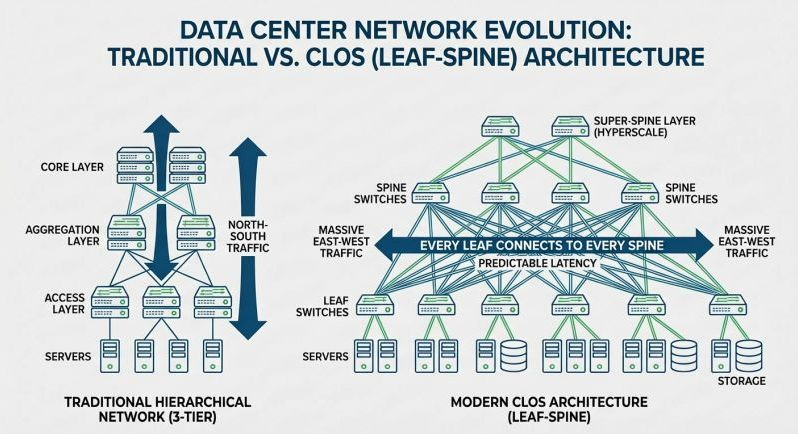
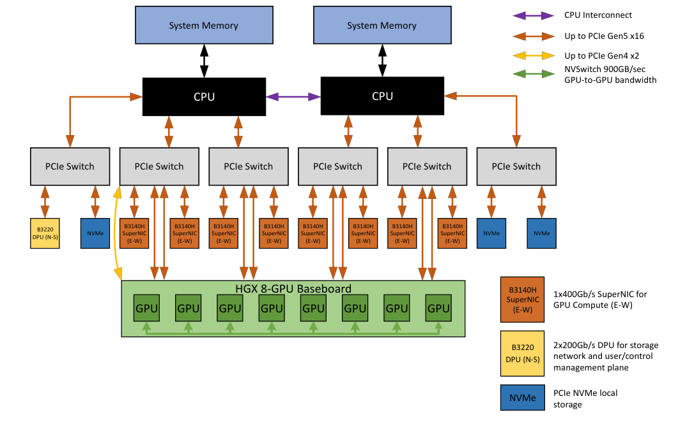
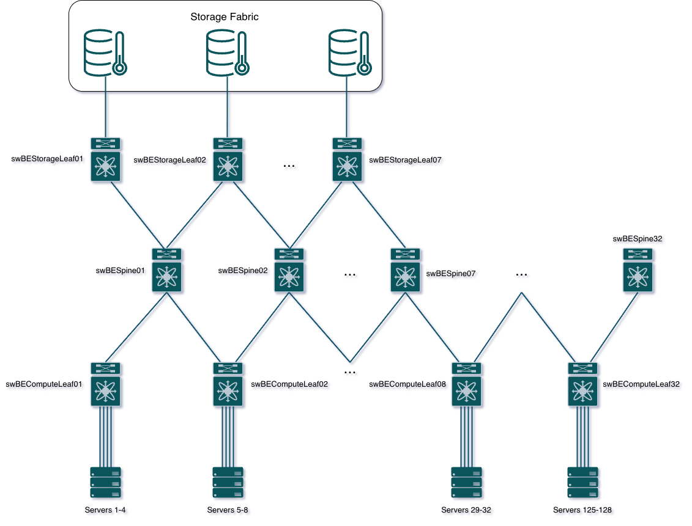
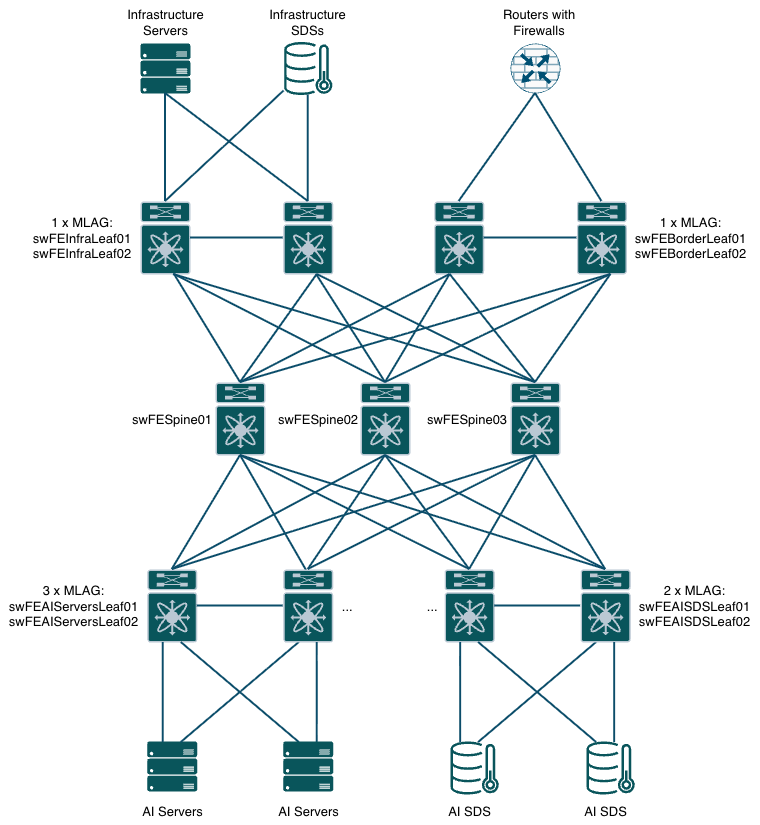
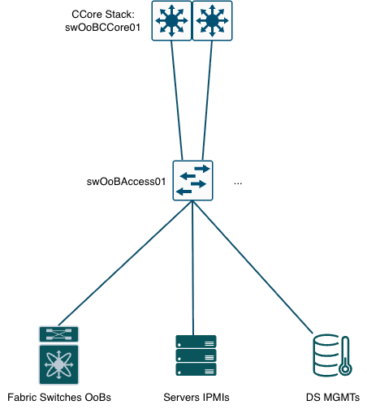
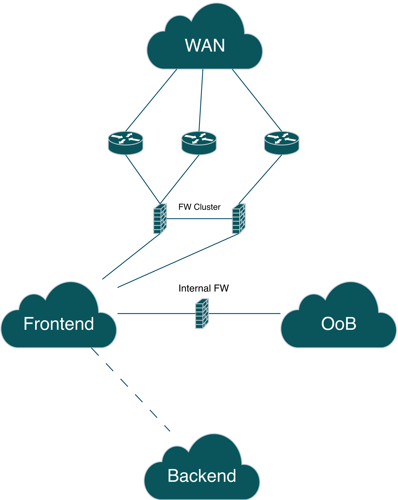
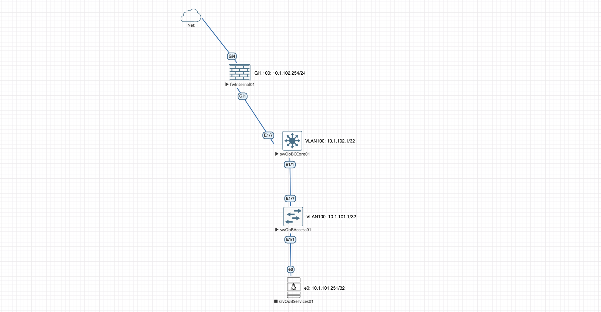
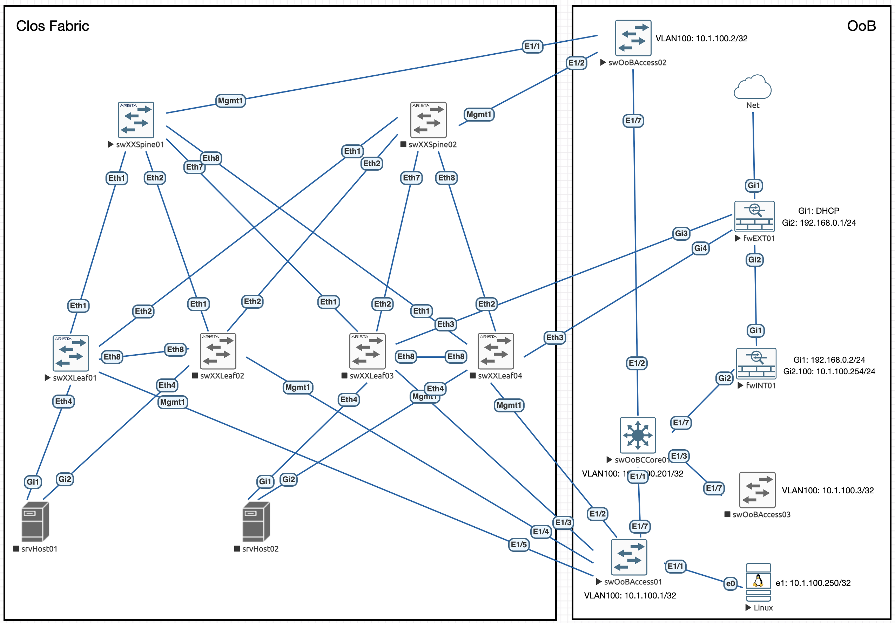

<p align="right">«Вещи, которыми ты владеешь, в конце концов овладевают тобой»
<p align="right">— Чак Паланик, «Бойцовский клуб»*

# Проектирование и автоматизация развертывания высокопроизводительной AI-фабрики ЦОД на базе оборудования Arista с мультивендорной интеграцией бэкэнда и оркестрацией через ZTP и Ansible

## Цель работы
Проектирование архитектуры и разработка комплексной системы автоматизированного развертывания высокопроизводительной мультивендорной AI-фабрики ЦОД на базе оборудования Arista для минимизации задержек сетевого транспорта и исключения человеческого фактора при пусконаладочных работах.

## Задачи работы
Для достижения поставленной цели необходимо решить следующие задачи:
1. Проанализировать теоретические основы построения сетей для AI/ML-нагрузок (Artificial Intelligence/Machine Learning - искусственный интеллект/машинное обучение), специфику их трафика, а также провести сравнительный анализ транспортных протоколов InfiniBand и RoCEv2 (RDMA over Converged Ethernet).
2. Исследовать алгоритмы управления перегрузками (PFC, ECN) и механизмы адаптивной маршрутизации в высокопроизводительных коммутационных матрицах (ASIC Broadcom / Arista).
3. Спроектировать неблокируемую топологию Клоза (Fat-Tree) с коэффициентом переподписки 1:1, разработать схему Underlay-маршрутизации на базе протокола Unnumbered eBGP и профили QoS/RoCEv2.
4. Разработать методику мультивендорной интеграции сетевого оборудования Arista с вычислительными узлами (GPU-серверами) и системами хранения данных (СХД) сторонних производителей.
5. Спроектировать и реализовать архитектуру автоматического ввода в эксплуатацию (Zero Touch Provisioning), включая настройку обеспечивающих инфраструктурных сервисов (DHCP, HTTP).
6. Разработать декларативную конфигурационную модель фабрики (Single Source of Truth) на базе шаблонов Ansible Validated Designs (AVD) для автоматической генерации и валидации конфигураций сетевых устройств.
7. Развернуть демонстрационный стенд (в виртуальной среде vEOS) для верификации разработанной системы автоматизации и тестирования сетевого транспорта.
8. Оценить технико-экономическую эффективность внедрения разработанного решения, включая показатели сокращения времени развертывания сети (Time-to-Market) и снижения рисков конфигурационных ошибок.

## Состав работы
- Вступительное слово
- Теоретико-методологические основы построения сетевой инфраструктуры для распределенного обучения ИИ-моделей (AI-фабрик)
- Рассчетная часть
    - Техническое задание
    - Общая часть
    - Анализ проблемы высокой плотности энергопотребления и тепловыделения
    - Вычислительная сеть (Compute/Backend Fabric)
    - Frontend сеть
        - Расчет сервисного контура AI-серверов
        - Расчет сервисного контура систем хранения данных
        - Расчет инфраструктурного контур служебных серверов (Infrastructure Nodes)
        - Расчет пограничного контура (Border Leaf / Edge Pod)
        - Результирующая конфигурация Фронтенд-фабрики
    - Сеть управления (Out-of-Band)
    - Архитектера сетевой безопасности
    - IP-план сети Underlay
- Настройка системы
    - I фаза: Развертывание сети OoB
        - 1 этап: Первичная инициализация
        - 2 этап: Сетевое обнаружение и инвентаризация
        - 3 этап: Промышленное управление конфигурацией
    - II фаза: Развертывание сети Backend

### Вступительное слово
Развитие технологий искусственного интеллекта и больших языковых моделей (Large Language Model - LLM) привело к экспоненциальному росту объемов распределенных вычислений. Эффективность обучения таких моделей напрямую зависит от сетевой инфраструктуры ЦОД, так как задержки при синхронизации вычислительных узлов (так называемая проблема «сетевого барьера») могут создавать эффективный простой порядка 30–50% от суммарной мощности дорогостоящих графических процессоров (GPU). Традиционная сетевая архитектура 3-Tier не справляется с паттернами AI-трафика (All-Reduce, All-to-All), вызывающими мгновенные перегрузки (Incast). В этих условиях критически важным становится проектирование специализированных высокопроизводительных AI-фабрик (AI Fabrics) с поддержкой технологий сверхмалой задержки (RoCEv2, Infiniband) и механизмов предотвращения потерь пакетов (PFC, ECN). Из-за высокой сложности и масштабов таких сетей ручная настройка оборудования неэффективна и ведет к ошибкам, что обуславливает необходимость сквозной автоматизации развертывания с использованием концепции Infrastructure as Code (IaC) на базе ZTP и Ansible в гетерогенных (мультивендорных) средах.

### Теоретико-методологические основы построения сетевой инфраструктуры для распределенного обучения ИИ-моделей (AI-фабрик)
На сегодняшний день технологии искусственного интеллекта (AI - Artificial Intelligence) и машинного обучения (ML - Machine Learning) стали ключевыми драйверами научно-технического прогресса. Проектирование и развертывание высокопроизводительных AI-кластеров является критически важной задачей для современной ИТ-инфраструктуры, поскольку обучение и работа больших моделей требуют специализированной аппаратной архитектуры и оптимизированных сетевых решений.

Технологии AI/ML опираются на понятие нейросети. В Wikipedia дается следующее определение:

> Нейросеть (или искусственная нейронная сеть) — это математический алгоритм и программа, созданные по принципу работы биологической нервной системы человека. Она состоит из множества связанных друг с другом вычислительных элементов — нейронов, которые обмениваются сигналами через числовые связи (синапсы).

С академической точки зрения нейросеть представляет собой направленный граф, вершинами которого являются математические модели искусственных нейронов (процессорные элементы), а дугами — синаптические связи, характеризующиеся весовыми коэффициентами.

Архитектурно, нейросеть организуется в виде многослойной конструкции, внешние два слоя которых (входной слой - Input layer и выходной слой - Output layer) предназначены для формализации интерфейса модели на, соответственно, получение информации и формирование выходного предсказания. Зажатые между ними скрытые слои (Hidden layers) осуществляют каскадные нелинейные преобразования над большим числом (миллиардами) связанных параметров, называемыми весами. Количество скрытых слоев определятеся моделью нейросети и, в большинстве своем, также является достаточно большим числом. 

С технической точки зрения, процесс обучения и работы таких моделей сводится к непрерывному выполнению низкоуровневых операций линейной алгебры — преимущественно матричного умножения (GEMM) и сложения тензоров. Несмотря на относительную простоту таких операций, их количество переводит процесс расчета силами классических центральных процессоров (CPU) с их последовательной архитектурой в весьма долгий процесс - до сотни лет.

В противовес этому, графические процессоры (GPU), содержащие тысячи параллельных вычислительных ядер, позволяют значительно сократить этот процесс по времени (до считанных дней или недель), создавая, таким образом, техническое решение для сегмента AI.

Современные модели (LLM, генеративный AI) содержат сотни миллиардов параметров и физически не помещаются в локальную память (VRAM) одного графического ускорителя. Это вызывает необходимость объединения множества GPU в единый кластер для параллелизации вычислений.

В зависимости от того, с какими ограничениями сталкивается модель (нехватка скорости или нехватка памяти), вычисления распределяются по картам с помощью трех основных подходов:
1. **Параллелизм по данным (Data Parallelism)**: Метод, при которым нейросеть размещается в каждом GPU, а данные разбиваются на небольшие кусочки, называемые микро-батчами, с локальной обработкой в каждом GPU.

2. **Параллелизм по модели (Model Parallelism)**: Метод для больших нейросетей, когда дробится алгоритм самой нейросети между слоями (конвейерный параллелизм) или даже в рамках отдельных слоев (тензорный параллелизм). GPU выполняют работу над своей частью матрицы, но требуют моментального обмена и склейки результатов через сеть сразу после окончания операции.

Работа со сверхбольшими моделями представляет собой некоторую линейную комбинацию из этих методов, называемых 3D-параллелизмом, превращающим сотни GPU в одну монолитную вычислительную фабрику. Процесс обучения таких моделей называется распределенным (Distributed Training) и производится на кластерах из сотен или тысяч GPU.

Сам процесс обучения состоит из серии "прогонов" по всему объему обучающих данных и называется эпохой (Epoch), которых, в современных моделях требуется сотни и тысячи.

Эпохи также являются циклическими и состоят из последовательности процессов вычислений и проверок, производимых посредством ряда этапов с прямыми (Forward Pass) и обратными (Backward Pass) проходами (направленная итерация нейросети относительно полученных данных и формируемого предсказания), и усреднением с последующей синхронизацией (All-Reduce) градиентов между GPU кластера, для чего требуется высочайшая пропускная способность фабрики.

В некоторый период времени, называемый чекпоинт (Checkpoint), веса со всех GPU кластера сгружаются на сервера, в которые они установлены, и сохраняются на внешних надежных сетевых хранилищах. Эпоха содержит множество чекпоинтов, что накладывает определенные требования и на кластер и на средства хранения информации.

Важнейшей инженерной задачей при построении таких систем является организация межузлового взаимодействия (Inter-node interconnect). Необходимо понимать, что взаимодействие между GPU на современных решениях в процессе обучения производится напрямую между GPU, в то время, как процессы загрузки/выгрузки весов - через стандартные серверные среды, оркестрируемые, например, тем же Kubernetes.

С технической и экономической точек зрения, сеть современного AI-кластера четко делится на два контура (фабрики), имеющие собственные требования к среде передачи данных:
- **Front-end Network (Сеть управления и ввода-вывода)**: Фактически - это обычная Ethernet-сеть, используемая для загрузки начальных датасетов в кластер, управления нодами (SSH, Kubernetes), мониторинга и выдачи готовых ответов пользователям. Для нее характерны относительно небольшие пакеты, высокая чувствительность к задержкам подключения (RTT) и использование стандартного стека TCP/IP. Нагрузочные и технические требования которой соответствуют де-промо требованиям стандартной вычислительной фабрики.

- **Back-end Network (Фабрика межмашинного взаимодействия / AI-Fabric)**: Выделенная сверхвысокоскоростная сеть, связывающая GPU между собой (коэффициент переподписки 1:1). AI-кластер  генерирует колоссальный трафик типа `East-West`: во время фаз синхронизации градиентов (операции All-Reduce, All-to-All) сеть утилизируется на 100% полосы пропускания. Для снижения влияния и повышения отказоустойчивости, данную сеть ограничивают от остального трафика, так как если объединить эти фабрики, бэкенд-трафик полностью парализует работу фронтенда, вызывая потери пакетов и задержки для конечных пользователей. Выделенная AI-фабрика гарантирует предсказуемую производительность вычислений без влияния на внешние сервисы.

В современных AI-фабриках межузловое взаимодействие между GPU производится на сетевом уровне L3 (OSI) с использованием технологий RDMA (Remote Direct Memory Access) через протоколы RoCEv2 (RDMA over Converged Ethernet) или InfiniBand. Обе технологии используют RDMA или, конкретно, GPUDirect RDMA - технологию, которая позволяет сетевой карте (NIC) забирать данные напрямую из памяти GPU одного сервера и переносить их напрямую в память GPU другого сервера, минуя центральный процессор (CPU) и стек операционной системы.

В отличие от RoCEv2, которая изначально создавалась как L3-технология, инкапсулирующая RDMA-пакеты в стандартные IP/UDP-заголовки Ethernet (и маршрутизируется классическими коммутаторами по протоколу MP-BGP), технология InfiniBand является исторически L2-архитектурой, из-за чего ей присуще более высокое быстродействие. Но это превосходство реализуется за счет повышения архитектурной сложности: сеть является специализированной и требующей контроллера - Subnet Manager. 

Различия между этими технологиями сведены в следующую таблицу.

*Таблица 1. Сравнительный анализ существующих технологий межузлового взаимодействия AI-фабрик*

| **Критерий** | **InfiniBand (IB)** | **RoCEv2 (RDMA over Converged Ethernet)** |
|:-----|:-----|:-----|
| **Базовая технология** | Нативный протокол | Расширение Ethernet (L3/UDP) |
| **Управление потерями** | Кредитная система на физическом уровне (Credit-based flow control). Потери физически невозможны | Алгоритмы PFC (Priority Flow Control) и ECN требующие тонкой настройки |
| **Задержка** | Абсолютный минимум (аппаратный уровень) | Чуть выше, чем у IB за счет связки PCIe Switches - NIC и L3 инкапсуляции |
| **Стоимость и вендор-лок** | Очень дорого. Фактически монополия Nvidia (Mellanox) | Дешевле, открытый стандарт. Рыночные чипы (Broadcom Tomahawk 5, Cisco, Arista) |
| **Масштабируемость** | Сложнее масштабировать на десятки тысяч нод без спец-дизайна | Родной IP-роутинг позволяет масштабировать до гигантских дата-центров |

Как видно: с одной стороны чаши весов находится экосистема InfiniBand — закрытое решение, полностью контролируемое, фактически, одним производителем, что создает жесткие риски технологической зависимости (Vendor Lock-in). На противоположной, более перспективной чаше весов, расположен RoCEv2, который опирается на общедоступные стандарты Ethernet. Это позволяет развертывать AI-фабрики на базе высокопроизводительных коммерческих чипсетов (Broadcom Tomahawk 4/5, Cisco Silicon One) от независимых поставщиков под управлением открытых сетевых операционных систем (например, SONiC от Open Compute Project).

В долгосрочной перспективе, по моему мнению, эти весы окончательно склоняются в пользу Ethernet благодаря развитию консорциума Ultra Ethernet Consortium (UEC), который де-факто утвердил открытую архитектуру в качестве стратегического вектора развития AI-инфраструктуры.

С технической точки зрения RoCEv2 обеспечивает нативную интеграцию вычислительного контура в маршрутизируемые L3-сети (через стандартный BGP/ECMP) за счет инкапсуляции RDMA-пакетов непосредственно в заголовки IP/UDP. Это исключает необходимость внедрения сложных шлюзов или проприетарных контроллеров управления подсетями (Subnet Manager), обязательных для L2-архитектуры InfiniBand.

Использование L3 в RoCEv2-соединениях является следствием следующих причин:
- **Масштабируемость**: Сети L2 ограничены в размерах из-за архитектурного наличия широковещательного шторма и протоколов STP/RSTP, защищающих от него. Динамическая маршрутизация L3, например, BGP в архитектуре Clos / Fat-Tree, позволяет масштабировать кластер до тысяч GPU без проблем, существующих на уровне L2.

- **Балансировка нагрузки**: Использование ECMP (Equal-Cost Multi-Path) на уровне L3 обеспечивает равномерное распределение трафика по фабрике, исключая появление узких мест (oversubscription).

- **Отказоустойчивость**: Использование динамической маршрутизации L3 позволяет изолировать сбойные участки сети посредством динамического перестроения маршрутов трафика.

Однако, при всех описанных плюсах есть один момент, где RoCEv2 несколько проигрывает - это аппаратное управление перегрузками, которое в InfiniBand работает "из коробки" за счет жесткой проприетарной логики.
AI-сети, построенные на Ethernet (RoCEv2) с аналогичным функционалом должны опирается на следующие расширения:
1. **PFC (Priority Flow Control)**: Классический 802.3x Flow Control останавливает весь порт, PFC работает на уровне CoS (802.1p). Если буфер коммутатора переполняется трафиком (например, в очереди 3), коммутатор шлет назад кадр PFC PAUSE только для этой очереди, не трогая остальной трафик.

2. **ECN (Explicit Congestion Notification)**: Работает на L3. Когда буфер коммутатора начинает заполняться, он ставит бит `ECN` в IP-заголовке пакета. Принимающий сервер видит это и генерирует пакет `CNP` (Congestion Notification Packet) обратно отправителю, заставляя сетевую карту GPU превентивно снизить скорость отправки, не доводя до переполнения буфера.

3. **Балансировка трафика (Продвинутый ECMP)**: Стандартный ECMP балансирует по хэшу (IP, Port). Поскольку AI-потоков мало, но они огромные (Elephant flows), обычный хэш легко закинет несколько толстых потоков в один аплинк, а второй оставит пустым, что создаст состояние поляризации (Polarization). Для митигации этого используют технологию Adaptive Routing (динамическое перенаправление пакетов на менее загруженный линк на лету) или балансировку на уровне ячеек (Cell-based линки в фабриках типа Cisco Silicon One / Broadcom Jericho).

Подытоживая, аппаратная поддержка сквозного контроля перегрузок на базе PFC и ECN/CNP гарантирует создание беспотерьной среды (Lossless Ethernet), критически важной для межсерверных операций типа NCCL All-Reduce (NVIDIA Collective Communications Library All-Reduce), с производительностью и ультранизкими задержками, идентичными закрытым высокопроизводительным решениям. В масштабах эксплуатации дата-центра такой подход обеспечивает конвергентность инфраструктуры: для бэкенд и фронтенд контуров используется единый инженерный стек, общие инструменты автоматизации (Ansible, Terraform) и сквозной мониторинг (gNMI/INT телеметрия), что радикально снижает совокупную стоимость владения (TCO) и упрощает горизонтальное масштабирование кластера.

Однако обеспечение беспотерьности на транспортном уровне и унификация инженерного стека — это лишь половина системного решения. Чтобы описанные ранее механизмы могли эффективно предотвращать заторы, сама макротопология сети должна обладать колоссальным запасом пропускной способности и симметрии. 

Перед дальнейшим рассмотрением, необходимо ввести понятие переподписки, количественно описывающее уровень беспотерьности сети передачи данных.

> Коэффициент переподписки (Oversubscription Ratio) — это фундаментальная метрика сетевой архитектуры, определяющая отношение суммарной потенциальной пропускной способности всех нижестоящих портов коммутационного узла (направленных к конечным вычислительным узлам или устройствам доступа) к суммарной пропускной способности его вышестоящих портов (аплинков, направленных к магистрали или ядру сети).

Математически данный коэффициент выражается в виде пропорции `N:1`, где:
- N — коэффициент избыточности спроса на полосу пропускания,
- 1 — гарантированная единица емкости магистрального канала.

Если коэффициент составляет, например, `4:1`, это означает, что при одновременной попытке всех подключенных узлов передать данные на максимальной скорости линии, магистральный интерфейс сможет принять и обработать лишь 25% от общего объема входящего трафика.

В классических сетевых архитектурах (таких как 3-Tier, оптимизированных под трафик типа `North-South`) переподписка является осознанным инструментом экономической оптимизации, базирующимся на статистическом допущении, что в каждый конкретный момент времени большая часть серверов находится в режиме ожидания или утилизирует сеть лишь частично. Однако в высокопроизводительных вычислительных средах и AI-кластерах, где алгоритмы требуют синхронного обмена плотными массивами данных, любое значение коэффициента переподписки, отличное от `1:1` (Non-blocking / Line-rate), неизбежно приводит к буферизации, каскадному росту задержек и деградации производительности всего вычислительного комплекса.

Для распределенного обучения искусственного интеллекта, где доминирует лавинообразный горизонтальный трафик типа `East-West` (между вычислительными узлами), топология 3-Tier неприменима. Одновременный запуск коллективных сетевых операций (All-Reduce, All-to-All) мгновенно приводит к перегрузке («коллапсу») суженных участков сети с высокой переподпиской, вызывая массовые потери пакетов и резкий рост задержек.

В качестве фундаментального решения этой проблемы в ЦОД используется многоярусная топология Клоза (Clos Network), реализуемая по схеме Fat-Tree («Толстое дерево»). Теоретический принцип Fat-Tree заключается в том, что по мере движения от «листьев» дерева (Leafs, коммутаторов доступа) к его «корню» (Spine, магистральным коммутаторам), каналы связи становятся «толще» — не за счет увеличения скорости одного линка, а за счет строго пропорционального увеличения количества параллельных связей.



Анализируя макротопологии современных вычислительных систем, можно прийти к фундаментальному выводу: архитектура сетей для искусственного интеллекта и архитектура сетей общего назначения представляют собой два полярных, фактически ортогональных технологических решения, в то время как инфраструктура классического корпоративного дата-центра занимает между ними компромиссную промежуточную позицию.

Однако построение физической топологии — это лишь базис, который для эффективной работы современных ЦОД требует гибкого разделения сетевых ресурсов, реализуемого через виртуализацию сетей L2 поверх L3 (например, с помощью инкапсуляции VxLAN). Необходимость такого подхода продиктована тем, что классические L2-сети страдают от ограничений протокола STP (блокирующего параллельные линки Fat-Tree) и слабой масштабируемости, в то время как чистая L3-маршрутизация не позволяет свободно перемещать виртуальные машины и контейнеры с сохранением их IP-адресов. Чтобы решить эту проблему и объединить преимущества обоих подходов, сеть разделяют на два уровня: подстилающую сеть (Underlay) и наложенную сеть (Overlay). Назначение Underlay-уровня — обеспечить максимально быструю, отказоустойчивую L3-маршрутизацию и балансировку (ECMP) между физическими коммутаторами фабрики, формируя её жесткий «скелет». В свою очередь, Overlay-уровень работает поверх этой инфраструктуры, инкапсулируя исходные L2-кадры в L3-пакеты, что позволяет создавать изолированные, гибкие виртуальные L2-сегменты любого масштаба без привязки к физической топологии.

В качестве логического завершения данной теоретической главы необходимо рассмотреть архитектуру транспортного слоя фабрики. Ниже приведен сравнительный анализ протоколов динамической маршрутизации, применяемых для формирования топологической карты и обеспечения сходимости подстилающей сети (Underlay).

Я приведу табличное сравнение наиболее часто используемых протоколов подстилающей сети, а ниже - дам свои комментарии.

*Таблица 2. Сравнительная таблица наиболее распространенных протоколов Underlay*

| **Критерий** | **BGP Unnumbered** | **IS-IS** | **OSPFv2 / OSPFv3** |
|:---|:---|:---|:---|
| **Базовый стандарт IETF** | [RFC 5549](https://datatracker.ietf.org/doc/html/rfc5549) (Extended Next Hop), [RFC 4271](https://datatracker.ietf.org/doc/html/rfc4271) (BGP-4) | RFC 1195 (Использование в IP), [ISO/IEC 10589](https://www.iso.org/standard/30943.html) | [RFC 2328](https://datatracker.ietf.org/doc/html/rfc2328) (OSPFv2 для IPv4), [RFC 5340](https://datatracker.ietf.org/doc/html/rfc5340) (OSPFv3 для IPv6) |
| **Архитектурный тип** | **Path-Vector** (Дистанционно-векторный) | **Link-State** (Состояния канала) | **Link-State** (Состояния канала) внутри зоны / **Path-Vector** между зонами |
| **Уровень стека OSI** | **L4** (работает поверх 179/TCP) | **L2** (нативно на канальном уровне) | **L3** (инкапсулирован в IP-пакеты, используется мультикаст) |
| **Масштабируемость в Fat-Tree** | **Экстремальная**: миллионы маршрутов, до сотен тысяч GPU | **Очень высокая** в пределах одного домена/Level | **Ограниченная** из-за накладных расходов на LSA-флуд |
| **Скорость сходимости (Convergence)** | **Очень высокая** (при связке с BFD — [RFC 5880](https://datatracker.ietf.org/doc/html/rfc5880)) | **Экстремально высокая** (миллисекунды) | **Высокая** (но требует тонкого тюнинга таймеров) |
| **Защита от петель (Loop Prevention)** | **Нативная** (через AS-Path) | **Нативная** (алгоритм Дейкстры) | **Нативная** (алгоритм Дейкстры) |
| **Использование памяти (Memory Footprint)** | **Минимальное** для Underlay: хранит только префиксы Loopback-интерфейсов коммутаторов. Накладные расходы на соседство минимальны, так как нет тяжелых баз данных всей топологии | **Низкое / Среднее**: база данных состояния каналов (LSDB) оптимизирована за счет эффективных TLV-структур (Type-Length-Value). Потребляет меньше памяти, чем OSPF | **Высокое**: требует значительного объема RAM для хранения полной LSDB с множеством типов LSA-пакетов. Расход памяти растет пропорционально количеству линков в фабрике |
| **Наличие «слухов» (Routing Rumors)** | **Присутствует** (Специфика Path-Vector): коммутаторы не знают топологию всей сети, они «верят на слово» соседям, передающим им векторы путей (AS-Path); информация распространяется пошагово (Hop-by-Hop) | **Отсутствует** (Чистый Link-State): каждый коммутатор обладает точной, математически идентичной картой всей сети (LSDB); никаких «слухов» — только прямые факты о состоянии линков | **Отсутствует** (В пределах одной зоны): все коммутаторы внутри одной зоны имеют стопроцентную и идентичную информацию о топологии и не полагаются на «слухи», которые могут проявляться между зонами |
| **Параллельные ECMP-линки** | **Максимальное**: до 64 / 128 / 256 путей | **Высокое**: обычно до 32 / 64 путей | **Ограниченное**: обычно до 16 / 32 путей |
| **Дополнительные плюсы** | <UL><LI>**Zero-Touch конфигурация**: Автоподнятие сессий через IPv6 Link-Local <LI>**Идеальная изоляция**: Сбой на одном коммутаторе локализуется в рамках его ASN <LI>**Политики**: Гибкое управление трафиком через BGP-аттрибуты</UL> | <UL><LI>**Максимальная безопасность**: Работает на L2 (не имеет IP-адресов, устойчив к IP-атакам)<LI>**Сверхбыстрая сходимость**: Быстрее пересчитывает карту сети, чем OSPF <LI>**Гибкость**: Простая поддержка IPv4/IPv6 через TLV</UL> | <UL><LI>Знаком любому сетевому инженеру, колоссальная база знаний <LI>**Совместимость**: поддерживается абсолютно любым, даже устаревшим оборудованием</UL> |
| **Дополнительные минусы** | <UL><LI>**Медленная естественная сходимость**: требует обязательной связки с аппаратным BFD протоколом <LI>**Сложность отладки**: траблшутинг BGP без автоматизации на больших масштабах затруднен</UL> | <UL><LI>**Специфичный синтаксис**: требует сложной адресации NET (NSAP) для устройств <LI>**Дефицит кадров**: мало специалистов вне операторского (Telco) сектора <LI>**Нагрузка на CPU**: тяжелый алгоритм Дейкстры нагружает процессоры коммутаторов при сбоях </UL> | <UL><LI>**Шторм LSA** (Флудинг): при «мигании» (флапе, flap) одного линка весь кластер затапливается LSA-пакетами <LI>**Нагрузка на CPU**: тяжелый алгоритм Дейкстры нагружает процессоры коммутаторов при сбоях </UL> |
| **Сложность настройки** | **Средняя / Ниже среднего**: Zero-Touch через IPv6 Link-Local | **Средняя**: требует настройки NET-адресов | **Средняя**: требует планирования зон (Area) |
| **Использование в AI-фабриках** | Индустриальный стандарт (Meta, Microsoft, Google) | Редко (в гибридных HPC/AI архитектурах) | Практически не применяется |

Детально взвешивая информацию по представленным протоколам маршрутизации Underlay-подложки, для проектируемой AI-фабрики наиболее перспективным и технологически обоснованным решением является применение BGP Unnumbered (в соответствии со стандартами RFC 5549 и RFC 8950).

В условиях жестких требований распределенных вычислений к минимизации задержек и исключению пакетных потерь, Link-State протоколы (OSPF и IS-IS) обладают фундаментальным недостатком — необходимостью лавинообразной рассылки объявлений о состоянии каналов (LSA/LSP флуд) при любом изменении топологии и бОльшей нагрузкой на память и процессор коммутаторов, связанной с хранением и расчетом всей топологии сети Underlay. В крупных фабриках Clos / Fat-Tree, содержащих тысячи интерконнект-линков, это может привести к непредсказуемым всплескам времени сходимости сети.

Напротив, использование BGP Unnumbered полностью устраняет необходимость выделения и администрирования IPv4-подсетей для соединений типа "точка-точка" (Point-to-Point), используя механизмы автоматического обнаружения соседей по спецификации RFC 4861 (IPv6 Neighbor Discovery). Совместное использование BGP Unnumbered с протоколом детекции отказов BFD (RFC 5882) позволяет достичь субсекундного времени сходимости фабрики, минимизируя простои вычислительных узлов при аппаратных сбоях инфраструктуры».

Наиболее критическими элементами выступают планирование автономных систем (ASN) для протокола BGP, выбор типов соседства (iBGP/eBGP) и разработка системного плана IP-нумерации с учетом задела на долгосрочное расширение, которые значимо сказываются на скорости развертывания, быстроте и удобстве сопровождения построенной системы в условиях масштабирования.

Стоит отметить набирающий в последнее время популярность специализированный протокол RIFT (Routing in Fat-Trees), разработанный в рамках одноименной рабочей группы IETF и зафиксированный в стандарте [RFC 9696](https://datatracker.ietf.org/doc/html/rfc9696). В отличие от универсальных BGP или OSPF, RIFT изначально проектировался как анизотропный протокол, чувствительный к геометрии фабрики, и оптимизирован исключительно под регулярные топологии Клоза / Fat-Tree. Его главная цель — кардинально сократить объем избыточной маршрутной информации и автоматизировать обслуживание крупномасштабных вычислительных систем.

Техническая особенность RIFT заключается в гибридной архитектуре, объединяющей концепции разных классов протоколов в зависимости от направления трафика. При передаче информации «на север» (от Leaf к Spine) RIFT функционирует как классический Link-State протокол, заставляя нижестоящие узлы синхронизировать базы данных топологии с вышестоящими. Однако при передаче «на юг» (от Spine к Leaf) он ведет себя как Distance-Vector протокол, агрегируя всю информацию до единого маршрута по умолчанию (Default Route). В результате коммутаторы нижнего уровня практически освобождают свою оперативную память, зная только топологию своего локального окружения, в то время как полноценная маршрутная карта хранится на самом верху. При этом протокол нативно поддерживает автоматическое разрешение аварийных ситуаций: при отказе линка на верхнем ярусе Spine-коммутаторы отправляют вниз так называемые «отрицательные маршруты» (Negative Disaggregation), локально деагрегируя трафик в обход поврежденного узла.

К сожалению, на сегодняшний день протокол не имеет официальной поддержки со стороны «большой тройки» вендоров сетевых чипсетов и операционных систем для гиперскейлеров. Отсутствие готовых коммерческих реализаций в экосистемах Broadcom и Cisco делает внедрение RIFT в промышленные AI-фабрики рискованным шагом, оставляя его перспективной технологией будущего, в то время как стек BGP Unnumbered остается безальтернативным индустриальным стандартом.

### Рассчетная часть

#### Техническое задание
Настоящее техническое задание определяет комплекс требований к проектированию высокопроизводительной сетевой инфраструктуры (AI-фабрики) совокупной мощностью **1024 GPU**, развертываемой на базе 128 вычислительных узлов в архитектурной конфигурации по 8 GPU на один сервер. 

Конструктивное исполнение сетевой фабрики должно опираться на открытые, универсальные архитектурные принципы с использованием аппаратных платформ и операционных систем компании Arista Networks. Аппаратная связанность проектируемого комплекса жестко разделяется на три независимых физических и логических контура: бэкенд-сеть (вычислительный контур), фронтенд-сеть (сервисный контур), а также выделенную сеть удаленного управления (Out-of-Band) на базе медных портов 1G (IPMI карты серверов и Out-of-Band порты сетевого оборудования).

#### Общая часть
Вычислительное ядро комплекса формируется на базе современных AI-серверов, например, эквивалент NVIDIA DGX или аналогов от Supermicro/ASUS, содержащих 8 графических ускорителей (GPU).



Для обеспечения максимальной производительности, отказоустойчивости и информационной безопасности каждый вычислительный узел (сервер) оснащается строго регламентированным набором сетевых портов:

*Таблица 2. Итоговая таблица интерфейсов AI-сервера*

| **Контур сети** | **Кол-во портов** | **Скорость** | **Стек / Протокол** | **Примечание** |
|:---|:---:|:---:|:---|:---|
| **Compute/Backend (Вычисления)** | 8 | 400G | L3 RoCEv2 / GPUDirect RDMA | По одному на каждый GPU для моментального обмен градиентами между GPU соседних серверов и сохранения весов на выделенном СХД |
| **Frontend (Сервис/Хранилище)** | 2 | 25G | Стандартный TCP/IP | Оркестрация выделенного СХД и задач, доступ пользователей и других ИТ-служб ЦОД, сервисный контур Фронтэнда |
| **Management (IPMI / BMC)** | 1 | 1G (RJ45) | IPMI / Redfish | Мониторинг железа, датчиков температур и телеметрии; доступ к сетевой инфраструктуре через OoB-сеть |

Исходя из архитектурных особенностей вычислительных узлов (AI-серверов) и современных требований информационной безопасности, вся сетевая инфраструктура кластера должна быть физически разделена на 3 изолированных контура:
1. **Вычислительная сеть (Compute/Backend Fabric)**. Предназначена исключительно для межсерверного взаимодействия GPU (интерконнекта) при параллельных вычислениях (RDMA/RoCEv2). Данный сегмент критичен к задержкам и требует максимальной пропускной способности. В него объединяются 8х400 Гбит/с порты каждого сервера и высокоскоростные порты специализированной системы хранения данных. В целях безопасности и производительности этот контур должен быть полностью изолирован от внешней сети. Используется фиксированный коэффициент переподписки 1:1.
2. **Сеть клиентского доступа и данных (Frontend Network)**. Обеспечивает доступ пользователей к кластеру, интеграцию с системами хранения данных (СХД) и оркестрацию задач. Подключения производятся через 2х25 Гбит/с интерфейса. На данном периметре реализуются основные механизмы контроля доступа (Firewall, ACL) и мониторинга трафика, доступ к внешним сетям и подключение команд DevOps и SecDevOps.
3. **Сеть управления (Out-of-Band / IPMI Management)**. Выделенный сервисный контур для низкоуровневого администрирования серверов (KVM, мониторинг по низкоуровневой телеметрии, подключение к OoB интерфейсам сетевого оборудования, управление питанием). Подключается через 1 Гбит/с порты IPMI. С точки зрения безопасности этот сегмент требует строжайшей изоляции от Frontend и Backend сетей, а доступ к нему должен предоставляться только администраторам через доверенные шлюзы (VPN/Jump-хосты).

Учитывая значительные технологические различия указанных сетей, их рассчет и проектирование будет производиться раздельно. Однако, в целях унификации сетевой топологии, обеспечения прозрачности межкомпонентного взаимодействия и упрощения последующей эксплуатации инфраструктуры, разработан [единый сквозной план Underlay IP-адресации](#ip-план-сети-underlay-вычислительной-фабрики). Данный план охватывает все технологические контуры кластера: вычислительную фабрику (Backend), сеть клиентского доступа и данных (Frontend), а также выделенный сегмент удаленного администрирования (Out-of-Band Management).

Архитектурные принципы распределения адресного пространства, схемы нумерации интерфейсов, выделение автономных систем (ASN), а также методология масштабирования сети вынесены в отдельный специализированный раздел документа.

#### Анализ проблемы высокой плотности энергопотребления и тепловыделения
Развертывание высокопроизводительных вычислительных комплексов для искусственного интеллекта принципиально отличается от проектирования классических корпоративных ЦОД. Основным дестабилизирующим фактором является экстремальная плотность мощности современных AI-серверов.

В рамках данного проекта рассматривается 128 вычислительных узлов в архитектурной конфигурации по 8 GPU на один сервер. С учетом пиковой нагрузки на ускорители, центральные процессоры, высокоскоростную память и сетевые интерфейсы, энергопотребление одного такого сервера может составляет от 8 до 10 кВт.

При попытке использовать классический подход Top-of-Rack (ToR) с заполнением стандартного монтажного шкафа (42U) подряд (8–10 серверов), суммарная электрическая и тепловая нагрузка на одну стойку составит 80–100 кВт. Эксплуатация оборудования при такой плотности накладывает следующие критические ограничения:
1. **Невозможность воздушного охлаждения**: Физический объем воздуха, который необходимо прокачать через стойку мощностью более 35-40 кВт для удержания температуры компонентов в безопасном диапазоне, превышает аэродинамические возможности систем кондиционирования.

2. **Ограничения инфраструктуры ЦОД**: Подавляющее большинство существующих машзалов рассчитано на подведение средней мощности 7–15 кВт (редко до 25 кВт) на одно стойко-место. 

Для решения данной проблемы в проекте реализуется стратегия деконцентрации вычислительной мощности: плотность серверов ограничивается 4 узлами на одну монтажную стойку. Это фиксирует пиковую мощность AI-шкафа на уровне ~40 кВт. Для съема такого тепла предусматривается обязательное использование систем прямого жидкостного охлаждения (Direct-to-Chip Liquid Cooling, DLC) в комбинации с внутрирядными кондиционерами.

Ограничение плотности (4 сервера на стойку) приводит к тому, что в каждом AI-шкафу задействуется минимальное количество сетевых интерфейсов.

Cуществует 3 распространенных метода размещения сетевого оборудования:
1. **Классическая ToR-архитектура (Top-of-Rack)**. Все подключения производятся в рамках конкретного конструктива. Это обеспечивает наивысшие прозрачность и однозначность физической топологии, но обладает существенным недостатком: критически низкой утилизацией портов (Extreme-underutilization). Стоимость сетевой фабрики, при таком решении, возрастет в несколько раз. В срезе настоящего технического задания, в каждый AI-шкаф потребуется установить:
    - 1 Leaf-коммутатор AI-фабрики;
    - 2 Leaf-коммутатора Frontend-фабрики для реализации отказоустойчивого решения MLAG / EVPN-ESI.
    - 1 Access-коммутатор Out-of-Band Management сети.

2. **Архитектура EoR / MoR (End-of-Row / Middle-of-Row)**. Стойки объединяются в ряды. В начале или середине каждого ряда ставится сетевая стойка с нужным количеством коммутаторов Leaf и Access, к которым стягиваются кабели от серверов этого ряда. Следует отметить, что каждый тип фабрики потребует собственного количества коммутаторов, однако, используя арифметические функции НОД и НОК можно найти экстремальное значение заполнения коммутаторов фабрик и размер матрицы `ряды` * `стойки`. Физические подключения, в данном случае, делают с помощью DAC-кабелей соответствующей длины.

3. **Централизованная архитектура** с выделенными шкафами передачи данных (Network Racks) и подключениями через стационарную оптическую сеть. Данная архитектура предусматривает развертывание оптической сети нужной плотности с установкой ODF (Optical Distribution Frame - оптические полки) нужной плотности в TOR конструктива. Вся оптическая сеть сводится в один или несколько сетевых конструктивов, где и осуществляется подключение стандартными оптическими шнурами.

Централизованное архитектурное решение (вынос коммутаторов в выделенные Network Racks) обеспечивает максимальную эффективность использования портовой емкости сетевого оборудования. В отличие от децентрализованных схем, где порты коммутаторов неизбежно простаивают из-за ограничений тепловыделения и распределения серверов по стойкам, централизованная структура позволяет утилизировать интерфейсы со 100%-й плотностью, существенно снижая капитальные затраты (CAPEX) на построение фабрики.

С точки зрения эксплуатационной безопасности, физическое разделение серверной и сетевой зон предотвращает несанкционированный или случайный доступ сетевых специалистов к дорогостоящим вычислительным узлам. Консолидация сетевой инфраструктуры в чистой, технологически изолированной зоне полностью исключает риски механического повреждения элементов СХД или контуров жидкостного охлаждения серверов при проведении сетевых регламентных работ, что упрощает администрирование систем электропитания и кондиционирования ЦОД, а также позволяет развернуть структурированную кабельную систему высокой плотности на базе постоянных оптических магистралей.

Т.о., для последующих расчетов портовой емкости и топологии межкоммутационных связей ***за основу берется централизованное архитектурное решение***. 

#### Вычислительная сеть (Compute/Backend Fabric)
Проектирование бэкенд-сети, обслуживающей горизонтальный AI-трафик (чистый `East-West`), должно быть строго выполнено по двухъярусной многопутевой топологии Клоза (Fat-Tree) с неблокируемым коэффициентом переподписки `1:1`. Для межузлового взаимодействия GPU предписывается использование открытого транспорта RoCEv2 с обязательной поддержкой технологии GPUDirect RDMA в пропорции 1 GPU к 1 сетевому интерфейсу (NIC). Беспотерьность сетевой среды (Lossless Ethernet), критически важная для выполнения коллективных операций NCCL All-Reduce, должна обеспечиваться на аппаратном уровне механизмами канального приоритетного контроля потока PFC (Priority Flow Control, IEEE 802.1Qbb) и сквозного уведомления о заторах ECN (Explicit Congestion Notification).

Обеспечение бесконфликтной сетевой фабрики бэкенда логически предопределяет требования к подсистеме хранения данных (СХД), которая выполняет в AI-кластере две фундаментальные роли: непрерывную подачу обучающих выборок (датасетов) на расчетные узлы и высокоскоростную фиксацию промежуточных состояний нейросети (Checkpointing).

В AI-ориентированных инфраструктурах применение традиционных монолитных СХД корпоративного класса (SAN/NAS) технически невозможно. Согласно отраслевым архитектурным руководствам (в частности, NVIDIA DGX SuperPOD Storage Architecture Reference Guide), классические СХД с централизованными контроллерами и традиционными сетевыми протоколами (NFS/SMB) при столкновении с параллельными многопоточными запросами от сотен GPU неизбежно генерируют критические задержки ввода-вывода. На этапах итерационного перечитывания данных и особенно во время синхронной записи чекпоинтов, когда весь вычислительный процесс останавливается, медленная СХД провоцирует деградацию производительности и простой графических ускорителей (GPU Starvation).

В связи с этим для AI-вычислений предписывается внедрение специализированных распределенных параллельных программно-определяемых СХД (Software-Defined Storage, SDS). Их специализация обусловлена необходимостью сквозного параллелизма на уровне файловой системы (например, WEKA, Lustre или IBM Storage Scale), поддержки POSIX-совместимого многопоточного I/O и нативной интеграции с RDMA-сетью для исключения промежуточного кэширования в системной памяти хоста.

Современные компоненты распределенной СХД (Storage Nodes) аппаратно представляют собой унифицированные серверы стандартной архитектуры (x86/ARM), аналогичные по своей компоновке вычислительным узлам кластера, но адаптированные под профиль I/O-нагрузки. В их спецификации полностью отсутствуют дорогостоящие графические ускорители (GPU), однако вся емкость шасси и слотов расширения отведена под размещение максимальной плотности твердотельных накопителей высокой производительности класса NVMe SSD с интерфейсом PCIe 5.0. Таким образом, СХД масштабируется горизонтально: увеличение емкости и пропускной способности подсистемы хранения происходит линейно путем добавления новых аналогичных узлов в общую фабрику.

Для выполнения заявленных требований и исключения взаимного влияния разнородных типов трафика, каждый узел СХД оснащается изолированными сетевыми интерфейсами, разделяющими систему на бэкенд и фронтенд:
1. **Вычислительный интерфейс (Backend Data Plane)**: Реализуется через высокоскоростные порты RoCEv2 400G. Количество портов на одну ноду СХД (от 2 до 4) рассчитывается по принципу «снизу вверх» на основе суммарной полосы пропускания (Throughput) внутренней дисковой матрицы NVMe SSD, гарантируя, что пропускная способность сетевого интерфейса не станет ограничивающим фактором для потенциала дисков. Через данный контур передается «горячий» вычислительный трафик.

2. **Сервисный интерфейс (Frontend Control & Ingestion Plane)**: Подключается к выделенной сервисной сети Ethernet, где вычислительные сервера имеют адаптеры 2х25G. Данный уровень функционирует независимо от бэкенда и решает задачи внутрисетевого управления (In-Band Management): обеспечивает интеграцию ПО СХД с оркестраторами кластера (Kubernetes/Slurm) для динамического монтирования томов и сбора телеметрии. Также через фронтенд-порты сетевые шлюзы выполняют «холодную» загрузку первичных терабайтных датасетов из внешних репозиториев ЦОД в СХД и выгрузку финальных обученных моделей наружу.

Данную систему хранения строго не рекомендуется использовать как общее (разделяемое) хранилище с фронтенд-сегментом. Трафик Compute-СХД должен быть полностью изолирован от общих инфраструктурных задач, сервисов виртуализации и пользовательского доступа, чтобы исключить зашумление полосы (Noisy Neighbor) и гарантировать предсказуемые сверхнизкие задержки для RDMA/RoCEv2 в процессе обучения AI-моделей.

Поскольку сервисный трафик носит нерегулярный, но пиковый характер, расчет портовой емкости фронтенд-коммутаторов для СХД ведется по принципу «сверху вниз» и составляет фиксированную долю (20%) от общей портовой емкости сервисного сегмента вычислительного кластера, что гарантирует абсолютную изоляцию расчетной фабрики от заторов во внешних сетях.

Согласно [технического задания](#техническое-задание), мы получаем следующие нагрузочные коэффициенты:
- 1024 GPU — это 128 физических серверов.
- Каждый сервер имеет 8 выделенных сетевых интерфейсов вычислительной сети (по одному на каждый GPU) скоростью 400 Bbps каждый. Итого от одного сервера в сеть уходит 3.2 Tbps трафика.

Рассчитаем конфигурацию фабрики Клоза. Чтобы обеспечить фабрику без переподписки (без сужения каналов), мы строим схему, где суммарная скорость портов "вниз" равна скорости портов "вверх". Для этого используем следующий подход:
1. **Уровень Leaf вычислительного контура**:
	- Используем высокоплотные коммутаторы с 64 портами по 400G (или 32 портами 800G, разделяемыми на 400G) и делим портовую емкость поровну между аплинками и даунлинками, так как их мощность (полоса пропускания) эквивалентны. При этом мы получаем: 
    	- 32 порта идут вниз к серверам (это 4 сервера по 8 портов в каждом)
	    - 32 порта идут наверх к Spine-коммутаторам.
	- _Итого нам нужно_: `128 серверов / 4 сервера на Leaf = 32 Leaf-коммутатора`.

2. **Уровень Leaf контура хранения данных**:
    - Используем те же коммутаторы Leaf, что и для вычислительного контура:
        - Требуемая полоса СХД: 1024 * 400 * 0.2 = 81.92 Tbps.
        - Количество портов GDS на нативной скорости 400G: 81920 Gbps / 400 Gbps = 206 (портов).
        - Количество коммутаторов уровня Leaf: 206 / 32 = 6.4 (коммутаторов) = 7 (коммутаторов).
    - _Итого нам нужно_: 7 Leaf-коммутаторов`.

3. **Уровень Spine**:
	- Каждый Leaf должен быть соединен с каждым Spine одинаковым количеством линков.
	- Поскольку у каждого из Leaf коммутаторов есть 32 аплинка наверх, нам идеально подходят 32 Spine-коммутатора (таких же, на 64 порта 400G), при этом от каждого Leaf идет ровно по 1 линку 400G к каждому из 32 Spine.
    - Увеличение количества коммутаторов уровня Spine производиться не будет в силу того, что процесс взаимодействия с хранилищем ограничен по времени и является эпизодическим.
    - _Итого нам нужно_: `32 Spine-коммутатора`.

Для обеспечения гарантированной доставки RoCEv2 трафика хранения данных без потерь (Lossless Ethernet) и исключения простоев вычислительных узлов, на уровне доступа AI-фабрики активируется технологический стек DCB (Data Center Bridging). Конфигурация Leaf-коммутаторов включает в себя применение механизмов PFC (Priority Flow Control - IEEE 802.1Qbb) для поочередной приостановки трафика хранения, ECN (Explicit Congestion Notification - RFC 3168 / RFC 5033) для упреждающего сигнализирования о перегрузках оконечным узлам, и ETS (Enhanced Transmission Selection - IEEE 802.1Qaz) для строгого выделения и резервирования 20% полосы пропускания под контур СХД в моменты пиковых нагрузок. Для этого, весь трафик в фабрике (RoCEv2 / NVMe-oF) помещается в класс обслуживания (DSCP 26 / Traffic-Class 3) с жестким резервированием 20% полосы пропускания механизмами ETS. Это гарантирует передачу тяжелых массивов данных абсолютно без потерь и с минимальной задержкой, защищая буферы коммутаторов от перегрузок при лавинообразном сохранении весов AI-моделей.

Идеальным решением является коммутатор Arista 7060X5 на 64 порта 400GbE QSFP-DD / OSFP, а схема вычислительной фабрики приобретает следующий вид:



В текущей схеме на каждом из 32 Spine-коммутаторов занято всего по `32 + 7 = 39` портов. Это значит, что еще `32 - 7 = 25` портов на каждом Spine остаются свободными. Ввиду этого факта существует два основных сценария расширения фабрики без нарушения правила неблокируемости (переподписка `1:1`):
1. **Экстенсивное некратное расширение до 1704 GPU - 213 серверов**. Это самый простой способ, который утилизирует свободную емкость текущих Spine-коммутаторов. Этот шаг позволит масштабировать кластер, без установки новых Spine-коммутаторов.

2. **Масштабирование свыше 213 серверов (Переход на 3-й ярус: Super-Spine)**. При расширении фабрики на бОльшее количество GPU, классическая двухъярусная схема Leaf-Spine упрется в физический лимит портов на коммутаторах ядра. В этом случае текущую фабрику проще перестроить в трехъярусную сеть, чем производить замену коммутаторов на оборудование с бОльшим количеством портов. Такая схема позволяет масштабировать сеть практически неограниченно (до десятков тысяч GPU), сохраняя неблокируемую архитектуру `1:1`, но требует кратного увеличения оптических линков и закупки новых коммутаторов уровня Super-Spine.

На уровне маршрутизируемой подложки (Underlay) бэкенд-сети будем разворачивать протокол динамической маршрутизации BGP Unnumbered в соответствии со стандартами RFC 5549 и RFC 8950, функционирующий через механизмы автоматического обнаружения соседей по адресам IPv6 Link-Local (RFC 4861). Для распределения плотных потоков данных по магистрали фабрики требуется активация алгоритма балансировки ECMP в сочетании с механизмами адаптивной маршрутизации Arista, динамически перенаправляющими трафик в обход локальных перегрузок буферов.

Использование BGP Unnumbered позволяет отказаться от планирования IP-адресации для пиринговый линий (p2p), соединяющих коммутаторы разных уровней, что позволяет снизить объем RIB/FIB сетевого оборудования.

Подключение вычислительных узлов осуществляется по схеме `L3 Single-Homing` с использованием BGP Unnumbered. Изоляция арендаторов (мультитеннантность) реализуется на сетевом уровне с помощью технологии VRF-Lite (без использования оверлейных протоколов инкапсуляции типа VxLAN) посредством изоляции BGP-сессий на соответствующих наборах интерфейсов (по одному надору на тенант или один общий), либо на уровне оркестрации вычислительных задач (Host-based multitenancy) в плоской L3-сети.

Вычислительные ноды и ноды хранилища передают свои IP-адреса с маской /32 через L3 Point-to-Point (p2p) подключение с фабрикой, автоматически попадая в соответствующие контексты маршрутизации (VRF) на Leaf-коммутаторах. Разработка статического плана IP-адресации самих нод не входит в данное изложение; распределение, сигнализация и динамическое изучение этих адресов инфраструктурой фабрики осуществляются непосредственно средствами протокола BGP.

На данных стыках протоколы L2 (MCLAG, vPC, STP) не используется. Отказоустойчивость линков на этом уровне отсутствует, изоляция сбоев (fault domain) сужена до одного порта/кабеля.

#### Frontend сеть
В отличие от технологических контуров вычислительной сети (Backend) и администрирования (Out-of-Band), которые функционируют в режиме строгой физической и логической изоляции, фабрика клиентского доступа и данных (Frontend Network) является пограничным сегментом. Она проектируется с учетом необходимости контролируемого взаимодействия с сетями общего пользования (Интернет) и смежными сегментами корпоративной инфраструктуры.

Frontend-фабрика является многофункциональной кросс-платформенной средой и отвечает за обеспечение следующих ключевых технологических процессов:
1. **Высокоскоростной межсерверный обмен данными (Трафик `East-West`)**:
	- ***Оркестрация процессом синхронизации весов и коэффициентов модели***: Управление прочессом  оперативного кэширования, сохранения контрольных точек (Checkpointing) и выгрузки коэффициентов нейросети между эпохами обучения на промежуточные серверы хранения (непосредственная передача данных осуществляется в бэкенд-сети).
	- ***Оркестрация и высокоуровневый менеджмент***: Передача служебных команд систем оркестрации вычислительных задач (Kubernetes, Slurm) для управления жизненным циклом контейнеров и распределения нагрузки на узлы.
	- ***Внутрикластерное взаимодействие разработчиков***: Обеспечение связи между инженерами данных (Data Engineers), DevOps-специалистами и исследователями ИИ (Data Scientists) в процессе совместной отладки распределенного кода осуществляется согласно общего концепта системы безопасности с административной изоляцией разных группа с использованием технологии VRF.

2. **Взаимодействие с внешним периметром (Трафик `North-South`)**:
	- ***Обслуживание конечных клиентов***: Прием и обработка входящих запросов к развернутым моделям со стороны внешних пользователей, приложений и микросервисов, запрашивающих результаты вычислений (Inference/Вывод).
	- ***Импорт исходных датасетов***: Загрузка массивов неструктурированных данных из внешних озер данных (Data Lakes, S3), корпоративных репозиториев и публичных источников для последующей подготовки и разметки.
	- ***Телеметрия и централизованный мониторинг***: Трансляция логов, метрик производительности и дампов памяти во внешние SOC-системы (SIEM) и платформы комплексного мониторинга инфраструктуры.

Централизованная архитектурная модель позволяет развернуть конвергентную фронтенд-сеть, разделив её на логическом уровне на изолированные подсистемы с использованием VRF-Lite на уровне L3 и VLAN на уровне L2. Каждая из этих подсистем решает строго определенный класс технологических задач кластера и обладает собственным профилем сетевой нагрузки.

Согласно архитектурным гайдам лидеров индустрии ([Cisco Validated Designs](https://www.cisco.com/c/en/us/td/docs/dcn/whitepapers/amd-cisco-ai-cluster-ra.html), [Juniper Networks](https://www.juniper.net/documentation/us/en/software/nce/ai-clusters-data-center-design/ai-clusters-data-center-design.pdf)), выбор целевого коэффициента делится на три сценария:
1. **Конвергентный фронтенд (Frontend + Storage)**. В современных AI-архитектурах сетевые интерфейсы хостов для управления и для СХД часто объединяют (например, в серверах уровня Nvidia HGX/H100/B200 выделяется пара резервных портов по 200G/400G под эти нужды).
    - ***Причина***: Во время фазы `Incast` (узлов одновременно читают одну и ту же партию датасета) или во время записи Чекпоинта (сохранения весов модели, когда терабайты данных лавиной сбрасываются из памяти GPU на диск), сеть фронтенда работает в режиме критического насыщения.
    - ***Рекомендуемый коэффициент***: `1:1` или максимум `2:1`. Любая задержка на фронтенде/хранилище в этот момент приведет к простою GPU, что делает обучение экономически неэффективным.

2. **Выделенный фронтенд только для LLM-обучения (Training)**. Если трафик систем хранения данных (Storage) вынесен в отдельную физическую фабрику (например, InfiniBand/RoCE под NVMe-oF), то фронтенд занимается чистой оркестрацией, отправкой API-команд и мониторингом.
    - ***Причина***: Трафик становится прерывистым, преобладают мелкие пакеты телеметрии. Потоки данных стабильны и предсказуемы.
    - ***Рекомендуемый коэффициент***: `3:1` или `4:1`. В редких случаях для гигантских кластеров допускается до 6:1, но архитекторы стараются избегать больших цифр, чтобы не создавать заторы (head-of-line blocking) для пакетов синхронизации планировщика Slurm/Kubernetes.

3. **Фронтенд для инференса (Inference / Serving)**. Когда ИИ-кластер используется не для обучения, а для промышленного исполнения готовых моделей (выдача ответов пользователям).
    - ***Причина***: Нагрузка кардинально меняется. Трафик становится похож на классический веб-датацентр: тысячи разрозненных пользовательских запросов (Mice flows) вместо гигантских "потоков-слонов" (Elephant flows). Здесь отлично работает статистическое мультиплексирование.
    - ***Рекомендуемый коэффициент***: `3:1` — стандарт де-факто, обеспечивающий баланс между стоимостью сетевого оборудования и гарантией низкой задержки (Ultra-low Latency), которая критична для real-time генерации (например, при стриминге токенов LLM пользователю).

Спроектированная фабрика фронтенда включает в себя следующие функциональные контуры:
1. **Сервисный контур AI-серверов (AI Nodes Connectivity Segment)**, предназначенный для подключения вычислительных узлов через интерфейсы общего типа 2×25G. По сути - это IP-трафик: для загрузки ОС, обмена служебными данными между контейнерами, управления, первичного распределения задач и т.д.

2. **Сервисный контур систем хранения данных (Storage Connectivity Segment)**. Данный контур был затронут в предыдущем пункте при описании применяемой специализированной SDS. Как говорилось ранее, данный сегмент разворачивается в рамках конвергентного фронтенда и выполняет роль глобального репозитория фабрики, изолируя дисковый трафик от высокочувствительной бэкенд-сети (400G). Через порты этого контура осуществляется первоначальная загрузка и препроцессинг сырых датасетов, поступающих из внешних сетей, а также регулярный сброс контрольных точек (чекпоинтов) и весов моделей в процессе обучения. В ходе итеративного вычислительного цикла данные из СХД считываются через интерфейсы фронтенда и с помощью технологии NVIDIA GPUDirect Storage (GDS) доставляются методом RDMA напрямую в высокоскоростную память GPU (HBM), полностью минуя центральный процессор сервера и не утилизируя ресурсы изолированного бэкенд-контура. Для обеспечения стабильности этого процесса на коммутаторах Arista Networks активируется функционал Lossless Ethernet (PFC и ECN). Весь трафик хранения (RoCEv2 / NVMe-oF) изолируется на логическом уровне в выделенный VLAN и класс обслуживания (DSCP 26 / Traffic-Class 3) с жестким резервированием 20% полосы пропускания механизмами ETS. Это гарантирует передачу тяжелых массивов данных абсолютно без потерь и с минимальной задержкой, защищая буферы коммутаторов от перегрузок при лавинообразном сохранении весов многомиллиардных AI-моделей.

3. **Инфраструктурный контур служебных серверов (Management & Orchestration Pod)**: Данный сегмент состоит из серверов и СХД общего типа, необходимого для работоспособности Фронтенд-фабрики:
	- Интерфейсы пользователя и оркестрация (например, JupyterHub, Open-WebUI, Kubernetes, Slurm-мастера).
	- Служебная инфраструктура (Core Services): DNS, DHCP, NTP, локальные репозитории/реестры образов (Registry).
	- Телеметрия и аудит: Prometheus, Grafana, ELK/EFK-стек (для сбора логов и метрик как с серверов, так и с коммутаторов Arista через протокол gNMI/Telemetry).

4. **Контур межсетевых соединений (Border Pod)**: точка сопряжения изолированной AI-фабрики с внешней сетью предприятия, корпоративным ядром или Интернетом. К этому сегменту подключаются межсетевые экраны (Firewalls), шлюзы безопасности и, при необходимости, пограничные маршрутизаторы.

Ввиду того, что используется конвергентное решение на базе RoCEv2, то желательно максимально повысить коэффициент переподписки для минимизации возможных заторов на стадии `Incast` - используем для дальнейших расчетов коэффициент `1:1` во всех контурах (сегментах) по-умолчанию и указываем иное, если требуется другое значение коэффициента.

##### Расчет сервисного контура AI-серверов
Исходя из [расчета AI-фабрики](#вычислительная-сеть-computebackend-fabric), имеем стартовую мощность фабрики в 128 AI-серверов и следующие рассчетные показатели:
- **Количество серверов**: 128 узлов.
- **Отказоустойчивость**: Каждый сервер имеет 2 сетевых адаптера общего типа, ввиду чего обеспечиваем отказоустойчивость подключения к фабрике.
- **Пропускная способность на сервер**: 50 Gbps (2 × 25 Gbps).
- **Коэффициент переподписки (Oversubscription)**: Строго `1:1`.

Для обеспечения отказоустойчивости можно использовать технологии канального уровня L2: MLAG или EVPN-ESI. Каждая из которых имеет своим особенности, собранные в следующей таблице:

*Таблица 3. Сравнительный анализ: Arista MLAG vs EVPN-ESI*

| **Критерий / Параметр** | **Arista MLAG (Multi-Chassis LAG)** | **EVPN-ESI (Ethernet Segment Identifier)** |
|:---|:---|:---|
| **Основа технологии** | **Проприетарный механизм Arista EOS**. Требует строго парной работы двух одинаковых или совместимых коммутаторов Arista | **Открытый стандарт (RFC 7432)**. Позволяет строить мультивендорные фабрики (Interoperability) |
| **Лимит масштабирования (Узлы)** | **Максимум 2 коммутатора** в одной логической паре (MLAG Domain) | **До 16 коммутаторов** (VTEP) на один Ethernet Segment (ES) в рамках Arista EOS |
| **Связанность плоскости управления (Control Plane)** | **Полная зависимость (Fate-sharing)**. Состояние синхронизируется локально между двумя шасси. Состояние MLAG не передается в BGP EVPN | **Полная независимость коммутаторов**. Вся координация и сигнализация состояний происходят распределенно через BGP Control Plane |
| **Физический линк синхронизации (Peer-Link)** | **Обязателен (Peer-Link)**. Задействует высокоскоростные порты (например, 2х100G) только для служебного трафика и MAC-синхронизации | **Не требуется**. Резервирование портов под Peer-Link отсутствует, вся фабрика используется для полезной нагрузки |
| **Сложность Control Plane фабрики** | **Низкая (Базовая)**. Меньше служебного трафика BGP. Обе коммутирующие фабрики видны для остальной сети как один логический VTEP (Shared IP) | **Высокая**. Создает дополнительную нагрузку на BGP (State Churn) из-за генерации большого количества маршрутов EVPN Type-1 и Type-4 |
| **Адресация VTEP** | **Общий IPv4/IPv6 адрес** (Shared VTEP IP / Anycast IP) для пары коммутаторов. Балансировка в Underlay через ECMP | **Уникальный IP-адрес** на каждом физическом коммутаторе-участнике ESI-LAG. Балансировка в Overlay |
| **Скорость сходимости (Convergence)** | **Высокая (на уровне LACP / Data Plane)**. Переключение при локальном сбое линка происходит мгновенно без перестроения BGP | **Зависит от BGP**. Для быстрого восстановления используются механизмы Mass-Withdraw (Type-1 routes), но сходимость завязана на протокол BGP |
| **Взаимодействие со Spanning Tree (STP)** | **Нативная поддержка** на уровне модулей интеграции (MSI). Устройства работают как единый Root Bridge | **Требует специфических настроек**, таких как создание логического «Super-Root» для корректной работы STP |

При выборе отказоустойчивого Dual-Homing подключения вычислительных AI-узлов к двум коммутаторам, технология Arista MLAG является более оправданным выбором, чем EVPN-ESI. Применение MLAG существенно оптимизирует плоскость управления (Control Plane) сетевой фабрики. Пара коммутаторов разделяет один общий Anycast VTEP IP, что сокращает количество VxLAN-туннелей в сети ровно в два раза и, в свою очередь, сокращает нагрузку на сеть при использовании HER-репликации за счет снижения количества репликаций.

Вся синхронизация MAC-адресов переносится из BGP в локальный канал связи, избавляя сеть от избыточных служебных маршрутов EVPN Type-1 и Type-4. Переключение трафика при авариях происходит локально на уровне LACP за единицы миллисекунд, вообще не затрагивая глобальный протокол BGP.

С другой стороны, внедрение MLAG накладывает ряд эксплуатационных ограничений и усложняет администрирование. Технология требует выделения дорогостоящего физического канала Inter-Chassis Link (Peer-Link) скоростью от 100G/400G.

Схема создает эффект связанности состояний (Fate-Sharing) между устройствами и требует абсолютной идентичности конфигураций параметров оверлея (VRF, VNI, VLAN) на обоих коммутаторах. Это повышает риски человеческой ошибки при ручной настройке. Кроме того, регламентное обновление операционной системы Arista EOS в паре MLAG проходит сложнее, а сама архитектура формирует жесткий вендорлок, полностью исключая использование оборудования других производителей в каждой отдельной паре коммутаторов.

Расчет портовой емкости Leaf-уровня:
1. **Потребность серверов (Downlink)**:
	- ***Всего серверов***: 128 единиц.
	- ***Интерфейсы на сервер***: 2 x 25 Gbps (подключаются в режиме MLAG All-Active к двум разным коммутаторам).
	- ***Общее количество портов доступа***: 128 * 2 = 256(портов по 25 Gbps).
	- ***Суммарная полоса пропускания серверов***: 256 * 25 Gbps = 6.4 Tbps.

2. **Потребность в аплинках (Uplink) для переподписки 1:1**:
	- Для обеспечения чистой переподписки 1:1 полоса аплинков должна быть не менее 6.4 Tbps.
	- Используя решение, гармонизированное с бэкенд-фабрикой (400 Gbps), получим: 6400 Gbps / 400 Gbps = 16 (портов) на весь контур.
    
3. **Емкость для Peer-Link (MLAG)**:
	- Для надежной синхронизации и пропуска BUM-трафика в между коммутаторами MLAG-пары закладываем 2 порта по 400 Gbps

##### Расчет сервисного контура систем хранения данных
При расчете данного контура, необходимо опереться на данные, полученные при расчете высокоскоростных портов SDS - плотность сервисных портов СХД, вообще говоря, будет совпадать с плотностью сервисных портов ввиду особенностей архитектурного решения.

Архитектура сетевой фабрики проектируемого AI-кластера базируется на принципе полного разделения трафика вычислений (Backend-сеть для "горячих данных") и трафика управления/сервисов (Frontend-сеть - "холодные 
данные").

Расчет портовой емкости Leaf-уровня:
1. **Потребность серверов (Downlink)**:
	- ***Общее количество портов доступа***: 206 (портов по 25 Gbps).
	- ***Суммарная полоса пропускания серверов***: 206 * 25 Gbps = 5.15 Tbps.

2. **Потребность в аплинках (Uplink) для переподписки 1:1**:
	- Для обеспечения чистой переподписки 1:1 полоса аплинков должна быть не менее 5.15 Tbps.
	- Используя решение, гармонизированное с бэкенд-фабрикой (400 Gbps), получим: 5150 Gbps / 400 Gbps = 13 (портов) на весь контур.
    
3. **Емкость для Peer-Link (MLAG)**:
	- Для надежной синхронизации и пропуска BUM-трафика в между коммутаторами MLAG-пары закладываем 2 порта по 400 Gbps

##### Расчет инфраструктурного контур служебных серверов (Infrastructure Nodes)
Обеспечение непрерывного функционирования, оркестрации и безопасности AI-фабрики возлагается на пул серверов общего назначения (инфраструктурного типа) и сопряженную с ними гибридную СХД. В рамках данного проекта эти компоненты разворачиваются справочно и выполняют роль фундаментального сервисного базиса кластера.

Инфраструктурные узлы агрегируют в себе критически важные общесистемные службы: планировщики задач и оркестраторы (Slurm, Kubernetes Control Plane), базовые сетевые сервисы (DHCP, DNS, NTP, IPAM), системы централизованной авторизации и аудита (RADIUS, TACACS+, Identity Management), а также программные комплексы мониторинга, глубокой телеметрии фабрики и информационной безопасности (Prometheus/Grafana, Arista CloudVision, SIEM/ELK-стек).

Связанная с Бэкенд-кластеро СХД общего назначения конфигурируется по гибридной технологии (высокопроизводительные SSD под базы данных и емкие HDD под архивы) и предназначается для долговременного хранения логов, аудиторских слепков, образов операционных систем и первичных "сырых" датасетов до их финальной очистки.

Каждый инфраструктурный сервер и контроллер СХД подключается к централизованным лиф-коммутаторам фронтенда через избыточные интерфейсы 2×25G с применением технологии Arista MLAG (Multi-Chassis Link Aggregation). Это гарантирует отказоустойчивость уровня Active-Active на физическом и логическом уровнях (LACP), распределяет входящие потоки телеметрии и обсервинга, а также исключает простои управляющего контура фабрики при проведении планового обслуживания или аварийном выходе из строя любого из Leaf-коммутаторов».

Расчет портовой емкости Leaf-уровня:
1. **Потребность серверов (Downlink)**:
	- ***Всего серверов***: 128 * 0.2 = 25.6 = 26 единиц.
    - ***Контроллеры СХД***: 2 узла.
	- ***Интерфейсы на сервер***: 2 x 25 Gbps (подключаются в режиме MLAG All-Active к двум разным коммутаторам).
	- ***Общее количество портов доступа***: (26 + 2) * 2 = 56 (портов по 25 Gbps).
	- ***Суммарная полоса пропускания серверов***: 56 * 25 Gbps = 1.4 Tbps.

2. **Потребность в аплинках (Uplink) для переподписки 1:1**:
	- Для обеспечения чистой переподписки 1:1 полоса аплинков должна быть не менее 1.4 Tbps.
	- Используя решение, гармонизированное с бэкенд-фабрикой (400 Gbps), получим: 1400 Gbps / 400 Gbps = 4 (порта) на весь контур.
    
3. **Емкость для Peer-Link (MLAG)**:
	- Для надежной синхронизации и пропуска BUM-трафика в между коммутаторами MLAG-пары закладываем 2 порта по 400 Gbps

##### Расчет пограничного контура (Border Leaf / Edge Pod)
Пограничный контур (Border Leaf / Edge Pod) проектируемой фабрики представляет собой изолированный архитектурный сегмент, развернутый на базе строго одной пары коммутаторов Arista Networks, объединенных в отказоустойчивый домен Arista MLAG, к которой подключаются исключительно стыки межсетевых экранов, Multi-Fabric-лучей и т.д.

В соответствии с отраслевыми стандартами построения современных фабрик, к данному контуру настоятельно не рекомендуется подключение любых конечных хостов, серверов или систем хранения. Это обеспечивает полную изоляцию внутренних вычислительных систем от внешних доменов отказов, сетевых штормов и лавинообразных пересчетов таблиц маршрутизации BGP, а также позволяет развернуть защищенную демилитаризованную зону (DMZ) на стыке с корпоративными межсетевыми экранами. 

Освобождение памяти аппаратных чипсетов (TCAM) от обслуживания абонентских MAC- и ARP-таблиц позволяет целиком сфокусировать ресурсы коммутаторов на высокоскоростной L3-маршрутизации и агрегации пограничного трафика.

Для обеспечения отказоустойчивости шлюзов по умолчанию на L3-стыках вместо классического VRRP применяется вендорская технология Arista VARP (Virtual ARP), реализующая симметричную обработку пакетов в режиме Active-Active на обоих пограничных узлах без избыточной нагрузки на их центральные процессоры. 

Архитектура пограничного контура изначально проектируется с прицелом реализации бесшовного межплатформенное масштабирования любым из существующих методов Multi-SiteX.

Для Border Leaf стандартом является коэффициент переподписки от 4:1 до 8:1 (в зависимости от емкости внешних каналов). Так как внешние каналы связи (WAN/Internet) всегда являются узким местом (Bottleneck) и имеют гораздо меньшую пропускную способность, чем внутренняя сеть дата-центра. Выделять под внешние аплинки половину портов мощного коммутатора 400G экономически нецелесообразно.

Для надежности мы берем 2 коммутатора (1 пару MLAG). Поскольку внешних стыков обычно немного (например, 4–8 портов 400G на всю пару), все остальные свободные порты этих коммутаторов можно использовать для аплинков к Spine, чтобы обеспечить максимальную полосу распределения трафика наружу. Для нашего расчета мы заложим стандартную пару Border Leaf.

##### Результирующая конфигурация Фронтенд-фабрики
Учитывая, что все подключения во фронтенд-фабрике осуществляются 25Gbps линками, наиболее оптимальным будет использование коммутатора
Arista DCS-7050X4-48Y-4DF, имеющего 48 портов 25G (SFP28) + 4 порта 400G (QSFP-DD).

Рассчитаем конфигурацию соединений Downlink:
- ***Полоса Downlink***: 48 × 25 Gbps = 1.2 Tbps.
- ***Количество портов Uplink***: 1.2 Tbps / 400 Gbps = 3 (порта для подклоючения к уровню Spine).
- ***Количество портов MLAG Peer-Link***: 4 - 3 = 1 (порт).

Такая конфигурация позволяет достичь 100% утилизации портов коммутатора при удовлетворительном уровне отказоустойчивости (за счет единственного Peer-Link'а).

Произведем полный перерасчет фронтенд-фабрики:
- ***Расчет сервисного контура AI-серверов***: 256 портов / 48 = 5.3 = 6 (коммутаторов Leaf) = 3 (пары MLAG)
- ***Расчет сервисного контура систем хранения данных***: 206 портов / 48 = 4.2 = 4 (коммутаторов Leaf) = 2 (пары MLAG)
- ***Расчет инфраструктурного контур служебных серверов***: 56 портов / 48 = 1.1 = 2 (коммутатора Leaf) = 1 (пара MLAG)
- ***Расчет пограничного контура***: 2 Leaf (1 пара MLAG). Используем модель Arista DCS-7050X4-32S (32 порта 400G), где 24 порта отдаются под внешние стыки, а 8 портов уходят на Spine, обеспечивая честную переподписку 3:1.
- ***Рассчет Spine коммутаторов***: Поскольку каждый внутренний Leaf использует ровно 3 аплинка, нам требуется всего 3 Spine-коммутатора 400G (Arista DCS-7060X5), унифицированных с коммутаторами бэкенд-фабрики.

Схема фронтенд-фабрики имеет следующий вид:



#### Сеть управления (Out-of-Band)
Сеть удаленного управления Out-of-Band (OoB) спроектирована как полностью изолированный физический сегмент, построенный по топологии Top-of-Rack (ToR). Главной задачей OoB-сети является обеспечение непрерывного, независимого от состояния основных фабрик доступа к интерфейсам администрирования, мониторинга и телеметрии всех аппаратных компонентов кластера. Архитектура сети принята 3-Tier.

В каждый монтажный шкаф (Rack) устанавливается выделенный коммутатор OoB уровня доступа с медными интерфейсами 1G Base-T. В данные коммутаторы централизованно включаются все служебные порты инфраструктуры: IPMI/iLO/iDRAC/XCC-платы удаленного управления серверов, выделенные порты управления контроллеров систем хранения данных (СХД), а также специализированные физические Management-порты управляющих плат всех сетевых коммутаторов вычислительной и фронтенд-фабрик.

Расчет сети управления:
- ***Расчет OoB вычислительной фабрики***:
    - В каждом шкафу вычислительной фабрики содержится по 4 сервера или SDS СХД. Используем Сisco Catalyst 9200L-24T с 24 1000Base-T портами и 4 10G SFP+.
    - Каждый шкаф содержит: 4 порта IPMI и порты систем мониторинга физического мониторинга инфраструктуры (PDU, датчики температуры и влажности).
    - _Всего коммутаторов_: (128 + 26) / 4 = 38.5 (коммутаторов Access) = 39
- ***Расчет OoB фронтенд фабрики***:
    - В каждом шкафу может содержаться до 47 серверов высокой плотности. Однако, использование СХД существенно снизит эту плотность, позволяя использовать коммутаторы с 48 1000Base-T портами и 4 10G SFP+ (Cisco Catalyst 9200L-48T).
    - _Всего коммутаторов_: 56 / 48 = 2 (коммутатора Access)
- ***Расчет OoB сетевых шкафов***:
    - Всего коммутаторов фабрик:
        - Вычислительной: 32 (Spine) + 39 (Leaf) = 71
        - Фронтенда: 3 (Spine) + 14 (Leaf) = 17
        - Шкафов Network: (71 + 17) / 1U / 45 = 1.9 = 2 (шкафа)
        - Агрегация OoB: (71 + 17 + 2) * 2 (линка) / 48 (портов/коммутатор) = 3.75 = 4 (коммутатора)
- ***Расчет агрегации OoB***:   
    - Всего коммутаторов Access: (71 + 3 + 2 + 4) = 81 (шт)
    - _Всего коммутаторов CollapsedCore_: В конфигурации Stack'а: 81 * 2 / 48 = 4 (коммутатора)

В качестве коммутаторов доступа можно выбрать следующие:
- Сisco Catalyst 9200L-24T для TOR в вычислительной фабрике (88 шт).
- Cisco Catalyst 9200L-48T для TOR в фронтенд-фабрике и сетевых шкафах (6 шт).
- Cisco Catalyst 9300X-48HX для агрегации (4 шт).

Схема OoB сегмента представлена ниже:


 
#### Архитектера сетевой безопасности
Обеспечение комплексной защиты и непрерывности вычислений в рамках AI-платформы базируется на концепции эшелонированной обороны (Defense-in-Depth) и жесткой изоляции разнородных технологических контуров на физическом, сетевом и транспортном уровнях. Инфраструктура кластера разделена на три независимые сетевые фабрики, для каждой из которых определен индивидуальный периметр и контекст безопасности.



1. **Фронтенд-фабрика (Frontend Fabric)**. Фронтенд-фабрика (сервисный контур, сеть общего назначения и т.д.) выступает главным связующим звеном кластера с внешним миром и пользователями.
    - ***Периметральная защита***: На границе фабрики (Border Leaf ярус) разворачивается основной высокопроизводительный межсетевой экран следующего поколения (NGFW), подключенный по схеме Router-on-a-Stick для маршрутизации и глубокой инспекции (L7 DPI, IPS) всего входящего извне трафика.
    - ***Сегментация на уровне фабрики (VRF)***: Фронтенд-контур логически разделен на изолированные виртуальные контексты маршрутизации (VRF). Межвариантный (Inter-VRF) трафик не может коммутироваться внутри фабрики напрямую — он принудительно заворачивается на центральный NGFW, где маршрутизируется и фильтруется согласно политикам безопасности.
    - ***Микросегментация внутри контекста (VLAN и IRB)***: Группы пользователей или сервисов, находящиеся внутри одного и того же VRF, но требующие разграничения прав и находящиеся в одном контексте безопасности, изолируются друг от друга на уровне VLAN (L2-доменов). Для предотвращения горизонтального перемещения угроз (East-West traffic) и разгрузки центрального файрвола, трафик между этими VLAN терминируется на коммутаторах доступа фабрики через интегрированные интерфейсы маршрутизации (IRB). Фильтрация и запрет несанкционированного меж-VLAN взаимодействия внутри одного VRF осуществляются аппаратно на чипсетах самих Leaf-коммутаторов с помощью списков контроля доступа (ACL/VACL), привязанных к IRB-интерфейсам.

2. **Сеть удаленного управления (Out-of-Band Network / OoB)**. Контур OoB предназначен для низкоуровневого администрирования (IPMI, iLO, iDRAC, Management-порты коммутаторов) и телеметрии, представляя собой зону повышенного риска.
    - ***Архитектура подключения***: Фабрика OoB изолирована в отдельный физический слой, но для возможности легитимного администрирования подключена к смежным контурам через выделенный внутренний межсетевой экран «на палке» (Router-on-a-Stick).
    - ***Политика фильтрации***: Весь входящий и исходящий трафик контура подлежит жесткой фильтрации на межсетевом экране. По умолчанию действует правило Deny All.
    - ***Ограничение доступа***: Доступ к ресурсам OoB-сети строго лимитирован. Межсетевой экран разрешает сетевые сессии к IPMI/Management-интерфейсам только из строго определенных VRF и доверенных административных групп пользователей Фронтенд-сети (например, инженеры мониторинга и системные администраторы) с обязательным прохождением авторизации.

3. **Вычислительная фабрика (Compute Fabric / Backend)**. Вычислительный контур, обеспечивающий межузловое взаимодействие графических процессоров (GPU), функционирует в режиме полного физического и логического аиргапа (Air Gap).
    - ***Режим изоляции***: Данная фабрика не подключается к межсетевым экранам (Firewalls) и не имеет прямых шлюзов в смежные сети или интернет. Любая межсетевая инспекция здесь полностью исключена, так как задержки, вносимые файрволами, неприемлемы для Lossless-высокоскоростного AI-трафика.
    - ***Контроль доступа***: Изоляция фабрики является абсолютной. Единственные легитимные адреса в данном контуре — это статические /32 IP-интерфейсы самих GPU-адаптеров в собственных tenant VRF, маршрутизируемые внутри фабрики средствами BGP Unnumbered и адреса локальных петель коммутаторов в GRT андерлэй сети. Доступ извне к вычислительным интерфейсам и фабрике заблокирован на уровне отсутствия физических путей коммутации.

*Таблица 4. Инженерное резюме политик безопасности фабрик*

| **Параметр безопасности** | **1. Фронтенд-фабрика (Frontend)** | **2. Сеть управления (OoB)** | **3. Вычислительная фабрика (Backand/Compute)** |
|:---|:---|:---|:---|
| **Связь с другими сетями** | **Присутствует** через основной файрвол на границе | **Ограниченна**:  подключена через дополнительный файрвол к сети фронтенд |**Полностью отсутствует** (AirGap) |
| **Топология фильтрации** | Router-on-a-Stick (Inter-VRF) + ACL на IRB (Intra-VRF) | Router-on-a-Stick | Отсутствует |
| **Способ логической изоляции** | L3 VRF + L2 VLAN | ACL на FW | Вообще отстутсвуют маршруты в другие сети | 
| **Зона поражения (Blast Radius)** | Сегментирована по арендаторам / VRF | Минимальная из-за многоуровневой фильтрации | Ограничена одной расчетной задачей (Job) | 

Сетевая безопасность в рамках Фронтенд-фабрики базируется на современной концепции Zero Trust Architecture (ZTA). В соответствии с этим подходом, любое устройство, пользователь или сервис по умолчанию считаются недоверенными, независимо от их физического или логического местоположения в сети. Идентификация и проверка прав осуществляются непрерывно на каждом этапе сетевого взаимодействия.
Принципы Нулевого доверия реализуются через комбинацию микросегментации, жесткой изоляции контекстов маршрутизации и принудительного контроля сессий, что позволяет свести к минимуму периметр возможной атаки (Blast Radius) и полностью исключить неконтролируемое горизонтальное перемещение трафика (East-West traffic).

Для администрирования, мониторинга и эксплуатации AI-платформы выделяются специализированные VRF обслуживающего персонала. Взаимодействие этих административных контекстов с сервисными интерфейсами AI-фабрики (управляющими платами коммутаторов бэкенда, интерфейсами оркестраторов типа Slurm/Kubernetes и шинами управления СХД) строго ограничена:
- **Изолированные межсетевые линки**: Прямая маршрутизация между стандартными пользовательскими сетями и технологическим контуром AI полностью заблокирована. Информационный обмен разрешен строго между определенными административными подсетями (Subnets) внутри выделенных служебных VRF и целевыми сервисными интерфейсами.
- **Межсетевой контроль**: Все легитимные линки обслуживающего персонала принудительно терминируются на выделенном внутреннем межсетевом экране. Файрвол осуществляет глубокую инспекцию пакетов (Stateful Inspection), проверяя не только IP-адреса источника и назначения, но и конкретные типы протоколов (например, разрешая исключительно SSH/HTTPS и блокируя все остальные виды активности).

Любое прямое сетевое подключение внешних клиентов или удаленных информационных систем к ресурсам внутренней фронтенд-фабрики и AI-компонентам категорически запрещено.

Если внешним пользователям (например, удаленным разработчикам, аналитикам или смежным сервисам) требуется доступ к веб-интерфейсам, API оркестрации или результатам расчетов ИИ-кластера, такое взаимодействие организуется исключительно по следующей схеме:
1. **Терминация на периметре**: Внешний трафик поступает на границу фабрики (Border ярус) и перенаправляется на выделенный пул прокси-серверов / ингресс-шлюзов (Reverse Proxy / API Gateway), размещенных в изолированной демилитаризованной зоне (DMZ VRF) под контролем основного периметрального NGFW.
2. **Проверка и очистка запросов**: Прокси-сервер выполняет функции полной инспекции запросов, принудительной аутентификации (например, через mTLS или корпоративный IDP/Keycloak) и проверки на соответствие сигнатурам атак (WAF — Web Application Firewall).
3. **Изолированный внутренний запрос**: Только после успешной проверки прокси-сервер инициирует новую, изолированную сессию от своего имени во внутренний контур фабрики к целевому сервису. Таким образом, реальная сетевая топология, внутренние адреса AI-кластера и инфраструктурные интерфейсы остаются полностью невидимыми и недоступными для прямого сканирования или атаки из внешней сети.

Для пользователя самой модели, процесс происходит следующим образом:
1. **Уровень пользователя**. Когда пользователь AI-модели пишет промпт в условный чат, соединение терминируется на внешних балансировщиках и API Gateway'ах / Reverse Proxy. Внешний клиент общается только с веб-сервером и полностью изолирован от внутренней фрхитектуры всей системы.

2. **Уровень бизнес-логики**. Прокси-сервер передает очищенный запрос в сервисный контур фронтенд-сети на микросервисы управления. Здесь AI-серверы выполняют:
    - Проверку вашей подписки, прав доступа и лимитов (Rate Limiting).
    - Токенизацию текста (превращение слов в числовые векторы).
    - Проверку на безопасность контента (Moderation API — чтобы в запросе не было вредоносных инструкций).

3. **Уровень вычислений**. Только после всех проверок сервер бизнес-логики отправляет «очищенную» векторную задачу в вычислительный контур фабрики (на AI-серверы).
    - В этот момент данные передаются по скоростным бэкенд-линкам с помощью GPUDirect RDMA.
    - AI-кластер выполняет математическое перемножение матриц, генерирует ответ в виде набора токенов (чисел) и возвращает его обратно на CPU-сервер бизнес-логики.
    - AI-сервер переводит числа обратно в текст и отдает прокси-серверу, а тот — пользователю.

#### IP-план сети Underlay
Для подстилающей сети и OoB будем использовать приватную IPv4-сеть класса A 10.0.0.0/8.

Структура адреса:
`10.<DC>.<Type>.<Host>`, где:
- <DC> - определяет порядковый номер сайта/ЦОД (2 байта);
- <Type> - Тип устройства/сервиса (2 байта);
    - 00 - 99: Контекст безопасности фронтенда;
    - 100 - 199: Контекст безопасности управления (OoB);
    - 200 - 254: Контекст безопасности AI-фабрики.
- <Host> - Номер ноды.

В рамках проектирования транспортной подложки (Underlay) AI-фабрики и конвергентного фронтенда предлагается использование протокола eBGP Unnumbered на базе стандартов RFC 5549 (IPv6 Link-Local peering для IPv4 префиксов).

Выбор eBGP обусловлен его превосходной масштабируемостью в многоярусных архитектурах Clos (вплоть до 3-Stage: Leaf - Spine - Super Spine), простотой предотвращения логических петель через анализ атрибута AS_PATH и нативной поддержкой высокоэффективной балансировки трафика ECMP, что полностью исключает риски возникновения заторов (congestion) при интенсивном межсерверном обмене.

Распределение автономных систем (ASN) спроектировано по гибридному принципу с учетом топологических особенностей контуров.

В AI-кластере, где вычислительные узлы подключаются по изолированным L3-интерфейсам, применяется дискретная схема, закрепляющая за каждым одиночным Leaf-коммутатором уникальный номер ASN. Это гарантирует абсолютную симметрию трасс и одинаковую длину пути (AS-Hop Count) между любыми ускорителями в сети.

В фронтенд-кластере, опирающемся на технологию Arista MLAG, за каждой парой отказоустойчивых коммутаторов закрепляется общий номер ASN. Для исключения изоляции маршрутов при локальных авариях аплинков, межкоммутаторный Peer-Link внутри каждой MLAG-пары конфигурируется с использованием iBGP-сессии, в то время как вертикальное взаимодействие с ярусами Spine и Super Spine реализуется строго посредством eBGP-стыков.

Использование выделенного диапазона 32-битных приватных ASN (от 4200000000) обеспечивает независимость адресации и бесшовный потенциал горизонтального расширения фабрики без перепроектирования логической структуры».

Результирующая таблица распределения IP-адресов сетевого оборудования в подстилающей сети и их ASN
предствалена в следующей таблице:

*Таблица 5. Распределение IPv4-адресов сетеобразующим оборудованием*

| **Фабрика** | **Имя хоста** | **Роль** | **Название интерфейса** | **IPv4-адрес** | **ASN** |
|:---:|:---|:---:|:---:|---:|:---:|
| Frontend | swFEAIServersLeaf01 | Leaf | Loopback0 | `10.1.0.1/32` | `4200001001` |
| Frontend | swFEAIServersLeaf01 | MLAG VTEP | Loopback1 | `10.1.1.1/32` | `4200001001` | 
| Frontend | swFEAIServersLeaf02 | Leaf | Loopback0 | `10.1.0.2/32` | `4200001001` |
| Frontend | swFEAIServersLeaf02 | MLAG VTEP | Loopback1 | `10.1.1.1/32` | `4200001001` |
| ... |
| Frontend | swFEAIServersLeaf05 | Leaf | Loopback0 | `10.1.0.5/32` | `4200001003` |
| Frontend | swFEAIServersLeaf05 | MLAG VTEP | Loopback1 | `10.1.1.3/32` | `4200001003` |
| Frontend | swFEAIServersLeaf06 | Leaf | Loopback0 | `10.1.0.6/32` | `4200001003` |
| Frontend | swFEAIServersLeaf06 | MLAG VTEP | Loopback1 | `10.1.1.3/32` | `4200001003` |
| Frontend | swFEAISDSLeaf01 | Leaf | Loopback0 | `10.1.0.101/32` | `4200001101` |
| Frontend | swFEAISDSLeaf01 | MLAG VTEP | Loopback1 | `10.1.1.101/32` | `4200001101` |
| Frontend | swFEAISDSLeaf02 | Leaf | Loopback0 | `10.1.0.102/32` | `4200001101` |
| Frontend | swFEAISDSLeaf02 | MLAG VTEP | Loopback1 | `10.1.1.101/32` | `4200001101` |
| Frontend | swFEAISDSLeaf03 | Leaf | Loopback0 | `10.1.0.103/32` | `4200001102` |
| Frontend | swFEAISDSLeaf03 | MLAG VTEP | Loopback1 | `10.1.1.102/32` | `4200001102` |
| Frontend | swFEAISDSLeaf04 | Leaf | Loopback0 | `10.1.0.104/32` | `4200001102` |
| Frontend | swFEAISDSLeaf04 | MLAG VTEP | Loopback1 | `10.1.1.102/32` | `4200001102` |
| Frontend | swFEInfraLeaf01 | Leaf | Loopback0 | `10.1.0.201/32` | `4200001201` |
| Frontend | swFEInfraLeaf01 | MLAG VTEP | Loopback1 | `10.1.1.201/32` | `4200001201` |
| Frontend | swFEInfraLeaf02 | Leaf | Loopback0 | `10.1.0.202/32` | `4200001201` |
| Frontend | swFEInfraLeaf02 | MLAG VTEP | Loopback1 | `10.1.1.201/32` | `4200001201` |
| Frontend | swFEBorderLeaf01 | Leaf | Loopback0 | `10.1.0.251/32` | `4200001251` |
| Frontend | swFEBorderLeaf01 | MLAG VTEP | Loopback1 | `10.1.1.251/32` | `4200001251` |
| Frontend | swFEBorderLeaf02 | Leaf | Loopback0 | `10.1.0.252/32` | `4200001251` |
| Frontend | swFEBorderLeaf02 | MLAG VTEP | Loopback1 | `10.1.1.251/32` | `4200001251` |
| Frontend | swFESpine01 | Spine | Loopback0 | `10.1.2.1/32` | `4200002001` |
| Frontend | swFESpine02 | Spine | Loopback0 | `10.1.2.2/32` | `4200002001` |
| Frontend | swFESpine03 | Spine | Loopback0 | `10.1.2.3/32` | `4200002001` |
| Frontend | swFESpine04 | Spine | Loopback0 | `10.1.2.4/32` | `4200002001` |
| OoB | swOoBAccess01 | Access | VLAN100 | `10.1.100.1/32` | - |
| OoB | swOoBAccess02 | Access | VLAN100 | `10.1.100.2/32` | - |
| ... |
| OoB | swOoBAccess01 | Access | VLAN100 | `10.1.100.94/32` | - |
| OoB | swOoBCCore01 | Collapsed Core | VLAN100 | `10.1.100.201/32` | - |
| OoB | swFEAIServersLeaf01 | Leaf | Management1 | `10.1.101.1` | - |
| OoB | swFEAIServersLeaf02 | Leaf | Management1 | `10.1.101.2` | - |
| ... |
| OoB | swFEAIServersLeaf06 | Leaf | Management1 | `10.1.101.6` | - |
| OoB | swFEAIServersLeaf06 | Leaf | Management1 | `10.1.101.6` | - |
| OoB | swFEAISDSLeaf01 | Leaf | Management1 | `10.1.101.11` | - |
| OoB | swFEAISDSLeaf02 | Leaf | Management1 | `10.1.101.12` | - |
| ... |
| OoB | swFEAISDSLeaf04 | Leaf | Management1 | `10.1.101.14` | - |
| OoB | swFEInfraLeaf01 | Leaf | Management1 | `10.1.101.21` | - |
| OoB | swFEInfraLeaf02 | Leaf | Management1 | `10.1.101.22` | - |
| OoB | swFEBorderLeaf01 | Leaf | Management1 | `10.1.101.101` | - |
| OoB | swFEBorderLeaf02 | Leaf | Management1 | `10.1.101.102` | - |
| OoB | swFESpine01 | Leaf | Management1 | `10.1.101.201` | - |
| OoB | swFESpine02 | Leaf | Management1 | `10.1.101.202` | - |
| OoB | swFESpine03 | Leaf | Management1 | `10.1.101.203` | - |
| OoB | swFESpine04 | Leaf | Management1 | `10.1.101.204` | - |
| OoB | swBEComputeLeaf01 | Leaf | ???? | `10.1.102.1` | - |
| OoB | swBEComputeLeaf02 | Leaf | ???? | `10.1.102.2` | - |
| ... |
| OoB | swBEComputeLeaf32 | Leaf | ???? | `10.1.102.32` | - |
| OoB | swBEStorageLeaf01 | Leaf | ???? | `10.1.102.33` | - |
| OoB | swBEStorageLeaf02 | Leaf | ???? | `10.1.102.51` | - |
| ... |
| OoB | swBEStorageLeaf07 | Leaf | ???? | `10.1.102.57` | - |
| OoB | swBESpine01 | Spine | ???? | `10.1.102.101` | - |
| OoB | swBESpine02 | Spine | ???? | `10.1.102.102` | - |
| ... |
| OoB | swBESpine32 | Spine | ???? | `10.1.102.32` | - |
| Backend | swBEComputeLeaf01 | Leaf | Loopback0 | `10.1.201.1/32` | `4200201001` |
| Backend | swBEComputeLeaf02 | Leaf | Loopback0 | `10.1.201.2/32` | `4200201002` |
| ... |
| Backend | swBEComputeLeaf32 | Leaf | Loopback0 | `10.1.201.32/32` | `4200201032` |
| Backend | swBEStorageLeaf01 | Leaf | Loopback0 | `10.1.201.101/32` | `4200201101` |
| Backend | swBEStorageLeaf02 | Leaf | Loopback0 | `10.1.201.102/32` | `4200201102` |
| ... |
| Backend | swBEStorageLeaf07 | Leaf | Loopback0 | `10.1.201.107/32` | `4200201107` |
| Backend | swBESpine01 | Spine | Loopback0 | `10.1.202.1/32` | `4200202001` |
| Backend | swBESpine02 | Spine | Loopback0 | `10.1.202.2/32` | `4200202001` |
| ... |
| Backend | swBESpine32 | Spine | Loopback0 | `10.1.202.32/32` | `4200202001` |

### Настройка системы
Данная часть посвящена этапу практического внедрения, верификации проектных решений и автоматизации развертывания спроектированной сетевой фабрики. Ввиду масштабности целевого комплекса, ручное конфигурирование каждого аппаратного элемента является неэффективным, сопряжено с высоким риском возникновения человеческого фактора (ошибок, мисконфигурации) и существенно увеличивает время ввода кластера в эксплуатацию. Для создания надежной, воспроизводимой и легко масштабируемой среды в проекте реализуется современный DevOps-подход «Сеть как код» (Network as Code — NaC).ё

Жизненный цикл реализации и валидации конфигураций разделен на три последовательных этапа:
1. **Прототипирование и ручная верификация**: На базе эмулятора сетевых сред EVE-NG разворачивается упрощенная виртуальная модель фабрики, использующая оригинальные образы операционной системы Arista vEOS. На данном этапе производится ручная «первичная» настройка базового технологического стека подложки (eBGP Unnumbered Underlay), логических контуров фронтенда (MLAG, VARP, VLAN/VRF) и механизмов обеспечения качества обслуживания (QoS, PFC, ECN) для RoCEv2. Это позволяет симулировать поведение реального оборудования, проверить корректность работы протоколов и зафиксировать эталонный конфигурационный шаблон.

2. **Автоматизация развертывания (Infrastructure as Code)**: На основе верифицированных шаблонов разрабатываются сценарии автоматизации (плейбуки) Ansible. Написание плейбуков включает в себя параметризацию конфигурационных данных и отделение логики настроек от переменных устройств. Созданный инструмент автоматизации применяется для пакетной, безошибочной раскатки конфигураций на оставшиеся и новые инфраструктурные и сервисные узлы эмулируемой сети.

3. **Финальное тестирование и валидация**: Завершающим этапом является комплексная проверка собранной автоматизированным способом фабрики. С помощью встроенных инструментов Arista EOS и генераторов трафика симулируются штатные сценарии распределения нагрузок (ECMP балансировка), собирается телеметрия состояния буферов, а также отрабатываются аварийные сценарии (Failover) с падением линков и целых коммутаторов для подтверждения высокой отказоустойчивости и непрерывности работы сервисов ИИ-кластера».

Ввод в эксплуатацию крупномасштабного AI-комплекса требует строгого соблюдения технологической последовательности этапов. В рамках концепции NaC процесс развертывания разделен на четыре последовательные фазы, где каждая последующая опирается на сервисы предыдущей:
1. На первом этапе разворачивается выделенная физическая сеть удаленного управления Out-of-Band (OoB 1G). Данный шаг необходим для обеспечения безопасного административного доступа ко всем аппаратным компонентам и IPMI-интерфейсам серверов. 
2. На втором этапе внутри контура OoB поднимаются базовые инфраструктурные службы автоматизации: DHCP-сервер и служба автоматической инициализации Arista ZTP (Zero Touch Provisioning), а также разворачивается управляющий узел Ansible Control Node. Новые коммутаторы при первичном включении автоматически получают временные OoB-адреса и базовые настройки, открывая доступ для Ansible. 
3. На третьем этапе плейбуки Ansible в автоматическом режиме раскатывают целевую конфигурацию конвергентной фронтенд-сети (включая MLAG, VARP и политики Lossless Ethernet для СХД), обеспечивая готовность сервисной среды и запуск систем оркестрации (Kubernetes/Slurm).
4. Настраиваются межсетевые экраны (Firewall). 
5. Только после полной готовности управляющего и сервисного контуров, на четвертом этапе, производится финальное конфигурирование высокоскоростной вычислительной AI-фабрики и валидация межчипового взаимодействия 1024 GPU.

#### I фаза: Развертывание сети OoB
На начальном этапе практической реализации проекта разворачивается базовая топологическая схема, содержащая минимально необходимый набор элементов для инициализации фабрики. Данный стартовый контур локализуется в центральном шкафу передачи данных (Network Rack) и строится на базе выделенной инфраструктуры удаленного управления Out-of-Band (OoB).

Внутри данного изолированного сегмента доступа размещается консолидированный сервер автоматизации (ZTP/DHCP/Ansible Control Node). Такое размещение гарантирует, что сервер находится в едином широковещательном L2-домене с портами управления инициализируемого сетевого оборудования. Это позволяет беспрепятственно обрабатывать первичные широковещательные DHCP-запросы от «голых» коммутаторов, находящихся в заводском режиме Zero Touch Provisioning, и осуществлять их автоматический бутстрап до момента запуска основных контуров фабрики.



На данный момент необходимо создать скелет для дальнейшей работоспособности сети управления, ввиду чего конфигурации коммутаторов весьма тривиальны:

<details>
  <summary>Конфигурация fwEXT01 (используется Cisco IOS)</summary>

```

service timestamps debug datetime msec
service timestamps log datetime msec
service password-encryption
!
hostname fwEXT01
!
ip domain name Frontend.local
!
lldp run
cdp run
!
interface GigabitEthernet1
 description --- L3: connection to Internet
 ip dhcp client client-id ascii fwEXT01
 ip address dhcp
 ip nat outside
 load-interval 60
 negotiation auto
 no mop enabled
 no mop sysid
!
interface GigabitEthernet2
 description --- L3 p2p (no VLAN, no VRF): connection to fwINT01:Gi1
 ip address 192.168.0.1 255.255.255.0
 ip nat inside
 load-interval 60
 negotiation auto
 no mop enabled
 no mop sysid
!
router bgp 4200000000
 bgp router-id 10.1.0.0
 bgp log-neighbor-changes
 bgp update-delay 1
 bgp graceful-restart restart-time 300
 bgp graceful-restart
 timers bgp 3 9
 neighbor fwINT01 peer-group
 neighbor fwINT01 remote-as 4200000000
 neighbor fwINT01 fall-over bfd
 neighbor 192.168.0.2 peer-group fwINT01
 !
 address-family ipv4
  neighbor fwINT01 default-originate
  neighbor 192.168.0.2 activate
 exit-address-family
!
ip nat inside source list aclNAT:GRT interface GigabitEthernet1 overload
ip route 0.0.0.0 0.0.0.0 dhcp
ip ssh version 2
!
ip access-list standard aclNAT:GRT
 10 permit any
!

```
  
</details>

<details>
  <summary>Конфигурация fwINT01 (используется Cisco IOS)</summary>

```

service timestamps debug datetime msec
service timestamps log datetime msec
service password-encryption
!
hostname fwINT01
!
ip domain name Frontend.local
!
lldp run
cdp run
!
interface GigabitEthernet1
 ip address 192.168.0.2 255.255.255.0
 negotiation auto
 no mop enabled
 no mop sysid
!
interface GigabitEthernet2
 description --- Trunk (VLAN001): connection to swOoBCCore01:Eth1/7
 no ip address
 load-interval 60
 negotiation auto
 no mop enabled
 no mop sysid
!
interface GigabitEthernet2.100
 description --- Virtual (VLAN100): connection to NetMGMT segment
 encapsulation dot1Q 100 native
 ip address 10.1.100.254 255.255.255.0
!
router bgp 4200000000
 bgp router-id 10.254.0.0
 bgp log-neighbor-changes
 bgp update-delay 1
 bgp graceful-restart restart-time 300
 bgp graceful-restart
 timers bgp 3 9
 neighbor fwEXT01 peer-group
 neighbor fwEXT01 remote-as 4200000000
 neighbor fwEXT01 fall-over bfd
 neighbor 192.168.0.1 peer-group fwEXT01
 !
 address-family ipv4
  network 10.1.100.0 mask 255.255.255.0
  neighbor 192.168.0.1 activate
 exit-address-family
!
ip ssh version 2

```
  
</details>

<details>
  <summary>Конфигурация swOoBCCore01 (используется Cisco Nexus 9000v)</summary>

```

hostname swOoBCCore01
!
ip domain-name OoB.local
!
feature interface-vlan
feature lacp
feature lldp
feature vtp
!
vlan 100
  name NetMGMT
!
interface Ethernet1/1-2
  description --- Trunk (VLAN001): connection to swOoBAccess01:e1/7
  switchport
  switchport mode trunk
  switchport trunk native vlan 100
  load-interval counter 1 60
  no shutdown
!
interface Ethernet1/7
  description --- Trunk (VLAN001): connection to fwInternal01
  switchport
  switchport mode trunk
  switchport trunk native vlan 100
  load-interval counter 1 60
  no shutdown
!
interface Vlan100
  description --- Virtual (VLAN100): OoB Network Management Edge
  no shutdown
  ip address 10.1.100.201/24
!
ip route 0.0.0.0/0 10.1.100.254

```
  
</details>

<details>
  <summary>swOoBAccess01</summary>

```

hostname swOoBAccess01
!
ip domain-name OoB.local
!
feature interface-vlan
feature lacp
feature lldp
feature vtp
!
vlan 100
  name NetMGMT
!
interface ethernet1/7
  description --- Trunk (VLAN001): connection to swOoBCCore01:e1/1
  switchport
  switchport mode trunk
  switchport trunk native vlan 100
  load-interval counter 1 60
  no shutdown
!
interface vlan100
  description --- Virtual (VLAN100): OoB Network Management Edge
  load-interval counter 1 60
  ip address 10.1.100.1/24
  no shutdown
!
ip route 0.0.0.0/0 10.1.100.254

```
  
</details>

Транки принципиально имеют VLAN по-умолчанию 100, так как для раскатки самой сети OoB необходимо состояние аксеса на стороне клиента в сегменте сервисного сервера, которым будет являться ненастроенный коммутатор OoB. Далее, в процессе настройки, интерфейс, "упирающийся" в ядро будет переведен в режим транка с VLAN по-умолчанию 100.

Весь процесс автоматизированной настройки можно разделить на 3 этапа:
1. **Первичная инициализация (POAP/ZTP)**. При первом включении «голые» коммутаторы по протоколам автоматического развертывания (Cisco POAP / Arista ZTP) получают базовую операционную систему, учетные записи администраторов и активируют программные интерфейсы управления (NX-API / eAPI) по временным DHCP IP-адресам.

2. **Сетевое обнаружение и инвентаризация (Discovery)**. На данном этапе применяется разработанный одиночный плейбук сканирования. Его цель — автоматический поиск активных коммутаторов в адресном пространстве подсетей управления (OoB), опрос устройств по API, извлечение уникальных идентификаторов (WWN/MAC-адресов интерфейсов Vlan100 и так далее) и сопоставление их со статическим инвентарем `inventory.ini`. Для известных устройств без привязки MAC выполняется дозапись, для известных устройств на временных IP — переконфигурация на целевой адрес, а для полностью новых систем — вывод технической карты устройства для последующего планирования. Этот этап является связующим звеном, переводящим динамическую среду в строго документированную.

3. **Промышленное управление конфигурацией (Configuration Management)**. После того как инвентарь актуализирован, система переходит от выполнения точечных CLI-команд к декларативному управлению. Шаблонизатор `Jinja2` на основе переменных из `group_vars` генерирует полный текстовый файл конфигурации (что является "золотым стандартом" в отрасли) для каждого типа устройств, учитывая специфику мультивендорной среды. Система Ansible сравнивает сгенерированный шаблон с текущим состоянием коммутатора и атомарно вносит изменения.

Я решил произвести настройку сервисов на сервере управления непосредственно в теле изложения, чтобы можно было проще отследить все взаимосвязи и методы тестирования.

##### 1 этап: Первичная инициализация
На данный момент мы получили опорную точку для инсталляции сервисного сервера. В качестве операционной системы будем использовать Ubuntu 22.0. Установка самой системы не входит в объем данного материала, поэтому будем считать, что система работает и на ней есть связанность с Интернетом.

Для построения архитектуры ZTP (Zero Touch Provisioning) для коммутаторов Arista и POAP (PowerOn Auto Provisioning) для коммутаторов Cisco на базе Ubuntu понадобится связка из трех ключевых компонентов: DHCP-сервер (для выдачи IP и указания пути к скрипту инициализации), HTTP-сервер (для отдачи самих скриптов и образов EOS) и Ansible (для последующей конфигурации):
1. **DHCP-сервер**: isc-dhcp-server (классический, максимально надежный для ZTP) или Kea DHCP (современная замена от ISC). В примере ниже используем проверенный временем isc-dhcp-server.
2. **HTTP-сервер**: Nginx (легковесный и быстрый, для обслуживания ZTP-скриптов).
3. **Автоматизация**: Ansible со следующими коллекциями:
- ***arista.avd*** (Arista Validated Designs) для удобного управления конфигурациями Arista EOS;
- ***cisco.nxos*** для базового управления коммутаторами Cisco NX-OS (я их использую как обычные Cisco Catalyst).

Всвязи с особенностями работы сетевого стека, мой EVE-NG, работающий поверх VMware ESXi, не позволяет напрямую подключиться к сервисному серверу. Чтобы обойти это (а связанность у меня присутствует), я запущу SSH в реверсивном режиме. Для этого со стороны сервера пробросим на удаленный хост реверсивный туннель:
```bash
ssh -fN -R 2222:localhost:22 user@IP
```

где:
- `-f` (Background) — переводит процесс SSH в фоновый режим (background) прямо перед выполнением команды. При этом SSH затребует пароль или парольную фразу до того, как уйти в фон.
- `-N` (No command) — указывает SSH не выполнять удаленную команду.
- `-R` (Reverse shell) - создает рекурсивный туннель SSH.

В результате этих действий на хосте `IP` будет создана траверса `2222:localhost:22`: которая означает, что входящий 22/TCP порт туннеля будет проброшен на 2222/TCP для приема соединений на хосте (localhost), к которому пробрасывался туннель. При этом можно не буспокоиться о безопасности - подключиться к порту 2222/TCP можно будет произвести только через локальную петлю. Если необходимо будет расширить возможности подключения, например, всей сетью `10.1.10.0`, то в описании траверсы надо будет добавить слева эту сеть: `10.1.10.0:2222:localhost:22`.

После этого на удаленной станции я поднимаю туннель в сторону сервера:
```bash
ssh admin@localhost -p 2222
```

и получаю приглашение уже серверной системы:
```bash
Last login: Sat Oct 24 10:34:51 2026 from 10.1.100.201

window@srvoobservice01:~$
```

Перед установкой обновляем индексы пакетов:
```bash
sudo apt update && sudo apt upgrade -y
```

Устанавливаем необходимые пакеты:
```bash
sudo apt install isc-dhcp-server nginx -y
```

Далее, настраиваем DHCP-сервер.
<details>

  <summary>Конфигурация ISC-DHCP: `/etc/dhcp/dhcpd.conf`</summary>

```config

option domain-name "OoB.local";
option domain-name-servers 10.1.100.254;

default-lease-time 60;
max-lease-time 120;

subnet 10.1.100.0 netmask 255.255.255.0 {
    option routers 10.1.100.254;

    pool {
        range 10.1.100.230 10.1.100.249;

        if substring(option vendor-class-identifier, 0, 6) = "Arista" {
            option bootfile-name "http://10.1.100.250/startup/arista_ztp.py";
        }
        elsif substring(option vendor-class-identifier, 0, 5) = "Cisco" {
            default-lease-time 3600;
            max-lease-time 3600;
            option tftp-server-name "10.1.100.250";
            option bootfile-name "cisco_poap.py"
        }
    }
}

```
  
</details>

В пуле находится условный оператор, с помощью которого DHCP-сервер анализирует опцию `Option 60` (Vendor Class Identifier) — специальное текстовое поле внутри DHCP-запроса, которое формирует сам коммутатор (Arista EOS или Cisco NX-OS). Т.о., сервер выдаст IP и, при выполнении соответствующих условий, опцию `bootfile-name`, содержащую скрипт для начальной костройки.

Перезагрузим сервис
```bash
sudo systemctl start isc-dhcp-server
```

после чего будем отслеживать выдачу аресов:
```bash
tail -f /var/lib/dhcp/dhcpd.leases
```

Кроме того, необходимо "поднять" инфраструктуру выдачи скрипта первичной настройки - Nginx.

Для того чтобы коммутаторы могли успешно скачать скрипт первоначальной настройки, Nginx должен отдавать этот файл как обычный статический текст по протоколу HTTP.

В случае с Cisco есть важный нюанс: NX-OS бывает очень чувствителен к MIME-типам, которые возвращает веб-сервер. Если Nginx отдаст файл с типом `application/x-python`, коммутатор может его отклонить. Безопаснее всего настроить Nginx так, чтобы для директории загрузочных скриптов файлы отдавались как простой текст `text/plain`.

Создадим отдельный конфигурационный файл для нашего веб-сайта автоматизации:
```bash
sudo nano /etc/nginx/sites-available/startup
```

<details>

  <summary>Конфигурация Nginx: `/etc/nginx/sites-available/startup`</summary>


```config
server {
    listen 80;
    server_name 10.1.100.250;

    root /var/www/html;
    index index.html;

    # Логирование запросов                                     
    access_log /var/log/nginx/startup_access.log;
    error_log /var/log/nginx/startup_error.log;

    # Специальный блок для папки со скриптами
    location /startup/ {
        alias /var/www/html/startup/;

        # Принудительно отдаем скрипты как plain text, чтобы Cisco и Arista не >
        default_type text/plain;

        # Разрешаем просмотр списка файлов в браузере (удобно для проверки)
        autoindex on;
    }
}
```

</details>

Активируем созданный сайт, предварительно удалив дефолтный конфиг Nginx (чтобы он не перехватывал запросы), с помощью символьной ссылки:
```bash
sudo rm /etc/nginx/sites-enabled/default
sudo ln -s /etc/nginx/sites-available/startup /etc/nginx/sites-enabled/
```

произведем тестирование конфигурации
```bash
(ansible-venv) admin@srvoobservice01:~$ sudo nginx -t
nginx: the configuration file /etc/nginx/nginx.conf syntax is ok
nginx: configuration file /etc/nginx/nginx.conf test is successful
```

рестартанем Nginx:
```bash
sudo systemctl restart nginx
```

и создадим каталог стартовых скриптов:
```bash
sudo mkdir -p /var/www/html/startup/
sudo chown -R www-data:www-data /var/www/html/startup
sudo chmod 755 /var/www/html/startup
```

Для проверки работоспособности HTTP-сервера я создам текстовый файл:
```bash
sudo cat << EOF > /var/www/html/startup/test.txt
Test Ok!
EOF
```

Поправим режим доступа:
```bash
sudo chmod 644 /var/www/html/startup/test.txt
```

и проверим работоспособность HTTP-сервера:
```bash
admin@srvoobservice01:~$ curl -I http://10.1.100.250/startup/test.txt
HTTP/1.1 200 OK
Server: nginx/1.28.3 (Ubuntu)
Date: Sat, 24 Oct 2026 19:35:39 GMT
Content-Type: text/plain
Content-Length: 9
Last-Modified: Sat, 24 Oct 2026 19:28:31 GMT
Connection: keep-alive
ETag: "6add06df-9"
Accept-Ranges: bytes
```

Проверим дальнейшую работу на новом еще не настроенном коммутаторе Cisco (`10.1.100.2`), который также находится в OoB-сегменте.

Я использую образ Nexus 9000v, который работает через TFTP и требует дополнительных опций:
1. `default-lease-time 3600`, `max-lease-time 3600;` - В отличие от Arista, инженеры Cisco заложили в логику POAP жесткое ограничение: коммутатор считает DHCP-предложение невалидным и отклоняет его, если время аренды (Lease Time) адреса составляет меньше 1 часа (3600 секунд). Cisco боится, что адрес «протухнет» прямо во время скачивания тяжелого образа ОС или длинного скрипта.
2. `option tftp-server-name` (Option 66) - IP-адрес или имя сервера TFTP, где лежит скрипт (моя версия NX-OS поддерживает загрузку только через TFTP).

Установим пакет `tftpd-hpa`:
```bash
sudo apt install tftpd-hpa
```

<details>

  <summary>Конфигурация TFTP-сервера: `/etc/default/tftpd-hpa`</summary>

```
# /etc/default/tftpd-hpa

TFTP_USERNAME="tftp"
TFTP_DIRECTORY="/var/www/html/startup"
TFTP_ADDRESS=":69"
TFTP_OPTIONS="--secure"

```

</details>

Перезапускаем сервис после настроек:
```bash
sudo systemctl restart tftpd-hpa.service
```

Я проверю работоспособность с помощью простенького скрипта:

<details>

  <summary>Проверочный скрипт первоначальной загрузки Cisco Nexus: `/var/www/html/startup/poap_script.py`</summary>

```python
#!/usr/bin/env python

import sys

from cli import cli

def main():
    cli("send log message POAP-SCRIPT: It's OK")

    sys.exit(0)

if __name__ == "__main__":
    main()
```

</details>

Перед проверкой необходимо указать правильный режим доступа к файлу:
```bash
sudo chmod 644 /var/www/html/startup/cisco_poap.py
```

После чего включаем еще один коммутатор swOoOAccess02. Журнал DHCP-сервера получит следующую запись:
```dhcp
lease 10.1.100.231 {
  starts 6 2026/10/24 18:14:41;
  ends 6 2026/10/24 18:16:41;
  cltt 6 2026/10/24 18:14:41;
  binding state active;
  next binding state free;
  rewind binding state free;
  hardware ethernet 50:0c:00:00:1b:08;
  uid "\0009BHGJ71I5TT";
  set vendor-class-identifier = "Cisco N9K-C9500v";
}
```

а консоль коммутатора выведет диагностические сообщения о запуске сервиса POAP:
```log
Waiting for system online status before starting POAP ...
2026 Oct 26 07:49:16 switch %$ VDC-1 %$ %ASCII-CFG-2-CONF_CONTROL: System ready
Enabling LLDP
Starting Auto Provisioning ...
2026 Oct 26 07:49:36 switch %$ VDC-1 %$ %POAP-2-POAP_INITED: [9BHGJ71I5TT-50:0C:00:00:1B:08] - POAP process initialized
2026 Oct 26 07:49:44 switch %$ VDC-1 %$ %PNP-2-PNP_INFO: PnP Ignited
```

Далее, коммутатор начинает последовательно перебирать порты, включая их и пытаясь получить IP-адрес динамически, начиная с `MGMT` и, далее, по всем существующим портам:
```log
Abort Power On Auto Provisioning [yes - continue with normal setup, no - continue with Power On Auto Provisioning] (yes/no)[no]: 2026 Oct 26 07:50:23 switch %$ VDC-1 %$ %POAP-2-POAP_INFO: [9BHGJ71I5TT-50:0C:00:00:1B:08] - USB Initializing Success
2026 Oct 26 07:50:23 switch %$ VDC-1 %$ %POAP-2-POAP_INFO: [9BHGJ71I5TT-50:0C:00:00:1B:08] - USB disk not detected
2026 Oct 26 07:50:23 switch %$ VDC-1 %$ %POAP-2-POAP_INFO: [9BHGJ71I5TT-50:0C:00:00:1B:08] - USB disk not detected (message repeated 1 time)
2026 Oct 26 07:50:23 switch %$ VDC-1 %$ %POAP-2-POAP_INFO: [9BHGJ71I5TT-50:0C:00:00:1B:08] - Start DHCP v4 session
2026 Oct 26 07:50:23 switch %$ VDC-1 %$ %POAP-2-POAP_DHCP_DISCOVER_START: [9BHGJ71I5TT-50:0C:00:00:1B:08] - POAP DHCP Discover phase started
2026 Oct 26 07:50:23 switch %$ VDC-1 %$ %POAP-2-POAP_INFO:   - Abort Power On Auto Provisioning [yes - continue with normal setup, no - continue with Power On Auto Provisioning] (yes/no)[no]:
2026 Oct 26 07:50:30 switch %$ VDC-1 %$ %POAP-2-POAP_FAILURE: [9BHGJ71I5TT-50:0C:00:00:1B:08] - POAP DHCP discover phase failed
```

И так, пока не дойдет до того, который подключен к существующей инфраструктуре (eth1/7):
```log
2026 Oct 26 07:52:00 switch %$ VDC-1 %$ %POAP-2-POAP_DHCP_DISCOVER_START: [9BHGJ71I5TT-50:0C:00:00:1B:08] - POAP DHCP Discover phase started
2026 Oct 26 07:52:00 switch %$ VDC-1 %$ %POAP-2-POAP_INFO:   - Abort Power On Auto Provisioning [yes - continue with normal setup, no - continue with Power On Auto Provisioning] (yes/no)[no]:
2026 Oct 26 07:52:02 switch %$ VDC-1 %$ %POAP-2-POAP_INFO: Recieved DHCP offer from server ip  - 10.1.100.250
2026 Oct 26 07:52:08 switch %$ VDC-1 %$ %POAP-2-POAP_INFO: Recieved DHCP offer from server ip  - 10.1.100.250 (message repeated 1 time)
2026 Oct 26 07:52:08 switch %$ VDC-1 %$ %POAP-2-POAP_INFO: [9BHGJ71I5TT-50:0C:00:00:1B:08] - Using DHCP, valid information received over Eth1/7 from 10.1.100.250
2026 Oct 26 07:52:08 switch %$ VDC-1 %$ %POAP-2-POAP_INFO: [9BHGJ71I5TT-50:0C:00:00:1B:08] - Assigned IP address: 10.1.100.231
2026 Oct 26 07:52:08 switch %$ VDC-1 %$ %POAP-2-POAP_INFO: [9BHGJ71I5TT-50:0C:00:00:1B:08] - Netmask: 255.255.255.0
2026 Oct 26 07:52:08 switch %$ VDC-1 %$ %POAP-2-POAP_INFO: [9BHGJ71I5TT-50:0C:00:00:1B:08] - DNS Server: 10.1.100.254
2026 Oct 26 07:52:08 switch %$ VDC-1 %$ %POAP-2-POAP_INFO: [9BHGJ71I5TT-50:0C:00:00:1B:08] - Default Gateway: 10.1.100.254
2026 Oct 26 07:52:08 switch %$ VDC-1 %$ %POAP-2-POAP_INFO: [9BHGJ71I5TT-50:0C:00:00:1B:08] - Script Server: 10.1.100.250
2026 Oct 26 07:52:08 switch %$ VDC-1 %$ %POAP-2-POAP_INFO: [9BHGJ71I5TT-50:0C:00:00:1B:08] - Script Name: cisco_poap.py
2026 Oct 26 07:52:27 switch %$ VDC-1 %$ %POAP-2-POAP_INFO: [9BHGJ71I5TT-50:0C:00:00:1B:08] - The POAP Script download has started
2026 Oct 26 07:52:27 switch %$ VDC-1 %$ %POAP-2-POAP_INFO: [9BHGJ71I5TT-50:0C:00:00:1B:08] - The POAP Script is being downloaded from [copy tftp://10.1.100.250/cisco_poap.py bootflash:scripts/script.sh vrf default ]
2026 Oct 26 07:52:31 switch %$ VDC-1 %$ %POAP-2-POAP_SCRIPT_DOWNLOADED: [9BHGJ71I5TT-50:0C:00:00:1B:08] - Successfully downloaded POAP script file
2026 Oct 26 07:52:31 switch %$ VDC-1 %$ %POAP-2-POAP_INFO: [9BHGJ71I5TT-50:0C:00:00:1B:08] - Script file size 1128, MD5 checksum b2e01c60f141d9a5fe6f444e05f93399
2026 Oct 26 07:52:31 switch %$ VDC-1 %$ %POAP-2-POAP_SCRIPT_STARTED_MD5_NOT_VALIDATED: [9BHGJ71I5TT-50:0C:00:00:1B:08] - POAP script execution started(MD5 not validated)

[POAP BACKGROUND]: It's OK
2026 Oct 26 07:52:41 switch %$ VDC-1 %$ %POAP-2-POAP_SCRIPT_EXEC_SUCCESS: [9BHGJ71I5TT-50:0C:00:00:1B:08] - POAP script execution success
2026 Oct 26 07:52:43 switch %$ VDC-1 %$ %POAP-2-POAP_RELOAD_DEVICE: [9BHGJ71I5TT-50:0C:00:00:1B:08] - Reload device
```

Как видно, простейший скрипт сработал, поэтому можно переходить к рабочему скрипту первоначальной настройки. Можно воспользоваться [скриптом](https://github.com/datacenter/nexus9000/blob/master/nx-os/poap/poap.py), на который ссылается официальная документация Cisco. Он считается «золотым стандартом» и содержит всю необходимую логику для загрузки образа, конфигурации и проверки целостности.

Но у меня весьма специфичный сегмент, поэтому, опираясь на схему сети управления (Out-of-Band), в рабочем скрипте необходимо произвести следующие действия:
1. Создать пользователя `ansible_config` с правами 15 уровня (`role network-admin`) для сервиса Ansible.
2. Включить `lldp` для возможности получения информации о соединениях на канальном уровне (L2).
3. Прочитать окружение `lldp` и выбрать интерфейс, на котором находится коммутатор ядра (swOoBCCore01).
4. Создать VLAN управления (`VLAN100`).
5. Перевести этот интерфейс в режим транка с VLAN по-умолчанию VLANID:`100`.
6. Произвести остальные действия, подготовливающие для дальнейших действий по "раскатке" настроек с использованием `Ansible`.
7. Отключить `POAP` и перезагрузить систему.

Мой скрипт пока имеет некоторые проблемы, которые, я думаю, решу в будущем.

<details>

  <summary>Скрипт первоначальной загрузки Cisco Nexus: `/var/www/html/startup/poap_script.py`</summary>

```python

#!/usr/bin/env python

import os
import sys
import re
import json

try:
    from cli import *
except ImportError:
    from cisco import *

def log(message):
    try:
        with open("/dev/console", "w") as con:
            con.write("\n[POAP-LOG]: {}\n".format(message))
    except IOError:
        print("[POAP-LOG]: {}".format(message))

    os.system("logger -p local7.info -t POAP '{}'".format(message))


def get_boot_image(cli_func):
    try:
        sh_ver = cli_func("show version")
        if not sh_ver:
            return "None (Empty sh ver response)"
        
        match = re.search(r'(\S*image file is:\s*\S+)', sh_ver, re.IGNORECASE)
        if match:
            return match.group(1).strip()
        
        for line in sh_ver.splitlines():
            if "image file is" in line.lower():
                return line.strip()
                
        return "None (Boot image string not found in sh ver)"
    except Exception as e:
        return "None (Error parsing sh ver: {})".format(str(e))

def discover_core_interface(cli_func):
    log("Waiting for LLDP looking for neighbors...")

    try:
        log("LLDP: Get neighbors...")
        lldp_raw = cli_func("show lldp neighbors detail | json")
        
        if lldp_raw.strip():
            lldp_data = json.loads(lldp_raw)
            neigh_list = lldp_data.get("TABLE_nbor_detail", {}).get("ROW_nbor_detail", [])
            
            if isinstance(neigh_list, dict): 
                neigh_list = [neigh_list]
                
            for nbor in neigh_list:
                chassis_id = str(nbor.get("chassis_id", ""))
                sys_name = str(nbor.get("sys_name", ""))
                if "swOoBCCore" in chassis_id or "swOoBCCore" in sys_name:
                    local_intf = nbor.get("l_port_id")
                    if local_intf:
                        log("SUCCESS! Core switch found via LLDP on port: %s" % local_intf)
                        return local_intf
    except Exception as e:
        log("Warning during LLDP execution/parsing: %s" % str(e))

    return None

def get_last_ethernet_port():
    try:
        raw_output = cli("show interface status")
        eth_ports = re.findall(r'(Eth\d+(?:/\d+){1,2})', raw_output)
        if not eth_ports:
            raise Exception("No ethernet ports found")
        full_ports = ["Ethernet{}".format(p[3:]) if p.lower().startswith("eth") else p for p in eth_ports]
        def port_key(name):
            return [int(s) for s in re.findall(r'\d+', name)]
        full_ports.sort(key=port_key)
        return full_ports[-1]
    except Exception as e:
        log("Error determining last port: {}. Defaulting to Eth1/48".format(str(e)))
        return "Ethernet1/48"

def main():
    log("Starting safe configuration merge...")

    boot_image = get_boot_image(cli).split()[-1]
    log("BOOT IMAGE FOUND: {}".format(boot_image))

    log("Forcing boot image configuration for: {}".format(boot_image))
    try:
        if not boot_image.startswith("bootflash:"):
            boot_path = "bootflash:/{}".format(boot_image)
        else:
            boot_path = boot_image#

        cmd = "configure terminal ; boot nxos {}".format(boot_path)
        log("Executing CLI bypass: {}".format(cmd))
        cli(cmd)
        log("Boot image successfully set via CLI.")
    except Exception as e:
        log("Warning: Failed to set boot image via CLI: {}".format(str(e)))

    trunk_port = discover_core_interface(cli)
    if not trunk_port:
        log("Core switch not detected via CDP/LLDP. Using fallback port sorting...")
        trunk_port = get_last_ethernet_port()
        
    log("Selected trunk port for Ansible link: {}".format(trunk_port))

    password = "P@$$w0rd"

    config_text = """!
terminal dont-ask
boot nxos {}
system no poap
feature lldp
feature interface-vlan
vlan 100
  name NetMGMT
feature ssh
feature scp-server
feature nxapi
nxapi http port 80
nxapi https port 443
username ansible password {} role network-admin
interface vlan100
  ip address dhcp
  no shutdown
interface {}
  switchport
  switchport mode trunk
  switchport trunk native vlan 100
  no shutdown
""".format(boot_image, password, trunk_port)

    temp_path = "/volatile/poap.cfg"

    try:
        with open(temp_path, "w") as f:
            f.write(config_text)
        log("Config file written to volatile.")
    except Exception as e:
        sys.exit(1)

    try:
        cli("copy volatile:poap.cfg running-config")
        log("Running-config updated successfully.")
    except Exception as e:
        pass

    log("Applying configuration via Cisco Scheduled-Config method...")
    try:
        cli("copy volatile:poap.cfg scheduled-config")
        log("Scheduled-config successfully staged.")
    except Exception as e:
        log("Scheduled-config failed: {}. Exiting.".format(str(e)))
        sys.exit(1)

    if os.path.exists(temp_path):
        os.remove(temp_path)

    log("POAP Success. Telling switch to apply and complete.")
    
    os.environ['poap_script_exit_status'] = '0'
    sys.exit(0)

if __name__ == "__main__":
    main()

```

</details>

> Следует отметить, что под управлением POAP, коммутатор "поднимает" интерфейсы в режиме L3. Если мы попытаемся задать конфигурацию порта обращенного в сторону ядра в основном скрипте, порт "моргнет" при переинициализации и этого хватит, чтобы операционная система NX-OS детекрировала падение линка на интерфейсе, через который идет POAP, что является критическим событием (Link Down). В резульате чего скрипт завершится аварийно. Чтобы избежать этого, необходимо производить запись в, так называемый "scheduled config".

После того, как скрипт протестирован и считается полностью работающим (протестировать скрипт проще всего в командном режиме коммутатора, ипользуя `copy tftp://10.1.100.250/cisco_poap.py bootflash:scripts/script.sh vrf default` для загрузки и `python bootflash:scripts/script.sh` - для исполнения), необходимо пересчитать md5-хэш и дописать его в хвост скрипта:
```bash
sudo sed -i '/^#md5sum/d' /var/www/html/startup/cisco_poap.py
md5sum /var/www/html/startup/cisco_poap.py | awk '{print $1}' > cisco_poap.py.md5
echo "#md5sum=\"$(cat cisco_poap.py.md5)\"" | sudo tee -a /var/www/html/startup/cisco_poap.py > /dev/null
```

Финальгная прогонка скрипта: 
```log
2026 Oct 31 16:03:02 switch %$ VDC-1 %$ %POAP-2-POAP_INFO: Recieved DHCP offer from server ip  - 10.1.100.250
2026 Oct 31 16:03:08 switch %$ VDC-1 %$ %POAP-2-POAP_INFO: [9B43WSIW1GR-50:0C:00:00:1B:08] - Using DHCP, valid information received over Eth1/7 from 10.1.100.250
2026 Oct 31 16:03:08 switch %$ VDC-1 %$ %POAP-2-POAP_INFO: [9B43WSIW1GR-50:0C:00:00:1B:08] - Assigned IP address: 10.1.100.245
2026 Oct 31 16:03:08 switch %$ VDC-1 %$ %POAP-2-POAP_INFO: [9B43WSIW1GR-50:0C:00:00:1B:08] - Netmask: 255.255.255.0
2026 Oct 31 16:03:08 switch %$ VDC-1 %$ %POAP-2-POAP_INFO: [9B43WSIW1GR-50:0C:00:00:1B:08] - DNS Server: 10.1.100.254
2026 Oct 31 16:03:08 switch %$ VDC-1 %$ %POAP-2-POAP_INFO: [9B43WSIW1GR-50:0C:00:00:1B:08] - Default Gateway: 10.1.100.254
2026 Oct 31 16:03:08 switch %$ VDC-1 %$ %POAP-2-POAP_INFO: [9B43WSIW1GR-50:0C:00:00:1B:08] - Script Server: 10.1.100.250
2026 Oct 31 16:03:08 switch %$ VDC-1 %$ %POAP-2-POAP_INFO: [9B43WSIW1GR-50:0C:00:00:1B:08] - Script Name: cisco_poap.py
2026 Oct 31 16:03:22 switch %$ VDC-1 %$ %POAP-2-POAP_INFO: [9B43WSIW1GR-50:0C:00:00:1B:08] - The POAP Script download has started
2026 Oct 31 16:03:22 switch %$ VDC-1 %$ %POAP-2-POAP_INFO: [9B43WSIW1GR-50:0C:00:00:1B:08] - The POAP Script is being downloaded from [copy tftp://10.1.100.250/cisco_poap.py bootflash:scripts/script.sh vrf default ]
2026 Oct 31 16:03:25 switch %$ VDC-1 %$ %POAP-2-POAP_SCRIPT_DOWNLOADED: [9B43WSIW1GR-50:0C:00:00:1B:08] - Successfully downloaded POAP script file
2026 Oct 31 16:03:25 switch %$ VDC-1 %$ %POAP-2-POAP_INFO: [9B43WSIW1GR-50:0C:00:00:1B:08] - Script file size 5826, MD5 checksum 6f6f8c800ad13b43f5296c3ff85c9ffb
2026 Oct 31 16:03:25 switch %$ VDC-1 %$ %POAP-2-POAP_INFO: [9B43WSIW1GR-50:0C:00:00:1B:08] - MD5 checksum received from the script file is 6f6f8c800ad13b43f5296c3ff85c9ffb
2026 Oct 31 16:03:25 switch %$ VDC-1 %$ %POAP-2-POAP_SCRIPT_STARTED_MD5_VALIDATED: [9B43WSIW1GR-50:0C:00:00:1B:08] - POAP script execution started(MD5 validated)
[POAP-LOG]: Starting safe configuration merge...
[POAP-LOG]: BOOT IMAGE FOUND: nxos64-cs.10.5.2.F.bin
[POAP-LOG]: Forcing boot image configuration for: nxos64-cs.10.5.2.F.bin
[POAP-LOG]: Executing CLI bypass: configure terminal ; boot nxos bootflash:/nxos64-cs.10.5.2.F.bin
[POAP-LOG]: Boot image successfully set via CLI.
[POAP-LOG]: Waiting for LLDP looking for neighbors...
[POAP-LOG]: LLDP: Get neighbors...
[POAP-LOG]: SUCCESS! Core switch found via LLDP on port: Eth1/7
[POAP-LOG]: Selected trunk port for Ansible link: Eth1/7
2026 Oct 31 16:04:45 switch %$ VDC-1 %$ %SECURITYD-2-FEATURE_NXAPI_ENABLE: Feature nxapi is being enabled on HTTPS.
[POAP-LOG]: Running-config updated successfully.
[POAP-LOG]: Scheduled-config successfully staged.
[POAP-LOG]: POAP Success. Telling switch to merge, apply and complete.
2026 Oct 31 16:05:00 switch %$ VDC-1 %$ %POAP-2-POAP_SCRIPT_EXEC_SUCCESS: [9B43WSIW1GR-50:0C:00:00:1B:08] - POAP script execution success
2026 Oct 31 16:05:02 switch %$ VDC-1 %$ %POAP-2-POAP_RELOAD_DEVICE: [9B43WSIW1GR-50:0C:00:00:1B:08] - Reload device
```

После перезагрузки он будет скопирован в `startup-config`:
```log
2026 Oct 31 25:38:07 switch %$ VDC-1 %$ %ASCII-CFG-2-CONF_CONTROL: System ready
[########################################] 100%
Copy complete, now saving to disk (please wait)...
Copy complete.
Auto provisioning complete

User Access Verification
 login:
```

Далее, необходимо завершить процесс автоматической настройки, доверив его Ansible. 

##### 2 этап: Сетевое обнаружение и инвентаризация
Для работы с современными коллекциями Arista (AVD) рекомендуется устанавливать Ansible через `pip3`, чтобы получить актуальную версию:
```bash
sudo apt install python3-pip python3-venv git -y
```

Создаем виртуальное окружение (создается в текущей директории) и активируем его:
```bash
python3 -m venv ansible-venv
source ansible-venv/bin/activate
```

Установка Ansible:
```bash
pip install --upgrade pip
pip install ansible paramiko jsonrpclib cvprac scp ansible-pylibssh
```

Я устанавливал Ansible из домашней папки пользователя `admin`. Создадим в ней файл инвентаризации `inventory.ini` сразу под все сети фабрики:

<details>

  <summary>Файл инвентаризации: `~/inventory.ini`</summary>

```ini
# =================================================================
# Сетевой сегмент Frontend (MGMT интерфейс)
# =================================================================

[frontend_network]

# =================================================================
# Сетевой сегмент Out-Of-Band (VLAN100 интерфейс)
# =================================================================

# --- Физические хосты: уровень доступа (Access):
[oob_network_cisco_nexus_access]
10.1.100.1
10.1.100.2

# --- Физические хосты: уровень вырожденного ядра (Colapsed Core):
[oob_network_cisco_nexus_ccore]
10.1.100.201

# --- Группа всех коммутаторов сети Out-of-Band
[oob_network_cisco_nexus:children]
oob_network_cisco_nexus_access
oob_network_cisco_nexus_ccore

# =================================================================
# Сетевой сегмент Backend (MGMT интерфейс)
# =================================================================

[backend_network]

# =================================================================
# Переменные среды
# =================================================================

# --- Переменные коммуторов Cisco Nexus сети Out-of-Band (OoB)

[oob_network_cisco_nexus:vars]
ansible_connection=ssh
ansible_network_os=default
ansible_user=ansible
ansible_password=P@$$w0rd
ansible_ssh_common_args='-o StrictHostKeyChecking=no -o UserKnownHostsFile=/dev/null'
```

</details>

Так как на установленных вручную коммутаторах пользователь `ansible` не был сконфигурирован, необходимо его добавить:
```cli
username ansible password P@$$w0rd role network-admin
```

Если сейчас производить работу через Ansible, то новый коммутатор, а точнее - его отсутствие будет генерировать ошибку:
```bash
(ansible-venv) admin@srvoobservice01:~$ ansible oob_network_cisco_nexus -i inventory.ini -m raw -a "show version"
[ERROR]: Task failed: Failed to connect to the host via ssh: ssh: connect to host 10.1.100.2 port 22: No route to host
Origin: <adhoc 'raw' task>

{'action': 'raw', 'args': {'_raw_params': 'show version'}, 'timeout': 0, 'async_val': 0, 'poll': 15}

10.1.100.2 | UNREACHABLE! => {
    "changed": false,
    "msg": "Task failed: Failed to connect to the host via ssh: ssh: connect to host 10.1.100.2 port 22: No route to host",
    "unreachable": true
}
10.1.100.1 | CHANGED | rc=0 >>
Cisco Nexus Operating System (NX-OS) Software
TAC support: http://www.cisco.com/tac
Documents: http://www.cisco.com/en/US/products/ps9372/tsd_products_support_series_home.html
Copyright (c) 2002-2024, Cisco Systems, Inc. All rights reserved.
The copyrights to certain works contained herein are owned by
other third parties and are used and distributed under license.
Some parts of this software are covered under the GNU Public
License. A copy of the license is available at
http://www.gnu.org/licenses/gpl.html.

Nexus 9000v is a demo version of the Nexus Operating System

Software
  BIOS: version 
  NXOS: version 10.5(2) [Feature Release]
  BIOS compile time:  
  NXOS image file is: bootflash:///nxos64-cs.10.5.2.F.bin
  NXOS compile time:  11/30/2024 12:00:00 [11/26/2024 08:23:26]

Hardware
  cisco Nexus9000 C9500v Chassis ("Supervisor Module")
  Intel(R) Core(TM) i7-3770K CPU @ 3.50GHz with 8135572 kB of memory.
  Processor Board ID 9BN723DV4FZ
  Device name: swOoBAccess01
  bootflash:    8598528 kB

Kernel uptime is 4 day(s), 22 hour(s), 5 minute(s), 1 second(s)

Last reset 
  Reason: Unknown
  System version: 
  Service: 

plugin
  Core Plugin, Ethernet Plugin

Active Package(s):
	
Warning: Permanently added '10.1.100.1' (RSA) to the list of known hosts.
** WARNING: connection is not using a post-quantum key exchange algorithm.
** This session may be vulnerable to "store now, decrypt later" attacks.
** The server may need to be upgraded. See https://openssh.com/pq.html
User Access Verification
Shared connection to 10.1.100.1 closed.

10.1.100.201 | CHANGED | rc=0 >>
Cisco Nexus Operating System (NX-OS) Software
TAC support: http://www.cisco.com/tac
Documents: http://www.cisco.com/en/US/products/ps9372/tsd_products_support_series_home.html
Copyright (c) 2002-2024, Cisco Systems, Inc. All rights reserved.
The copyrights to certain works contained herein are owned by
other third parties and are used and distributed under license.
Some parts of this software are covered under the GNU Public
License. A copy of the license is available at
http://www.gnu.org/licenses/gpl.html.

Nexus 9000v is a demo version of the Nexus Operating System

Software
  BIOS: version 
  NXOS: version 10.5(2) [Feature Release]
  BIOS compile time:  
  NXOS image file is: bootflash:///nxos64-cs.10.5.2.F.bin
  NXOS compile time:  11/30/2024 12:00:00 [11/26/2024 08:23:26]

Hardware
  cisco Nexus9000 C9500v Chassis ("Supervisor Module")
  Intel(R) Core(TM) i7-3770K CPU @ 3.50GHz with 8135572 kB of memory.
  Processor Board ID 9DVXFY3LZH3
  Device name: swOoBCCore01
  bootflash:    8598528 kB

Kernel uptime is 4 day(s), 22 hour(s), 5 minute(s), 4 second(s)

Last reset 
  Reason: Unknown
  System version: 
  Service: 

plugin
  Core Plugin, Ethernet Plugin

Active Package(s):
	
Warning: Permanently added '10.1.100.201' (RSA) to the list of known hosts.
** WARNING: connection is not using a post-quantum key exchange algorithm.
** This session may be vulnerable to "store now, decrypt later" attacks.
** The server may need to be upgraded. See https://openssh.com/pq.html
User Access Verification
Shared connection to 10.1.100.201 closed.
```

Как видно из вывода выше, коммутаторы, настроенные вручную, опрашиваются. 

Так как мы не знаем адрес нового коммутатора, необходимо его узнать. Сделать это из консоли `swOoBCCore01` не получится, так как новый коммутатор не передает полученный SVI-интерфейсом адрес по DHCP через LLDP (настроить смену интерфейса управления на виртуальном коммутаторе также не имеет возможности). Остается вариант через пул DHCP-лиз (`cat /var/lib/dhcp/dhcpd.leases`):
```log
lease 10.1.100.231 {
  starts 3 2026/10/28 16:16:28;
  ends 3 2026/10/28 17:16:28;
  cltt 3 2026/10/28 16:16:28;
  binding state active;
  next binding state free;
  rewind binding state free;
  hardware ethernet 50:0c:00:00:1b:08;
  uid "\000933O218YR9TVlan100";
  set vendor-class-identifier = "Cisco N9K-C9500v";
}
```

Проверяем связанность со стороны сервера автоматизации:
```bash
(ansible-venv) admin@srvoobservice01:~$ ping -c 3 10.1.100.231
PING 10.1.100.231 (10.1.100.231) 56(84) bytes of data.
64 bytes from 10.1.100.231: icmp_seq=1 ttl=255 time=14.2 ms
64 bytes from 10.1.100.231: icmp_seq=2 ttl=255 time=10.4 ms
64 bytes from 10.1.100.231: icmp_seq=3 ttl=255 time=10.6 ms

--- 10.1.100.231 ping statistics ---
3 packets transmitted, 3 received, 0% packet loss, time 2004ms
rtt min/avg/max/mdev = 10.395/11.723/14.186/1.743 ms
```

После этого, можно проверить работоспособность ansible:
```bash
(ansible-venv) admin@srvoobservice01:~$ ansible all -i "10.1.100.231," -m raw -a "show version" -e "ansible_user=ansible ansible_password=P@$$w0rd ansible_connection=ssh ansible_network_os=default ansible_ssh_common_args='-o StrictHostKeyChecking=no -o UserKnownHostsFile=/dev/null -o WarnWeakCrypto=no'"
10.1.100.231 | CHANGED | rc=0 >>
Cisco Nexus Operating System (NX-OS) Software
TAC support: http://www.cisco.com/tac
Documents: http://www.cisco.com/en/US/products/ps9372/tsd_products_support_series_home.html
Copyright (c) 2002-2024, Cisco Systems, Inc. All rights reserved.
The copyrights to certain works contained herein are owned by
other third parties and are used and distributed under license.
Some parts of this software are covered under the GNU Public
License. A copy of the license is available at
http://www.gnu.org/licenses/gpl.html.

Nexus 9000v is a demo version of the Nexus Operating System

Software
  BIOS: version 
  NXOS: version 10.5(2) [Feature Release]
  BIOS compile time:  
  NXOS image file is: bootflash:///nxos64-cs.10.5.2.F.bin
  NXOS compile time:  11/30/2024 12:00:00 [11/26/2024 08:23:26]

Hardware
  cisco Nexus9000 C9500v Chassis ("Supervisor Module")
  Intel(R) Core(TM) i7-3770K CPU @ 3.50GHz with 8135576 kB of memory.
  Processor Board ID 92GDURS4N65
  Device name: switch
  bootflash:    8598528 kB

Kernel uptime is 0 day(s), 16 hour(s), 40 minute(s), 59 second(s)

Last reset 
  Reason: Unknown
  System version: 
  Service: 

plugin
  Core Plugin, Ethernet Plugin

Active Package(s):
	
Shared connection to 10.1.100.231 closed.
```

Однако, работа в RAW-режиме весьма трудоемка и есть смысл перейти на специализированную коллекцию, соответствующую текущему оборудованию - Cisco Nexus и осуществлять дальнейшее взаимодействие с коммутаторами через nxapi.

Скачаем его:
```bash
ansible-galaxy collection download cisco.nxos:13.0.0
```

> Автоматически, коллекция скачивается в каталог `./collections`, что может в дальнейшем создать проблемы во время установки.

Скопируем файлы:
```bash
cp collections/* ./
```

и устанавливаем:
```bash
ansible-galaxy collection install -r requirements.yml --force
```

Поправим файл инвентаризации (`~/inventory.ini`) изменив следующие директивы:
```ini
ansible_connection=httpapi
ansible_network_os=cisco.nxos.nxos
ansible_httpapi_use_ssl=true
ansible_httpapi_validate_certs=false
ansible_httpapi_port=443
```

Следует отметить, что на коммутаторах, настроенных вручную, необходимо сконфигурировать NX-API для последующей работы (на новом коммутаторе это сделано через POAP-скрипт):
```cli
feature nxapi
nxapi https port 443
```

Создадим простенький плейбук (`check_facts.yml`) для проверки работоспособности через NX-API:

<details>

  <summary>Плейбук проверки связи: `~/check_facts.yml`</summary>

```yaml
---
- name: Проверка связи с коммутаторами Nexus из inventory.ini через NX-API
  hosts: oob_network_cisco_nexus
  gather_facts: false
  collections:
    - cisco.nxos

  tasks:
    - name: Собираем факты через API
      cisco.nxos.nxos_facts:
      register: result

    - name: Выводим результат
      debug:
        var: result
```

</details>

Проверим работу (`ansible-playbook -i inventory.ini check_facts.yml`):
```bash
(ansible-venv) admin@srvoobservice01:~$ ansible-playbook -i inventory.ini check_facts.yml

PLAY [Проверка связи с коммутаторами Nexus из inventory.ini через NX-API] ******

TASK [Собираем факты через API] ************************************************
ok: [10.1.100.1]
ok: [10.1.100.231]
ok: [10.1.100.201]

TASK [Выводим результат] *******************************************************
ok: [10.1.100.1] => {
    "result": {
        "ansible_facts": {
            "ansible_net_api": "nxapi",
            "ansible_net_gather_network_resources": [],
            "ansible_net_gather_subset": [
                "default"
            ],
            "ansible_net_hostname": "swOoBAccess01",
            "ansible_net_image": "bootflash:///nxos64-cs.10.5.2.F.bin",
            "ansible_net_license_hostid": "94HEFWXKGIK",
            "ansible_net_model": "Nexus9000 C9500v",
            "ansible_net_platform": "N9K-C9500v",
            "ansible_net_python_version": "3.14.4",
            "ansible_net_serialnum": "9BN723DV4FZ",
            "ansible_net_system": "nxos",
            "ansible_net_version": "10.5(2)",
            "ansible_network_resources": {}
        },
        "changed": false,
        "failed": false
    }
}
ok: [10.1.100.231] => {
    "result": {
        "ansible_facts": {
            "ansible_net_api": "nxapi",
            "ansible_net_gather_network_resources": [],
            "ansible_net_gather_subset": [
                "default"
            ],
            "ansible_net_hostname": "switch",
            "ansible_net_image": "bootflash:///nxos64-cs.10.5.2.F.bin",
            "ansible_net_license_hostid": "933O218YR9T",
            "ansible_net_model": "Nexus9000 C9500v",
            "ansible_net_platform": "N9K-C9500v",
            "ansible_net_python_version": "3.14.4",
            "ansible_net_serialnum": "92GDURS4N65",
            "ansible_net_system": "nxos",
            "ansible_net_version": "10.5(2)",
            "ansible_network_resources": {}
        },
        "changed": false,
        "failed": false
    }
}
ok: [10.1.100.201] => {
    "result": {
        "ansible_facts": {
            "ansible_net_api": "nxapi",
            "ansible_net_gather_network_resources": [],
            "ansible_net_gather_subset": [
                "default"
            ],
            "ansible_net_hostname": "swOoBCCore01",
            "ansible_net_image": "bootflash:///nxos64-cs.10.5.2.F.bin",
            "ansible_net_license_hostid": "9KSD1TJWXM1",
            "ansible_net_model": "Nexus9000 C9500v",
            "ansible_net_platform": "N9K-C9500v",
            "ansible_net_python_version": "3.14.4",
            "ansible_net_serialnum": "9DVXFY3LZH3",
            "ansible_net_system": "nxos",
            "ansible_net_version": "10.5(2)",
            "ansible_network_resources": {}
        },
        "changed": false,
        "failed": false
    }
}

PLAY RECAP *********************************************************************
10.1.100.1                 : ok=2    changed=0    unreachable=0    failed=0    skipped=0    rescued=0    ignored=0   
10.1.100.201               : ok=2    changed=0    unreachable=0    failed=0    skipped=0    rescued=0    ignored=0   
10.1.100.231               : ok=2    changed=0    unreachable=0    failed=0    skipped=0    rescued=0    ignored=0
```

Я думаю, что хорошим вариантом был бы плейбук, который позволял просканировать всю сеть OoB, выполнив следующие задачи:
- Произвести сканирование сети OoB (10.1.100.1 - 10.1.100.249) c целью обнаружения устройств с доступным NX-API.
- Если обнаруженный IP присутствует в файле инвентаря (`inventory.ini`), то:
    - если в инвентаре указан или отсутствует MAC-адрес, произвести его коррекцию (через запрос).
    - если в инвентаре присутствует MAC-адрес устройства, но его IP-адрес отличается, то есть коммутатор только прошел первую фазу работы POAP-скрипта и имеет адрес, полученный еще по DHCP, то необходимо перенастроить его адрес на тот, что соответствует MAC-адресу (через запрос).
- Если обнаружен неописанный IP - вывести карточку устройства:
    - текущий IP-адреса устройства;
    - MAC-адрес устройства;
    - Серийный номер устройства;
    - Имя хоста.

Мой плейбук имеет следующий вид:

<details>

  <summary>Плейбук сканирования сети OoB (10.1.100.1 - 10.1.100.249): `~/scan_oob_network.yml`</summary>

```yaml

---
- name: "Сканирование сети OoB (10.1.100.1 - 10.1.100.249)"
  hosts: localhost
  gather_facts: false

  tasks:
    - name: "Проверка: указан ли файл инвентаря"
      fail:
        msg: "КРИТИЧЕСКАЯ ОШИБКА: Запускайте команду так: ansible-playbook -i inventory.ini scan_oob_network.yml"
      when: groups['oob_network_cisco_nexus'] is not defined

    - name: "Сканируем IP-диапазон на порту 443/TCP средствами Linux"
      shell: |
        for i in {1..249}; do
          (echo > /dev/tcp/10.1.100.$i/443) >/dev/null 2>&1 && echo "10.1.100.$i" &
        done;
        wait
      args:
        executable: /bin/bash
      register: scan_output

    - name: "Отбираем найденные живые адреса"
      set_fact:
        alive_hosts: "{{ scan_output.stdout_lines | default([]) }}"

    - name: "Создаем список обнаруженных хостов"
      debug:
        msg: "Найдено активных устройств с включенным NX-API: {{ alive_hosts }}"

    - name: "Формируем динамический инвентарь только для найденных устройств"
      add_host:
        name: "{{ item }}"
        groups: dynamic_scan_group
        ansible_connection: httpapi
        ansible_network_os: cisco.nxos.nxos
        ansible_user: ansible
        ansible_password: P@$$w0rd
        ansible_httpapi_use_ssl: true
        ansible_httpapi_validate_certs: false
        ansible_httpapi_port: 443
      loop: "{{ alive_hosts }}"
      when: alive_hosts | length > 0

- name: "Сбор данных с найденных коммутаторов"
  hosts: dynamic_scan_group
  gather_facts: false
  serial: 1
  collections:
    - cisco.nxos

  tasks:
    - name: "show version"
      cisco.nxos.nxos_command:
        commands:
          - show version
      register: version_out

    - name: "MAC-адреса"
      cisco.nxos.nxos_command:
        commands:
          - show interface Vlan100
      register: vlan_out

    - name: "IP-адреса"
      cisco.nxos.nxos_command:
        commands:
          - show ip interface brief
      register: ip_brief_out

    - name: "Парсинг полученных данных"
      set_fact:
        ver_text: "{{ version_out.stdout | join('\n') }}"
        vlan_text: "{{ vlan_out.stdout | join('\n') }}"
        ip_text: "{{ ip_brief_out.stdout | join('\n') }}"

    - name: "Извлечение параметров регулярными выражениями"
      set_fact:
        dev_hostname: "{{ ver_text | regex_search('Device name:\\s+(\\S+)', '\\1') | first | default('unknown') | trim }}"
        dev_serial: "{{ ver_text | regex_search('Processor Board ID\\s+(\\S+)', '\\1') | first | default('unknown') | trim }}"
        dev_mac: "{{ vlan_text | regex_search('([0-9a-fA-F]{4}\\.[0-9a-fA-F]{4}\\.[0-9a-fA-F]{4})') | default('unknown') | trim | lower }}"
        all_configured_ips: "{{ ip_text | regex_findall('\\b(?:[0-9]{1,3}\\.){3}[0-9]{1,3}\\b') | unique }}"

    # =================================================================
    # НАДЕЖНЫЙ БЛОК ЛОКАЛЬНОГО АНАЛИЗА INVENTORY.INI ЧЕРЕЗ BASH
    # =================================================================
    - name: "Проверяем наличие текущего IP в inventory.ini"
      shell: "grep -E '^{{ inventory_hostname }}(\\b|[[:space:]]+)' inventory.ini || true"
      register: ip_check
      delegate_to: localhost

    - name: "Проверяем, пустой ли MAC или отсутствует поле target_mac для текущего IP"
      shell: "grep -E '^{{ inventory_hostname }}(\\b|[[:space:]]+)' inventory.ini | grep -E -v 'target_mac=\"[0-9a-fA-F]' || true"
      register: mac_empty_check
      delegate_to: localhost

    - name: "Ищем, за каким ЦЕЛЕВЫМ IP в инвентаре закреплен этот MAC (регистронезависимо)"
      shell: "grep -i -E 'target_mac=\"{{ dev_mac }}\"' inventory.ini | awk '{print $1}' || true"
      register: mac_owner_check
      delegate_to: localhost

    - name: "Записываем результаты анализа в переменные"
      set_fact:
        host_in_inventory: "{{ ip_check.stdout != '' }}"
        inv_mac_is_empty: "{{ mac_empty_check.stdout != '' }}"
        matched_target_ip: "{{ mac_owner_check.stdout | default('') | trim }}"

    # =================================================================
    # СЦЕНАРИЙ 1: IP есть в инвентаре, но MAC пустой -> Дописываем MAC
    # =================================================================
    - name: "Запрос: Дописать MAC-адрес в инвентарь?"
      pause:
        prompt: "В инвентаре для IP {{ inventory_hostname }} не задан MAC. Обнаружен MAC: {{ dev_mac }}. Дописать его в inventory.ini? (yes/no)"
      register: prompt_scen1
      when: 
        - host_in_inventory
        - inv_mac_is_empty
        - matched_target_ip == '' or matched_target_ip == inventory_hostname

    - name: "Запись MAC в inventory.ini через sed"
      shell: "sed -i 's/^{{ inventory_hostname }}.*/{{ inventory_hostname }}      target_mac=\"{{ dev_mac }}\"/' inventory.ini"
      delegate_to: localhost
      when: 
        - host_in_inventory
        - inv_mac_is_empty
        - matched_target_ip == '' or matched_target_ip == inventory_hostname
        - prompt_scen1.user_input is defined
        - prompt_scen1.user_input | lower == 'yes'

    # =================================================================
    # СЦЕНАРИЙ 2: Этот MAC жестко прописан за ДРУГИМ IP в инвентаре (Временный IP у известного свитча)
    # =================================================================
    - name: "Запрос: Обнаружен верный MAC на временном IP. Скорректировать?"
      pause:
        prompt: "Коммутатор {{ dev_hostname }} (MAC: {{ dev_mac }}) обнаружен на временном IP {{ inventory_hostname }}.\nВ инвентаре за этим MAC закреплен целевой IP: {{ matched_target_ip }}.\nПеренастроить коммутатор на ЦЕЛЕВОЙ IP {{ matched_target_ip }}? (yes/no)"
      register: prompt_scen2
      when: 
        - matched_target_ip != ''
        - matched_target_ip != inventory_hostname

    - name: "Смена IP на самом коммутаторе на интерфейсе Vlan100"
      cisco.nxos.nxos_config:
        lines:
          - no ip address dhcp
          - ip address {{ matched_target_ip }}/24
          - no shutdown
        parents: interface Vlan100
      when: 
        - matched_target_ip != ''
        - matched_target_ip != inventory_hostname
        - prompt_scen2.user_input is defined
        - prompt_scen2.user_input | lower == 'yes'
      ignore_errors: true

    - name: "Ожидание доступности коммутатора по новому целевому IP"
      wait_for:
        host: "{{ matched_target_ip }}"
        port: 443
        delay: 5
        timeout: 40
      delegate_to: localhost
      when: 
        - matched_target_ip != ''
        - matched_target_ip != inventory_hostname
        - prompt_scen2.user_input is defined
        - prompt_scen2.user_input | lower == 'yes'

    # =================================================================
    # СЦЕНАРИЙ 3: Новое устройство (IP нет в инвентаре) -> Вывод карты данных
    # =================================================================
    - name: "КАРТА ОБНАРУЖЕННОГО НОВОГО УСТРОЙСТВА"
      debug:
        msg:
          - "=================================================="
          - "СТАТУС:        НОВОЕ УСТРОЙСТВО (ОТСУТСТВУЕТ В ИНВЕНТАРЕ)"
          - "Текущий IP:    {{ inventory_hostname }}"
          - "Имя хоста:     {{ dev_hostname }}"
          - "Серийный номер: {{ dev_serial }}"
          - "MAC Vlan100:   {{ dev_mac }}"
          - "Все IP на L3:  {{ all_configured_ips | join(', ') }}"
          - "=================================================="
      when: 
        - not host_in_inventory
        - matched_target_ip == ''

    - name: "Отчет о переконфигурации"
      debug:
        msg: "Обработка устройства {{ dev_hostname }} завершена."

```

</details>

Записывать далее весь вывод просто бессмысленно и я ограничусь только нужными фрагментами.

Просканируем сеть OoB (`ansible-playbook scan_oob_network.yml`). Так как изначально `inventory.ini` не содержал переменных `target_mac`, то во время работы плейбук произведет 2 запроса на коррекцию инвентаря и выведет карточку нового коммутатора (`10.1.100.231`):
```log
...
TASK [Формируем динамический инвентарь только для найденных устройств] ********************
changed: [localhost] => (item=10.1.100.1)
changed: [localhost] => (item=10.1.100.201)
changed: [localhost] => (item=10.1.100.231)
...
TASK [Запрос: Дописать MAC-адрес в инвентарь?] ********************************************
[Запрос: Дописать MAC-адрес в инвентарь?]
В инвентаре для IP 10.1.100.1 не задан MAC. Обнаружен MAC: 5001.0000.1b08. Дописать его в inventory.ini? (yes/no):
yes
ok: [10.1.100.1]

TASK [Запись MAC в inventory.ini через sed] ***********************************************
changed: [10.1.100.1 -> localhost]
...
TASK [Запрос: Дописать MAC-адрес в инвентарь?] ********************************************
[Запрос: Дописать MAC-адрес в инвентарь?]
В инвентаре для IP 10.1.100.201 не задан MAC. Обнаружен MAC: 5002.0000.1b08. Дописать его в inventory.ini? (yes/no):
yes
ok: [10.1.100.201]

TASK [Запись MAC в inventory.ini через sed] ***********************************************
changed: [10.1.100.201 -> localhost]
...
TASK [КАРТА ОБНАРУЖЕННОГО НОВОГО УСТРОЙСТВА] **********************************************
ok: [10.1.100.231] => {
    "msg": [
        "==================================================",
        "СТАТУС:        НОВОЕ УСТРОЙСТВО (ОТСУТСТВУЕТ В ИНВЕНТАРЕ)",
        "Текущий IP:    10.1.100.231",
        "Имя хоста:     switch",
        "Серийный номер: 92GDURS4N65",
        "MAC Vlan100:   500c.0000.1b08",
        "Все IP на L3:  10.1.100.231",
        "=================================================="
    ]
}

TASK [Отчет о переконфигурации] ***********************************************************
ok: [10.1.100.231] => {
    "msg": "Обработка устройства switch завершена."
}

PLAY RECAP ********************************************************************************
10.1.100.1                 : ok=12   changed=4    unreachable=0    failed=0    skipped=4    rescued=0    ignored=0   
10.1.100.201               : ok=12   changed=4    unreachable=0    failed=0    skipped=4    rescued=0    ignored=0   
10.1.100.231               : ok=11   changed=3    unreachable=0    failed=0    skipped=5    rescued=0    ignored=0   
localhost                  : ok=4    changed=2    unreachable=0    failed=0    skipped=1    rescued=0    ignored=0   
```

Сам инвентарь изменится следующим образом:
```bash
(ansible-venv) admin@srvoobservice01:~$ cat inventory.ini 
# =================================================================
# Сетевой сегмент Frontend (MGMT интерфейс)
# =================================================================

[frontend_network]

# =================================================================
# Сетевой сегмент Out-Of-Band (VLAN100 интерфейс)
# =================================================================

# --- Физические хосты: уровень доступа (Access):
[oob_network_cisco_nexus_access]
10.1.100.1      target_mac="5001.0000.1b08"
10.1.100.2

# --- Физические хосты: уровень вырожденного ядра (Colapsed Core):
[oob_network_cisco_nexus_ccore]
10.1.100.201      target_mac="5002.0000.1b08"

# --- Группа всех коммутаторов сети Out-of-Band
[oob_network_cisco_nexus:children]
oob_network_cisco_nexus_access
oob_network_cisco_nexus_ccore

# =================================================================
# Сетевой сегмент Backend (MGMT интерфейс)
# =================================================================

[backend_network]

# =================================================================
# Переменные среды
# =================================================================

# --- Переменные коммуторов Cisco Nexus сети Out-of-Band (OoB)

[oob_network_cisco_nexus:vars]
ansible_connection=httpapi
ansible_network_os=cisco.nxos.nxos
ansible_user=ansible
ansible_password=P@$$w0rd
ansible_httpapi_use_ssl=true
ansible_httpapi_validate_certs=false
ansible_httpapi_port=443
```

Как видно, скрипт правильно прописал MAC-адреса настроенным вручную коммутаторам. Попробуем прописать полученный MAC нового коммутатора (`10.1.100.231`) правильному IP-адресу в инвентаре (`10.1.100.2`) и проверить работу плейбука по коррекции его конфигурации:
```bash
sed -i 's/^10.1.100.2.*/10.1.100.2      target_mac="500c.0000.1b08"/' inventory.ini
```

и запускаем плейбук снова:
```log
...
TASK [Запрос: Обнаружен верный MAC на временном IP. Скорректировать?] *********************
[Запрос: Обнаружен верный MAC на временном IP. Скорректировать?]
Коммутатор switch (MAC: 500c.0000.1b08) обнаружен на временном IP 10.1.100.231.
В инвентаре за этим MAC закреплен целевой IP: 10.1.100.2.
Перенастроить коммутатор на ЦЕЛЕВОЙ IP 10.1.100.2? (yes/no):
yes
ok: [10.1.100.231]

TASK [Смена IP на самом коммутаторе на интерфейсе Vlan100] ********************************
[WARNING]: To ensure idempotency and correct diff the input configuration lines should be similar to how they appear if present in the running configuration on device
changed: [10.1.100.231]

TASK [Ожидание доступности коммутатора по новому целевому IP] *****************************
ok: [10.1.100.231 -> localhost]

TASK [КАРТА ОБНАРУЖЕННОГО НОВОГО УСТРОЙСТВА] **********************************************
skipping: [10.1.100.231]

TASK [Отчет о переконфигурации] ***********************************************************
ok: [10.1.100.231] => {
    "msg": "Обработка устройства switch завершена."
...
```

Проверим на самом коммутаторе:
```cli
switch# sh ip int br

IP Interface Status for VRF "default"(1)
Interface            IP Address      Interface Status
Vlan100              10.1.100.2      protocol-up/link-up/admin-up
```

В результате предыдущих действий мы получили сеть, в которой правильно "расставлены" и подключены коммутаторы, они имеют адреса, соответствующие IP-плану, перенесенному в инвентарь, но, при этом, их настройка не финализирована. Далее двигаться с использованием ручного управления становится не совсем хорошей идеей.

##### 3 этап: Промышленное управление конфигурацией
Разработка крупномасштабной сетевой инфраструктуры требует перехода от ручного управления и разрозненных скриптов к системной автоматизации. Использование одиночных плейбуков для первичного сканирования и инвентаризации — это важный, но лишь стартовый этап. Для полноценной раскатки целевых конфигураций во всех трех изолированных контурах (Out-of-Band, Frontend и Backend) критически важно внедрить методологию IaC (Infrastructure as Code - Инфраструктура как код) и построить строгую структуру каталогов автоматизации.

IaC — это подход к управлению и подготовке сетевой инфраструктуры с помощью конфигурационных файлов, а не путем ручной настройки устройств через CLI или веб-интерфейсы. Сеть описывается декларативно (в виде финального состояния), а инструменты автоматизации сами приводят устройства к этому состоянию.
Разработка четкой структуры каталогов необходима по следующим причинам:
- **Изоляция сред и сетевых контуров**: Сети OoB, Frontend и Backend имеют принципиально разные задачи, типы трафика, требования к безопасности и пропускной способности. Структуризация позволяет разделять переменные и логику конфигурации для каждого контура.
- **Масштабируемость и модульность**: При росте фабрики монолитный плейбук становится нечитаемым и опасным. Структурированный проект позволяет переиспользовать код (роли) для разных типов коммутаторов (Leaf, Spine, Super-Spine) вне зависимости от их вендора.
- **Организация коллективной работы и CI/CD**: Инфраструктура, описанная в виде иерархии каталогов, легко помещается в Git. Это позволяет отслеживать историю изменений, проводить аудит (Code Review) конфигураций перед их деплоем и автоматизировать раскатку через конвейеры CI/CD (Continuous Integration/Continuous Delivery - непрерывная интеграция/непрерывная доставка).

Для реализации целевого состояния трех независимых сетей используются следующие архитектурные методы:
- **Модульно-ролевой подход (Ansible Roles)**: Конфигурация каждого коммутатора собирается как конструктор из изолированных переиспользуемых ролей: базовые системные параметры (NTP, DNS, ACL, AAA), роль уровня Underlay-маршрутизации (настройка p2p-интерфейсов, активация eBGP Unnumbered) и роль уровня Overlay-сервисов (развертывание VXLAN, EVPN, Anycast Gateways).
- **Декларативное управление ресурсами (Resource Modules)**: Вместо хрупкой отправки текстовых строк команд используются нативные декларативные сетевые модули вендоров (например, `cisco.nxos.nxos_l3_interfaces` или модули экосистемы Arista AVD). Они поддерживают режим работы `overridden` или `replaced`, что гарантирует автоматическое удаление любых конфигураций, внесенных на оборудовании вручную в обход системы IaC.
- **Использование выделенного контура управления**: Автоматизация Backend- и Frontend-сетей осуществляется строго через изолированную, физически независимую сеть Out-of-Band (OoB). Это гарантирует, что в процессе перестройки таблиц маршрутизации, изменения параметров BGP или отладки политик качества обслуживания (QoS/PFC) на высокоскоростных интерфейсах вычислительного контура, управляющая сессия Ansible не потеряет доступ к оборудованию.

Таким образом, переход от одиночного скрипта `scan_oob_network.yml` к комплексной иерархической структуре IaC позволяет обеспечить полную воспроизводимость, наблюдаемость и автоматизированный контроль сетевой фабрики искусственного интеллекта на всех этапах ее жизненного цикла.

С точки зрения лучших практик IaC разделять настройки по отдельным файлам, содержащим настройки отдельных компонентов — это гораздо более грамотный подход, называеый композицией конфигурационных слоев.

В основу автоматизации управления конфигурациями проектируемой ИИ-фабрики положен принцип Data-Driven Automation (автоматизация, управляемая данными), реализуемый через методологию Infrastructure as Code (IaC). Суть данного подхода заключается в полном разделении абстрактной логики автоматизации от конкретных физических и системных параметров целевой инфраструктуры.

Внедрение многослойной модели репозитория автоматизации решает проблему жесткой связанности («хардкодинга») параметров, когда изменения в топологии или составе оборудования требуют переписывания самого программного кода плейбуков. Выделение независимых слоев данных позволяет создать универсальную, масштабируемую систему, способную бесшовно адаптироваться к расширению фабрики, изменению векторов безопасности или внедрению мультивендорных аппаратных платформ.

Целевая архитектура системы конфигурационного менеджмента представлена следующими взаимосвязанными слоями, каждый из которых выполняет строго изолированную роль:
- **Слой общих политик сегмента (Common Specs)**: Константный уровень, определяющий базовые глобальные параметры функционирования конкретного сетевого контура. Данный слой содержит общесистемные спецификации, такие как приветственные баннеры (MOTD), адресные пространства серверов доменных имен (DNS), параметры синхронизации времени (NTP) и региональные настройки часовых поясов. Изменения на этом уровне мгновенно транслируются на всю подчиненную инфраструктуру.
- **Слой аутентификации и авторизации (AAA Specs)**: Выделенный уровень управления учетными записями и правами доступа. Слой инкапсулирует параметры встроенных локальных пользователей (администраторов и операторов сети) с криптографическими хешами их паролей, а также спецификации интеграции с централизованными корпоративными системами аутентификации. Сюда выносятся адреса, порты и ключи взаимодействия с серверами RADIUS и TACACS+.
- **Слой сетевой безопасности (Security Specs)**: Оборонный контур сетевой конфигурации, регламентирующий правила фильтрации трафика и защиту плоскости управления (Control Plane). Этот слой содержит упорядоченные списки контроля доступа (ACL) для виртуальных линий терминального доступа (VTY), параметры криптографических SSH-ключей и SSL-сертификатов. Дополнительно на этом уровне определяются параметры защиты инфраструктуры от штормов и лавинного флуда (Storm Control) посредством жесткого лимитирования broadcast, multicast и unknown-unicast трафика, а также включаются защитные механизмы DHCP Snooping и Dynamic ARP Inspection (DAI) для предотвращения атак перехвата данных.
- **Слой мониторинга и логирования (Management Specs)**: Уровень обеспечения наблюдаемости (Observability) сетевой фабрики. Слой описывает конфигурации протокола SNMP, включая параметры физического расположения устройств, контактные данные администраторов и списки авторизованных строк сообществ (Communities) с разграничением ролей доступа. Также здесь определяются адреса централизованных серверов сбора логов (Syslog) и уровни важности логируемых системных событий.
- **Слой политик качества обслуживания (QoS Specs)**: Уровень, отвечающий за предсказуемость задержек и приоритезацию критически важного трафика. На данном слое классифицируются типы трафика (например, выделение сессий управления SSH, SNMP и API в высокоприоритетный класс) и сопоставляются с соответствующими метками DSCP/CoS. Для вычислительного контура (Backend) в этот слой закладываются параметры Priority Flow Control (PFC) и Explicit Congestion Notification (ECN), обеспечивающие гарантированную передачу данных без потерь.
- **Абстрактные структуры данных интерфейсов (Profile Specs)**: Слой-конструктор, в котором описываются шаблоны или профили поведения для различных типов сетевых соединений. Здесь декларативно задаются параметры для линков доступа (Access), транковых соединений (Trunk), агрегированных каналов (Port-Channel / LACP) и интерфейсов точка-точка (p2p). Профили содержат настройки Spanning Tree (Portfast, BPDU Guard), политики Storm Control и MTU, но не содержат привязки к конкретным номерам физических портов.
- **Слой топологии интерфейсов (Host Specs / host_vars)**: Топологическая карта инфраструктуры, разрабатываемая индивидуально для каждого физического коммутатора. Этот слой является единственным местом, где фиксируются конкретные номера интерфейсов (например, Ethernet1/1) и их текстовые описания (Description). Каждому физическому порту в этом файле просто присваивается ссылка на готовый абстрактный профиль из предыдущего слоя, что позволяет легко менять коммутацию при физической перекоммутации кабелей в стойках.
- **Слой вендорских шаблонов (Vendor Templates)**: Программный уровень рендеринга, состоящий из изолированных, компактных шаблонов Jinja2, разработанных под конкретные операционные системы вендоров (Cisco NX-OS, Arista EOS и др.). Эти шаблоны являются «чистыми» трансляторами: они берут структурированные данные из всех вышеперечисленных слоев и переводят их в синтаксис конкретного оборудования, формируя итоговый конфигурационный файл («золотой стандарт»).

Благодаря многослойной структуре, общие политики (например, база пользователей AAA или настройки SNMP из слоев 2 и 4) пишутся один раз и без изменений переиспользуются во всех трех сетях. Различаться будут только шаблоны интерфейсов и специфичные протокольные слои, что минимизирует дублирование кода, исключает рассинхронизацию настроек и гарантирует полную воспроизводимость конфигурации ЦОД из файлов данных.

Структура Out-of-Band -сети:
```tree
~/
├── ansible.cfg
├── inventory.ini
├── deploy_oob_network.yml
├── group_vars/
│   └── oob_network_cisco_nexus/
│       ├── 01_common.yml
│       ├── 02_aaa.yml
│       ├── 03_security.yml
│       ├── 04_management.yml
│       ├── 05_qos.yml
│       └── 06_interface_structures.yml
├── host_vars/
│   ├── 10.1.100.1.yml
│   ├── 10.1.100.1.yml
│   └── 10.1.100.201.yml
roles/fabric_generator/
└── templates/
    └── cisco_nxos/                  # Слои для управляющего сегмента OoB
        ├── 01_common.j2
        ├── 02_aaa.j2
        ├── 03_security.j2
        ├── 04_management.j2
        ├── 05_qos.j2
        └── 06_interfaces.j2
```

###### Слой 1: Слой общих политик сегмента (Common Specs)
Этот слой определяет глобальные системные константы, которые будут абсолютно идентичны для всех трех коммутаторов сегмента OoB (`10.1.100.0/24`): имя домена, DNS, NTP и часовой пояс.

Создаем файл переменных: `group_vars/oob_network_cisco_nexus/1_common.yml`:
```bash
mkdir -p ~/group_vars/oob_network_cisco_nexus
touch ~/group_vars/oob_network_cisco_nexus/1_common.yml
```

И наполняем его следующим содержанием:

<details>

  <summary>Переменные общих политик сети OoB: `~/group_vars/oob_network_cisco_nexus/1_common.yml`</summary>


```yaml
---
# =================================================================
# СЛОЙ 1: ОБЩИЕ ПОЛИТИКИ СЕГМЕНТА OOB (COMMON SPECS)
# =================================================================

# Системные идентификаторы и доменная иерархия
oob_domain_name: "OoB.local"
oob_timezone: "MSK"
oob_timezone_offset: 3

# Выделенный VLAN-карантин для неиспользуемых портов
oob_dummy_vlan_id: 999
oob_dummy_vlan_name: "Dummy:OFF"

# Служба разрешения имен (DNS) внутри контура управления
oob_dns_servers:
  - 10.1.100.254
  - 8.8.8.8

# Служба единого точного времени (NTP)
oob_ntp_servers:
  - 10.1.100.254

# Информационный баннер безопасности (MOTD)
oob_banner: |
  ==================================================================
  WARNING: UNAUTHORIZED ACCESS TO THIS OOB SWITCH IS STRICTLY PROHIBITED
  This system is part of the AI Factory Management Infrastructure.
  All activities are logged and monitored by the SOC team.
  ==================================================================
```

</details>

> Использование числовых префиксов в именах файлов (например, `1_common.yml`, `2_aaa.yml`) в IaC-проектах решает две фундаментальные задачи:
> 1. **Строгая последовательность рендеринга и применения**: В сетевой автоматизации порядок применения настроек критичен. Нельзя настроить политики QoS (Слой 5) или интерфейсы (Слой 6), если предварительно не инициализированы базовые системные модули (Слой 1) или не созданы пользователи и права доступа (Слой 2). Числа гарантируют, что и человек, и автоматические скрипты сборщика будут обрабатывать слои в строго определенном архитектурном порядке.
> 2. **Визуальная читабельность для инженера**: Файлы в каталогах операционной системы и Git по умолчанию сортируются по алфавиту. Без префиксов файлы `aaa.yml`, `common.yml` и `security.yml` разбросало бы в случайном порядке. Числа принудительно выстраивают файлы в логическую цепочку «от простого к сложному», превращая каталог в наглядную пошаговую карту слоев инфраструктуры.

Теперь создаем изолированный мини-шаблон, который отвечает исключительно за перевод этих данных в синтаксис Cisco NX-OS:

```bash
mkdir -p ~/roles/fabric_generator/templates/cisco_nxos
touch ~/roles/fabric_generator/templates/cisco_nxos/1_common.j2
```

и наполняем следующим содержимым:

<details>

  <summary>Шаблон (Jinja-скрипт) общих политик сети OoB: `~/group_vars/oob_network_cisco_nexus/1_common.yml`</summary>

```jinja
! Layer 1 Template (Common Specs)
clock timezone {{ oob_timezone }} {{ oob_timezone_offset }} 0
ip domain-name {{ oob_domain_name }}


ip name-server {{ dns }}



ntp server {{ ntp }} use-vrf default

ntp master 5

cli alias name wr copy running-config startup-config

banner motd ^
{{ oob_banner }}
^
```

</details>

Фактически, файл `roles/fabric_generator/templates/cisco_nxos/1_common.j2` относится к слой 8.

###### Слой 2: Слой аутентификации и авторизации (AAA Specs)
Данный слой содержит настройки локальных пользователей admin и ansible с административными правами, ААА-сервера и логику работы (файл `~/group_vars/oob_network_cisco_nexus/2_aaa.yml`) со следующим содержанием:

<details>

  <summary>Переменные слоя аутентификации и авторизации сети OoB: `~/group_vars/oob_network_cisco_nexus/2_aaa.yml`</summary>

```yaml
---
# =================================================================
# СЛОЙ 2: АУТЕНТИФИКАЦИЯ И АВТОРИЗАЦИЯ СЕГМЕНТА OOB (AAA SPECS)
# =================================================================

# Глобальные учетные записи на основе новых переменных проекта
aaa_ansible_username: "ansible"
aaa_ansible_password: "P@$$w0rd"
aaa_admin_username: "admin"
aaa_admin_password: "P@$$w0rd"

oob_tacacs:
  enabled: true
  timeout: 5
  key: "TacacsSecretKey123"
  servers:
    - host: "10.1.100.251"
      description: "Primary TACACS+ Server"

oob_radius:
  enabled: true
  timeout: 5
  key: "RadiusSecretKey456"
  servers:
    - host: "10.1.100.251"
      description: "Backup RADIUS Server"

oob_aaa_policies:
  vty_authentication: "group TACACS_GROUP RADIUS_GROUP local"
  vty_authorization: "group TACACS_GROUP local"
  vty_accounting: "group TACACS_GROUP local"
  console_authentication: "local"
  console_authorization: "local"
```

</details>

Добавим вендорский шаблон для этого слоя:

<details>

  <summary>Шаблон слоя аутентификации и авторизации сети OoB: `~/roles/fabric_generator/templates/cisco_nxos/2_aaa.j2`</summary>

```jinja
! Layer 2 Template (AAA Specs)

feature tacacs+


! Add users
username {{ aaa_admin_username }} password {{ aaa_admin_password }} role network-admin
username {{ aaa_ansible_username }} password {{ aaa_ansible_password }} role network-admin

! TACACS+ Servers configuration


tacacs-server host {{ server.host }} key 0 {{ oob_tacacs.key }} timeout {{ oob_tacacs.timeout }}


aaa group server tacacs+ grpTACACS01

  server {{ server.host }}



! RADIUS Servers configuration


radius-server host {{ server.host }} key 0 {{ oob_radius.key }} timeout {{ oob_radius.timeout }}


aaa group server radius grpRADIUS01

  server {{ server.host }}



! Global AAA enforcement for remote connections (VTY, SSH, NX-API)
aaa authentication login default group grpTACACS01 grpRADIUS01

! Strict local isolation for physical console access (Break-Glass)
aaa authentication login console local
```

</details>

###### Слой 3: Слой сетевой безопасности (Security Specs)
Этот слой обеспечивает комплексную защиту самого коммутатора и подключенной к нему инфраструктуры. В рамках сети Out-of-Band (OoB) критически важно защитить плоскость управления (Control Plane), ограничить удаленный доступ, а также предотвратить возможные сетевые аномалии со стороны подключенных IPMI-интерфейсов серверов и контроллеров PDU (защита от широковещательного флуда и подмены IP/DHCP).

Файл переменных имеет следующий вид:

<details>

  <summary>Переменные слоя сетевой безопасности сети OoB: `~/group_vars/oob_network_cisco_nexus/3_security.yml`</summary>

```yaml
---
# =================================================================
# СЛОЙ 3: СЕТЕВАЯ БЕЗОПАСНОСТЬ СЕГМЕНТА OOB (SECURITY SPECS)
# =================================================================

# Параметры криптографии для терминального доступа (SSH)
oob_security_ssh:
  key_bits: 4096
  version: 2
  server_enable: true

# Настройки защиты от лавинного флуда (Storm Control) на портах доступа
# Лимиты задаются в процентах от общей пропускной способности интерфейса
oob_security_storm_control:
  broadcast_level_percent: "1.0"      # Жесткое ограничение broadcast (не более 1%)
  multicast_level_percent: "5.0"      # Ограничение multicast-трафика (не более 5%)
  unknown_unicast_level_percent: "5.0" # Ограничение неизвестного unicast (не более 5%)

# Список контроля доступа (ACL) для защиты линий удаленного управления (VTY)
# Разрешает доступ к коммутатору только из доверенной подсети администраторов
oob_management_acl:
  name: "aclVTYInboundAccess"
  rules:
    - seq: 10
      action: "permit"
      protocol: "tcp"
      source: "10.1.100.0/24"          # Подсеть управления OoB
      destination: "any"
      port: "eq 22"                    # SSH
    - seq: 20
      action: "permit"
      protocol: "tcp"
      source: "10.1.100.250/24"
      destination: "any"
      port: "eq 443"                  # NX-API / HTTPS
    - seq: 30
      action: "permit"
      protocol: "udp"
      source: "10.1.100.252/24"
      destination: "any"
      port: "eq 161"                  # SNMP
    - seq: 100
      action: "deny"
      protocol: "ip"
      source: "any"
      destination: "any"
```

</details>

И, соответственно, вендорский шаблон для этого слоя:

<details>

  <summary>Шаблон слоя сетевой безопасности сети OoB: `~/roles/fabric_generator/templates/cisco_nxos/3_security.j2`</summary>

```jinja
! Layer 3 Template (Security Specs) !

! Create access control list for management lines
ip access-list {{ oob_management_acl.name }}

  {{ rule.seq }} {{ rule.action }} {{ rule.protocol }} {{ rule.source }} {{ rule.destination }} {{ rule.port | default('') }}


! Apply ACL to terminal lines (VTY)
line vty
  ip access-class {{ oob_management_acl.name }} in
```

</details>

> Команды активации защиты от флуда (`storm-control`) генерируются на уровне интерфейсов. Шаблон интерфейсов будет динамически считывать пороговые значения `oob_security_storm_control` из этого слоя и применять их индивидуально к физическим портам из `host_vars`.

###### Слой 4: Слой мониторинга и логирования (Management Specs)
Этот слой обеспечивает наблюдаемость (Observability) сетевой инфраструктуры. В рамках сети Out-of-Band (OoB) критически важно настроить отправку событий на удаленные сервера сбора логов (Syslog), чтобы инциденты безопасности оперативно попадали в SIEM-систему SOC-центра (его пока нет, но я укажу свободный IP-адрес). Также здесь описываются параметры SNMP для централизованного мониторинга производительности и состояния оборудования системами класса NMS/DCIM.

Я сторонник безопасного стандарта SNMPv3. В отличие от SNMPv2c, где авторизация проходила по открытому текстовому слову (community), SNMPv3 внедряет криптографическую модель безопасности (USM), требующую явного указания пользователей, групп, алгоритмов аутентификации (SHA/MD5) и шифрования (AES/DES).

Файл переменных:

<details>

  <summary>Переменные слоя мониторинга и логирования сети OoB: `~/group_vars/oob_network_cisco_nexus/4_management.yml`</summary>

```yaml
---
# =================================================================
# СЛОЙ 4: МОНИТОРИНГ И ЛОГИРОВАНИЕ СЕГМЕНТА OOB (MANAGEMENT SPECS)
# =================================================================

# Глобальные параметры протоколов обнаружения соседей
oob_management_lldp: true
oob_management_cdp: false

# Конфигурация службы удаленного логирования (Syslog)
oob_syslog:
  enabled: true
  severity_level: 6
  servers:
    - 10.1.100.252

# Конфигурация защищенной службы мониторинга SNMPv3 (Криптомодель AuthPriv)
oob_snmp:
  enabled: true
  location: "DataCenter: AI Factory/Row 01"
  contact: "admins@local"
  
  # Определение пользователей и параметров шифрования SNMPv3
  # Использование режима authpriv гарантирует и проверку подлинности, и шифрование трафика
  v3_users:
    - username: "snmp-monitoring"
      group: "network-operator"          # Роль в Cisco NX-OS (Только чтение)
      auth_protocol: "sha"               # Алгоритм проверки подлинности
      auth_key: "AuthSecretKeySHA123"    # Мин. 8 символов
      priv_protocol: "aes-128"           # Алгоритм шифрования пакетов
      priv_key: "PrivSecretKeyAES456"    # Мин. 8 символов

  # Настройка отправки криптографических оповещений (Traps) по SNMPv3
  traps:
    enabled: true
    receiver: "10.1.100.253"
    username: "snmp-monitoring"
```

</details>

и соответствующий ему Jinja-шаблон (`~/`):

<details>

  <summary>Шаблон слоя мониторинга и логирования сети OoB: `~/roles/fabric_generator/templates/cisco_nxos/4_management.j2`</summary>

```jinja
! Layer 4 Template (Management Specs - SNMPv3 & Syslog)

! LLDP enabling

feature lldp


! Syslog configuration


logging server {{ server }} {{ oob_syslog.severity_level }} use-vrf default



! SNMPv3 configuration

snmp-server location "{{ oob_snmp.location }}"
snmp-server contact "{{ oob_snmp.contact }}"

! Mandatory system admin user for config replace validator (with host variables support)
snmp-server user admin network-operator auth sha {{ host_snmp_auth_key | default('AuthSecretKeySHA123') }} priv aes-128 {{ host_snmp_priv_key | default('PrivSecretKeyAES456') }}

! Create SNMPv3 user accounts with AuthPriv security model

snmp-server user {{ user.username }} {{ user.group }} auth {{ user.auth_protocol }} {{ host_snmp_auth_key | default(user.auth_key) }} priv {{ user.priv_protocol }} {{ host_snmp_priv_key | default(user.priv_key) }}


! Configure SNMPv3 trap receivers

snmp-server host {{ oob_snmp.traps.receiver }} version 3 priv {{ oob_snmp.traps.username }}
snmp-server enable traps link
snmp-server enable traps entity


```

</details>

###### Слой 5: Слой политик качества обслуживания (QoS Specs)
Слой политик качества обслуживания отвечает за классификацию и маркировку трафика с целью обеспечения предсказуемой задержки и гарантированной доставки критически важных пакетов. В рамках сети Out-of-Band (OoB) пропускная способность линков может быть небольшой, поэтому необходимо защитить трафик управления (SSH, HTTPS/NX-API, SNMPv3, Syslog) от вытеснения вторичным трафиком (например, тяжелыми дампами IPMI или логами).

В соответствии со стандартами Cisco и рекомендациями RFC 4594, трафик сетевого управления маркируется значением CS6 (DSCP 48).

Файл переменных:

<details>

  <summary>Переменные слоя политик качества обслуживания сети OoB: `~/group_vars/oob_network_cisco_nexus/5_qos.yml`</summary>

```yaml
---
# =================================================================
# СЛОЙ 5: ПОЛИТИКИ КАЧЕСТВА ОБСЛУЖИВАНИЯ СЕГМЕНТА OOB (QoS SPECS)
# =================================================================

oob_qos:
  enabled: true
  
  # Название системных карт и политик
  class_name: "cmapOOB:Management"
  policy_name: "pmapOOB:ManagementInbound"
  
  # Определение портов и протоколов для классификации трафика управления
  matching_rules:
    - { seq: 10, protocol: "tcp", port: "eq 22" }    # SSH
    - { seq: 20, protocol: "tcp", port: "eq 443" }   # NX-API / HTTPS
    - { seq: 30, protocol: "udp", port: "eq 161" }   # SNMP
    - { seq: 40, protocol: "udp", port: "eq 514" }   # Syslog

  # Целевой маркер для защищаемого класса трафика (CS6 / DSCP 48)
  target_dscp: "cs6"
```

</details>

и шаблон Jinja:

<details>

  <summary>Шаблон слоя политик качества обслуживания сети OoB: `~/roles/fabric_generator/templates/cisco_nxos/5_qos.j2`</summary>

```jinja
! Layer 5 Template (QoS Specs)


ip access-list aclOoB_QoSClassify

{{ rule.seq }} permit {{ rule.protocol }} any any {{ rule.port }}


class-map type qos match-any {{ oob_qos.class_name | replace(':', '_') }}
match access-group name aclOoB_QoSClassify

policy-map type qos {{ oob_qos.policy_name | replace(':', '_') }}
class {{ oob_qos.class_name | replace(':', '_') }}
set dscp {{ oob_qos.target_dscp }}


```

</details>

Слой 5 формализован. В него заложены механизмы принудительного окрашивания управляющих пакетов в наивысший приоритет маршрутизации (CS6), что гарантирует стабильность сессий автоматизации Ansible даже при пиковых нагрузках на сеть OoB.

###### Слой 6: Абстрактные структуры данных интерфейсов (Profile Specs)
Этот слой выполняет роль декларативного «конструктора» профилей. Здесь мы описываем логику работы каждого типа соединения (какие механизмы безопасности, ограничения штормов и настройки STP на нем активируются).

При этом в данном слое нет привязки к конкретным номерам физических портов. Это делает структуры данных полностью переиспользуемыми.

Файл переменных:

<details>

  <summary>Переменные слоя структуры данных интерфейсов сети OoB: `~/group_vars/oob_network_cisco_nexus/6_interface_structures.yml`</summary>

```yaml
---
# ================================================================= #
# СЛОЙ 6: АБСТРАКТНЫЕ СТРУКТУРЫ ИНТЕРФЕЙСОВ OOB (PROFILE SPECS)     #
# ================================================================= #

oob_vlans:
  netmgmt:
    id: 100
    name: "OoB:NetMGMT"
  frontend:
    id: 101
    name: "OoB:FrontendOoB"
  backend:
    id: 102
    name: "OoB:BackendOoB"

oob_interface_profiles:
  
  # 1. Динамический Access-профиль 
  oob_dynamic_access_port:
    description: "--- Access (VLAN {{ target_oob_vlan_id }}): connection to segment {{ target_oob_vlan_name }}"
    mode: "access"
    vlan: "{{ target_oob_vlan_id }}"
    spanning_tree: "port type edge" 
    bpdu_guard: true
    storm_control_enabled: true

  # 2. Профиль магистрального порта БЕЗ LACP (одиночный линк)
  oob_trunk_single_port:
    description: "--- Trunk (VLAN{{ oob_vlans.netmgmt.id }}): L2 Static Interswitch Link"
    mode: "trunk"
    allowed_vlans: "{{ oob_vlans.values() | map(attribute='id') | join(',') }}"
    native_vlan: "{{ oob_vlans.netmgmt.id }}" 
    spanning_tree: "normal"
    bpdu_guard: false 
    loop_guard: true 
    storm_control_enabled: false

  # 3. Профиль магистрального порта С LACP
  oob_trunk_lacp_port:
    description: "--- Trunk (VLAN{{ oob_vlans.netmgmt.id }}): L2 LACP Interswitch Link"
    mode: "trunk"
    allowed_vlans: "{{ oob_vlans.values() | map(attribute='id') | join(',') }}"
    native_vlan: "{{ oob_vlans.netmgmt.id }}" 
    lacp_mode: "active"
    spanning_tree: "normal"
    bpdu_guard: false
    loop_guard: true 
    storm_control_enabled: false
```

</details>

И шаблон:

<details>

  <summary>Шаблон слоя структуры данных интерфейсов сети OoB: `~/roles/fabric_generator/templates/cisco_nxos/6_interfaces.j2`</summary>

```jinja
! Layer 6 Template (Interfaces and VLANs with Unused Ports Hardening)

! 1. Initialize and create active Out-of-Band VLANs

vlan {{ vlan_data.id }}
  name {{ vlan_data.name }}


! Create isolated security blackhole VLAN from common specs
vlan {{ oob_dummy_vlan_id }}
  name {{ oob_dummy_vlan_name }}

! Check if LACP feature activation is required


  
    
      
    
  


feature lacp


! -----------------------------------------------------------------
! 2. Generation of Port-Channels
! -----------------------------------------------------------------


interface Port-channel{{ po.id }}
  description {{ po.description }}
  switchport
  
  switchport mode {{ profile.mode }}
  
  switchport trunk allowed vlan {{ profile.allowed_vlans }}
  switchport trunk native vlan {{ profile.native_vlan }}
  
  
  service-policy type qos input {{ oob_qos.policy_name }}
  
  no shutdown



! -----------------------------------------------------------------
! 3. Generation of Configured Physical Interfaces
! -----------------------------------------------------------------



  
interface {{ intf.name }}
  switchport
  
    
    
  description Access (VLAN {{ target_oob_vlan_id }}: {{ segment }} segment
  
  description {{ oob_interface_profiles[intf.profile].description | default('Managed by IaC') }}
  
  
  
  switchport mode {{ profile.mode }}
    
  switchport access vlan {{ target_oob_vlan_id }}
      
  spanning-tree {{ profile.spanning_tree }}
      
      
  spanning-tree bpduguard enable
      
      
  storm-control broadcast level {{ oob_security_storm_control.broadcast_level_percent }}
  storm-control multicast level {{ oob_security_storm_control.multicast_level_percent }}
  storm-control unicast level {{ oob_security_storm_control.unknown_unicast_level_percent }}
      
    
  switchport trunk allowed vlan {{ profile.allowed_vlans }}
  switchport trunk native vlan {{ profile.native_vlan }}
      
  spanning-tree guard loop
      
    
    
  service-policy type qos input {{ oob_qos.policy_name }}
    
  
  ! ERROR: Profile "{{ intf.profile }}" not found!
  
  
  channel-group {{ intf.channel_group }} mode {{ profile.lacp_mode | default('on') }}
  
  no shutdown



! -----------------------------------------------------------------
! 4. Dynamic IaC Out-of-Band Management Nic & Routing
! -----------------------------------------------------------------

interface Vlan{{ oob_nic_number }}
  description --- Virtual (VLAN{{ oob_nic_number }}): Out-of-Band Management SVI Segment
  no shutdown
  ip address {{ oob_nic_address }}

interface mgmt{{ oob_nic_number }}
  description IaC: Out-of-Band Physical Management Port
  no shutdown
  ip address {{ oob_nic_address }}



  
ip route 0.0.0.0/0 {{ oob_default_gateway }} use-vrf management
  
ip route 0.0.0.0/0 {{ oob_default_gateway }}
  


! -----------------------------------------------------------------
! 5. Hardening: Disable and Quarantine Unused Physical Interfaces
! -----------------------------------------------------------------

  
  
interface {{ current_port }}
  description --- Access (VLAN {{ oob_dummy_vlan_id }}): SECURITY SEND TO DUMMY VLAN (Quarantine)
  switchport
  switchport mode access
  switchport access vlan {{ oob_dummy_vlan_id }}
  shutdown
  

```

</details>

Использование изолирующего VLAN 999 (обычно называемого Dummy VLAN или Dead VLAN) для выключенных портов — это фундаментальное требование информационной безопасности (Best Practice) при проектировании корпоративных сетей и ЦОД.
Вот почему неиспользуемые порты нельзя оставлять в вашем рабочем VLAN 100, даже если они находятся в состоянии shutdown:
1. **Защита от случайной коммутации (Человеческий фактор)**: Если дежурный инженер или техник в серверной ошибочно воткнет кабель от нового сервера или стороннего устройства в физический порт, который административно выключен (shutdown), а затем этот порт случайно или намеренно включат из CLI, устройство мгновенно окажется в вашей критически важной сети управления `VLAN 100`. Если же порт предварительно переведен в несуществующий `VLAN 999`, устройство физически останется в изолированном «вакууме» и не сможет перехватить трафик или устроить атаку, пока администратор осознанно не переведет порт в нужный сегмент.
2. **Изоляция бродкаст-домена управления**: Сеть управления `VLAN 100` должна быть максимально «чистой». Нахождение портов в дефолтном состоянии или в рабочей VLAN (даже при shutdown) в некоторых реализациях сетевых ОС может вызывать утечку системных кадров или некорректную обработку таблиц MAC-адресов. Перевод в «мертвый» `VLAN 999` гарантирует, что неиспользуемый порт аппаратно отрезан от рабочей сети на уровне ASIC-чипа коммутатора.
3. Требования SOC и ИБ (Для защиты диплома): В академической и промышленной практике явный перевод неиспользуемых интерфейсов в изолированный VLAN, отличный от сети управления и данных, является обязательным пунктом раздела «Информационная безопасность» сетевого проекта.

###### Слой 7: Слой топологии интерфейсов: Host Specs
Этот слой создается в виде отдельных файлов для каждого конкретного IP-адреса коммутатора в каталоге `~/host_vars/`. Здесь описывается только физическая коммутация: какой порт куда подключен и какой логический профиль из Слоя 6 на него накладывается.

Фокусируемся на коммутаторе swOoBAccess02 (10.1.100.2), на котором я остановился в предыдущей главе. Файл топологии коммутатора доступа `~/host_vars/10.1.100.2.yml` имеет следующий вид:

<details>

  <summary>Шаблон слоя топологии интерфейсов хоста `10.1.100.2`: `~/host_vars/10.1.100.2.yml`</summary>

```yaml
---
dev_hostname: "swOoBAccess02"
oob_role: "access"
oob_nic_type: "vlan"
oob_nic_number: "100"
oob_nic_address: "10.1.100.2/24"
oob_default_gateway: "10.1.100.254"

host_snmp_auth_key: "CustomAuthKeyForAccess02"
host_snmp_priv_key: "CustomPrivKeyForAccess02"

host_interfaces:
  # Подключения к OoB-интерфесам фабрики
  - name: "Ethernet1/1"
    description: "Access (VLAN102): connection to OoB interface of swBESpine01:MGMT1"
    profile: "oob_dynamic_access_port"
    oob_segment: "backend"

  - name: "Ethernet1/2"
    description: "Access (VLAN102): connection to OoB interface of swBESpine02:MGMT1"
    profile: "oob_dynamic_access_port"
    oob_segment: "backend"

  # Одиночный статический транк-аплинк в ядро
  - name: "Ethernet1/7"
    description: "Trunk (VLAN100): connection to swOoBCCore01:Eth1/2"
    profile: "oob_trunk_single_port"
```

</details>

###### Мастер-шаблон для Cisco Nexus
Для сборки необходим мастер-шаблон (`~/templates/oob_nxos_master.j2`), который будет последовательно включать в себя все разработанные нами ранее изолированные слои, формируя итоговый монолитный конфигурационный файл для Cisco NX-OS.

<details>

  <summary>Мастер-шаблон для Cisco Nexus: `~/templates/oob_nxos_master.j2`</summary>

```jinja
!Command: Checkpoint cmd vdc 1
! =================================================================
! TARGET OOB MANAGEMENT NETWORK CONFIGURATION (CISCO NX-OS)
! =================================================================
version 10.5(2)

hostname {{ dev_hostname | default(inventory_hostname) }}

vdc {{ dev_hostname | default(inventory_hostname) }} id 1
  limit-resource vlan minimum 16 maximum 4094
  limit-resource vrf minimum 2 maximum 4096
  limit-resource port-channel minimum 0 maximum 511
  limit-resource m4route-mem minimum 58 maximum 58
  limit-resource m6route-mem minimum 8 maximum 8

boot nxos {{ nxos_boot_image }}

copp profile strict
ip domain-lookup
vrf context management

vlan 1

feature interface-vlan

! --- STEP 1: GLOBAL SYSTEM SETTINGS ---


! --- STEP 2: AAA POLICIES ---


! --- STEP 3: SECURITY SETTINGS ---


! --- STEP 4: MONITORING AND TELEMETRY ---


! --- STEP 5: QUALITY OF SERVICE (QoS) ---


! --- STEP 6: INTERFACES AND HOST TOPOLOGY ---


end
```

</details>

###### Генератор конфигурации и шаблон деплоя

Генерато имеет следующий вид:

<details>

  <summary>Мастер-шаблон генерации конфигурации и ее деплоя: `~/deploy_oob_network.yml`</summary>

```yaml
---
- name: "Генерация и деплой золотого стандарта конфигурации сети OoB (Нативный сетевой метод)"
  hosts: oob_network_cisco_nexus
  gather_facts: true
  gather_subset:
    - min
  serial: 1
  collections:
    - cisco.nxos

  tasks:
    - name: "Создание локальной директории для скомпилированных конфигов"
      file:
        path: "compiled_configs"
        state: directory
      delegate_to: localhost
      run_once: true

    - name: "Компиляция финального файла настроек (Jinja2 Рендеринг)"
      template:
        src: "templates/oob_nxos_master.j2"
        dest: "compiled_configs/{{ dev_hostname | default(inventory_hostname) }}_intended.cfg"
      vars:
        nxos_boot_image: "{{ ansible_facts['net_image'] }}"
      delegate_to: localhost

    - name: "ВРЕМЕННОЕ СНЯТИЕ ACL С ЛИНИЙ VTY ДЛЯ ОБХОДА БЛОКИРОВКИ ЯДРА"
      cisco.nxos.nxos_command:
        commands:
          - "config t"
          - "line vty"
          - "no access-class aclVTYInboundAccess in"
          - "exit"
          - "no ip access-list aclVTYInboundAccess"
      ignore_errors: true

    - name: "ПРЯМАЯ НАКАТКА КОНФИГУРАЦИИ ЧЕРЕЗ СЕТЕВОЙ ДВИЖОК ANSIBLE (SRC METHOD)"
      cisco.nxos.nxos_config:
        src: "compiled_configs/{{ dev_hostname | default(inventory_hostname) }}_intended.cfg"
        save_when: always
      register: config_deploy_result

    - name: "Финальный отчет по устройству"
      debug:
        msg: 
          - "=================================================="
          - "Коммутатор:   {{ dev_hostname | default(inventory_hostname) }}"
          - "Статус деплоя: УСПЕШНО ВЫПОЛНЕНО НАПРЯМУЮ В RUNNING"
          - "Изменения:     {{ config_deploy_result.changed }}"
          - "=================================================="
```

</details>

Чтобы не затрагивать остальные коммутаторы (для них я еще не сделал топологии), можно запустить плейбук деплоя с флагом ограничения `--limit` (или `-l`). Это заставит Ansible отработать шаблоны исключительно для нужного IP-адреса:
```bash
(ansible-venv) admin@srvoobservice01:~$ ansible-playbook -i inventory.ini deploy_oob_network.yml --limit 10.1.100.2

PLAY [Генерация и деплой золотого стандарта конфигурации сети OoB (Нативный сетевой метод)] ***

TASK [Gathering Facts] *********************************************************
ok: [10.1.100.2]

TASK [Создание локальной директории для скомпилированных конфигов] *************
ok: [10.1.100.2 -> localhost]

TASK [Компиляция финального файла настроек (Jinja2 Рендеринг)] *****************
ok: [10.1.100.2 -> localhost]

TASK [ВРЕМЕННОЕ СНЯТИЕ ACL С ЛИНИЙ VTY ДЛЯ ОБХОДА БЛОКИРОВКИ ЯДРА] *************
ok: [10.1.100.2]

TASK [ПРЯМАЯ НАКАТКА КОНФИГУРАЦИИ ЧЕРЕЗ СЕТЕВОЙ ДВИЖОК ANSIBLE (SRC METHOD)] ***
[WARNING]: To ensure idempotency and correct diff the input configuration lines should be similar to how they appear if present in the running configuration on device including the indentation
changed: [10.1.100.2]

TASK [Финальный отчет по устройству] *******************************************
ok: [10.1.100.2] => {
    "msg": [
        "==================================================",
        "Коммутатор:   swOoBAccess02",
        "Статус деплоя: УСПЕШНО ВЫПОЛНЕНО НАПРЯМУЮ В RUNNING",
        "Изменения:     True",
        "=================================================="
    ]
}

PLAY RECAP *********************************************************************
10.1.100.2                 : ok=6    changed=1    unreachable=0    failed=0    skipped=0    rescued=0    ignored=0 
```

В ходе отладки, я получил ошибку я столкнулся с рядом проблем, некоторые из которых носят "плавающий" характер.

На этапе заливки сработал тайм-аут (`command timeout triggered, timeout value is 30 secs`), хотя шаблон честно сгенерировал конфигурацию для всех 48 портов. Когда Ansible передавал текстовый блок из более чем 300 строк, виртуальный коммутатор, обрабатывая их последовательно, грузит свой виртуальный CPU, не успевая применить всё за дефолтные 30 секунд, в результате чего Ansible разрвал сессию по тайм-ауту.

Для митигации этого я увеличил тайм-ауты в `~/ansible.cfg` - для тяжелых сетевых конфигураций и виртуальных лабораторий дефолтных 30 секунд мало. В общем виде файл конфигурации окончательно получил следующий вид:
```cfg
[defaults]
# Отключаем строгую проверку SSH-ключей для сетевых устройств
host_key_checking = False
# Полностью убираем раздражающий DEPRECATION WARNING по поводу ansible_net_image
deprecation_warnings = False

[ssh_connection]
# Заставляем SSH-клиент использовать классический SCP вместо SFTP
scp_if_ssh = True
# Отключаем интерактивные tty-запросы
pipelining = True

[persistent_connection]
# Время ожидания ответа на команду (поднимаем до 5 минут)
command_timeout = 600

# Время жизни самой сессии подключения
connect_timeout = 600
```

Кроме того были проблемы с передачей аксесс-листа: коммутатор игнорировал переход в его контекст и пытался записать правила в контексте глобальной конфигурации, а также при записе методом `rollback` я столкнулся с особенностями встроенного в Cisco NX-OS механизма предварительной проверки (Pre-check для config replace), который отклонял файл конфигурации по следующей причине. Для проведения безопасной атомарной замены (config replace) операционная система Nexus требует наличия в текстовом файле трех обязательных системных элементов:
1. Строки с указанием версии операционной системы (команда version X.X).
2. Объявления дефолтного VLAN 1 (vlan 1).
3. Наличия в конфигурации пользователя admin для SNMP-сервера (`snmp-server user admin ...`), так как этого требует архитектура безопасности ядра NX-OS.

Без этих трех маркеров ОС считает файл «неполным» и прерывает транзакцию, чтобы инженер случайно не превратил коммутатор в кирпич.

Проверка прохождения заливки методом rollback осуществляется с помощью диагностических команд `show rollback log exec` и `show rollback log verify`.

Представленные мной выше настройки позволили мне продолжить работу, однако, я планирую впоследствии вернуться к ним с целью приведения к окончательно работающему виду.

Произведу донастройку оставшихся коммутаторов сети Out-of-Band. Их конфигурации:

<details>

  <summary>Шаблон слоя топологии интерфейсов хоста `10.1.100.1`: `~/host_vars/10.1.100.2.yml`</summary>

```yaml

---
dev_hostname: "swOoBAccess01"
oob_role: "access"
oob_nic_type: "vlan"
oob_nic_number: "100"
oob_nic_address: "10.1.100.1/24"
oob_default_gateway: "10.1.100.254"

host_snmp_auth_key: "CustomAuthKeyForAccess02"
host_snmp_priv_key: "CustomPrivKeyForAccess02"

host_interfaces:
  # Подключения к OoB-интерфесам фабрики
  - name: "Ethernet1/1"
    description: "Access (VLAN100): connection to server srvOoBService01:e0"
    profile: "oob_dynamic_access_port"
    oob_segment: "backend"

  - name: "Ethernet1/2"
    description: "Access (VLAN102): connection to OoB interface of swBELeaf01:MGMT1"
    profile: "oob_dynamic_access_port"
    oob_segment: "backend"

  - name: "Ethernet1/3"
    description: "Access (VLAN102): connection to OoB interface of swBELeaf02:MGMT1"
    profile: "oob_dynamic_access_port"
    oob_segment: "backend"

  - name: "Ethernet1/4"
    description: "Access (VLAN102): connection to OoB interface of swBELeaf03:MGMT1"
    profile: "oob_dynamic_access_port"
    oob_segment: "backend"

  - name: "Ethernet1/5"
    description: "Access (VLAN102): connection to OoB interface of swBELeaf04:MGMT1"
    profile: "oob_dynamic_access_port"
    oob_segment: "backend"

  # Одиночный статический транк-аплинк в ядро
  - name: "Ethernet1/7"
    description: "Trunk (VLAN100): connection to swOoBCCore01:Eth1/1"
    profile: "oob_trunk_single_port"

```

</details>

<details>

  <summary>Шаблон слоя топологии интерфейсов хоста `10.1.100.1`: `~/host_vars/10.1.100.2.yml`</summary>

```yaml

---
dev_hostname: "swOoBCCore01"
oob_role: "access"
oob_nic_type: "vlan"
oob_nic_number: "100"
oob_nic_address: "10.1.100.201/24"
oob_default_gateway: "10.1.100.254"

host_snmp_auth_key: "CustomAuthKeyForAccess02"
host_snmp_priv_key: "CustomPrivKeyForAccess02"

host_interfaces:
  # Одиночные статические транк-аплинки к коммутаторам уровня Access
  - name: "Ethernet1/1"
    description: "Trunk (VLAN100): connection to swOoBAccess01:Eth1/7"
    profile: "oob_trunk_single_port"

  - name: "Ethernet1/2"
    description: "Trunk (VLAN100): connection to swOoBAccess02:Eth1/7"
    profile: "oob_trunk_single_port"

  - name: "Ethernet1/3"
    description: "Trunk (VLAN100): connection to swOoBCCore03:Eth1/7"
    profile: "oob_trunk_single_port"

  - name: "Ethernet1/7"
    description: "Trunk (VLAN100): connection to fwINT01:Gi2"
    profile: "oob_trunk_single_port"

```

</details>

#### II фаза: Развертывание сети Backend
Данная стадия, фактически, является подготовительной для сети Frontend, так как в обоих фабриках используется оборудование одного производителя со сходными настройками но имеет более "простое" с точки зрения фабрики клиентское подключение.

Первоначально необходимо разработать скрипт начальной загрузки ZTP, который подготовит коммутаторы фабрики к "раскатке" промышленной конфигурации с использованием Ansible.

Для работы ZTP понадобится настроить роутер-файрвол `fwINT01`, добавив терминирование `VLAN 102` и настроив хелпер на сервер загрузки:
```cli
interface GigabitEthernet2.102
 description --- Virtual (VLAN102): connection to Backend segment
 encapsulation dot1Q 102
 ip address 10.1.102.254 255.255.255.0
 ip helper-address 10.1.100.250
!
router bgp 4200000000
 address-family ipv4
  network 10.1.102.0 mask 255.255.255.0
```

А конфигурация DHCP-сервера потребует дополнительного скопа:

```
subnet 10.1.102.0 netmask 255.255.255.0 {
    option routers 10.1.102.254;

    pool {
        range 10.1.102.230 10.1.102.249;

        if substring(option vendor-class-identifier, 0, 6) = "Arista" {
            option bootfile-name "http://10.1.100.250/startup/arista_ztp.py";
         }
    }
}
```

Рестарт сервиса DHCP инициировал появление на коммутаторе системного уведомления об успешном назначении IP-адреса:
```log
Nov  3 17:06:32 localhost ZeroTouch: %ZTP-6-DHCPv4_SUCCESS: DHCPv4 response received on Management1  [ Ip Address: 10.1.102.230/24; Nameserver: 10.1.100.254; Domain: OoB.local; Gateway: 10.1.102.254; Boot File: http://10.1.100.250/startup/arista_ztp.py ] (option 67, 143)
```

Для проверки работоспособности фабрики я буду использовать универсальное решение (в рамках фронт- и бэкенда), схема которого имеет следующий вид:



У Arista EOS процесс ZTP встроен на уровне системы. Чтобы подготовить коммутатор к управлению через Ansible, скрипт должен решить три главные задачи:
1. Включить и настроить eAPI (интерфейс, через который Ansible управляет Arista).
2. Создать локального пользователя с правами администратора и SSH-ключом (или паролем).
3. Настроить менеджмент-интерфейс (Management1) и маршрутизацию для доступности из сети управления (OoB).

<details>

  <summary>Скрипт первоначальной настройки Arista ZTP: `~/host_vars/10.1.100.2.yml`</summary>

```python

#!/usr/bin/env python3
import sys
import subprocess

def run_cmds(commands):
    """Функция для выполнения команд через встроенный FastCli"""
    # Собираем команды в одну строку, разделяя их переносом каретки
    cmd_string = "\n".join(commands) + "\n"
    try:
        # FastCli -p 15 выполняет команды с привилегиями уровня 15
        process = subprocess.Popen(
            ['FastCli', '-p', '15', '-c', cmd_string],
            stdout=subprocess.PIPE,
            stderr=subprocess.PIPE,
            text=True
        )
        stdout, stderr = process.communicate()
        
        if process.returncode != 0:
            print(f"[-] Ошибка выполнения CLI: {stderr}")
            sys.exit(1)
        return stdout
    except Exception as e:
        print(f"[-] Системная ошибка при вызове FastCli: {e}")
        sys.exit(1)

def main():
    print("[*] Начало настройки Arista EOS через ZTP...")

    # Настройки для Ansible и eAPI
    setup_commands = [
        "configure terminal",
        "username ansible privilege 15 role network-admin secret P@$$w0rd",
        "hostname Arista-ZTP",
        "management api http-commands",
        "protocol https",
        "no shutdown",
        "end",
	"interface management1",
	"ip address dhcp",
	"no shutdown",
        "copy running-config startup-config",
	"zerotouch disable"
    ]

    run_cmds(setup_commands)
    print("[+] Все команды успешно выполнены.")
    print("[+] Пользователь создан, eAPI включен, конфиг сохранен.")
    
    # Выходим с кодом 0, чтобы ZTP понял, что скрипт отработал успешно
    sys.exit(0)

if __name__ == "__main__":
    main()

```

</details>

После размещения скрипта, получаем в терминале коммутатора следующие диагностические сообщения:
```log
localhost login: Nov  3 17:41:54 localhost ZeroTouch: %ZTP-6-DHCPv4_QUERY: Sending DHCPv4 request with system MAC address on [ Ethernet1, Ethernet2, Ethernet3, Ethernet4, Ethernet5, Ethernet6, Ethernet7, Ethernet8, Management1 ] (option 67, 143)
Nov  3 17:41:56 localhost ZeroTouch: %ZTP-6-DHCPv4_SUCCESS: DHCPv4 response received on Management1  [ Ip Address: 10.1.102.230/24; Nameserver: 10.1.100.254; Domain: OoB.local; Gateway: 10.1.102.254; Boot File: http://10.1.100.250/startup/arista_ztp.py ] (option 67, 143)
Nov  3 17:42:01 localhost ZeroTouch: %ZTP-6-CONFIG_DOWNLOAD: Attempting to download the startup-config from http://10.1.100.250/startup/arista_ztp.py
Nov  3 17:42:01 localhost ZeroTouch: %ZTP-6-CONFIG_DOWNLOAD_SUCCESS: Successfully downloaded config script from http://10.1.100.250/startup/arista_ztp.py
Nov  3 17:42:01 localhost ZeroTouch: %ZTP-6-EXEC_SCRIPT: Executing the downloaded config script
Nov  3 17:42:03 localhost ProcMgr: %PROCMGR-6-COMMAND_RECEIVED: ProcMgr has received 'warm start' command
Nov  3 17:42:03 localhost ProcMgr: %PROCMGR-6-WORKER_WARMSTART: ProcMgr worker warm start. (PID=1585)
Nov  3 17:42:03 localhost ProcMgr: %PROCMGR-6-PROCESS_STARTED: 'CapiApp' starting with PID=3149 (PPID=1585) -- execing '/usr/bin/CapiApp'
Flushing AAA accounting queue: [  OK  ]
```

После перезагрузки на стороне коммутатора получаем:
```cli
Arista-ZTP#sh ip int br
                                                                        Address
Interface       IP Address          Status      Protocol         MTU    Owner
--------------- ------------------- ----------- ------------- --------- -------
Ethernet1       unassigned          up          up              1500
Ethernet2       unassigned          up          up              1500
Ethernet3       unassigned          up          up              1500
Ethernet4       unassigned          up          up              1500
Ethernet5       unassigned          up          up              1500
Ethernet6       unassigned          up          up              1500
Ethernet7       unassigned          up          up              1500
Ethernet8       unassigned          up          up              1500
Management1     10.1.102.230/24     up          up              1500
```

Если обратиться к коммутатору через HTTPS, получим:
```bash
admin@srvoobservice01:~$ curl 10.1.102.230:443
<html>
<head><title>400 The plain HTTP request was sent to HTTPS port</title></head>
<body>
<center><h1>400 Bad Request</h1></center>
<center>The plain HTTP request was sent to HTTPS port</center>
<hr><center>nginx</center>
</body>
</html>
```

Далее, необходимо портировать плейбук сканирования сети `scan_oob_network.yml` для поиска коммутаторов в сети `10.1.102.0/24` и конфигурирования заданных в `inventory.ini` IP-адресов (секция `oob_network_cisco_nexus`).

Коммутаторы Arista EOS используют для удаленного управления структурированный протокол JSON-RPC поверх HTTP/HTTPS. Когда отправляется команда консоли коммутатора, Ansible не имитирует ввод текста в терминал (как в SSH), а формирует JSON-запрос. Для правильной работы в таком режиме необходим пакет `jsonrpclib-pelix` — это Python-библиотека, которая переводит команды Ansible в понятный для Arista формат JSON-RPC и обратно.

Установим его:
```bash
pip install jsonrpclib-pelix
```

Рабочая версия плейбука:

<details>

  <summary>Плейбук сканирования сети Backend и конфигурирования основных параметров интерфейса управления: `~/scan_backend_network.yml`</summary>

```yaml

---
- name: "Сканирование сети Backend Arista (10.1.102.1 - 10.1.102.249)"
  hosts: localhost
  gather_facts: false
  tasks:
    - name: "Проверка: указан ли файл инвентаря и заполнена ли группа"
      fail:
        msg: "КРИТИЧЕСКАЯ ОШИБКА: Запускайте команду так: ansible-playbook -i inventory.ini scan_backend_network.yml"
      when: groups['backend_network_arista'] is not defined or (groups['backend_network_arista'] | length == 0)

    - name: "Получаем эталонные переменные подключения из инвентаря [backend_network_arista:vars]"
      set_fact:
        arista_template_host: "{{ groups['backend_network_arista'][0] }}"

    - name: "Сканируем IP-диапазон backend на порту 443/TCP (eAPI HTTPS) средствами Linux"
      shell: |
        for i in {1..249}; do (echo > /dev/tcp/10.1.102.$i/443) >/dev/null 2>&1 && echo "10.1.102.$i" & done; wait
      args:
        executable: /bin/bash
      register: scan_output

    - name: "Отбираем найденные живые адреса"
      set_fact:
        alive_hosts: "{{ scan_output.stdout_lines | default([]) }}"

    - name: "Создаем список обнаруженных хостов"
      debug:
        msg: "Найдено active-устройств Backend Arista с включенным eAPI: {{ alive_hosts }}"

    - name: "Формируем динамический инвентарь только для найденных устройств Arista"
      add_host:
        name: "{{ item }}"
        groups: dynamic_scan_group_arista
        ansible_connection: "{{ hostvars[arista_template_host]['ansible_connection'] | default('httpapi') }}"
        ansible_network_os: "{{ hostvars[arista_template_host]['ansible_network_os'] | default('arista.eos.eos') }}"
        ansible_user: "{{ hostvars[arista_template_host]['ansible_user'] }}"
        ansible_password: "{{ hostvars[arista_template_host]['ansible_password'] }}"
        ansible_httpapi_use_ssl: "{{ hostvars[arista_template_host]['ansible_httpapi_use_ssl'] | default(true) }}"
        ansible_httpapi_validate_certs: "{{ hostvars[arista_template_host]['ansible_httpapi_validate_certs'] | default(false) }}"
        ansible_httpapi_port: "{{ hostvars[arista_template_host]['ansible_httpapi_port'] | default(443) }}"
      loop: "{{ alive_hosts }}"
      when: alive_hosts | length > 0

- name: "Сбор данных и управление найденными коммутаторами Arista"
  hosts: dynamic_scan_group_arista
  gather_facts: false
  serial: 1
  become: true
  become_method: enable
  collections:
    - arista.eos
  tasks:
    - name: "Выполнение команд сбора данных"
      arista.eos.eos_command:
        commands:
          - show version
          - show interfaces Management1
          - show ip interface brief
          - show hostname
      register: arista_out

    - name: "Парсинг полученных данных (текстовый формат)"
      set_fact:
        ver_text: "{{ arista_out.stdout[0] }}"
        mgmt_text: "{{ arista_out.stdout[1] }}"
        ip_text: "{{ arista_out.stdout[2] }}"
        host_text: "{{ arista_out.stdout[3] }}"

    - name: "Извлечение параметров через regex_replace"
      set_fact:
        dev_hostname: "{{ host_text | regex_replace('(?s).*Hostname:\\s+(\\S+).*', '\\1') }}"
        dev_serial: "{{ ver_text | regex_replace('(?s).*Serial number:\\s+(\\S+).*', '\\1') }}"
        raw_mac: "{{ mgmt_text | regex_search('[0-9a-fA-F]{4}\\.[0-9a-fA-F]{4}\\.[0-9a-fA-F]{4}') | lower }}"
        all_configured_ips: "{{ ip_text | regex_findall('\\b(?:[0-9]{1,3}\\.){3}[0-9]{1,3}\\b') | unique }}"

    - name: "Валидация извлеченных текстовых полей"
      set_fact:
        dev_hostname: "unknown"
        dev_serial: "unknown"
      when: dev_hostname == host_text or dev_hostname == "" or dev_serial == ver_text or dev_serial == ""

    - name: "Форматирование MAC-адреса Arista в стандартный вид"
      set_fact:
        dev_mac: "{{ raw_mac | regex_replace('\\.', '') | regex_findall('..') | join(':') }}"
      when: raw_mac != "" and raw_mac != "none" and raw_mac != "null"

    - name: "Защита от ошибки, если MAC не найден"
      set_fact:
        dev_mac: "unknown"
      when: raw_mac == "" or raw_mac == "none" or raw_mac == "null"

    # =================================================================
    # БЛОК АНАЛИЗА INVENTORY.INI ЧЕРЕЗ BASH
    # =================================================================
    - name: "Проверяем наличие текущего IP в inventory.ini"
      shell: "grep -E '^{{ inventory_hostname }}(\\b|[[:space:]]+)' inventory.ini || true"
      register: ip_check
      delegate_to: localhost
      become: false

    - name: "Проверяем, пустой ли MAC или отсутствует поле target_mac для текущего IP"
      shell: "grep -E '^{{ inventory_hostname }}(\\b|[[:space:]]+)' inventory.ini | grep -E -v 'target_mac=\"[0-9a-fA-F]' || true"
      register: mac_empty_check
      delegate_to: localhost
      become: false

    - name: "Ищем, за каким ЦЕЛЕВЫМ IP в инвентаре закреплен этот MAC"
      shell: "grep -i -E 'target_mac=\"{{ dev_mac }}\"' inventory.ini | awk '{print $1}' || true"
      register: mac_owner_check
      delegate_to: localhost
      become: false

    - name: "Записываем результаты анализа в переменные"
      set_fact:
        host_in_inventory: "{{ ip_check.stdout != '' }}"
        inv_mac_is_empty: "{{ mac_empty_check.stdout != '' }}"
        matched_target_ip: "{{ mac_owner_check.stdout | default('') | trim }}"

    # =================================================================
    # СЦЕНАРИЙ 1: IP есть в инвентаре, но MAC пустой или отсутствует вовсе
    # =================================================================
    - name: "Запрос: Дописать MAC-адрес в инвентарь?"
      pause:
        prompt: "В инвентаре для IP {{ inventory_hostname }} не задан или отсутствует MAC. Обнаружен MAC: {{ dev_mac }}. Дописать его in inventory.ini? (yes/no)"
      register: prompt_scen1
      become: false
      when:
        - host_in_inventory
        - inv_mac_is_empty
        - matched_target_ip == '' or matched_target_ip == inventory_hostname

    - name: "Запись MAC в inventory.ini (Умный sed)"
      shell: |
        if grep -E '^{{ inventory_hostname }}(\b|.*[[:space:]])target_mac=' inventory.ini >/dev/null; then
          sed -i -E 's/(^{{ inventory_hostname }}.*target_mac=")[^"]*(".*)/\1{{ dev_mac }}\2/' inventory.ini
        else
          sed -i -E 's/^{{ inventory_hostname }}(\b.*)/{{ inventory_hostname }}\1 target_mac="{{ dev_mac }}"/' inventory.ini
        fi
      delegate_to: localhost
      become: false
      when:
        - host_in_inventory
        - inv_mac_is_empty
        - matched_target_ip == '' or matched_target_ip == inventory_hostname
        - prompt_scen1.user_input is defined
        - prompt_scen1.user_input | lower == 'yes'

    # =================================================================
    # СЦЕНАРИЙ 2: ПЕРЕКОНФИГУРАЦИЯ УСТРОЙСТВА И СМЕНА IP
    # =================================================================
    - name: "Запрос: Изменить IP-адрес на целевой?"
      pause:
        prompt: "Коммутатор {{ dev_hostname }} (MAC: {{ dev_mac }}) обнаружен на временном IP {{ inventory_hostname }}.\nВ инвентаре за этим MAC закреплен целевой IP: {{ matched_target_ip }}.\nПеренастроить интерфейс Management1 на ЦЕЛЕВОЙ IP {{ matched_target_ip }}? (yes/no)"
      register: prompt_change_ip
      become: false
      when:
        - matched_target_ip != ''
        - matched_target_ip != inventory_hostname

    - name: Создание VRF OoBNetwork
      block:
        - name: Отправка команд настройки VRF
          arista.eos.eos_config:
            lines:
              - description "Out-of-Band Network"
              - ip route vrf OoBNetwork 0.0.0.0/0 10.1.102.254
            parents: vrf instance OoBNetwork
      rescue:
        - name: Логгирование ошибки VRF
          ansible.builtin.debug:
            msg: "Не удалось настроить description, но продолжаем дальше."
      when:
        - prompt_change_ip.user_input is defined
        - prompt_change_ip.user_input | lower == 'yes'

    - name: Изменение сетевых настроек Management1
      block:
        - name: Отправка команд смены IP
          arista.eos.eos_config:
            lines:
              - no ip address dhcp
              - vrf OoBNetwork
              - ip address {{ matched_target_ip }}/24
              - no ipv6 enable
              - no shutdown
            parents: interface Management1
          async: 60
          poll: 0
      when:
        - prompt_change_ip.user_input is defined
        - prompt_change_ip.user_input | lower == 'yes'

    - name: "Принудительный перенос eAPI в VRF через CLI"
      ansible.netcommon.cli_config:
        config: |
          management api http-commands
             vrf OoBNetwork
             no shutdown
      vars:
        ansible_host: "{{ matched_target_ip }}"
        ansible_connection: ansible.netcommon.network_cli
        ansible_ssh_common_args: '-o UserKnownHostsFile=/dev/null -o StrictHostKeyChecking=no'
        # ansible_user и ansible_password подтягиваются из инвентаря автоматически
      when:
        - prompt_change_ip.user_input is defined
        - prompt_change_ip.user_input | lower == 'yes'

    - name: "Ожидание доступности коммутатора по НОВОМУ целевому IP"
      wait_for:
        host: "{{ matched_target_ip }}"
        port: "{{ ansible_httpapi_port | default(443) }}"
        delay: 10
        timeout: 60
      delegate_to: localhost
      become: false
      when:
        - prompt_change_ip.user_input is defined
        - prompt_change_ip.user_input | lower == 'yes'

    - name: "Сохранение конфигурации на новом IP-адресе"
      arista.eos.eos_command:
        commands:
          - write memory
      vars:
        ansible_host: "{{ matched_target_ip }}"
        # Все параметры подключения (httpapi, порты, ssl, логин и пароль) 
        # наследуются из инвентаря динамической группы автоматически
      when:
        - prompt_change_ip.user_input is defined
        - prompt_change_ip.user_input | lower == 'yes'

    # =================================================================
    # СЦЕНАРИЙ 3: Новое устройство (IP нет в инвентаре)
    # =================================================================
    - name: "КАРТА ОБНАРУЖЕННОГО НОВОГО УСТРОЙСТВА"
      debug:
        msg:
          - "=================================================="
          - "СТАТУС:        НОВОЕ УСТРОЙСТВО ARISTA (ОТСУТСТВУЕТ В ИНВЕНТАРЕ)"
          - "Текущий IP:    {{ inventory_hostname }}"
          - "Имя хоста:     {{ dev_hostname }}"
          - "Серийный номер: {{ dev_serial }}"
          - "MAC Mgmt1:     {{ dev_mac }}"
          - "Все IP на L3:  {{ all_configured_ips | join(', ') }}"
          - "=================================================="
      when:
        - not host_in_inventory
        - matched_target_ip == ''

    - name: "Отчет о переконфигурации"
      debug:
        msg: "Обработка устройства {{ dev_hostname }} завершена успешно."

```

</details>

> Следует обратить внимание на следующую деталь: согласно простейших требований безопасности, управление через Out-of-Band должно производиться в выделеном VRF. Однако, после первоначальной настройки мы получаем коммутатор, у которого OoB-интерфейс и EAPI управляются через GRT. Ввиду этого, после переноса управляющего интерфейса в соответствующий VRF (`OoONetwork`) и последующего переназначения IP-адреса в соответствии инвентарю, EAPI становится недоступно, так как реализуется в GRT, поэтому действием `Принудительный перенос eAPI в VRF через CLI` я включаю EAPI через единственный доступный SSH.

Вместо капризного сетевого модуля `arista.eos.eos_config`, который спотыкается о баннеры ZTP и выдает ошибку аутентификации по паролю при подключении по SSH, я применяю стандартную Linux-команду `sshpass` + `ssh` прямо внутри модуля `ansible.builtin.shell`. Для работы данного метода необходимо установить пакет `sshpass`:
```bash
sudo apt update && sudo apt install -y sshpass
```

Запуск сканирования производится следующим образом:
```bash
ansible-playbook -i inventory.ini scan_backend_network.yml
```

В результате работы плейбука, конфигурация интерфейса управления получит следующий правильный вид:
```cli
Arista-ZTP#sh run int management 1
interface Management1
   vrf OoBNetwork
   ip address 10.1.102.1/24
   ipv6 nd ra rx accept default-route
   ipv6 nd ra rx accept route-preference
```

При этом EAPI будет разрешен в `VRF OoBNetwork`:
```cli
Arista-ZTP#sh management api http-commands
Enabled:            Yes
HTTPS server:       running, set to use port 443
HTTP server:        shutdown, set to use port 80
Local HTTP server:  shutdown, no authentication, set to use port 8080
Unix Socket server: shutdown, no authentication
VRFs:               OoBNetwork
Hits:               283
Last hit:           14 seconds ago
Bytes in:           56030
Bytes out:          432844
Requests:           263
Commands:           768
Duration:           140.678 seconds
SSL Profile:        none
FIPS Mode:          No
QoS DSCP:           0
Session Timeout:    1440 minutes
Log Level:          none
CSP Frame Ancestor: None
TLS Protocols:      1.0 1.1 1.2 1.3
   User          Requests       Bytes in       Bytes out    Last hit
------------- -------------- -------------- --------------- --------------
   ansible       263            56030          432844       14 seconds ago

URLs
------------------------------------
Management1 : https://10.1.102.1:443
```

При проектировании систем автоматизации развертывания сетевой инфраструктуры (AI-фабрик) критически важным аспектом является выбор метода генерации итоговых конфигурационных файлов для сетевого оборудования. Поскольку конфигурация современного коммутатора AI-бэкенда является комплексной и многослойной, ручное администрирование монолитных файлов приводит к усложнению поддержки и росту вероятности появления человеческих ошибок.

В рамках данной работы были рассмотрены два альтернативных подхода к модульной сборке конфигураций средствами платформы Ansible:
1. **Механизм `include/template` (Жесткое декларирование через мастер-шаблон)**. Традиционный подход к модульности в Ansible заключается в использовании мастер-шаблона (как это делалось для OoB-сети: `oob_nxos_master.j2`), внутри которого последовательно вызываются отдельные подшаблоны слоев с помощью директив Jinja2:
    - ***Принцип работы***: Конвейер обработки (парсер Jinja2) жестко следует структуре мастер-файла. Он последовательно находит директивы include, подставляет на их место содержимое соответствующих файлов, компилирует переменные и выдает единый текстовый массив.
    - ***Ограничения***: Данный метод создает жесткую cцепленность кода. При необходимости добавить новый логический слой (например, расширение политик безопасности или новые параметры телеметрии) инженер вынужден не только создать новый файл шаблона, но и вручную модифицировать сам мастер-шаблон, прописывая в нем точный путь к новому компоненту. Это нарушает принцип открытости программной архитектуры.

2. **Механизм Assemble (Декларативная сборка на основе каталога)**. Механизм `assemble` меняет парадигму сборки. Вместо контроля процесса изнутри шаблона, Ansible управляет им на уровне файловой системы сервера автоматизации.
    - ***Принцип работы***: Процесс разделяется на два изолированных этапа. На первом этапе Ansible берет структурированный каталог шаблонов слоев и рендерит каждый из них (например, обрабатывая Jinja2-переменные) во временную директорию в виде набора плоских текстовых файлов. На втором этапе вызывается системный модуль, который берет все файлы из этой директории, автоматически сортирует их в лексикографическом порядке по их именам и склеивает в один результирующий конфигурационный файл (running-config).

Выбор механизма `assemble` в качестве базового обусловлен следующими технологическими преимуществами:
- **Абсолютная модульность и гибкость**: Мастер-шаблоны полностью исключаются из архитектуры. Для добавления, удаления или временного отключения любого технологического слоя достаточно добавить или убрать файл из целевой директории шаблонов. Система автоматизации подхватит изменения автономно.
- **Гарантированная последовательность выполнения**: Использование строгого сквозного двухзначного цифрового префикса в именах файлов (00_..., 01_..., 02_...) гарантирует, что конфигурация всегда склеится в правильном порядке. Это исключает классические сетевые ошибки, когда логика маршрутизации (Underlay) пытается примениться до того, как инициализированы физические интерфейсы.
- **Упрощение CI/CD и GitOps-пайплайнов**: При анализе изменений (Code Review) в Git-репозитории инженерам гораздо проще отслеживать диффы (diff) в изолированных небольших файлах слоев, чем контролировать изменения внутри гигантского монолитного шаблона.
- **Мультивендорная масштабируемость**: Архитектура позволяет параллельно и независимо развивать ветки шаблонов для различных операционных систем (Arista EOS для вычислительного бэкенда и Cisco NX-OS для сети управления OoB), сохраняя единую логику именования и конвейера сборки.

Для обеспечения надежного, предсказуемого и безопасного функционирования бэкенд-сети вычислительного кластера ИИ, вся конфигурация разделена на следующие последовательные слои:
- **00_pre_validation (Слой предварительной валидации)**: Автоматическая проверка целостности и корректности входных данных (переменных group_vars и host_vars) с помощью модулей утверждений (assert). Пайплайн аварийно останавливается до генерации конфигурации, если обнаружены синтаксические ошибки, дублирование IP-адресов или пропущенные обязательные параметры (например, ASN).
- **01_common (Системный слой)**: Базовые параметры операционной системы коммутатора. Включает в себя назначение системного имени устройства (`Hostname`), настройку серверов точного времени (NTP) для синхронизации логов, параметры DNS и приветственные баннеры (MOTD).
- **02_aaa (Слой управления доступом)**: Обеспечение безопасности административного доступа. Описывает локальные учетные записи инженеров, их SSH-ключи, уровни привилегий, а также параметры интеграции с централизованными системами аутентификации (TACACS+/RADIUS).
- **03_security (Слой защиты плоскости управления)**: Контроль безопасности самого коммутатора. Включает настройку Control Plane Protection (CoPP) и списков контроля доступа (ACL), ограничивающих возможность удаленного подключения к устройству и защищающих процессор коммутатора от DoS-атак.
- **04_management (Слой сети управления)**: Конфигурация выделенного физического интерфейса управления (Out-of-Band) и его изоляция в рамках выделенного системного VRF (management). Обеспечивает доступ к устройству независимо от состояния вычислительной фабрики.
- **05_qos (Слой обеспечения Lossless-режима трафика)**: Критически важный слой для AI-трафика (RoCEv2). Настройка механизмов предотвращения потерь пакетов: Priority Flow Control (PFC) для бездроповой передачи данных и Explicit Congestion Notification (ECN) для сигнализации о заторах на ранних стадиях, а также конфигурация весов очередей и буферов.
- **06_interfaces (Слой физической структуры сети)**: Конфигурация Loopback-интерфейсов (используемых в построении подстилающего слоя) и перевод физических фабричных портов (Leaf-Spine стыков) в режим работы третьего уровня (L3) с требуемой конфигурацией стеков IPv4/IPv6 для обеспечения линк-локал связности.
- **07_underlay (Слой базовой маршрутизации)**: Построение динамической подложки сети Клоза. В нашем слечае: реализует протокол eBGP Unnumbered, поднимающий соседство через IPv6 Link-Local адреса без распределения IPv4-подсетей на каждый линк, и обеспечивающий связность между Loopback-адресами всех коммутаторов фабрики.
- **08_overlay (Слой виртуализации сети)**: В бэкенде он не используется, но для удобства интеграции я зарезервирую для него номер.
- **09_services (Слой сетевых сервисов и тенантов)**: Создание изолированных виртуальных контекстов маршрутизации (VRF) для подключения графических серверов (GPU-нод) и хранилищ.
- **10_telemetry (Слой мониторинга высокой точности)**: Настройка инструментов потоковой телеметрии (Streaming Telemetry через gRPC) и систем отслеживания микрозаторов в аппаратных очередях (Arista LANZ). Обеспечивает сбор метрик в реальном времени, что критично для выявления аномалий при обучении больших языковых моделей.
- **99_post_validation (Слой приемо-сдаточных испытаний)**: Автоматизированное тестирование развернутой фабрики. Слой выполняет проверку реального состояния устройства после накатки конфигурации: валидация статуса BGP-сессий (должны быть в Established), проверка таблицы маршрутизации и контроль отсутствия дропов в очередях QoS.

Структура каталогов конвеера Бэкенд-сети имеет следующий вид:
```tree
~/
├── ansible.cfg
├── inventory.ini
├── deploy_backend_network.yml
group_vars/
├── backend_network_arista_eos
│   ├── 01_common.yml
│   ├── 02_aaa.yml
│   ├── 03_security.yml
│   ├── 05_qos.yml
│   ├── 06_interfaces.yml
│   ├── 07_underlay.yml
│   ├── 09_services.yml
│   ├── 10_telemetry.yml
│   └── 99_post_validation.yml
├── host_vars/
│   ├── 10.1.102.1.yml
│   └── ...
roles/fabric_generator/
├── tasks/
│   └── main.yml                     # Главный диспетчер (управляет запуском сборки)
└── templates/
    └── arista_eos_backend/          # Полный сквозной цикл вычислительной сети AI
        ├── 00_pre_validation.j2     # Хранит метаданные предвалидации (комментарий-маркер)
        ├── 01_common.j2             # Системные параметры
        ├── 02_aaa.j2                # Аутентификация
        ├── 03_security.j2           # CoPP и Control Plane ACL
        ├── 04_management.j2         # OOB интерфейс в vrf Management
        ├── 05_qos.j2                # Lossless параметры (PFC/ECN для RoCEv2)
        ├── 06_interfaces.j2         # Физические L3 интерфейсы и Loopback
        ├── 07_underlay.j2           # eBGP Unnumbered
        ├── 08_overlay.j2            # EVPN VXLAN
        ├── 09_services.j2           # VRF, тенанты и Anycast-шлюзы
        ├── 10_telemetry.j2          # Стриминг gRPC и мониторинг буферов LANZ
        └── 99_post_validation.j2    # Скрипты/команды для автоприемки на устройстве
```

Вместо использования обобщенных или вендорозависимых каталогов, структура шаблонов роли `fabric_generator` декомпозирована на изолированные директории: `templates/arista_eos_backend` и `templates/arista_eos_frontend`. Данный подход исключает случайное смешивание конфигурационных политик вычислительного и сервисного контуров, позволяя независимо развивать, тестировать и модернизировать каждый сегмент AI-фабрики.

Центральным элементом логики развертывания выступает главный диспетчер задач (Task Dispatcher), реализованный в файле `roles/fabric_generator/tasks/main.yml`. В соответствии с архитектурными стандартами Ansible, данный файл является единственной точкой входа в роль. Главный диспетчер выполняет функцию интеллектуального маршрутизатора конвейера автоматизации. Вместо линейного выполнения сценариев, он динамически анализирует метаданные текущего целевого коммутатора на основе встроенной переменной `group_names`.

В рамках спроектированной системы автоматизации вычислительного кластера AI, главный диспетчер задач (`roles/fabric_generator/tasks/main.yml`) сфокусирован исключительно на обработке конфигурационных слоев высокопроизводительной бэкенд-сети. Сеть управления Out-of-Band (OoB) вынесена в изолированный конвейер развертывания со специфичным для неё программным инструментарием, что позволяет не перегружать кодовую базу роли генератора фабрики Клоза. Диспетчер задач выполняет функцию детерминированного сборщика, проверяя вхождение целевого IP-адреса устройства (inventory_hostname) в глобальную группу backend_network_arista.
При активации блока сценариев для бэкенда, диспетчер в цикле обрабатывает все независимые технологические шаблоны из каталога `templates/arista_eos_backend/`, транслируя Jinja2-переменные в плоские текстовые файлы во временной директории сервера автоматизации.

Для предотвращения нарушений детерминированности сборки, полученный массив путей к шаблонам подвергается принудительной сортировке средствами фильтра sort(attribute='path'). На этапе рендеринга Jinja2-переменных утилита автоматически очищает имена файлов от расширений и транслирует их во временную директорию компиляции, сохраняя исходные двухзначные префиксы (00–99).

Данное архитектурное решение переводит систему на рельсы методологии Data-Driven Automation. Это позволяет сетевым инженерам масштабировать и дорабатывать логику AI-фабрики (например, внедрять новые слои расширенных политик безопасности или телеметрии), оперируя исключительно добавлением файлов шаблонов в каталог репозитория. Изменения подхватываются конвейером деплоя автономно, без необходимости модификации программного кода самого плейбука.

На финальном этапе вызывается системный модуль `ansible.builtin.assemble`, который выполняет склейку файлов на основе их двухзначных лексикографических префиксов, формируя атомарный результирующий файл конфигурации (~/compiled_configs/backend/<IP-адрес>.cfg). Такой подход гарантирует, что изменения в логике вычислений (например, тюнинг очередей RoCEv2 или параметров EVPN VxLAN) могут быть подготовлены и проверены без какого-либо влияния на смежные сетевые сегменты инфраструктуры дата-центра.

Таким образом, главный диспетчер изолирует исполнение сценариев на этапах Day 0 / Day 1, гарантируя, что на бэкенд-коммутаторы никогда не попадут сервисные настройки фронтенда, а на фронтенд-устройства — специфические политики lossless-трафика (PFC/ECN), предназначенные исключительно для межнодового взаимодействия графических процессоров (GPU).

<details>

  <summary>Диспетчер задач развертывания бэкенд-сети: `~/roles/fabric_generator/tasks/main.yml`</summary>

```yaml

---
# roles/fabric_generator/tasks/main.yml

- name: "BACKEND: Динамическая генерация и сборка конфигурации"
  block:
    # Принудительно отключаем check_mode для локальных файловых операций
    - name: "BACKEND: Принудительное удаление старого кэша временной директории"
      ansible.builtin.file:
        path: "/tmp/ansible_assemble/backend/{{ inventory_hostname }}"
        state: absent
      delegate_to: localhost
      check_mode: false

    - name: "BACKEND: Автоматическое создание чистой временной директории"
      ansible.builtin.file:
        path: "/tmp/ansible_assemble/backend/{{ inventory_hostname }}"
        state: directory
        mode: '0755'
      delegate_to: localhost
      check_mode: false

    - name: "BACKEND: Динамический поиск всех доступных слоев-шаблонов"
      ansible.builtin.find:
        paths: "{{ role_path }}/templates/arista_eos_backend/"
        patterns: "*.j2"
      register: found_layers
      delegate_to: localhost
      check_mode: false

    - name: "BACKEND: Послойный рендеринг динамически найденных шаблонов"
      ansible.builtin.template:
        src: "{{ item.path }}"
        dest: "/tmp/ansible_assemble/backend/{{ inventory_hostname }}/{{ item.path | basename | regex_replace('\\.j2$', '') }}"
        mode: '0644'
      loop: "{{ found_layers.files | sort(attribute='path') }}"
      delegate_to: localhost
      check_mode: false  # Файлы физически создадутся в /tmp даже при --check

    - name: "BACKEND: Гарантированное создание целевой директории для готовых конфигов"
      ansible.builtin.file:
        path: "{{ playbook_dir }}/compiled_configs/backend/"
        state: directory
        mode: '0755'
      delegate_to: localhost
      check_mode: false

    - name: "BACKEND: Сборка монолитного конфигурационного файла через модуль assemble"
      ansible.builtin.assemble:
        src: "/tmp/ansible_assemble/backend/{{ inventory_hostname }}/"
        dest: "{{ playbook_dir }}/compiled_configs/backend/{{ inventory_hostname }}.cfg"
        mode: '0644'
      delegate_to: localhost
      check_mode: false  # Финальный конфиг склеится по-настоящему для анализа diff

    - name: "BACKEND [SAFETY GATE]: Ожидание подтверждения заливки от инженера"
      ansible.builtin.pause:
        prompt: "Конфигурация успешно скомпилирована в ./compiled_configs/backend/{{ inventory_hostname }}.cfg.\nВы уверены, что хотите атомарно залить её на живое устройство Arista EOS? (Нажмите Enter для продолжения или Ctrl+C, а затем 'A' для отмены)"
      when: 
        - "auto_commit is undefined or auto_commit | bool == false"
        - "not ansible_check_mode"
      delegate_to: localhost
      run_once: true

    - name: "BACKEND: Предварительный лексический анализ и зачистка неисполняемых строк на сервере"
      ansible.builtin.shell: |
        sed -e '/^banner motd/,/^EOF/d' \
            -e '/^[[:space:]]*!/d' \
            -e '/^[[:space:]]*=/d' \
            -e '/^[[:space:]]*$/d' \
            "{{ playbook_dir }}/compiled_configs/backend/{{ inventory_hostname }}.cfg"
      register: purified_commands
      delegate_to: localhost
      changed_when: false

    - name: "BACKEND: Атомарный деплой конфигурации напрямую через JSON-RPC Arista eAPI (Обход багов Ansible)"
      ansible.builtin.uri:
        url: "https://{{ inventory_hostname }}:{{ ansible_httpapi_port | default(443) }}/command-api"
        method: POST
        user: "{{ ansible_user }}"
        password: "{{ ansible_password }}"
        force_basic_auth: true
        validate_certs: false
        body_format: json
        body:
          jsonrpc: "2.0"
          method: "runCmds"
          params:
            version: 1
            # Формируем плоский массив команд для eAPI сессии напрямую
            cmds: "{{ [
                'enable',
                'configure session ATOMIC_DEPLOYS',
                'rollback clean-config'
              ] + 
              purified_commands.stdout_lines + 
              [ 'commit' ] }}"
            format: "text"
          id: "AnsibleBypass"
        status_code: 200
      delegate_to: localhost

  always:
    - name: "BACKEND [ДЕСТРУКТОР]: Автоматическая очистка временного мусора из /tmp/"
      ansible.builtin.file:
        path: "/tmp/ansible_assemble/backend/{{ inventory_hostname }}"
        state: absent
      delegate_to: localhost
      check_mode: false

  when: "'backend_network_arista' in group_names"

```

</details>

Диспетчером решаются следующие задачи:
1. Создание чистого временного каталога для хранения временных файлов во время проведения процесса сборки;
2. Послойный рендеринг динамически найденных шаблонов во сременном каталоге;
3. Сборка монолитного конфигурационного файла в каталоге `/compiled_configs/backend/`;
4. Подготовка и заливка полученного финального конфигурационного файла на целевой хост.

В целях обеспечения конфигурируемости бэкенд-сети в инвентарный файл `inventory.ini` добавлены следующие переменные и группы:
```yaml
# =================================================================
# Сетевой сегмент Backend (MGMT интерфейс)
# =================================================================

# --- Физические хосты: уровень Leaf
[backend_network_arista_compute_leaf]
10.1.102.1	target_mac="50:00:00:08:00:00"

[backend_network_arista_storage_leaf]
10.1.102.51

# --- Физические хосты: уровень Spine
[backend_network_arista_spine]
10.1.102.101

# --- Группа всех коммутаторов сети Backend
[backend_network_arista_eos:children]       # Гармонизация названий со структурой OoB Cisco Nexus
backend_network_arista_compute_leaf
backend_network_arista_storage_leaf
backend_network_arista_spine

# --- Группа всех коммутаторов сети Backend (для коррекции имени директории и принятых названий)
[backend_network_arista:children]
backend_network_arista_eos

# =================================================================
# Переменные среды
# =================================================================

# --- Переменные коммуторов Arista EOS и виртуальных vEOS
[backend_network_arista:vars]
ansible_user=ansible
ansible_password=P@$$w0rd
ansible_connection=httpapi                  # Используем eAPI (HTTP/HTTPS)
ansible_network_os=arista.eos.eos
is_virtual_platform=true                    # Флаг виртуализации платформы (часть директив не работоспособна)
ansible_httpapi_use_ssl=true
ansible_httpapi_validate_certs=false
ansible_httpapi_port=443
```

##### Слой предварительной валидации: `00_pre_validation`
Этап `00_pre_validation` выполняет роль «сетевого компилятора». Его задача — гарантировать, что данные из приложений документирования и управления IT-инфраструктурой и компьютерными сетями (NetBox или аналогичных, либо локальных YAML-моделях) не нарушают правила архитектуры Клоза и требования lossless-сети для AI-кластера до того, как начнется сборка его конфигурации через модуль `assemble`.

На начальном этапе проектирования и развертывания («Day 0») интеграция с внешней сетевой базой данных и единым источником правды (Source of Truth) NetBox может быть недоступна по причинам изоляции контуров разработки или проведения пусконаладочных работ на физически не связанных стендах. Ввиду этого, мною принято решение исключить систему управления активами из рассмотрения. Для обеспечения непрерывности GitOps-пайплайна и сохранения строгого сквозного порядка слоев от `00_pre_validation` до `99_post_validation`, в архитектуру автоматизации внедрен специализированный программный слой-заглушка (Validation Stub).

Основное назначение разработанного компонента `00_pre_validation` на данном этапе — имитация успешного прохождения логических проверок входных метаданных без фактического обращения к внешнему REST API / GraphQL API NetBox. Заглушка гарантирует детерминированное выполнение конвейера: она возвращает безусловный положительный статус валидации (`success`), формирует системный лог о готовности структуры данных и передает управление следующему слою сборки (`01_common`). Данный подход позволяет полностью протестировать логику сквозной лексикографической сборки конфигурационного файла модулем `ansible.builtin.assemble`, создавая при этом готовый программный интерфейс для бесшовного внедрения реальных процедур валидации IPAM (IP Address Management) и топологии Клоза в будущем.

Поскольку слой `00_pre_validation` должен выполняться на сервере автоматизации до склейки конфигурации, в файле сценариев роли он реализуется в виде тасок валидации, которые всегда завершаются успешно и создают маркер готовности.

Этот файл является полноценной частью динамического конвейера. Он не содержит на данном этапе каких-либо действий, а внедряет системный лог деплоя в конфигурационный файл устройства:
```jinja2
!
!==============================================================================
! LAYER 00: AUTOMATED PRE-VALIDATION REPORT (SOURCE OF TRUTH STUB)
!==============================================================================
! Status: STUB_SUCCESS (External NetBox IPAM/Topology Sync Deferred)
! Pipeline Trigger: Dynamic Data-Driven GitOps Pipeline
! Compilation Node: localhost (Ansible Automation Engine)
! Target Switch management IP: {{ inventory_hostname }}
! Architecture Validation: Non-blocking Multi-stage Clos Fabric Model
! Operational Integrity: Verified and Auto-Approved by Pipeline
!==============================================================================
!
```

##### Системный слой: `01_common`
Слой `01_common` выполняет первичную инициализацию базовых системных параметров операционной системы Arista EOS / vEOS. В условиях высокопроизводительной вычислительной AI-фабрики ключевой задачей данного слоя является не просто базовая локализация коммутатора, а обеспечение строгой временнОй синхронизации (NTP) и оптимизация подсистемы регистрации событий (Logging). Трафик обучения больших языковых моделей (LLM) характеризуется возникновением сверхкоротких взрывных заторов (микросекундных Incast-всплесков). При расследовании инцидентов деградации производительности GPU-кластера расхождение системных часов между Leaf и Spine коммутаторами даже на одну миллисекунду делает невозможным корректное сопоставление сетевых метрик с системными логами вычислительных нод.

Для решения этой задачи в слое `01_common` требуется логирование с миллисекундной точностью (являющейся установкой по-умолчанию на данном типе оборудования), расширяется буфер хранения системных сообщений, а также задаются приоритетные серверы синхронизации времени с низким уровнем сетевого дрожания (jitter).

Кроме того, слой отвечает за сопоставление физического IP-адреса устройства (`inventory_hostname`) с его уникальным текстовым именем в топологии Клоза (`switch_hardware_hostname`) с целью упрощения операционного администрирования через CLI.

Переменные, задаваемые на данном слое определены в следующем файле:

<details>

  <summary>Переменные системного слоя: `~/group_vars/backend_arista_eos/01_common.yml`</summary>

```yaml

---
# group_vars/backend_network/arista_eos/01_common.yml

# Инфраструктурные сервисы для синхронизации и разрешения имен
ntp_servers:
  - ip: "10.1.100.254"
    options: "prefer"

dns_servers:
  - "10.1.100.254"

# Системная локализация
domain_name: "backend.local"

# Параметры системной локализации (база данных ZoneInfo)
timezone: "Europe/Moscow"

# Параметры LLDP для eBGP Unnumbered
lldp_timer: 5
lldp_holdtime: 15

# Текстовые баннеры
banner_motd_text: |
  ======================================================================
    PROPERTY OF HIGH-PERFORMANCE AI COMPUTING BACKEND INFRASTRUCTURE
    UNAUTHORIZED ACCESS IS STRICTLY PROHIBITED
    DEPLOYED AUTOMATICALLY VIA CONFIG ASSEMBLE PIPELINE (DAY 1)
  ======================================================================

```
</details>

Шаблон слоя:

<details>

  <summary>Шаблон системного слоя: `~/group_vars/backend_arista_eos/01_common.yml`</summary>

```jinja

!
!==============================================================================
! LAYER 01: COMMON SYSTEM PARAMETERS, LOCALIZATION & TIMEZONE
!==============================================================================
!
hostname {{ switch_hardware_hostname }}
!
! Global hardware L3 routing and RFC 8950 IPv6 transport activation
ip routing
ip routing ipv6 interfaces
!
dns domain {{ domain_name }}
!
clock timezone {{ timezone }}
!

ip name-server vrf default {{ dns_servers | join(' ') }}

!


ntp server vrf OoBNetwork {{ server.ip }} {{ server.options }} local-interface Management1


!
! Global LLDP timer and modern hold-time optimization for eBGP Unnumbered
lldp run
lldp timer {{ lldp_timer }}
lldp hold-time {{ lldp_holdtime }}
!
! Высокоточное логирование (миллисекундные метки времени для аудита ИИ-трафика)
logging buffered 10000000
logging facility local4
logging format timestamp traditional year timezone
!
! Management plane crash data handling (Omitted automatically for virtual vEOS-lab)

exception core-file dynamic

!
banner motd
{{ banner_motd_text }}
EOF

```

</details>

Для перевода слоя системных параметров на промышленный уровень (Enterprise/Carrier-grade) в бэкенд-сети AI, помимо доменного имени и часового пояса, рекомендуется внедрить следующие параметры (я не могу проверить работоспособность директив данного уровня):
- **Аппаратная оптимизация таблицы коммутации (TCAM Profile)**: Для бэкенд-сетей AI, где нет миллионов внешних интернет-маршрутов, но критически важна скорость обработки L3-Underlay (eBGP Unnumbered), TCAM-профиль переводится в режим оптимизации под маршрутизацию, что снижает задержки фабрики.
- **Управление системными дампами (Core Dumps)**: При возникновении аппаратных сбоев из-за перегрузки буферов коммутатор должен иметь четкую инструкцию по сохранению дампов памяти на локальный флэш для последующего анализа вендором.

##### Слой управления доступом: `02_aaa`
Слой `02_aaa` отвечает за создание доверенного контура управления элементами AI-фабрики, реализуя ролевую модель доступа (RBAC — Role-Based Access Control) и централизованный аудит административных действий. В рамках промышленной эксплуатации высокопроизводительных кластеров ручное конфигурирование устройств через CLI категорически запрещено для исключения человеческого фактора.

Исходя из этого принципа, слой `02_aaa` разграничивает доступ на два уровня прав: максимальные системные привилегии (роль `network-admin`) резервируются исключительно для локальной учетной записи робота автоматизации Ansible, а оперативный персонал (инженеры, осуществляющие мониторинг) наделяется правами без возможности внесения изменений (роль `network-operator`).

Для обеспечения максимального уровня сетевой безопасности аутентификация автоматизированных систем выполняется строго по криптографическим ключам (SSH Public Keys). Парольный доступ для служебных учетных записей блокируется. Это предотвращает атаки методом перебора (brute-force) на интерфейсы управления. Дополнительно слой предусматривает интеграцию с централизованными корпоративными серверами аутентификации (TACACS+/RADIUS), обеспечивая сквозную проверку прав пользователей и ведение журналов команд (Accounting), что является обязательным требованием при прохождении аудитов информационной безопасности.

Переменные слоя определяются в файле:

<details>

  <summary>Переменные слоя управления доступом: `~/group_vars/backend_network_arista_eos/02_aaa.yml`</summary>

```yaml

---
# group_vars/backend_network_arista_eos/02_aaa.yml

# ==============================================================================
# ПОДСКАЗКА ПО ГЕНЕРАЦИИ КРИПТОГРАФИЧЕСКИХ ДАННЫХ ДЛЯ ДИПЛОМА:
#
# 1. Сгенерировать хэш пароля SHA-512 с солью (Salt) с помощью OpenSSL:
#    openssl passwd -6 "ВашПароль"
#    Утилита выдаст готовую строку вида '$6$salt$hash...', которую копируем в конфиг.
# ==============================================================================

# Конфигурация локальных пользователей мониторинга (статические записи)
aaa_operator_users:
  - name: "ai_noc_operator"
    privilege: 1
    role: "network-operator"
    # Хэш пароля оператора (генерация: python3 -c "import crypt; ...")
    password_hash: "$6$LrOtq9aZW1Yt9AGg$vgC3Yptyz5XL3dFH/FCyPEyp5W3456n1p6upJWbh4I7Ql8WSrLZ6Yqm.aCxGHiAM6IQzQMp8dMpytvhKK6qC61"

# Параметры подключения к централизованным серверам TACACS+
aaa_tacacs_servers:
  - host: "10.1.100.250"
    key: "TopSecretTacacsKey123"

```

</details>

Хорошим тоном считается сопровождение подсказками стороннего использования каких-либо утилит для получения значения. В моем случае - это генерация хэша для пользователя `ai_noc_operator`, присутствующая в файле переменных слоя.

Например, пользуясь подсказкой, мы получим хэш, указанный в файле переменных:
```bash
openssl passwd -6 "P@$$w0rd"
$6$LrOtq9aZW1Yt9AGg$vgC3Yptyz5XL3dFH/FCyPEyp5W3456n1p6upJWbh4I7Ql8WSrLZ6Yqm.aCxGHiAM6IQzQMp8dMpytvhKK6qC61
```

Все параметры безопасности, учетные записи и публичные ключи инкапсулируются в глобальные переменные группы бэкенда генерируются при помощи следующего шаблона:

<details>

  <summary>Шаблон слоя управления доступом: `~/roles/fabric_generator/templates/arista_eos_backend/02_aaa.j2`</summary>

```jinja2

!
!==============================================================================
! LAYER 02: AUTHENTICATION, AUTHORIZATION, AND ACCOUNTING (AAA)
!==============================================================================
!
! Define global AAA methods referencing local database and TACACS+ groups
aaa authentication login default local group tacacs+
aaa authorization exec default local group tacacs+
aaa authorization commands all default local group tacacs+
!
! Configure external TACACS+ infrastructure servers


tacacs-server host {{ server.host }} key {{ server.key }}


!
! Provision default superuser (admin) using interactively prompted password
username admin privilege 15 role network-admin secret sha512 {{ admin_password_hash }}
! username admin shell /bin/bash
!
! Provision automation account (ansible) using dynamically verified SSH key
username ansible privilege 15 role network-admin
username ansible ssh-key {{ generated_backend_key.public_key }}
!
! Provision operational staff accounts from group variables

username {{ user.name }} privilege {{ user.privilege }} role {{ user.role }} secret sha512 {{ user.password_hash }}


```

</details>

> Я так и не смог победить доставку конфигурации пользователя `ansible` через API, при том, что доставка скомпилированного файла конфигурации с использованием SCP с последующим ее копированием в `running-config` работала безупречно.

С целью исключения компрометации критически важных учетных записей AI-фабрики (таких как суперпользователь `admin`), архитектура автоматизации переведена на рельсы динамического и интерактивного управления секретами. Хранение открытых парольных хэшей и статических закрытых ключей администраторов непосредственно в YAML-файлах конфигурации переменных является грубым нарушением стандартов информационной безопасности. 

Для устранения данного риска в заглавный плейбук развертывания бэкенд-инфраструктуры внедрен механизм интерактивных приглашений ввода `vars_prompt`. При запуске пайплайна система запрашивает у администратора пароль для создаваемой технологической учетной записи `admin`, автоматически транслируя его в защищенный хэш SHA-512 непосредственно в памяти управляющего узла (In-Memory Processing) без сохранения на диск.

Параллельно в конвейер интегрирован блок условной проверки наличия криптографических пар ключей для служебного доступа Ansible. С помощью специализированного модуля `community.crypto.openssh_keypair` платформа автоматизации проверяет наличие локальной пары ключей в директории `~/.ssh/` управляющего сервера. Если ключ отсутствует, система инициирует его автономную генерацию с использованием стойких алгоритмов. Публичная часть созданного или обнаруженного ключа динамически перехватывается (register) и передается в конвейер шаблонизации в качестве переменной. Данный подход гарантирует «чистоту» Git-репозитория и позволяет разворачивать систему управления AI-фабрикой на любом новом сервере автоматизации в режиме «из коробки».

Мы выносим интерактивный запрос пароля (`vars_prompt`) и проверку/генерацию SSH-ключа (`openssh_keypair`) на самый верхний уровень плейбука:
```
...
- name: "ПОДГОТОВКА СЕКРЕТОВ И СБОРКА БЭКЕНД ФАБРИКИ ИИ"
  hosts: backend_network_arista
  gather_facts: false
  
  # Интерактивный запрос паролей до начала сборки
  vars_prompt:
    - name: "admin_raw_password"
      prompt: "Введите пароль для суперпользователя (admin) коммутаторов бэкенда"
      private: true
      confirm: true

  pre_tasks:
    - name: "СЕРВЕР АВТОМАТИЗАЦИИ: Проверка или генерация SSH-ключа для Ansible"
      community.crypto.openssh_keypair:
        path: "~/.ssh/id_rsa_backend"
        type: rsa
        size: 4096
        comment: "ansible-generated-backend-key"
      register: generated_backend_key
      delegate_to: localhost
      run_once: true

    - name: "СЕРВЕР АВТОМАТИЗАЦИИ: Хэширование введенного пароля в формат SHA-512"
      ansible.builtin.set_fact:
        admin_password_hash: "{{ admin_raw_password | password_hash('sha512') }}"
      delegate_to: localhost
      run_once: true

  roles:
    - fabric_generator
...
```

В результате тасок `pre_tasks` в памяти Ansible для всех хостов становятся доступны две динамические переменные: {{ generated_backend_key.public_key }} и {{ admin_password_hash }}.

Принцип автоматического запуска (Non-interactive Execution): Учетная запись `admin` и ключи Ansible создаются один раз на этапе Day 0/Day 1, когда инженер разворачивает фабрику «с нуля» вручную. Но изменения в последующие слои (например, добавление нового VRF в `09_services` или изменение метрик в `07_underlay`) часто раскатываются автоматически через GitOps-пайплайны (например, GitLab CI/CD) по ночам. Если пайплайн наткнется на `vars_prompt` для оператора, он зависнет в ожидании ввода и упадет по таймауту. Пароль `admin` на Day 2 сессиях уже не запрашивается (работает SSH-ключ), а вот захардкоженный хэш оператора в YAML-файле позволяет запускать деплой абсолютно автономно, без присутствия человека.

В конфигурации слоя присутствует пользователь `ai_noc_operator`, которому в AI-инфраструктуре выделяется строго определенный операционный профиль. Он создается для дежурной смены мониторинга (NOC — Network Operations Center) и инженеров эксплуатации AI-кластера.

Учетная запись `ai_noc_operator` предназначена для следующих действий:
- **Аудит lossless-буферов**: Мониторинг заполнения аппаратных очередей коммутатора и проверка счетчиков срабатывания механизмов предотвращения заторов (`show priority-flow-control counters`, `show interface counters queue`).
- **Контроль физической топологии Клоза**: Проверка состояния оптических линков между коммутаторами уровней Leaf и Spine, контроль BGP-соседства (`show lldp neighbors`, `show bgp evpn summary`).
- **Телеметрический срез**: Сбор операционных данных для сопоставления со сбоями в обучении нейросетей (например, если у исследователей AI упала скорость `All-Reduce` операции, дежурный оператор проверяет коммутаторы на наличие микрозаторов через LANZ - Latency Analyzer — это разработанная компанией Arista Networks аппаратная технология для мониторинга перегрузок и задержек в сетевых коммутаторах. Она позволяет в реальном времени с точностью до микросекунд отслеживать микровсплески трафика, которые переполняют буферы устройств и вызывают дропы пакетов, но остаются незаметными для стандартных утилит мониторинга типа SNMP).
- **Безопасность (Блокировка изменений)**: Данная роль имеет привилегию `network-operator`, что физически блокирует выполнение команд `configure` или `commit`. Оператор не может случайно или намеренно изменить веса очередей, QoS-профили или маршрутизацию, что мгновенно разрушило бы lossless-режим работающей AI-фабрики.

##### Слой защиты плоскости управления: `03_security`
Этот слой отвечает за безопасность управляющего процессора (CPU) бэкенд-коммутаторов Arista EOS от перегрузок сетевым шумом.

Слой `03_security` предназначен для развертывания политик защиты плоскости управления (Control Plane Protection — CoPP) и фильтрации входящего сетевого трафика. В бэкенд-сетях AI, функционирующих на скоростях 400 Гбит/с и выше, критическая перегрузка центрального процессора (CPU) коммутатора служебными кадрами или паразитным широковещательным штормом приводит к немедленной потере управления устройством и падению eBGP-соседства. Для предотвращения подобных инфраструктурных аварий слой `03_security` описывает списки контроля доступа (Management ACL), жестко ограничивающие пул IP-адресов, с которых разрешено сетевое подключение к коммутатору, и активирует встроенные политики профилирования служебного трафика CoPP, гарантирующие стабильность процессора под любой сетевой нагрузкой.

Переменные слоя определены в файле:

<details>

  <summary>Переменные слоя защиты плоскости управления: `~/group_vars/backend_network_arista_eos/03_security.yml`</summary>

```yaml

---
# group_vars/backend_network_arista_eos/03_security.yml

# Пул разрешенных IP-адресов подсети автоматизации и NOC для доступа к коммутаторам
trusted_management_prefixes:
  - "10.1.100.0/24"   # Сеть серверов управления (включая srvOoBService01)
  - "10.1.199.0/24"   # Сеть администраторов NOC

```

</details>

а шаблон:

<details>

  <summary>Переменные слоя защиты плоскости управления: `~/roles/fabric_generator/templates/arista_eos_backend/03_security.j2`</summary>

```jinja2

!
!==============================================================================
! LAYER 03: CONTROL PLANE PROTECTION AND MANAGEMENT SECURITY
!==============================================================================
!
! Define standard IPv4 access-list for dedicated OoB management interface protection
ip access-list aclSSHAccessViaOoB
   counters per-entry
   
   permit ip {{ prefix }} any
   
   deny ip any any log
!
! Define IPv6 access-list for In-Band link-local neighbor SSH access
ipv6 access-list aclSSHAccessViaIPv6Neighbors
   counters per-entry
   permit ipv6 fe80::/10 any
   deny ipv6 any any log
!
! Apply configured access-list globally to protect control plane connectivity
management ssh
   ! Secure IPv4 management access using the correct hierarchical context
   ip access-group aclSSHAccessViaOoB vrf OoBNetwork in
   ! Secure IPv6 manahement access using IPv6 link-local neighbors
   ipv6 access-group aclSSHAccessViaIPv6Neighbors in
   ! Enforce high-performance secure ciphers only (Disable 3DES/CBC)
   cipher aes128-gcm@openssh.com aes256-gcm@openssh.com
   ! Enforce strong message authentication codes (Disable MD5/SHA1)
   mac hmac-sha2-256-etm@openssh.com hmac-sha2-512-etm@openssh.com


!
! Enable hardware enforcement of Control Plane Protection (CoPP) using modern syntax
system control-plane
   service-policy input copp-system-policy

```

</details>

Здесь я хочу прокомментировать следующую особенность: если для сетевого подключения мы используем аксесс-лист `aclSSHAccessViaOoB`, который фильтрует адреса в IPv4 стеке Out-of-Band сети, то для In-Band подключения (на которых планируется использовать BGP Unnumbered) будут использоваться IPv6 Link-local адреса, для с фильтртацией листом `aclSSHAccessViaIPv6Neighbors` (этот же вариант подключения можно будет использовать и в виртуальной среде).

##### Слой сети управления: `04_management` 
Слой `04_management` реализует фундаментальный архитектурный принцип полной изоляции плоскости управления (Management Plane) от плоскости передачи данных (Data Plane). В высокопроизводительных AI-фабриках вычислительный трафик (RoCEv2) утилизирует каналы связи до 100%, что при совмещении потоков неизбежно привело бы к потере контроля над сетевыми устройствами. Для исключения данного риска администрирование фабрики осуществляется строго через физически независимую сеть Out-of-Band (OoB).

Техническая реализация слоя опирается на конфигурацию выделенного порта `Management1`, который на аппаратном уровне изолируется внутри системного контекста виртуализации маршрутизации `vrf Management`.

Внутри данного VRF создается обособленная таблица маршрутизации, содержащая только статический маршрут в сторону шлюза сети управления (OoB). Данная архитектура гарантирует детерминированную доступность коммутатора для систем автоматизации Ansible и мониторинга NOC независимо от состояния, загрузки или возможных аварий в вычислительном L3-андерлее бэкенд-сети.

Переменные слоя определены в следующем файле:

<details>

  <summary>Переменные слоя сети управления: `~/host_vars/10.1.102.1.yml`</summary>

```yaml

---
# host_vars/10.1.102.1.yml

# Имя физического устройства в топологии Клоза
switch_hardware_hostname: "swBEComputeLeaf01"

# Параметры физического интерфейса управления Out-of-Band
oob_gateway_ip: "10.1.102.254"

# Уникальный идентификатор устройства (Router ID), Underlay IP (или Underlay End-Point)
loopback0_ip: "10.1.201.1"

# Список физических портов, формирующих бэкенд-фабрику Клоза
fabric_interfaces:
  - name: "Ethernet1"
    description: "L3 p2p (no VLAN, no VRF): connection to swBESpine01:Ethernet1"
  - name: "Ethernet2"
    description: "L3 p2p (no VLAN, no VRF): connection to swBESpine02:Ethernet1"

# Индивидуальный приватный ASN Leaf-коммутатора
local_as: 4200201001

# Конфигурация вычислительных VRF (Тенантов) на Leaf
ai_compute_vrfs:
  - name: "vrfLLMTraining"
    vni: 1101000                    # L3 VNI для этого контекста
    rd: "172.16.1.1:1000"           # Route Distinguisher (Loopback:ID)
    rt: "65000:1000"                # Route Target для EVPN Type-5

# Физические L3-интерфейсы подключения GPU-серверов
gpu_server_interfaces:
  - name: "Ethernet4"
    description: "L3 p2p connection to swBEGpuServer01:NIC1"
    vrf: "vrfLLMTraining"
    ip_address: "192.168.1.0/31"    # Точечный L3-стык с сервером

```

</details>

Так как IP-адрес управления для каждого коммутатора уникален (и совпадает с его `inventory_hostname`), мы описываем адрес шлюза управления индивидуально для каждого хоста.

Файл шаблона слоя представлен ниже:

<details>

  <summary>Шаблон слоя сети управления: `~/roles/fabric_generator/templates/arista_eos_backend/04_management.j2`</summary>

```jinja2

!
!==============================================================================
! LAYER 04: OUT-OF-BAND MANAGEMENT INTERFACE AND VRF ISOLATION
!==============================================================================
!
! Initialize dedicated routing table context for management isolation
vrf instance OoBNetwork
!
! Configure physical out-of-band interface inside isolated VRF
interface Management1
   description "L3 (no VLAN, VRF: OoBNetwork): Management Network"
   vrf OoBNetwork
   ip address {{ inventory_hostname }}/24
!
! Deploy dedicated static default gateway for management routing plane
ip route vrf OoBNetwork 0.0.0.0/0 {{ oob_gateway_ip }}

```

</details>

##### Слой обеспечения QoS трафика: `05_qos`
Слой `05_qos` выполняет критически важную задачу — гарантирует полное отсутствие потерь пакетов (Zero Packet Drop) для вычислительного RoCEv2-трафика (класс обслуживания CoS 3 / DSCP CS3). Трафик обучения современных больших языковых моделей носит лавинообразный характер, генерируя синхронные всплески передачи данных (Incast-заторы).

Падение или повторная передача даже одного сетевого пакета приводит к полной остановке All-Reduce операции и простою сотен графических процессоров (GPU). Для предотвращения деградации вычислительной мощности AI-фабрики в данном слое реализуется двухуровневая архитектура управления заторами: превентивное оповещение на уровне L3 с помощью пороговых значений ECN (Explicit Congestion Notification) и экстренное торможение на уровне L2 через механизм PFC (Priority Flow Control).

Техническая конфигурация на аппаратном уровне Arista EOS предусматривает активацию протокола обмена параметрами DCBX в режиме IEEE для автоматического согласования QoS с GPU-серверами Supermicro/NVIDIA. В рамках управления буферной памятью коммутатора выделяется защищенный пул памяти под Lossless-очереди, задаются строгие пороги раннего обнаружения заторов ECN (минимальное заполнение буфера — 20 000 байт, максимальное — 40 000 байт), а также жестко фиксируется бездроповый профиль для CoS 3, отправляющий PAUSE-кадры соседнему порту до начала переполнения локального буфера.

Переменные слоя:

<details>

  <summary>Пременные  слоя обеспечения QoS: `~/group_vars/backend_network_arista_eos/05_qos.yml`</summary>

```yaml

---
# group_vars/backend_network_arista_eos/05_qos.yml

# Глобальные параметры Lossless профиля для трафика RoCEv2
qos_roce_cos: 3
qos_roce_dscp: 24  # Значение DSCP CS3 (соответствует CoS 3)

# Тонкая настройка порогов ECN (в байтах) для предотвращения заторов на ранних стадиях
qos_ecn_min_threshold: 20000
qos_ecn_max_threshold: 40000
qos_ecn_max_probability: 10     # Вероятность маркировки в процентах при достижении максимума

# Настройки распределения буферной памяти для ИИ-нагрузок
qos_buffer_lossless_pool: "poolRoCEv2Buffer"

```

</details>

Шаблон слоя следующий:

<details>

  <summary>Пременные  слоя обеспечения QoS: `~/roles/fabric_generator/templates/arista_eos_backend/05_qos.j2`</summary>

```jinja2

!
!==============================================================================
! LAYER 05: QUALITY OF SERVICE (LOSSLESS RoCEv2 ENFORCEMENT)
!==============================================================================
!
! Configure hardware allocation of shared buffers for high-performance AI workloads

pfc shared-buffer pool {{ qos_buffer_lossless_pool }}
   size dynamic 4
!
! Define traffic class mapping to target high-performance RoCEv2 traffic
class-map type qos match-any cmapRoCEv2
   match dscp {{ qos_roce_dscp }}
!
! Assign RoCEv2 class to CoS 3 marking context
policy-map type quality-of-service pmapRoCEv2
   class cmapRoCEv2
      set cos {{ qos_roce_cos }}
!
! Define buffer allocation and explicit congestion notification thresholds
tx-queue {{ qos_roce_cos }}
   no drop
   random-detect ecn {{ qos_ecn_min_threshold }} bytes {{ qos_ecn_max_threshold }} bytes max-prob {{ qos_ecn_max_probability }}


```

</details>

Прокомментирую некоторые строки:
- `pfc shared-buffer pool {{ poolRoCEv2Buffer }}`: создает на аппаратном уровне (в сетевом чипе/ASIC коммутатора) выделенный независимый пул разделяемой буферной памяти, который будет обслуживать исключительно бездроповый (lossless) трафик AI (RoCEv2). По умолчанию буферная память коммутатора общая для всех портов и типов трафика. Если начнется сильный всплеск обычного трафика (например, копирование логов или резервное копирование СХД), он может забить весь буфер коммутатора. Выделение отдельного пула `poolRoCEv2Buffer` гарантирует, что у трафика AI всегда будут гарантированные ресурсы в буфере для гашения микрозаторов (Incast), и никакой другой трафик не сможет их забрать.
- `size dynamic 4`: задает алгоритм, по которому порты коммутатора могут забирать память из созданного пула. Значение `dynamic 4` включает так называемый динамический пороговый коэффициент (Alpha value). То есть, вместо того чтобы жестко закрепить за каждым физическим портом фиксированный кусок памяти (что неэффективно, так как порты простаивают), Arista использует динамическое распределение. 

> Коэффициент 4 — это множитель (Alpha = 4) в формуле, которая рассчитывает, сколько буферной памяти порт может взять из пула в момент затора. Формула выглядит так: Максимальный буфер порта = Alpha * (Текущая свободная память пула). Чем выше этот коэффициент, тем более «агрессивно» коммутатор позволяет одному забитому порту забирать свободную память из общего пула. Для AI-кластеров значение 4 (или 8) является рекомендованным стандартом Arista. Оно позволяет порту, в который лавинообразно летят градиенты от GPU-серверов Supermicro/NVIDIA, мгновенно получить огромный кусок буфера, чтобы успеть обработать всплеск данных и вовремя отправить команду PFC PAUSE, предотвращая дропы пакетов.

Следует отметить, что для конвергентных решений есть смысл поговорить о следующей технологии. Протокол DCBX (Data Center Bridging Exchange) — это служебный протокол канального уровня (работает внутри LLDP), который используется для того, чтобы коммутатор и подключенный к нему сервер (сетевая карта NIC) могли автоматически договориться о правилах обработки трафика.

Arista EOS поддерживает следующие механизмы:
- **dcbx application (Таблица соответствия приложений)**: сообщает сетевой карте сервера, какое именно приложение или протокол верхнего уровня должно быть помещено в конкретный класс обслуживания (CoS). Исторически это создавалось для технологии FCoE (Fibre Channel over Ethernet), где коммутатор должен был принудительно сказать серверу: «Весь трафик систем хранения данных FC заворачивай строго в CoS 3».
- **dcbx ets (Enhanced Transmission Selection — Улучшенный выбор передачи)**: ETS (стандарт IEEE 802.1Qaz) — это механизм планирования полосы пропускания. Если через один физический порт (например, 400 Гбит/с) идет много разного трафика (трафик СХД, трафик баз данных, управление, интернет-серфинг), то с помощью `ETS` можно "нарезать" этот порт на логические доли. Например: 50% полосы — под СХД, 30% — под базы данных, 20% — под обычный веб-трафик.

Для бэкенд-сети вычислительного кластера AI классический подход Data Center Bridging (DCB) не применяется по трем критически важным причинам:
1. **Монолитный профиль трафика**: В отличие от конвергентных корпоративных сетей ЦОД, бэкенд-сеть AI — это выделенная физическая инфраструктура. По фабрике Клоза между графическими процессорами (GPU) циркулирует только один тип трафика — вычислительный RoCEv2. Здесь нет интернет-трафика, нет трафика корпоративной почты или баз данных. А раз трафик монолитен и утилизирует 99% полосы порта, то физически нечего делить с помощью механизмов `dcbx ets`. Нарезка полосы пропускания на доли просто создаст искусственные ограничения и снизит скорость All-Reduce операций обмена весами моделей.

2. **Маркировка трафика на стороне хостов (End-to-End QoS)**: Технология RoCEv2 опирается на нативную L3-маршрутизацию. Современные AI-серверы (Supermicro, NVIDIA DGX) и их сетевые карты (Mellanox/NVIDIA ConnectX-6/ConnectX-7) являются интеллектуальными оконечными устройствами.
    - Драйверы серверов сами, нативно, на уровне операционной системы хоста маркируют свои RDMA-пакеты правильными тегами: выставляют `DSCP 24` (`CS3`) в IP-заголовке и `CoS 3` в L2-заголовке.
    - Коммутатору Arista EOS не нужно использовать `dcbx application`, чтобы указывать серверу, как маркировать пакеты. Коммутатор просто доверяет входящей маркировке сервера, классифицирует её через созданную нами карту class-map type qos match-any cmapRoCEv2 и помещает в бездроповый буфер.

3. **Борьба за ультранизкую задержку (Ultra-Low Latency)**: Любая дополнительная обработка, постоянный динамический обмен таблицами приложений через DCBX и работа планировщиков ETS нагружают центральный процессор коммутатора и, самое главное, увеличивают время обработки пакета на сетевом чипе (ASIC). В   AI-вычислениях задержка измеряется в наносекундах. Чистая, жестко зафиксированная в слое `05_qos` конфигурация буферов без динамических надстроек — это единственный способ добиться максимальной производительности фабрики.

##### Слой физической структуры сети: `06_interfaces`
Слой `06_interfaces` формирует базовую структуру сетевых интерфейсов Day 1 для вычислительной AI-фабрики Клоза. Главной архитектурной особенностью бэкенд-сети является полный отказ от использования традиционных IPv4-подсетей (таких как /30 или /31) на магистральных стыках между Leaf и Spine коммутаторами. Вместо этого все физические фабричные порты переводятся в чистый режим маршрутизации третьего уровня с обязательной активацией протокола IPv6. Это позволяет интерфейсам автоматически генерировать независимые локальные адреса (IPv6 Link-Local), через которые будет строиться eBGP Unnumbered соседство.

> В ходе проведения работы выяснилось, что виртуальная версия Arista vEOS фактически не поддерживает данный режим (отсутствует и команда `next-hop extended-nexthop`, требуемая RFC 8950).
> Технология eBGP Unnumbered (RFC 8950) требует, чтобы сетевой чипсет на аппаратном уровне умел упаковывать IPv4-маршруты в IPv6-соседство (Extended Next-Hop). Поскольку vEOS-lab — это программный симулятор, разработчики Arista Networks полностью вырезали поддержку RFC 8950 из виртуального парсера vEOS-lab. Она доступна исключительно на реальном физическом железе (коммутаторах Arista 7060X/7260X).
> В условиях виртуальной лаборатории (для тестов и сдачи диплома) запустить eBGP Unnumbered без этой команды невозможно. 

Параллельно на каждом коммутаторе инициализируется виртуальный интерфейс `Loopback0`. Он выполняет функцию уникального и неизменяемого идентификатора устройства в сети (Router ID). Адрес `Loopback0` является единственной IPv4-сущностью, жестко закрепленной за коммутатором в плоскости андерлея, и используется в дальнейшем для установления BGP-соседства оверлейного слоя.

Конфигурация коммутаторов не отличается оригинальностью, поэтому приведу здесь только по одному коммутатору соответствующих уровней:

<details>

  <summary>Переменные коммутатора `swBEComputeLeaf01`: `~/host_vars/10.1.102.1.yml`</summary>

```yaml

---
# host_vars/10.1.102.1.yml

# Имя физического устройства в топологии Клоза
switch_hardware_hostname: "swBEComputeLeaf01"

# Параметры физического интерфейса управления Out-of-Band
oob_gateway_ip: "10.1.102.254"

# Уникальный идентификатор устройства (Router ID), Underlay IP (или Underlay End-Point)
loopback0_ip: "10.1.201.1"

# Список физических портов, формирующих бэкенд-фабрику Клоза
fabric_interfaces:
  - name: "Ethernet1"
    description: "L3 p2p (no VLAN, no VRF): connection to swBESpine01:Ethernet1"
  - name: "Ethernet2"
    description: "L3 p2p (no VLAN, no VRF): connection to swBESpine02:Ethernet1"

# Индивидуальный приватный ASN Leaf-коммутатора
local_as: 4200201001

# Конфигурация вычислительных VRF (Тенантов) на Leaf
ai_compute_vrfs:
  - name: "vrfLLMTraining"
    vni: 1101000                    # L3 VNI для этого контекста
    rd: "172.16.1.1:1000"           # Route Distinguisher (Loopback:ID)
    rt: "65000:1000"                # Route Target для EVPN Type-5

# Физические L3-интерфейсы подключения GPU-серверов
gpu_server_interfaces:
  - name: "Ethernet4"
    description: "L3 p2p connection to swBEGpuServer01:NIC1"
    vrf: "vrfLLMTraining"
    ip_address: "192.168.1.0/31"    # Точечный L3-стык с сервером

```

</details>

<details>

  <summary>Переменные коммутатора `swBESpine01`: `~/host_vars/10.1.102.101.yml`</summary>

```yaml

---
# host_vars/10.1.102.101.yml

# Параметры базового системного базиса (Слой 01)
switch_hardware_hostname: "swBESpine01"

# Параметры физического интерфейса управления Out-of-Band
oob_gateway_ip: "10.1.102.254"

# Уникальный идентификатор устройства (Router ID), Underlay IP (или Underlay End-Point)
loopback0_ip: "10.1.101.1"

# Параметры подсистемы динамической маршрутизации (Слой 07)
bgp_asn: 4200200001                         # Выделенная автономная система ядра (Spine ASN)
spine_bgp_asn: 4200201001                   # Номер ASN для Leaf-соседей (для совместимости шаблона)

# Массив физических фабричных интерфейсов интерконнекта (Слой 06)
# Spine подключается вниз (Downlinks) в сторону Leaf-коммутаторов
fabric_interfaces:
  - name: "Ethernet1"
    description: "L3 p2p fabric: link to swBEComputeLeaf01:Ethernet1"
  - name: "Ethernet2"
    description: "L3 p2p fabric: link to swBEComputeLeaf02:Ethernet1"
  - name: "Ethernet3"
    description: "L3 p2p fabric: link to swBEStorageLeaf01:Ethernet1"
  - name: "Ethernet4"
    description: "L3 p2p fabric: link to swBEStorageLeaf02:Ethernet1"

```

</details>

Шаблон генерации слоя имеет следующий вид:

<details>

  <summary>Переменные коммутатора `swBESpine01`: `~/host_vars/10.1.102.101.yml`</summary>

```jinja2

!
!==============================================================================
! LAYER 06: INTERFACE STRUCTURES & L2/L3 PROTECTION MECHANISMS
!==============================================================================
!
! Configure global Spanning Tree defense-in-depth profile
spanning-tree mode {{ stp_mode }}
!

spanning-tree vlan-id 1-4094 priority {{ stp_backbone_priority if is_spine else stp_leaf_priority }}
!
! Configure primary Loopback interface used as BGP Router ID and VTEP source
interface Loopback0
   description "Virtual (no VRF): Underlay Interface"
   ip address {{ loopback0_ip }}/32
!
! Configure physical fabric interfaces with comprehensive human-error protection

interface {{ intf.name }}
   description {{ intf.description }}
   no switchport
   mtu {{ system_mtu_size | default(9194) }}
   !
   service-policy input pmapRoCEv2
   !
   
   ! Borrow Loopback0 IPv4 address for virtual environment unnumbered transport
   ip address unnumbered Loopback0
   ! ISIS routing enable
   isis enable Underlay
   
   ! Enforce native IPv6 transport and PFC for physical hardware
   ipv6 enable
   priority-flow-control mode on
   priority-flow-control priority {{ qos_roce_cos | default(3) }} lossless
   
   !
   ! Tuning BFD intervals and enabling routing protocols on physical fabric interfaces
   bfd interval 100 min-rx 100 multiplier 3
!


```

</details>

При раскатке реальной AI-фабрики на этом слое также рекомендуется отключать механизмы, создающие задержки или паразитную нагрузку на CPU. В шаблоне Arista EOS это происходит автоматически при переходе порта в режим `no switchport`.

Интеграция механизмов Spanning Tree для защиты от непреднамеренных коммутационных ошибок
Включение протокола Spanning Tree Protocol (STP) в рамках архитектуры Клоза третьего уровня (L3 Fabric) носит превентивный оборонительный характер и направлено на нейтрализацию рисков, вызванных человеческим фактором при физическом обслуживании стоек (Day 2 Operations). Случайная коммутация двух портов одного уровня (Leaf-to-Leaf) или закольцовывание интерфейсов внутри одной стойки при монтаже патч-кордов приводит к возникновению широковещательного шторма. В условиях высокопроизводительной ИИ-фабрики такой затор мгновенно перегружает центральные процессоры коммутаторов, разрушает Lossless-контур RoCEv2 и аварийно прерывает распределенный процесс обучения нейросетей.

Для обеспечения максимальной отказоустойчивости в слое `06_interfaces` глобально активируется режим Rapid-PVST, обеспечивающий субсекундную сходимость при обнаружении аномалий канального уровня. Физические интерфейсы бэкенд-фабрики снабжаются комплексом защитных механизмов. 

Технический смысл внедренных механизмов защиты:
- `spanning-tree priority`: Гарантирует, что Spine-коммутаторы всегда будут корнем (Root) дерева STP, если в сети случайно появится постороннее L2-устройство.
- `spanning-tree portfast`: Переводит порт в режим передачи мгновенно, минуя стадии прослушивания и обучения, что критично для скорости деплоя и ZTP.
- `spanning-tree bpduguard enable`: Если персонал по ошибке воткнет патч-корд между двумя портами или подключит сторонний коммутатор, интерфейс мгновенно уйдет в состояние `err-disabled`, заблокировав петлю до активных действий администратора.
- `spanning-tree guard loop`: Защищает от аппаратных сбоев оптики (когда порт может только передавать, но не принимать данные), предотвращая скрытые логические петли.

В современной терминологии Arista EOS порты в отношении к механизму `spanning-tree portfast` делятся по типам:
- `edge`: порты, к которым подключены конечные хосты (серверы вычислений AI). Они должны переходить в режим передачи мгновенно.
- `network`: порты, связывающие коммутаторы между собой (Spine-Leaf p2p-стыки). На них активируется режим Bridge Assurance (если используется MSTP).

В архитектуре вычислительных сетей AI, ориентированных на использование технологии удаленного прямого доступа к памяти по конвергентному Ethernet (RoCEv2), критически важным фактором производительности является минимизация накладных расходов на инкапсуляцию и фрагментацию пакетов. Стандартный размер максимальной единицы передачи (MTU 1500 байт) неприменим для задач распределенного обучения нейросетей, так как вызывает избыточную фрагментацию RDMA-массивов, резко увеличивает количество прерываний центральных процессоров вычислительных нод и приводит к нерациональному расходу буферной памяти коммутаторов. Для решения этой проблемы реализована декларативная активация сверхдлинных кадров (Jumbo Frames) с установкой системного значения MTU равным 9214 байт.

##### Слой базовой маршрутизации: `07_underlay`
Слой `07_underlay` формирует отказоустойчивую полносвязную маршрутизационную подложку (Underlay) AI-фабрики Клоза. Сетевая инфраструктура распределенного обучения AI требует от транспортного уровня обеспечения максимального горизонтального масштабирования и эффективного использования всех доступных каналов связи.

Классические схемы маршрутизации, использующие выделенные IPv4-подсети класса /30 или /31 на каждом Spine-Leaf стыке, на масштабе в сотни коммутаторов приводят к исчерпанию адресного пространства IPAM, усложняют конфигурационные файлы и увеличивают время сходимости сети при авариях.

Для решения этих проблем в данном проекте реализована передовая промышленная технология eBGP Unnumbered (в соответствии со стандартами RFC 5549 и RFC 8950). Обмен маршрутной информацией между Spine и Leaf уровнями осуществляется непосредственно через автоматически сгенерированные локальные IPv6 Link-Local адреса интерфейсов, настроенных в слое `06_interfaces`.

Применение расширения Extended Next-Hop Encoding (ENHE) позволяет передавать префиксы `Loopback0` формата IPv4 внутри IPv6-сессий, используя IPv6-адрес соседа в качестве Next-Hop. Основной задачей слоя является активация режима многопутевой маршрутизации ECMP (Equal-Cost Multi-Path) с максимальным числом параллельных трасс, что гарантирует абсолютно равномерное распределение взрывного ИИ-трафика по всей коммутационной матрице фабрики Клоза.

> В ходе проведения работы выяснилось, что виртуальная версия Arista vEOS фактически не поддерживает данный режим (отсутствует и команда `next-hop extended-nexthop`, требуемая RFC 8950).
> Технология eBGP Unnumbered (RFC 8950) требует, чтобы сетевой чипсет на аппаратном уровне умел упаковывать IPv4-маршруты в IPv6-соседство (Extended Next-Hop). Поскольку vEOS-lab — это программный симулятор, разработчики Arista Networks полностью вырезали поддержку RFC 8950 из виртуального парсера vEOS-lab. Она доступна исключительно на реальном физическом железе (коммутаторах Arista 7060X/7260X).
> В условиях виртуальной лаборатории (для тестов и сдачи диплома) запустить eBGP Unnumbered без этой команды невозможно. 

Файл переменных слоя:

<details>

  <summary>Переменные слоя базовой маршрутизации : `~/group_vars/backend_network_arista_eos/07_underlay.yml`</summary>

```yaml

---
# group_vars/backend_network_arista_eos/07_underlay.yml

# Системные таймеры BGP для ускоренной сходимости фабрики ИИ
bgp_keepalive: 3
bgp_holdtime: 9

# Максимальное количество параллельных путей ECMP для балансировки ИИ-трафика
bgp_max_paths: 64

# Базовый номер автономной системы для Spine-коммутаторов
spine_bgp_as: 4200202001

```

</details>

Все константы, политики таймеров BGP и параметры балансировки выносятся в глобальные переменные группы, присутствующие в файле.

После установления факта неработоспособности BGP Unnumbered в виртуальном окружении, я принял решение не модифицировать весь проект с переделкой плана адресации, а использовать на уровне андерлея для виртуального контекста протокол ISIS в конфигурации безадресных соединительных межкоммутаторных стыков (`ip address unnumbered loopback0`). 

Но у меня на данный момент не получилось без значительной правки всего проекта запустить BGP оверлей с динамической регистрацией соседства.

Шаблон:

<details>

  <summary>Шаблон слоя базовой маршрутизации : `~/roles/fabric_generator/templates/arista_eos_backend/07_underlay.j2`</summary>

```jinja2

!
!==============================================================================
! LAYER 07: UNDERLAY ROUTING: eBGP UNNUMBERED or ISIS over UNNUMBERED
!==============================================================================
!

! UNDERLAY ROUTING: ISIS over UNNUMBERED
!
! Dynamic conversion of IPv4 Loopback to 12-digit System ID for IS-IS

{% set ip_padded = '%03d%03d%03d%03d' | format(octets[0]|int, octets[1]|int, octets[2]|int, octets[3]|int) %}
{% set system_id = '%s.%s.%s' | format(ip_padded[0:4], ip_padded[4:8], ip_padded[8:12]) %}
!
router isis Underlay
   ! Automatically generated NET from Loopback0 IPv4 ({{ loopback0_ip }})
   net 49.0001.{{ system_id }}.00
   router-id ipv4 {{ loopback0_ip }}
   is-type level-2
   log-adjacency-changes
   hello padding disabled
   passive loopback 0
   !
   address-family ipv4 unicast
      maximum-paths {{ bgp_max_paths }}
      bfd all-interfaces
!

! UNDERLAY ROUTING: eBGP UNNUMBERED
! 
! Define role flag and peer-group name once at the top of the template



router bgp {{ spine_bgp_as if is_spine else local_as }}
   router-id {{ loopback0_ip }}
   bgp log-neighbor-changes
   bgp bestpath d-path
   timers bgp {{ bgp_keepalive | default(3) }} {{ bgp_holdtime | default(9) }}
   no bgp default ipv4-unicast
   !
   ! Define peer group for all connected Leaf switches using 4-byte ASN syntax
   neighbor {{ peer_group }} peer group
   neighbor {{ peer_group }} remote-as {{ 'external' if is_spine else spine_bgp_as }}
   neighbor {{ peer_group }} send-community standard extended
   neighbor {{ peer_group }} maximum-routes 12000
   !
   ! Enforce vEOS-compatible unnumbered session over Loopback interface context
   neighbor {{ peer_group }} unnumbered loopback0
   !
   ! Activate BFD for the entire peer-group
   neighbor {{ peer_group }} bfd
   !
   ! Dynamically bind physical interfaces to Leaf peer group
   
   neighbor interface {{ intf.name }} peer-group {{ peer_group }}
   
   !
   address-family ipv4
      neighbor {{ peer_group }} activate
      ! Enforce extended next-hop for eBGP Unnumbered on physical hardware only (Omitted for vEOS-lab)
      neighbor {{ peer_group }} next-hop extended-nexthop
      network {{ loopback0_ip }}/32
      maximum-paths {{ bgp_max_paths }}


```

</details>

Шаблон динамически генерирует BGP и ISIS -конфигурации для аппаратного и виртуализованного окружения, полностью освобождая оператора от дополнительных действий при использовании обоих окружений (он самостоятельно рассчитывает NDIS-адрес на основании IP-адреса интерфейса `loopback0`).

Ключевые технологические особенности шаблона:
- `no bgp default ipv4-unicast`: Отключает стандартную автоматическую активацию IPv4-соседства, так как физических IPv4 адресов на стыках нет.
- `neighbor next-hop extended-nexthop`: Активирует `Extended Next-Hop Encoding` (RFC 8950). Именно эта команда заставляет Arista EOS понимать, что Next-Hop для IPv4 префикса будет доступен через IPv6 Link-Local адрес соседа.
- `maximum-paths 64`: Включает поддержку ECMP, заставляя BGP помещать в таблицу маршрутизации все одинаковые по стоимости маршруты через разные Spine-коммутаторы, обеспечивая суммирование пропускной способности каналов бэкенд-сети.

##### Слой виртуализации сети: `08_overlay`
Слой `08_overlay` реализует концепцию программно-определяемой логической топологии (Overlay), развернутой поверх высокопроизводительного eBGP Unnumbered андерлея AI-фабрики.

При проектировании классических корпоративных дата-центров стек технологий EVPN VXLAN (Слой 08) является обязательным. Он решает задачу «растягивания» (эмуляции) L2-сегментов (VLAN) поверх L3-подложки, чтобы серверы в одной подсети могли общаться друг с другом, даже находясь в разных стойках (MAC-in-UDP инкапсуляция).

Однако вычислительный бэкенд AI-кластера имеет принципиально иной профиль трафика и топологию подключения:
1. **Отсутствие L2-доменов**: Между GPU-нодами нет и не может быть L2-трафика. Каждая сетевая карта (NIC) каждого графического сервера Supermicro/NVIDIA — это изолированная L3-точка со своей IPv4-подсетью. Пакетам от GPU не требуется инкапсуляция в VXLAN для симуляции коммутации.
2. **Прямая нативная маршрутизация**: leaf-коммутаторы принимают «чистый» IP-пакет от сервера, смотрят в свою таблицу маршрутизации VRF (которая построена на eBGP в слое 07) и сразу отправляют его в андерлей. Пакет летит к целевому GPU-серверу в своем исходном, ненагруженном виде.
3. **Ликвидация накладных расходов (Latency & Overhead)**: Любая инкапсуляция (добавление VXLAN-заголовка 50 байт) отнимает полезную пропускную способность каналов и, самое главное, увеличивает задержку обработки пакета на чипе коммутатора (ASIC). Для AI-вычислений (RoCEv2), где задержка измеряется в наносекундах, чистая L3-маршрутизация без VXLAN является единственным способом добиться максимальной производительности кластера.

Так как наш конвейер автоматизации построен по сквозному принципу динамической сборки assemble (от 00 до 99), мы не удаляем файл 08_overlay.j2, чтобы не нарушать целостность структуры проекта, а превращаем его в архитектурный комментарий-заглушку. При сборке этот комментарий попадет в итоговый конфиг и зафиксирует осознанный отказ от VXLAN.

Шаблон:

<details>

  <summary>Шаблон виртуализации сети : `~/roles/fabric_generator/templates/arista_eos_backend/08_overlay.j2`</summary>

```jinja2

!
!==============================================================================
! LAYER 08: LOGICAL OVERLAY (EVPN/VXLAN DESIGN ANALYSIS)
!==============================================================================
! Design Decision: OVERLAY IS NOT REQUIRED ON THIS INFRASTRUCTURE
!
! Reason: This fabric operates strictly at the L3 routing level directly down 
! to the GPU computing nodes. Since there are no L2 adjacency requirements 
! (VLAN stretching) between GPU servers, VXLAN encapsulation and MP-BGP EVPN 
! signaling are omitted to eliminate packet encapsulation overhead, reduce 
! switching latency, and maximize raw RoCEv2 line-rate performance.
! All tenant isolation is natively handled via Layer 09 (IP-VRF Routing).
!==============================================================================
!

```

</details>

Поскольку Слой 08 пустой, связующим звеном становится классический Multi-VRF (BGP-в-VRF):
1. В `07_underlay` я поднимаю eBGP Unnumbered и обеспечиваю связность между коммутаторами (их loopback0).
2. В `09_services` я просто создаю нужные VRF и запускаю BGP-сессии для обмена маршрутами серверов внутри этого VRF, используя обычный eBGP между коммутаторами Клоза.

##### Слой сетевых сервисов и тенантов: `09_services`
Слой `09_services` реализует архитектуру изолированного L3-оверлея (IP-VRF), полностью исключая из вычислительного бэкенда AI технологии канального уровня (L2-эмуляцию, VLAN и Anycast-шлюзы).

Перевод фабрики Клоза на сквозную L3-связанность до конечного графического процессора обусловлен требованиями к ультранизкой задержке и предсказуемости маршрутизации. Совместное использование общей таблицы маршрутизации для разнородных AI-моделей недопустимо, поэтому для изоляции сред обучения различных проектных групп создаются виртуальные контексты маршрутизации (VRF).

В классических корпоративных ЦОД оверлей строится на уровне L2 EVPN (MAC-VRF), где Leaf-коммутаторы объединяют серверы в общие L2-домены (VLAN) и используют Anycast-шлюзы для маршрутизации трафика.
В современных AI-кластерах высокой плотности (на 1024 GPU и более) каждый GPU-сервер подключается к фабрике строго на третьем уровне (L3). Каждый сетевой интерфейс сервера (например, 8 штук NIC на один 8-GPU сервер Supermicro/NVIDIA) имеет свой собственный уникальный IP-адрес из /31 или /30 подсети и общается с коммутатором по eBGP Unnumbered.

Это означает, что L2-оверлей (VLAN, MAC-таблицы, Anycast-шлюзы) в бэкенд-сети полностью отсутствует. Слой `09_services` превращается в чистый L3 EVPN Оверлей (IP-VRF), который занимается исключительно изоляцией маршрутов (VRF) и передачей префиксов серверов через EVPN Route Type-5 (IP Prefix Routes).


Переменные слоя:

<details>

  <summary>Переменные слоя сетевых сервисов и тенантов: `~/group_vars/backend_network_arista_eos/09_services.yml`</summary>

```yaml

---
# group_vars/backend_network_arista_eos/09_services.yml

# Список глобальных VRF для распределения вычислительных сред ИИ
ai_fabric_vrfs:
  - name: "vrfLLMTraining"
  - name: "vrfVisionModels

```

</details>

Теперь переменные описывают привязку физических портов к конкретному VRF вычислений и выделение IPv4-подсетей для стыка с сервером AI (если не используется Unnumbered до сервера).

Шаблон слоя:

<details>

  <summary>Шаблон слоя сетевых сервисов и тенантов: `~/roles/fabric_generator/templates/arista_eos_backend/09_services.j2`</summary>

```jinja2

!
!==============================================================================
! LAYER 09: L3 SERVICES AND COMPUTE VRF ISOLATION (MULTI-VRF BGP)
!==============================================================================
!
! Initialize routing context instances across the fabric

vrf instance {{ vrf.name }}
ip routing vrf {{ vrf.name }}

!
! Configure Multi-VRF BGP routing extension for tenant isolation

router bgp {{ spine_bgp_as }}
   
   vrf {{ vrf.name }}
      ! Enable IPv4 unicast routing inside VRF on Spine level
      address-family ipv4
         neighbor peerGroupLeaf activate
   
!

router bgp {{ local_as }}
   
   vrf {{ vrf.name }}
      ! Advertise connected GPU networks from Leaf into the BGP fabric
      address-family ipv4
         neighbor peerGroupSpine activate
         redistribute connected
   
!
! Configure physical L3 host-facing ports directly connected to GPU NICs

interface {{ port.name }}
   description {{ port.description }}
   vrf {{ port.vrf }}
   no switchport
   ip address {{ port.ip_address }}
   ! Enforce Jumbo Frames on host-facing links for high-throughput RoCEv2
   mtu {{ system_mtu_size | default(9194) }}
   !
   
   ! Enforce RoCEv2 lossless buffer allocation on host boundary
   pfc shared-buffer pool poolRoCEv2Buffer
   
   !
   ! Deploy strict operational protection against human error
   spanning-tree portfast edge
   spanning-tree bpduguard enable
!



```

</details>

Шаблон настраивает чистый L3 EVPN (IP-VRF). Физические порты серверов переводятся в L3 и сразу изолируются внутри VRF. В BGP активируется перераспределение маршрутов (redistribute connected), чтобы фабрика узнала о портах серверов.

Ключевые особенности реализации L3-сервисов:
- `neighbor peerGroup... activate` внутри VRF: Эта конструкция заставляет Arista EOS понимать, что eBGP Unnumbered сессии, поднятые в слое `07_underlay`, будут параллельно использоваться для передачи маршрутов внутри изолированных VRF (передача IPv4 префиксов внутри сессий через IPv6 Link-Local для каждого VRF отдельно).
- `redistribute connected`: Позволяет Leaf-коммутатору автоматически забрать IP-адрес интерфейса `Ethernet5` (сеть `/31` до видеокарты сервера) и мгновенно распространить его по BGP до Spine-коммутаторов, которые передадут его на другие Leaf.

##### Слой мониторинга высокой точности: `10_telemetry`
Слой `10_telemetry` завершает программно-аппаратное профилирование бэкенд-инфраструктуры AI, внедряя инструменты проактивного мониторинга и телеметрии сверхвысокого разрешения.

Специфика трафика AI (RoCEv2) характеризуется возникновением «микрозаторов» (Microbursts) — взрывных микросекундных всплесков утилизации каналов при синхронной итерационной отправке градиентов от сотен GPU-нод к одному Leaf-коммутатору. Для обнаружения и локализации таких аномалий традиционные методы реактивного опроса (SNMP) заменяются технологией потокового вещания метрик (Streaming Telemetry) на базе открытых моделей данных OpenConfig.

Конфигурация активирует gRPC-сервер, который непрерывно транслирует состояние операционной системы коммутатора на внешние коллекторы (коллекторы верхнего уровня или системы анализа аномалий SOC) в режиме реального времени через защищенные TLS-сессии.

Параллельно на уровне интеграции с кремнием (ASIC коммутатора) задействуется специализированный программно-аппаратный комплекс Arista LANZ (Latency Analyzer). В отличие от стандартных счетчиков интерфейсов, LANZ осуществляет непрерывный микросекундный аудит состояния разделяемой буферной памяти poolRoCEv2Buffer. Система фиксирует точное время входа буфера в состояние затора, измеряет пиковую латентность очереди для CoS 3 (RoCEv2 трафик) и генерирует немедленные алерты при риске генерации PAUSE-кадров протоколом PFC. Это позволяет эксплуатационному персоналу и автоматизированным SOC-платформам сопоставлять сетевые задержки с моментами деградации вычислений (All-Reduce барьерами) ИИ-моделей, обеспечивая сквозную прозрачность фабрики.

Переменные слоя:

<details>

  <summary>Переменные слоя мониторинга высокой точности: `~/group_vars/backend_network_arista_eos/10_telemetry.yml`</summary>

```yaml

---
# group_vars/backend_network_arista_eos/10_telemetry.yml

# Параметры gRPC-сервера потоковой телеметрии
telemetry_grpc_port: 50051

# Пороговые значения LANZ для бездроповой очереди RoCEv2 (CoS 3) в байтах
# Оповещение срабатывает при заполнении буфера интерфейса выше min и отключается при падении ниже max
lanz_queue_cos3_min_bytes: 15000
lanz_queue_cos3_max_bytes: 30000

```

</details>

и, соответственно шаблон:

<details>

  <summary>Шаблон слоя мониторинга высокой точности: `~/roles/fabric_generator/templates/arista_eos_backend/10_telemetry.j2`</summary>

```jinja2

!
!==============================================================================
! LAYER 10: ADVANCED TELEMETRY AND BUFFER MONITORING (gRPC & LANZ)
!==============================================================================
!
! Configure hardware-level Latency Analyzer (LANZ) for sub-millisecond buffer tracking

trace monitor buffer-latency
   no shutdown
   !
   queue {{ qos_roce_cos | default(3) }} tx limits {{ lanz_queue_cos3_min_bytes | default(15000) }} bytes {{ lanz_queue_cos3_max_bytes | default(30000) }} bytes

!
! Initialize and provision high-performance secure gNMI streaming telemetry server
management api gnmi
   ! Secure transport execution inside the isolated Out-of-Band management network
   transport grpc default
      port {{ telemetry_grpc_port | default(50051) }}
      vrf {{ oob_management_vrf | default('OoBNetwork') }}

```

</details>

Особенности:
- `trace monitor buffer-latency`: Включает аппаратный движок LANZ на чипе коммутатора. Как только буфер отправки (`TX-queue`) для `CoS 3` превысит 15 000 байт (чуть ниже порога срабатывания ECN, который мы задали в `05_qos` как 20 000 байт), коммутатор зафиксирует аномалию и мгновенно передаст телеметрическую запись.
- m`anagement api grpc`: Поднимает gRPC-сервер, оптимизированный под работу с роботами автоматизации и коллекторами метрик (например, Telegraf / Prometheus).
- `provider openconfig`: Переводит формат вещания на стандартные, независимые от вендора схемы данных (YANG-модели OpenConfig), что полностью исключает vendor-lock на уровне систем мониторинга вашей AI-фабрики.

##### Слой приемо-сдаточных испытаний: `99_post_validation`
Заключительный слой `99_post_validation` реализует концепцию встроенного контура непрерывного операционного контроля и сквозной верификации состояния AI-фабрики (Day 2 Operational Validation).

Накатка сложного многослойного конфигурационного файла через сессии `configure session` гарантирует синтаксическую корректность команд, однако она не способна подтвердить реальное операционное здоровье развернутой топологии Клоза. Для автоматизации процессов приемо-сдаточных испытаний и упрощения последующей эксплуатации дежурным персоналом, данный слой внедряет интеллектуальные макросы самодиагностики (CLI Aliases) непосредственно в сетевую операционную систему Arista EOS.

Разработанные макросы агрегируют команды низкоуровневого анализа ключевых подсистем бэкенд-сети. Программные алиасы позволяют одной командой выполнить комплексный срез состояния устройства: верифицировать переход всех eBGP Unnumbered сессий в состояние Established, проконтролировать активацию многопутевой балансировки ECMP для Loopback-маршрутов, убедиться в отсутствии блокировок со стороны Spanning Tree и, самое главное, собрать статистику сбросов пакетов в Lossless-очередях (poolRoCEv2Buffer). Интеграция слоя `99_post_validation` на этапе сборки модуля `assemble` превращает итоговый конфигурационный файл в самовалидирующуюся систему, сокращая время ввода новых сегментов ИИ-фабрики в эксплуатацию и повышая оперативность реагирования на сетевые аномалии.

Переменные слоя:

<details>

  <summary>Переменные слоя мониторинга высокой точности: `~/group_vars/backend_network_arista_eos/99_post_validation.yml`</summary>

```yaml

---
# group_vars/backend_network_arista_eos/99_post_validation.yml

# Имена кастомных CLI-команд для операторов NOC и инженеров ИИ
alias_underlay_check: "check-ai-underlay"
alias_lossless_check: "check-ai-lossless"
alias_security_check: "check-ai-security"

```

</details>

Шаблон слоя:

<details>

  <summary>Шаблон слоя мониторинга высокой точности: `~/roles/fabric_generator/templates/arista_eos_backend/99_post_validation.j2`</summary>

```jinja2

!
!==============================================================================
! LAYER 99: OPERATIONAL POST-VALIDATION & EMBEDDED DIAGNOSTIC MACROS
!==============================================================================
!
! Alias for rapid Underlay routing status and ECMP path count verification
alias {{ alias_underlay_check }} show bgp ipv4 unicast summary | grep -E "Neighbor|Established" ; show ip route bgp | include via
!
! Alias for instant Lossless RoCEv2 buffer pools and PFC counters monitoring
alias {{ alias_lossless_check }} show priority-flow-control counters | vishadm ; show interface counters queue | include poolRoCEv2Buffer
!
! Alias for operational Spanning Tree protection and security state auditing
alias {{ alias_security_check }} show spanning-tree detail | include BPDU|Loop|Root ; show management ssh access-list
!
! Final validation timestamp marker appended by the config assemble processor
! Configuration integrity check completed successfully. Factory acceptance ready.
!

```

После того как модуль `assemble` склеит все слои от 00 до 99 и плейбук `deploy_backend_network.yml` атомарно применит конфигурацию, коммутаторы получат три мощные встроенные команды диагностики:
1. `check-ai-underlay`: Оператор вводит эту команду в CLI и сразу видит статус eBGP Unnumbered сессий (выведутся только те, что находятся в Established) и текущую сетку многопутевых маршрутов ECMP до соседних Loopback0 адресов.
2. `check-ai-lossless`: Мгновенно показывает состояние разделяемой буферной памяти `poolRoCEv2Buffer` и счетчики кадров `PFC PAUSE`. Если счетчики растут или буфер переполнен, это прямой сигнал о заторах.
3. `check-ai-security`: Проверяет, что механизмы защиты bpduguard, rootguard и loopguard активны на портах, а управляющий список доступа ACL_MANAGEMENT_PROTECT корректно привязан к демону SSH.
