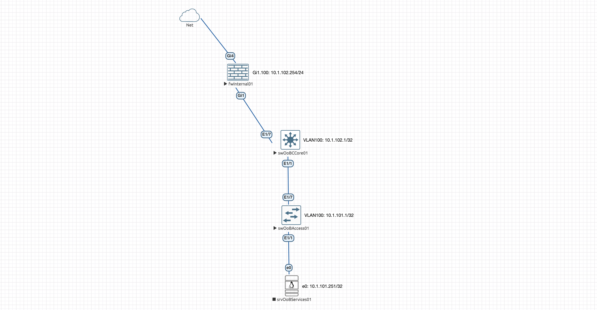

<p align="right">«Вещи, которыми ты владеешь, в конце концов овладевают тобой»
<p align="right">— Чак Паланик, «Бойцовский клуб»*

# Проектирование и автоматизация развертывания высокопроизводительной AI-фабрики ЦОД на базе оборудования Arista с мультивендорной интеграцией бэкэнда и оркестрацией через ZTP и Ansible

## Цель работы
Проектирование архитектуры и разработка комплексной системы автоматизированного развертывания высокопроизводительной мультивендорной AI-фабрики ЦОД на базе оборудования Arista для минимизации задержек сетевого транспорта и исключения человеческого фактора при пусконаладочных работах.

## Задачи работы
Для достижения поставленной цели необходимо решить следующие задачи:
1. Проанализировать теоретические основы построения сетей для AI/ML-нагрузок (Artificial Intelligence/Machine Learning - искусственный интеллект/машинное обучение), специфику их трафика, а также провести сравнительный анализ транспортных протоколов InfiniBand и RoCEv2 (RDMA over Converged Ethernet).
2. Исследовать алгоритмы управления перегрузками (PFC, ECN) и механизмы адаптивной маршрутизации в высокопроизводительных коммутационных матрицах (ASIC Broadcom / Arista).
3. Спроектировать неблокируемую топологию Клоза (Fat-Tree) с коэффициентом переподписки 1:1, разработать схему Underlay-маршрутизации на базе протокола Unnumbered eBGP и профили QoS/RoCEv2.
4. Разработать методику мультивендорной интеграции сетевого оборудования Arista с вычислительными узлами (GPU-серверами) и системами хранения данных (СХД) сторонних производителей.
5. Спроектировать и реализовать архитектуру автоматического ввода в эксплуатацию (Zero Touch Provisioning), включая настройку обеспечивающих инфраструктурных сервисов (DHCP, HTTP).
6. Разработать декларативную конфигурационную модель фабрики (Single Source of Truth) на базе шаблонов Ansible Validated Designs (AVD) для автоматической генерации и валидации конфигураций сетевых устройств.
7. Развернуть демонстрационный стенд (в виртуальной среде vEOS) для верификации разработанной системы автоматизации и тестирования сетевого транспорта.
8. Оценить технико-экономическую эффективность внедрения разработанного решения, включая показатели сокращения времени развертывания сети (Time-to-Market) и снижения рисков конфигурационных ошибок.

## Состав работы
- Вступительное слово
- Теоретико-методологические основы построения сетевой инфраструктуры для распределенного обучения ИИ-моделей (AI-фабрик)
- 


### Вступительное слово
Развитие технологий искусственного интеллекта и больших языковых моделей (Large Language Model - LLM) привело к экспоненциальному росту объемов распределенных вычислений. Эффективность обучения таких моделей напрямую зависит от сетевой инфраструктуры ЦОД, так как задержки при синхронизации вычислительных узлов (так называемая проблема «сетевого барьера») могут создавать эффективный простой порядка 30–50% от суммарной мощности дорогостоящих графических процессоров (GPU). Традиционная сетевая архитектура 3-Tier не справляется с паттернами AI-трафика (All-Reduce, All-to-All), вызывающими мгновенные перегрузки (Incast). В этих условиях критически важным становится проектирование специализированных высокопроизводительных AI-фабрик (AI Fabrics) с поддержкой технологий сверхмалой задержки (RoCEv2, Infiniband) и механизмов предотвращения потерь пакетов (PFC, ECN). Из-за высокой сложности и масштабов таких сетей ручная настройка оборудования неэффективна и ведет к ошибкам, что обуславливает необходимость сквозной автоматизации развертывания с использованием концепции Infrastructure as Code (IaC) на базе ZTP и Ansible в гетерогенных (мультивендорных) средах.

### Теоретико-методологические основы построения сетевой инфраструктуры для распределенного обучения ИИ-моделей (AI-фабрик)
На сегодняшний день технологии искусственного интеллекта (AI - Artificial Intelligence) и машинного обучения (ML - Machine Learning) стали ключевыми драйверами научно-технического прогресса. Проектирование и развертывание высокопроизводительных AI-кластеров является критически важной задачей для современной ИТ-инфраструктуры, поскольку обучение и работа больших моделей требуют специализированной аппаратной архитектуры и оптимизированных сетевых решений.

Технологии AI/ML опираются на понятие нейросети. В Wikipedia дается следующее определение:

> Нейросеть (или искусственная нейронная сеть) — это математический алгоритм и программа, созданные по принципу работы биологической нервной системы человека. Она состоит из множества связанных друг с другом вычислительных элементов — нейронов, которые обмениваются сигналами через числовые связи (синапсы).

С академической точки зрения нейросеть представляет собой направленный граф, вершинами которого являются математические модели искусственных нейронов (процессорные элементы), а дугами — синаптические связи, характеризующиеся весовыми коэффициентами.

Архитектурно, нейросеть организуется в виде многослойной конструкции, внешние два слоя которых (входной слой - Input layer и выходной слой - Output layer) предназначены для формализации интерфейса модели на, соответственно, получение информации и формирование выходного предсказания. Зажатые между ними скрытые слои (Hidden layers) осуществляют каскадные нелинейные преобразования над большим числом (миллиардами) связанных параметров, называемыми весами. Количество скрытых слоев определяеся моделью нейросети и, в большинстве своем, также является достаточно большим числом. 

С технической точки зрения, процесс обучения и работы таких моделей сводится к непрерывному выполнению низкоуровневых операций линейной алгебры — преимущественно матричного умножения (GEMM) и сложения тензоров. Несмотря на относительную простоту таких операций, их количество переводит процесс рассчета силами классических центральных процессоров (CPU) с их последовательной архитектурой в весьма долгий процесс - до сотни лет.

В противовес этому, графические процессоры (GPU), содержащие тысячи параллельных вычислительных ядер, позволяют значительно сократить этот процесс по времени (до считанных дней или недель), создавая, таким образом, техническое решение для сегмента AI.

Cовременные модели (LLM, генеративный AI) содержат сотни миллиардов параметров и физически не помещаются в локальную память (VRAM) одного графического ускорителя. Это вызывает необходимость объединения множества GPU в единый кластер для параллелизации вычислений.

В зависимости от того, с какими ограничениями сталкивается модель (нехватка скорости или нехватка памяти), вычисления распределяются по картам с помощью трех основных подходов:
1. **Параллелизм по данным (Data Parallelism)**: Метод, при которым нейросеть размещается в каждом GPU, а данные разбиваются на небольшие кусочки, называемые микро-батчами, с локальной обработкой в каждом GPU.

2. **Параллелизм по модели (Model Parallelism)**: Метод для больших нейросетей, когда дробится алгоритм самой нейросети между слоями (конвейерный параллелизм) или даже в рамках отдельных слоев (тензорный параллелизм). GPU выполняют работу над своей частью матрицы, но требуют моментального обмена и склейки результатов через сеть сразу после окончания операции.

Работа со сверхбольшими моделями представляет собой некоторую линейную комбинацию из этих методов, называемых 3D-параллелизмом, превращающим сотни GPU в одну монолитную вычислительную фабрику. Процесс обучения таких моделей называется распределенным (Distributed Training) и производится на кластерах из сотен или тысяч GPU.

Сам процесс обучения состоит из серии "прогонов" по всему объему обучающих данных и называется эпохой (Epoch), которых, в современных моделях требуется сотни и тысячи.

Эпохи также являются циклическими и состоят из последовательности процессов вычислений и проверок, производимых посредством ряда этапов с прямыми (Forward Pass) и обратными (Backward Pass) проходами (направленная итерация нейросети относительно полученных данных и формируемого предсказания), и усреднением с последующей синхронизацией (All-Reduce) градиентов между GPU кластера, для чего требуется высочайшая пропускная способность фабрики.

В некоторый период времени, называемый чекпоинт (Checkpoint), веса со всех GPU кластера сгружаются на сервера, в которые они установлены, и сохраняются на внешних надежных сетевых хранилищах. Эпоха содержит множество чекпоинтов, что накладывает определенные требования и на кластер и на средства хранения информации.

Важнейшей инженерной задачей при построении таких систем является организация межузлового взаимодействия (Inter-node interconnect). Необходимо понимать, что взаимодействие между GPU на современных решениях в процессе обучения производится напрямую между GPU, в то время, как процессы загрузки/выгрузки весов - через стандартные серверные среды, оркестрируемые, например, тем же Kubernetes.

С технической и экономической точек зрения, сеть современного AI-кластера четко делится на два контура (фабрики), имеющие собственные требования к среде передачи данных:
- **Front-end Network (Сеть управления и ввода-вывода)**: Фактически - это обычная Ethernet-сеть, используемая для загрузки начальных датасетов в кластер, управления нодами (SSH, Kubernetes), мониторинга и выдачи готовых ответов пользователям. Для нее характерны относительно небольшие пакеты, высокая чувствительность к задержкам подключения (RTT) и использование стандартного стека TCP/IP. Нагрузочные и технические требования которой соответствуют де-промо требованиям стандартной вычислительной фабрики.

- **Back-end Network (Фабрика межмашинного взаимодействия / AI-Fabric)**: Выделенная сверхвысокоскоростная сеть, связывающая GPU между собой (коэффициент переподписки 1:1). AI-кластер  генерирует колоссальный трафик типа `East-West`: во время фаз синхронизации градиентов (операции All-Reduce, All-to-All) сеть утилизируется на 100% полосы пропускания. Для снижения влияния и повышения отказоустойчивости, данную сеть ограничивают от остального трафика, так как если объединить эти фабрики, бэкенд-трафик полностью парализует работу фронтенда, вызывая потери пакетов и задержки для конечных пользователей. Выделенная AI-фабрика гарантирует предсказуемую производительность вычислений без влияния на внешние сервисы.

В современных AI-фабриках межузловое взаимодействие между GPU производится на сетевом уровне L3 (OSI) с использованием технологий RDMA (Remote Direct Memory Access) через протоколы RoCEv2 (RDMA over Converged Ethernet) или InfiniBand. Обе технологии используют RDMA или, конкретно, GPUDirect RDMA - технологию, которая позволяет сетевой карте (NIC) забирать данные напрямую из памяти GPU одного сервера и переносить их напрямую в память GPU другого сервера, минуя центральный процессор (CPU) и стек операционной системы.

В отличие от RoCEv2, которая изначально создавалась как L3-технология, инкапсулирующая RDMA-пакеты в стандартные IP/UDP-заголовки Ethernet (и маршрутизируется классическими коммутаторами по протоколу MP-BGP), технология InfiniBand является исторически L2-архитектурой, из-за чего ей присуще более высокое быстродействие. Но это превосходство реализуется за счет повышения архитектурной сложности: сеть является специализированной и требующей контроллера - Subnet Manager. 

Различия между этими технологиями сведены в следующую таблицу.

*Таблица 1. Сравнительный анализ существующих технологий межузлового взаимодействия AI-фабрик*

| **Критерий** | **InfiniBand (IB)** | **RoCEv2 (RDMA over Converged Ethernet)** |
|:-----|:-----|:-----|
| **Базовая технология** | Нативный протокол | Расширение Ethernet (L3/UDP) |
| **Управление потерями** | Кредитная система на физическом уровне (Credit-based flow control). Потери физически невозможны | Алгоритмы PFC (Priority Flow Control) и ECN требующие тонкой настройки |
| **Задержка** | Абсолютный минимум (аппаратный уровень) | Чуть выше, чем у IB за счет связки PCIe Switches - NIC и L3 инкапсуляции |
| **Стоимость и вендор-лок** | Очень дорого. Фактически монополия Nvidia (Mellanox) | Дешевле, открытый стандарт. Рыночные чипы (Broadcom Tomahawk 5, Cisco, Arista) |
| **Масштабируемость** | Сложнее масштабировать на десятки тысяч нод без спец-дизайна | Родной IP-роутинг позволяет масштабировать до гигантских дата-центров |

Как видно: с одной стороны чаши весов находится экосистема InfiniBand — закрытое решение, полностью контролируемое, фактически, одним производителем, что создает жесткие риски технологической зависимости (Vendor Lock-in). На противоположной, более перспективной чаше весов, расположен RoCEv2, который опирается на общедоступные стандарты Ethernet. Это позволяет развертывать AI-фабрики на базе высокопроизводительных коммерческих чипсетов (Broadcom Tomahawk 4/5, Cisco Silicon One) от независимых поставщиков под управлением открытых сетевых операционных систем (например, SONiC от Open Compute Project).

В долгосрочной перспективе, по моему мнению, эти весы окончательно склоняются в пользу Ethernet благодаря развитию консорциума Ultra Ethernet Consortium (UEC), который де-факто утвердил открытую архитектуру в качестве стратегического вектора развития AI-инфраструктуры.

С технической точки зрения RoCEv2 обеспечивает нативную интеграцию вычислительного контура в маршрутизируемые L3-сети (через стандартный BGP/ECMP) за счет инкапсуляции RDMA-пакетов непосредственно в заголовки IP/UDP. Это исключает необходимость внедрения сложных шлюзов или проприетарных контроллеров управления подсетями (Subnet Manager), обязательных для L2-архитектуры InfiniBand.

Использование L3 в RoCEv2-соединениях является следствием следующих причин:
- **Масштабируемость**: Сети L2 ограничены в размерах из-за архитектурного наличия широковещательного шторма и протоколов STP/RSTP, защищающих от него. Динамическая маршрутизация L3, например, BGP в архитектуре Clos / Fat-Tree, позволяет масштабировать кластер до тысяч GPU без проблем, существующих на уровне L2.

- **Балансировка нагрузки**: Использование ECMP (Equal-Cost Multi-Path) на уровне L3 обеспечивает равномерное распределение трафика по фабрике, исключая появление узких мест (oversubscription).

- **Отказоустойчивость**: Использование динамической маршрутизации L3 позволяет изолировать сбойные участки сети посредством динамического перестроения маршрутов трафика.

Однако, при всех описанных плюсах есть один момент, где RoCEv2 несколько проигрывает - это аппаратное управление перегрузками, которое в InfiniBand работает "из коробки" за счет жесткой проприетарной логики.
AI-сети, построенные на Ethernet (RoCEv2) с аналогичным функционалом должны опирается на следующие расширения:
1. **PFC (Priority Flow Control)**: Классический 802.3x Flow Control останавливает весь порт, PFC работает на уровне CoS (802.1p). Если буфер коммутатора переполняется трафиком (например, в очереди 3), коммутатор шлет назад кадр PFC PAUSE только для этой очереди, не трогая остальной трафик.

2. **ECN (Explicit Congestion Notification)**: Работает на L3. Когда буфер коммутатора начинает заполняться, он ставит бит `ECN` в IP-заголовке пакета. Принимающий сервер видит это и генерирует пакет `CNP` (Congestion Notification Packet) обратно отправителю, заставляя сетевую карту GPU превентивно снизить скорость отправки, не доводя до переполнения буффера.

3. **Балансировка трафика (Продвинутый ECMP)**: Стандартный ECMP балансирует по хэшу (IP, Port). Поскольку AI-потоков мало, но они огромные (Elephant flows), обычный хэш легко закинет несколько толстых потоков в один аплинк, а второй оставит пустым, что создаст состояние поляризации (Polarization). Для митигации этого используют технологию Adaptive Routing (динамическое перенаправление пакетов на менее загруженный линк на лету) или балансировку на уровне ячеек (Cell-based линки в фабриках типа Cisco Silicon One / Broadcom Jericho).

Подытоживая, аппаратная поддержка сквозного контроля перегрузок на базе PFC и ECN/CNP гарантирует создание беспотерьной среды (Lossless Ethernet), критически важной для межсерверных операций типа NCCL All-Reduce (NVIDIA Collective Communications Library All-Reduce), с производительностью и ультранизкими задержками, идентичными закрытым высокопроизводительным решениям. В масштабах эксплуатации дата-центра такой подход обеспечивает конвергентность инфраструктуры: для бэкенд и фронтенд контуров используется единый инженерный стек, общие инструменты автоматизации (Ansible, Terraform) и сквозной мониторинг (gNMI/INT телеметрия), что радикально снижает совокупную стоимость владения (TCO) и упрощает горизонтальное масштабирование кластера.

Однако обеспечение беспотерьности на транспортном уровне и унификация инженерного стека — это лишь половина системного решения. Чтобы описанные ранее механизмы могли эффективно предотвращать заторы, сама макротопология сети должна обладать колоссальным запасом пропускной способности и симметрии. 

Перед дальнейшим рассмотрением, необходимо ввести понятие переподписки, количественно описывающее уровень беспотерьности сети передачи данных.

> Коэффициент переподписки (Oversubscription Ratio) — это фундаментальная метрика сетевой архитектуры, определяющая отношение суммарной потенциальной пропускной способности всех нижестоящих портов коммутационного узла (направленных к конечным вычислительным узлам или устройствам доступа) к суммарной пропускной способности его вышестоящих портов (аплинков, направленных к магистрали или ядру сети).

Математически данный коэффициент выражается в виде пропорции `N:1`, где:
- N — коэффициент избыточности спроса на полосу пропускания,
- 1 — гарантированная единица емкости магистрального канала.

Если коэффициент составляет, например, `4:1`, это означает, что при одновременной попытке всех подключенных узлов передать данные на максимальной скорости линии, магистральный интерфейс сможет принять и обработать лишь 25% от общего объема входящего трафика.

В классических сетевых архитектурах (таких как 3-Tier, оптимизированных под трафик типа `North-South`) переподписка является осознанным инструментом экономической оптимизации, базирующимся на статистическом допущении, что в каждый конкретный момент времени большая часть серверов находится в режиме ожидания или утилизирует сеть лишь частично. Однако в высокопроизводительных вычислительных средах и AI-кластерах, где алгоритмы требуют синхронного обмена плотными массивами данных, любое значение коэффициента переподписки, отличное от `1:1` (Non-blocking / Line-rate), неизбежно приводит к буферизации, каскадному росту задержек и деградации производительности всего вычислительного комплекса.

Для распределенного обучения искусственного интеллекта, где доминирует лавинообразный горизонтальный трафик типа `East-West` (между вычислительными узлами), топология 3-Tier неприменима. Одновременный запуск коллективных сетевых операций (All-Reduce, All-to-All) мгновенно приводит к перегрузке («коллапсу») суженных участков сети с высокой переподпиской, вызывая массовые потери пакетов и резкий рост задержек.

В качестве фундаментального решения этой проблемы в ЦОД используется многоярусная топология Клоза (Clos Network), реализуемая по схеме Fat-Tree («Толстое дерево»). Теоретический принцип Fat-Tree заключается в том, что по мере движения от «листьев» дерева (Leafs, коммутаторов доступа) к его «корню» (Spine, магистральным коммутаторам), каналы связи становятся «толще» — не за счет увеличения скорости одного линка, а за счет строго пропорционального увеличения количества параллельных связей.


Анализируя макротопологии современных вычислительных систем, можно прийти к фундаментальному выводу: архитектура сетей для искусственного интеллекта и архитектура сетей общего назначения представляют собой два полярных, фактически ортогональных технологических решения, в то время как инфраструктура классического корпоративного дата-центра занимает между ними компромиссную промежуточную позицию.

Однако построение физической топологии — это лишь базис, который для эффективной работы современных ЦОД требует гибкого разделения сетевых ресурсов, реализуемого через виртуализацию сетей L2 поверх L3 (например, с помощью инкапсуляции VxLAN). Необходимость такого подхода продиктована тем, что классические L2-сети страдают от ограничений протокола STP (блокирующего параллельные линки Fat-Tree) и слабой масштабируемости, в то время как чистая L3-маршрутизация не позволяет свободно перемещать виртуальные машины и контейнеры с сохранением их IP-адресов. Чтобы решить эту проблему и объединить преимущества обоих подходов, сеть разделяют на два уровня: подстилающую сеть (Underlay) и наложенную сеть (Overlay). Назначение Underlay-уровня — обеспечить максимально быструю, отказоустойчивую L3-маршрутизацию и балансировку (ECMP) между физическими коммутаторами фабрики, формируя её жесткий «скелет». В свою очередь, Overlay-уровень работает поверх этой инфраструктуры, инкапсулируя исходные L2-кадры в L3-пакеты, что позволяет создавать изолированные, гибкие виртуальные L2-сегменты любого масштаба без привязки к физической топологии.

В качестве логического завершения данной теоретической главы необходимо рассмотреть архитектуру транспортного слоя фабрики. Ниже приведен сравнительный анализ протоколов динамической маршрутизации, применяемых для формирования топологической карты и обеспечения сходимости подстилающей сети (Underlay).

Я приведу табличное сравнение наиболее часто используемых протоколов подстилающей сети, а ниже - дам свои комментарии.

*Таблица 2. Сравнительная таблица наиболее распространенных протоколов Underlay*

| **Критерий** | **BGP Unnumbered** | **IS-IS** | **OSPFv2 / OSPFv3** |
|:---|:---|:---|:---|
| **Базовый стандарт IETF** | [RFC 5549](https://datatracker.ietf.org/doc/html/rfc5549) (Extended Next Hop), [RFC 4271](https://datatracker.ietf.org/doc/html/rfc4271) (BGP-4) | RFC 1195 (Использование в IP), [ISO/IEC 10589](https://www.iso.org/standard/30943.html) | [RFC 2328](https://datatracker.ietf.org/doc/html/rfc2328) (OSPFv2 для IPv4), [RFC 5340](https://datatracker.ietf.org/doc/html/rfc5340) (OSPFv3 для IPv6) |
| **Архитектурный тип** | **Path-Vector** (Дистанционно-векторный) | **Link-State** (Состояния канала) | **Link-State** (Состояния канала) внутри зоны / **Path-Vector** между зонами |
| **Уровень стека OSI** | **L4** (работает поверх 179/TCP) | **L2** (нативно на канальном уровне) | **L3** (инкапсулирован в IP-пакеты, используется мультикаст) |
| **Масштабируемость в Fat-Tree** | **Экстремальная**: миллионы маршрутов, до сотен тысяч GPU | **Очень высокая** в пределах одного домена/Level | **Ограниченная** из-за накладных расходов на LSA-флуд |
| **Скорость сходимости (Convergence)** | **Очень высокая** (при связке с BFD — [RFC 5880](https://datatracker.ietf.org/doc/html/rfc5880)) | **Экстремально высокая** (миллисекунды) | **Высокая** (но требует тонкого тюнинга таймеров) |
| **Защита от петель (Loop Prevention)** | **Нативная** (через AS-Path) | **Нативная** (алгоритм Дейкстры) | **Нативная** (алгоритм Дейкстры) |
| **Использование памяти (Memory Footprint)** | **Минимальное** для Underlay: хранит только префиксы Loopback-интерфейсов коммутаторов. Накладные расходы на соседство минимальны, так как нет тяжелых баз данных всей топологии | **Низкое / Среднее**: база данных состояния каналов (LSDB) оптимизирована за счет эффективных TLV-структур (Type-Length-Value). Потребляет меньше памяти, чем OSPF | **Высокое**: требует значительного объема RAM для хранения полной LSDB с множеством типов LSA-пакетов. Расход памяти растет пропорционально количеству линков в фабрике |
| **Наличие «слухов» (Routing Rumors)** | **Присутствует** (Специфика Path-Vector): коммутаторы не знают топологию всей сети, они «верят на слово» соседям, передающим им векторы путей (AS-Path); информация распространяется пошагово (Hop-by-Hop) | **Отсутствует** (Чистый Link-State): каждый коммутатор обладает точной, математически идентичной картой всей сети (LSDB); никаких «слухов» — только прямые факты о состоянии линков | **Отсутствует** (В пределах одной зоны): все коммутаторы внутри одной зоны имеют стопроцентную и идентичную информацию о топологии и не полагаются на «слухи», которые могут проявляться между зонами |
| **Параллельные ECMP-линки** | **Максимальное**: до 64 / 128 / 256 путей | **Высокое**: обычно до 32 / 64 путей | **Ограниченное**: обычно до 16 / 32 путей |
| **Дополнительные плюсы** | <UL><LI>**Zero-Touch конфигурация**: Автоподнятие сессий через IPv6 Link-Local <LI>**Идеальная изоляция**: Сбой на одном коммутаторе локализуется в рамках его ASN <LI>**Политики**: Гибкое управление трафиком через BGP-аттрибуты</UL> | <UL><LI>**Максимальная безопасность**: Работает на L2 (не имеет IP-адресов, устойчив к IP-атакам)<LI>**Сверхбыстрая сходимость**: Быстрее пересчитывает карту сети, чем OSPF <LI>**Гибкость**: Простая поддержка IPv4/IPv6 через TLV</UL> | <UL><LI>Знаком любому сетевому инженеру, колоссальная база знаний <LI>**Совместимость**: поддерживается абсолютно любым, даже устаревшим оборудованием</UL> |
| **Дополнительные минусы** | <UL><LI>**Медленная естественная сходимость**: требует обязательной связки с аппаратным BFD протоколом <LI>**Сложность отладки**: траблшутинг BGP без автоматизации на больших масштабах затруднен</UL> | <UL><LI>**Специфичный синтаксис**: требует сложной адресации NET (NSAP) для устройств <LI>**Дефицит кадров**: мало специалистов вне операторского (Telco) сектора <LI>**Нагрузка на CPU**: тяжелый алгоритм Дейкстры нагружает процессоры коммутаторов при сбоях </UL> | <UL><LI>**Шторм LSA** (Флудинг): при «мигании» (флапе, flap) одного линка весь кластер затапливается LSA-пакетами <LI>**Нагрузка на CPU**: тяжелый алгоритм Дейкстры нагружает процессоры коммутаторов при сбоях </UL> |
| **Сложность настройки** | **Средняя / Ниже среднего**: Zero-Touch через IPv6 Link-Local | **Средняя**: требует настройки NET-адресов | **Средняя**: требует планирования зон (Area) |
| **Использование в AI-фабриках** | Индустриальный стандарт (Meta, Microsoft, Google) | Редко (в гибридных HPC/AI архитектурах) | Практически не применяется |

Детально взвешивая информацию по представленным протоколам маршрутизации Underlay-подложки, для проектируемой AI-фабрики наиболее перспективным и технологически обоснованным решением является применение BGP Unnumbered (в соответствии со стандартами RFC 5549 и RFC 8950).

В условиях жестких требований распределенных вычислений к минимизации задержек и исключению пакетных потерь, Link-State протоколы (OSPF и IS-IS) обладают фундаментальным недостатком — необходимостью лавинообразной рассылки объявлений о состоянии каналов (LSA/LSP флуд) при любом изменении топологии и бОльшей нагрузкой на память и процессор коммутаторов, связанной с хранением и расчетом всей топологии сети Underlay. В крупных фабриках Clos / Fat-Tree, содержащих тысячи интерконнект-линков, это может привести к непредсказуемым всплескам времени сходимости сети.

Напротив, использование BGP Unnumbered полностью устраняет необходимость выделения и администрирования IPv4-подсетей для соединений типа "точка-точка" (Point-to-Point), используя механизмы автоматического обнаружения соседей по спецификации RFC 4861 (IPv6 Neighbor Discovery). Совместное использование BGP Unnumbered с протоколом детекции отказов BFD (RFC 5882) позволяет достичь субсекундного времени сходимости фабрики, минимизируя простои вычислительных узлов при аппаратных сбоях инфраструктуры».

Наиболее критическими элементами выступают планирование автономных систем (ASN) для протокола BGP, выбор типов соседства (iBGP/eBGP) и разработка системного плана IP-нумерации с учетом задела на долгосрочное расширение, которые значимо сказываются на скорости развертывания, быстроте и удобстве сопровождения построенной системы в условиях масштабирования.

Стоит отметить набирающий в последнее время популярность специализированный протокол RIFT (Routing in Fat-Trees), разработанный в рамках одноименной рабочей группы IETF и зафиксированный в стандарте [RFC 9696](https://datatracker.ietf.org/doc/html/rfc9696). В отличие от универсальных BGP или OSPF, RIFT изначально проектировался как анизотропный протокол, чувствительный к геометрии фабрики, и оптимизирован исключительно под регулярные топологии Клоза / Fat-Tree. Его главная цель — кардинально сократить объем избыточной маршрутной информации и автоматизировать обслуживание крупномасштабных вычислительных систем.

Техническая особенность RIFT заключается в гибридной архитектуре, объединяющей концепции разных классов протоколов в зависимости от направления трафика. При передаче информации «на север» (от Leaf к Spine) RIFT функционирует как классический Link-State протокол, заставляя нижестоящие узлы синхронизировать базы данных топологии с вышестоящими. Однако при передаче «на юг» (от Spine к Leaf) он ведет себя как Distance-Vector протокол, агрегируя всю информацию до единого маршрута по умолчанию (Default Route). В результате коммутаторы нижнего уровня практически освобождают свою оперативную память, зная только топологию своего локального окружения, в то время как полноценная маршрутная карта хранится на самом верху. При этом протокол нативно поддерживает автоматическое разрешение аварийных ситуаций: при отказе линка на верхнем ярусе Spine-коммутаторы отправляют вниз так называемые «отрицательные маршруты» (Negative Disaggregation), локально деагрегируя трафик в обход поврежденного узла.

К сожалению, на сегодняшний день протокол не имеет официальной поддержки со стороны «большой тройки» вендоров сетевых чипсетов и операционных систем для гиперскейлеров. Отсутствие готовых коммерческих реализаций в экосистемах Broadcom и Cisco делает внедрение RIFT в промышленные AI-фабрики рискованным шагом, оставляя его перспективной технологией будущего, в то время как стек BGP Unnumbered остается безальтернативным индустриальным стандартом.

### Рассчетная часть

#### Техническое задание
Настоящее техническое задание определяет комплекс требований к проектированию высокопроизводительной сетевой инфраструктуры (AI-фабрики) совокупной мощностью **1024 GPU**, развертываемой на базе 128 вычислительных узлов в архитектурной конфигурации по 8 GPU на один сервер. 

Конструктивное исполнение сетевой фабрики должно опираться на открытые, универсальные архитектурные принципы с использованием аппаратных платформ и операционных систем компании Arista Networks. Аппаратная связанность проектируемого комплекса жестко разделяется на три независимых физических и логических контура: бэкенд-сеть (вычислительный контур), фронтенд-сеть (сервисный контур), а также выделенную сеть удаленного управления (Out-of-Band) на базе медных портов 1G (IPMI карты серверов и Out-of-Band порты сетевого оборудования).

#### Общая часть
Вычислительное ядро комплекса формируется на базе современных AI-серверов, например, эквивалент NVIDIA DGX или аналогов от Supermicro/ASUS, содержащих 8 графических ускорителей (GPU).


Для обеспечения максимальной производительности, отказоустойчивости и информационной безопасности каждый вычислительный узел (сервер) оснащается строго регламентированным набором сетевых портов:

*Таблица 2. Итоговая таблица интерфейсов AI-сервера*

| **Контур сети** | **Кол-во портов** | **Скорость** | **Стек / Протокол** | **Примечание** |
|:---|:---:|:---:|:---|:---|
| **Compute/Backend (Вычисления)** | 8 | 400G | L3 RoCEv2 / GPUDirect RDMA | По одному на каждый GPU для моментального обмен градиентами между GPU соседних серверов и сохранения весов на выделенном СХД |
| **Frontend (Сервис/Хранилище)** | 2 | 25G | Стандартный TCP/IP | Оркестрация выделенного СХД и задач, доступ пользователей и других ИТ-служб ЦОД, сервисный контур Фронтэнда |
| **Management (IPMI / BMC)** | 1 | 1G (RJ45) | IPMI / Redfish | Мониторинг железа, датчиков температур и телеметрии; доступ к сетевой инфраструктуре через OoB-сеть |

Исходя из архитектурных особенностей вычислительных узлов (AI-серверов) и современных требований информационной безопасности, вся сетевая инфраструктура кластера должна быть физически разделена на 3 изолированных контура:
1. **Вычислительная сеть (Compute/Backend Fabric)**. Предназначена исключительно для межсерверного взаимодействия GPU (интерконнекта) при параллельных вычислениях (RDMA/RoCEv2). Данный сегмент критичен к задержкам и требует максимальной пропускной способности. В него объединяются 8х400 Гбит/с порты каждого сервера и высокоскоростные порты специализированной системы хранения данных. В целях безопасности и производительности этот контур должен быть полностью изолирован от внешней сети. Используется фиксированный коэффициент переподписки 1:1.
2. **Сеть клиентского доступа и данных (Frontend Network)**. Обеспечивает доступ пользователей к кластеру, интеграцию с системами хранения данных (СХД) и оркестрацию задач. Подключения производятся через 2х25 Гбит/с интерфейса. На данном периметре реализуются основные механизмы контроля доступа (Firewall, ACL) и мониторинга трафика, доступ к внешним сетям и подключение команд DevOps и SecDevOps.
3. **Сеть управления (Out-of-Band / IPMI Management)**. Выделенный сервисный контур для низкоуровневого администрирования серверов (KVM, мониторинг по низкоуровневой телеметрии, подключение к OoB интерфейсам сетевого оборудования, управление питанием). Подключается через 1 Гбит/с порты IPMI. С точки зрения безопасности этот сегмент требует строжайшей изоляции от Frontend и Backend сетей, а доступ к нему должен предоставляться только администраторам через доверенные шлюзы (VPN/Jump-хосты).

Учитывая значительные технологические различия указанных сетей, их рассчет и проектирование будет производиться раздельно. Однако, в целях унификации сетевой топологии, обеспечения прозрачности межкомпонентного взаимодействия и упрощения последующей эксплуатации инфраструктуры, разработан [единый сквозной план Underlay IP-адресации](#ip-план-сети-underlay-вычислительной-фабрики). Данный план охватывает все технологические контуры кластера: вычислительную фабрику (Backend), сеть клиентского доступа и данных (Frontend), а также выделенный сегмент удаленного администрирования (Out-of-Band Management).

Архитектурные принципы распределения адресного пространства, схемы нумерации интерфейсов, выделение автономных систем (ASN), а также методология масштабирования сети вынесены в отдельный специализированный раздел документа.

#### Анализ проблемы высокой плотности энергопотребления и тепловыделения
Развертывание высокопроизводительных вычислительных комплексов для искусственного интеллекта принципиально отличается от проектирования классических корпоративных ЦОД. Основным дестабилизирующим фактором является экстремальная плотность мощности современных AI-серверов.

В рамках данного проекта рассматривается 128 вычислительных узлов в архитектурной конфигурации по 8 GPU на один сервер. С учетом пиковой нагрузки на ускорители, центральные процессоры, высокоскоростную память и сетевые интерфейсы, энергопотребление одного такого сервера может составляет от 8 до 10 кВт.

При попытке использовать классический подход Top-of-Rack (ToR) с заполнением стандартного монтажного шкафа (42U) подряд (8–10 серверов), суммарная электрическая и тепловая нагрузка на одну стойку составит 80–100 кВт. Эксплуатация оборудования при такой плотности накладывает следующие критические ограничения:
1. **Невозможность воздушного охлаждения**: Физический объем воздуха, который необходимо прокачать через стойку мощностью более 35-40 кВт для удержания температуры компонентов в безопасном диапазоне, превышает аэродинамические возможности систем кондиционирования.

2. **Ограничения инфраструктуры ЦОД**: Подавляющее большинство существующих машзалов рассчитано на подведение средней мощности 7–15 кВт (редко до 25 кВт) на одно стойко-место. 

Для решения данной проблемы в проекте реализуется стратегия деконцентрации вычислительной мощности: плотность серверов ограничивается 4 узлами на одну монтажную стойку. Это фиксирует пиковую мощность AI-шкафа на уровне ~40 кВт. Для съема такого тепла предусматривается обязательное использование систем прямого жидкостного охлаждения (Direct-to-Chip Liquid Cooling, DLC) в комбинации с внутрирядными кондиционерами.

Ограничение плотности (4 сервера на стойку) приводит к тому, что в каждом AI-шкафу задействуется минимальное количество сетевых интерфейсов.

Cуществует 3 распространенных метода размещения сетевого оборудования:
1. **Классическая ToR-архитектура (Top-of-Rack)**. Все подключения производятся в рамках конкретного конструктива. Это обеспечивает наивысшие прозрачность и однозначность физической топологии, но обладает существенным недостатком: критически низкой утилизацией портов (Extreme-underutilization). Стоимость сетевой фабрики, при таком решении, возрастет в несколько раз. В срезе настоящего технического задания, в каждый AI-шкаф потребуется установить:
    - 1 Leaf-коммутатор AI-фабрики;
    - 2 Leaf-коммутатора Frontend-фабрики для реализации отказоустойчивого решения MLAG / EVPN-ESI.
    - 1 Access-коммутатор Out-of-Band Management сети.

2. **Архитектура EoR / MoR (End-of-Row / Middle-of-Row)**. Стойки объединяются в ряды. В начале или середине каждого ряда ставится сетевая стойка с нужным количеством коммутаторов Leaf и Access, к которым стягиваются кабели от серверов этого ряда. Следует отметить, что каждый тип фабрики потребует собственного количества коммутаторов, однако, используя арифметические функции НОД и НОК можно найти экстремальное значение заполнения коммутаторов фабрик и размер матрицы `ряды` * `стойки`. Физические подключения, в данном случае, делают с помощью DAC-кабелей соответствующей длины.

3. **Централизованная архитектура** с выделенными шкафами передачи данных (Network Racks) и подключениями через стационарную оптическую сеть. Данная архитектура предусматривает развертывание оптической сети нужной плотности с установкой ODF (Optical Distribution Frame - оптические полки) нужной плотности в TOR конструктива. Вся оптическая сеть сводится в один или несколько сетевых конструктивов, где и осуществляется подключение стандартными оптическими шнурами.

Централизованное архитектурное решение (вынос коммутаторов в выделенные Network Racks) обеспечивает максимальную эффективность использования портовой емкости сетевого оборудования. В отличие от децентрализованных схем, где порты коммутаторов неизбежно простаивают из-за ограничений тепловыделения и распределения серверов по стойкам, централизованная структура позволяет утилизировать интерфейсы со 100%-й плотностью, существенно снижая капитальные затраты (CAPEX) на построение фабрики.

С точки зрения эксплуатационной безопасности, физическое разделение серверной и сетевой зон предотвращает несанкционированный или случайный доступ сетевых специалистов к дорогостоящим вычислительным узлам. Консолидация сетевой инфраструктуры в чистой, технологически изолированной зоне полностью исключает риски механического повреждения элементов СХД или контуров жидкостного охлаждения серверов при проведении сетевых регламентных работ, что упрощает администрирование систем электропитания и кондиционирования ЦОД, а также позволяет развернуть структурированную кабельную систему высокой плотности на базе постоянных оптических магистралей.

Т.о., для последующих расчетов портовой емкости и топологии межкоммутационных связей ***за основу берется централизованное архитектурное решение***. 

#### Вычислительная сеть (Compute/Backend Fabric)
Проектирование бэкенд-сети, обслуживающей горизонтальный AI-трафик (чистый `East-West`), должно быть строго выполнено по двухъярусной многопутевой топологии Клоза (Fat-Tree) с неблокируемым коэффициентом переподписки `1:1`. Для межузлового взаимодействия GPU предписывается использование открытого транспорта RoCEv2 с обязательной поддержкой технологии GPUDirect RDMA в пропорции 1 GPU к 1 сетевому интерфейсу (NIC). Беспотерьность сетевой среды (Lossless Ethernet), критически важная для выполнения коллективных операций NCCL All-Reduce, должна обеспечиваться на аппаратном уровне механизмами канального приоритетного контроля потока PFC (Priority Flow Control, IEEE 802.1Qbb) и сквозного уведомления о заторах ECN (Explicit Congestion Notification).

Обеспечение бесконфликтной сетевой фабрики бэкенда логически предопределяет требования к подсистеме хранения данных (СХД), которая выполняет в AI-кластере две фундаментальные роли: непрерывную подачу обучающих выборок (датасетов) на расчетные узлы и высокоскоростную фиксацию промежуточных состояний нейросети (Checkpointing).

В AI-ориентированных инфраструктурах применение традиционных монолитных СХД корпоративного класса (SAN/NAS) технически невозможно. Согласно отраслевым архитектурным руководствам (в частности, NVIDIA DGX SuperPOD Storage Architecture Reference Guide), классические СХД с централизованными контроллерами и традиционными сетевыми протоколами (NFS/SMB) при столкновении с параллельными многопоточными запросами от сотен GPU неизбежно генерируют критические задержки ввода-вывода. На этапах итерационного перечитывания данных и особенно во время синхронной записи чекпоинтов, когда весь вычислительный процесс останавливается, медленная СХД провоцирует деградацию производительности и простой графических ускорителей (GPU Starvation).

В связи с этим для AI-вычислений предписывается внедрение специализированных распределенных параллельных программно-определяемых СХД (Software-Defined Storage, SDS). Их специализация обусловлена необходимостью сквозного параллелизма на уровне файловой системы (например, WEKA, Lustre или IBM Storage Scale), поддержки POSIX-совместимого многопоточного I/O и нативной интеграции с RDMA-сетью для исключения промежуточного кэширования в системной памяти хоста.

Современные компоненты распределенной СХД (Storage Nodes) аппаратно представляют собой унифицированные серверы стандартной архитектуры (x86/ARM), аналогичные по своей компоновке вычислительным узлам кластера, но адаптированные под профиль I/O-нагрузки. В их спецификации полностью отсутствуют дорогостоящие графические ускорители (GPU), однако вся емкость шасси и слотов расширения отведена под размещение максимальной плотности твердотельных накопителей высокой производительности класса NVMe SSD с интерфейсом PCIe 5.0. Таким образом, СХД масштабируется горизонтально: увеличение емкости и пропускной способности подсистемы хранения происходит линейно путем добавления новых аналогичных узлов в общую фабрику.

Для выполнения заявленных требований и исключения взаимного влияния разнородных типов трафика, каждый узел СХД оснащается изолированными сетевыми интерфейсами, разделяющими систему на бэкенд и фронтенд:
1. **Вычислительный интерфейс (Backend Data Plane)**: Реализуется через высокоскоростные порты RoCEv2 400G. Количество портов на одну ноду СХД (от 2 до 4) рассчитывается по принципу «снизу вверх» на основе суммарной полосы пропускания (Throughput) внутренней дисковой матрицы NVMe SSD, гарантируя, что пропускная способность сетевого интерфейса не станет ограничивающим фактором для потенциала дисков. Через данный контур передается «горячий» вычислительный трафик.

2. **Сервисный интерфейс (Frontend Control & Ingestion Plane)**: Подключается к выделенной сервисной сети Ethernet, где вычислительные сервера имеют адаптеры 2х25G. Данный уровень функционирует независимо от бэкенда и решает задачи внутрисетевого управления (In-Band Management): обеспечивает интеграцию ПО СХД с оркестраторами кластера (Kubernetes/Slurm) для динамического монтирования томов и сбора телеметрии. Также через фронтенд-порты сетевые шлюзы выполняют «холодную» загрузку первичных терабайтных датасетов из внешних репозиториев ЦОД в СХД и выгрузку финальных обученных моделей наружу.

Данную систему хранения строго не рекомендуется использовать как общее (разделяемое) хранилище с фронтенд-сегментом. Трафик Compute-СХД должен быть полностью изолирован от общих инфраструктурных задач, сервисов виртуализации и пользовательского доступа, чтобы исключить зашумление полосы (Noisy Neighbor) и гарантировать предсказуемые сверхнизкие задержки для RDMA/RoCEv2 в процессе обучения AI-моделей.

Поскольку сервисный трафик носит нерегулярный, но пиковый характер, расчет портовой емкости фронтенд-коммутаторов для СХД ведется по принципу «сверху вниз» и составляет фиксированную долю (20%) от общей портовой емкости сервисного сегмента вычислительного кластера, что гарантирует абсолютную изоляцию расчетной фабрики от заторов во внешних сетях.

Согласно [технического задания](#техническое-задание), мы получаем следующие нагрузочные коэффициенты:
- 1024 GPU — это 128 физических серверов.
- Каждый сервер имеет 8 выделенных сетевых интерфейсов вычислительной сети (по одному на каждый GPU) скоростью 400 Bbps каждый. Итого от одного сервера в сеть уходит 3.2 Tbps трафика.

Рассчитаем конфигурацию фабрики Клоза. Чтобы обеспечить фабрику без переподписки (без сужения каналов), мы строим схему, где суммарная скорость портов "вниз" равна скорости портов "вверх". Для этого используем следующий подход:
1. **Уровень Leaf вычислительного контура**:
	- Используем высокоплотные коммутаторы с 64 портами по 400G (или 32 портами 800G, разделяемыми на 400G) и делим портовую емкость поровну между аплинками и даунлинками, так как их мощность (полоса пропускания) эквивалентны. При этом мы получаем: 
    	- 32 порта идут вниз к серверам (это 4 сервера по 8 портов в каждом)
	    - 32 порта идут наверх к Spine-коммутаторам.
	- _Итого нам нужно_: `128 серверов / 4 сервера на Leaf = 32 Leaf-коммутатора`.

2. **Уровень Leaf контура хранения данных**:
    - Используем те же коммутаторы Leaf, что и для вычислительного контура:
        - Требуемая полоса СХД: 1024 * 400 * 0.2 = 81.92 Tbps.
        - Количество портов GDS на нативной скорости 400G: 81920 Gbps / 400 Gbps = 206 (портов).
        - Количество коммутаторов уровня Leaf: 206 / 32 = 6.4 (коммутаторов) = 7 (коммутаторов).
    - _Итого нам нужно_: 7 Leaf-коммутаторов`.

3. **Уровень Spine**:
	- Каждый Leaf должен быть соединен с каждым Spine одинаковым количеством линков.
	- Поскольку у каждого из Leaf коммутаторов есть 32 аплинка наверх, нам идеально подходят 32 Spine-коммутатора (таких же, на 64 порта 400G), при этом от каждого Leaf идет ровно по 1 линку 400G к каждому из 32 Spine.
    - Увеличение количества коммутаторов уровня Spine производиться не будет в силу того, что процесс взаимодействия с хранилищем ограничен по времени и является эпизодическим.
    - _Итого нам нужно_: `32 Spine-коммутатора`.

Для обеспечения гарантированной доставки RoCEv2 трафика хранения данных без потерь (Lossless Ethernet) и исключения простоев вычислительных узлов, на уровне доступа AI-фабрики активируется технологический стек DCB (Data Center Bridging). Конфигурация Leaf-коммутаторов включает в себя применение механизмов PFC (Priority Flow Control - IEEE 802.1Qbb) для поочередной приостановки трафика хранения, ECN (Explicit Congestion Notification - RFC 3168 / RFC 5033) для упреждающего сигнализирования о перегрузках оконечным узлам, и ETS (Enhanced Transmission Selection - IEEE 802.1Qaz) для строгого выделения и резервирования 20% полосы пропускания под контур СХД в моменты пиковых нагрузок. Для этого, весь трафик в фабрике (RoCEv2 / NVMe-oF) помещается в класс обслуживания (DSCP 26 / Traffic-Class 3) с жестким резервированием 20% полосы пропускания механизмами ETS. Это гарантирует передачу тяжелых массивов данных абсолютно без потерь и с минимальной задержкой, защищая буферы коммутаторов от перегрузок при лавинообразном сохранении весов AI-моделей.

Идеальным решением является коммутатор Arista 7060X5 на 64 порта 400GbE QSFP-DD / OSFP, а схема вычислительной фабрики приобретает следующий вид:


В текущей схеме на каждом из 32 Spine-коммутаторов занято всего по `32 + 7 = 39` портов. Это значит, что еще `32 - 7 = 25` портов на каждом Spine остаются свободными. Ввиду этого факта существует два основных сценария расширения фабрики без нарушения правила неблокируемости (переподписка `1:1`):
1. **Экстенсивное некратное расширение до 1704 GPU - 213 серверов**. Это самый простой способ, который утилизирует свободную емкость текущих Spine-коммутаторов. Этот шаг позволит масштабировать кластер, без установки новых Spine-коммутаторов.

2. **Масштабирование свыше 213 серверов (Переход на 3-й ярус: Super-Spine)**. При расширении фабрики на бОльшее количество GPU, классическая двухъярусная схема Leaf-Spine упрется в физический лимит портов на коммутаторах ядра. В этом случае текущую фабрику проще перестроить в трехъярусную сеть, чем производить замену коммутаторов на оборудование с бОльшим количеством портов. Такая схема позволяет масштабировать сеть практически неограниченно (до десятков тысяч GPU), сохраняя неблокируемую архитектуру `1:1`, но требует кратного увеличения оптических линков и закупки новых коммутаторов уровня Super-Spine.

На уровне маршрутизируемой подложки (Underlay) бэкенд-сети будем разворачивать протокол динамической маршрутизации BGP Unnumbered в соответствии со стандартами RFC 5549 и RFC 8950, функционирующий через механизмы автоматического обнаружения соседей по адресам IPv6 Link-Local (RFC 4861). Для распределения плотных потоков данных по магистрали фабрики требуется активация алгоритма балансировки ECMP в сочетании с механизмами адаптивной маршрутизации Arista, динамически перенаправляющими трафик в обход локальных перегрузок буферов.

Использование BGP Unnumbered позволяет отказаться от планирования IP-адресации для пиринговый линий (p2p), соединяющих коммутаторы разных уровней, что позволяет снизить объем RIB/FIB сетевого оборудования.

Подключение вычислительных узлов осуществляется по схеме `L3 Single-Homing` с использованием BGP Unnumbered. Изоляция арендаторов (мультитеннантность) реализуется на сетевом уровне с помощью технологии VRF-Lite (без использования оверлейных протоколов инкапсуляции типа VxLAN) посредством изоляции BGP-сессий на соответствующих наборах интерфейсов (по одному надору на тенант или один общий), либо на уровне оркестрации вычислительных задач (Host-based multitenancy) в плоской L3-сети.

Вычислительные ноды и ноды хранилища передают свои IP-адреса с маской /32 через L3 Point-to-Point (p2p) подключение с фабрикой, автоматически попадая в соответствующие контексты маршрутизации (VRF) на Leaf-коммутаторах. Разработка статического плана IP-адресации самих нод не входит в данное изложение; распределение, сигнализация и динамическое изучение этих адресов инфраструктурой фабрики осуществляются непосредственно средствами протокола BGP.

На данных стыках протоколы L2 (MCLAG, vPC, STP) не используется. Отказоустойчивость линков на этом уровне отсутствует, изоляция сбоев (fault domain) сужена до одного порта/кабеля.

#### Frontend сеть
В отличие от технологических контуров вычислительной сети (Backend) и администрирования (Out-of-Band), которые функционируют в режиме строгой физической и логической изоляции, фабрика клиентского доступа и данных (Frontend Network) является пограничным сегментом. Она проектируется с учетом необходимости контролируемого взаимодействия с сетями общего пользования (Интернет) и смежными сегментами корпоративной инфраструктуры.

Frontend-фабрика является многофункциональной кросс-платформенной средой и отвечает за обеспечение следующих ключевых технологических процессов:
1. **Высокоскоростной межсерверный обмен данными (Трафик `East-West`)**:
	- ***Оркестрация процессом синхронизации весов и коэффициентов модели***: Управление прочессом  оперативного кэширования, сохранения контрольных точек (Checkpointing) и выгрузки коэффициентов нейросети между эпохами обучения на промежуточные серверы хранения (непосредственная передача данных осуществляется в бэкенд-сети).
	- ***Оркестрация и высокоуровневый менеджмент***: Передача служебных команд систем оркестрации вычислительных задач (Kubernetes, Slurm) для управления жизненным циклом контейнеров и распределения нагрузки на узлы.
	- ***Внутрикластерное взаимодействие разработчиков***: Обеспечение связи между инженерами данных (Data Engineers), DevOps-специалистами и исследователями ИИ (Data Scientists) в процессе совместной отладки распределенного кода осуществляется согласно общего концепта системы безопасности с административной изоляцией разных группа с использованием технологии VRF.

2. **Взаимодействие с внешним периметром (Трафик `North-South`)**:
	- ***Обслуживание конечных клиентов***: Прием и обработка входящих запросов к развернутым моделям со стороны внешних пользователей, приложений и микросервисов, запрашивающих результаты вычислений (Inference/Вывод).
	- ***Импорт исходных датасетов***: Загрузка массивов неструктурированных данных из внешних озер данных (Data Lakes, S3), корпоративных репозиториев и публичных источников для последующей подготовки и разметки.
	- ***Телеметрия и централизованный мониторинг***: Трансляция логов, метрик производительности и дампов памяти во внешние SOC-системы (SIEM) и платформы комплексного мониторинга инфраструктуры.

Централизованная архитектурная модель позволяет развернуть конвергентную фронтенд-сеть, разделив её на логическом уровне на изолированные подсистемы с использованием VRF-Lite на уровне L3 и VLAN на уровне L2. Каждая из этих подсистем решает строго определенный класс технологических задач кластера и обладает собственным профилем сетевой нагрузки.

Согласно архитектурным гайдам лидеров индустрии ([Cisco Validated Designs](https://www.cisco.com/c/en/us/td/docs/dcn/whitepapers/amd-cisco-ai-cluster-ra.html), [Juniper Networks](https://www.juniper.net/documentation/us/en/software/nce/ai-clusters-data-center-design/ai-clusters-data-center-design.pdf)), выбор целевого коэффициента делится на три сценария:
1. **Конвергентный фронтенд (Frontend + Storage)**. В современных AI-архитектурах сетевые интерфейсы хостов для управления и для СХД часто объединяют (например, в серверах уровня Nvidia HGX/H100/B200 выделяется пара резервных портов по 200G/400G под эти нужды).
    - ***Причина***: Во время фазы `Incast` (узлов одновременно читают одну и ту же партию датасета) или во время записи Чекпоинта (сохранения весов модели, когда терабайты данных лавиной сбрасываются из памяти GPU на диск), сеть фронтенда работает в режиме критического насыщения.
    - ***Рекомендуемый коэффициент***: `1:1` или максимум `2:1`. Любая задержка на фронтенде/хранилище в этот момент приведет к простою GPU, что делает обучение экономически неэффективным.

2. **Выделенный фронтенд только для LLM-обучения (Training)**. Если трафик систем хранения данных (Storage) вынесен в отдельную физическую фабрику (например, InfiniBand/RoCE под NVMe-oF), то фронтенд занимается чистой оркестрацией, отправкой API-команд и мониторингом.
    - ***Причина***: Трафик становится прерывистым, преобладают мелкие пакеты телеметрии. Потоки данных стабильны и предсказуемы.
    - ***Рекомендуемый коэффициент***: `3:1` или `4:1`. В редких случаях для гигантских кластеров допускается до 6:1, но архитекторы стараются избегать больших цифр, чтобы не создавать заторы (head-of-line blocking) для пакетов синхронизации планировщика Slurm/Kubernetes.

3. **Фронтенд для инференса (Inference / Serving)**. Когда ИИ-кластер используется не для обучения, а для промышленного исполнения готовых моделей (выдача ответов пользователям).
    - ***Причина***: Нагрузка кардинально меняется. Трафик становится похож на классический веб-датацентр: тысячи разрозненных пользовательских запросов (Mice flows) вместо гигантских "потоков-слонов" (Elephant flows). Здесь отлично работает статистическое мультиплексирование.
    - ***Рекомендуемый коэффициент***: `3:1` — стандарт де-факто, обеспечивающий баланс между стоимостью сетевого оборудования и гарантией низкой задержки (Ultra-low Latency), которая критична для real-time генерации (например, при стриминге токенов LLM пользователю).

Спроектированная фабрика фронтенда включает в себя следующие функциональные контуры:
1. **Сервисный контур AI-серверов (AI Nodes Connectivity Segment)**, предназначенный для подключения вычислительных узлов через интерфейсы общего типа 2×25G. По сути - это IP-трафик: для загрузки ОС, обмена служебными данными между контейнерами, управления, первичного распределения задач и т.д.

2. **Сервисный контур систем хранения данных (Storage Connectivity Segment)**. Данный контур был затронут в предыдущем пункте при описании применяемой специализированной SDS. Как говорилось ранее, данный сегмент разворачивается в рамках конвергентного фронтенда и выполняет роль глобального репозитория фабрики, изолируя дисковый трафик от высокочувствительной бэкенд-сети (400G). Через порты этого контура осуществляется первоначальная загрузка и препроцессинг сырых датасетов, поступающих из внешних сетей, а также регулярный сброс контрольных точек (чекпоинтов) и весов моделей в процессе обучения. В ходе итеративного вычислительного цикла данные из СХД считываются через интерфейсы фронтенда и с помощью технологии NVIDIA GPUDirect Storage (GDS) доставляются методом RDMA напрямую в высокоскоростную память GPU (HBM), полностью минуя центральный процессор сервера и не утилизируя ресурсы изолированного бэкенд-контура. Для обеспечения стабильности этого процесса на коммутаторах Arista Networks активируется функционал Lossless Ethernet (PFC и ECN). Весь трафик хранения (RoCEv2 / NVMe-oF) изолируется на логическом уровне в выделенный VLAN и класс обслуживания (DSCP 26 / Traffic-Class 3) с жестким резервированием 20% полосы пропускания механизмами ETS. Это гарантирует передачу тяжелых массивов данных абсолютно без потерь и с минимальной задержкой, защищая буферы коммутаторов от перегрузок при лавинообразном сохранении весов многомиллиардных AI-моделей.

3. **Инфраструктурный контур служебных серверов (Management & Orchestration Pod)**: Данный сегмент состоит из серверов и СХД общего типа, необходимого для работоспособности Фронтенд-фабрики:
	- Интерфейсы пользователя и оркестрация (например, JupyterHub, Open-WebUI, Kubernetes, Slurm-мастера).
	- Служебная инфраструктура (Core Services): DNS, DHCP, NTP, локальные репозитории/реестры образов (Registry).
	- Телеметрия и аудит: Prometheus, Grafana, ELK/EFK-стек (для сбора логов и метрик как с серверов, так и с коммутаторов Arista через протокол gNMI/Telemetry).

4. **Контур межсетевых соединений (Border Pod)**: точка сопряжения изолированной AI-фабрики с внешней сетью предприятия, корпоративным ядром или Интернетом. К этому сегменту подключаются межсетевые экраны (Firewalls), шлюзы безопасности и, при необходимости, пограничные маршрутизаторы.

Ввиду того, что используется конвергентное решение на базе RoCEv2, то желательно максимально повысить коэффициент переподписки для минимизации возможных заторов на стадии `Incast` - используем для дальнейших расчетов коэффициент `1:1` во всех контурах (сегментах) по-умолчанию и указываем иное, если требуется другое значение коэффициента.

##### Расчет сервисного контура AI-серверов
Исходя из [расчета AI-фабрики](#вычислительная-сеть-computebackend-fabric), имеем стартовую мощность фабрики в 128 AI-серверов и следующие рассчетные показатели:
- **Количество серверов**: 128 узлов.
- **Отказоустойчивость**: Каждый сервер имеет 2 сетевых адаптера общего типа, ввиду чего обеспечиваем отказоустойчивость подключения к фабрике.
- **Пропускная способность на сервер**: 50 Gbps (2 × 25 Gbps).
- **Коэффициент переподписки (Oversubscription)**: Строго `1:1`.

Для обеспечения отказоустойчивости можно использовать технологии канального уровня L2: MLAG или EVPN-ESI. Каждая из которых имеет своим особенности, собранные в следующей таблице:

*Таблица 3. Сравнительный анализ: Arista MLAG vs EVPN-ESI*

| **Критерий / Параметр** | **Arista MLAG (Multi-Chassis LAG)** | **EVPN-ESI (Ethernet Segment Identifier)** |
|:---|:---|:---|
| **Основа технологии** | **Проприетарный механизм Arista EOS**. Требует строго парной работы двух одинаковых или совместимых коммутаторов Arista | **Открытый стандарт (RFC 7432)**. Позволяет строить мультивендорные фабрики (Interoperability) |
| **Лимит масштабирования (Узлы)** | **Максимум 2 коммутатора** в одной логической паре (MLAG Domain) | **До 16 коммутаторов** (VTEP) на один Ethernet Segment (ES) в рамках Arista EOS |
| **Связанность плоскости управления (Control Plane)** | **Полная зависимость (Fate-sharing)**. Состояние синхронизируется локально между двумя шасси. Состояние MLAG не передается в BGP EVPN | **Полная независимость коммутаторов**. Вся координация и сигнализация состояний происходят распределенно через BGP Control Plane |
| **Физический линк синхронизации (Peer-Link)** | **Обязателен (Peer-Link)**. Задействует высокоскоростные порты (например, 2х100G) только для служебного трафика и MAC-синхронизации | **Не требуется**. Резервирование портов под Peer-Link отсутствует, вся фабрика используется для полезной нагрузки |
| **Сложность Control Plane фабрики** | **Низкая (Базовая)**. Меньше служебного трафика BGP. Обе коммутирующие фабрики видны для остальной сети как один логический VTEP (Shared IP) | **Высокая**. Создает дополнительную нагрузку на BGP (State Churn) из-за генерации большого количества маршрутов EVPN Type-1 и Type-4 |
| **Адресация VTEP** | **Общий IPv4/IPv6 адрес** (Shared VTEP IP / Anycast IP) для пары коммутаторов. Балансировка в Underlay через ECMP | **Уникальный IP-адрес** на каждом физическом коммутаторе-участнике ESI-LAG. Балансировка в Overlay |
| **Скорость сходимости (Convergence)** | **Высокая (на уровне LACP / Data Plane)**. Переключение при локальном сбое линка происходит мгновенно без перестроения BGP | **Зависит от BGP**. Для быстрого восстановления используются механизмы Mass-Withdraw (Type-1 routes), но сходимость завязана на протокол BGP |
| **Взаимодействие со Spanning Tree (STP)** | **Нативная поддержка** на уровне модулей интеграции (MSI). Устройства работают как единый Root Bridge | **Требует специфических настроек**, таких как создание логического «Super-Root» для корректной работы STP |

При выборе отказоустойчивого Dual-Homing подключения вычислительных AI-узлов к двум коммутаторам, технология Arista MLAG является более оправданным выбором, чем EVPN-ESI. Применение MLAG существенно оптимизирует плоскость управления (Control Plane) сетевой фабрики. Пара коммутаторов разделяет один общий Anycast VTEP IP, что сокращает количество VxLAN-туннелей в сети ровно в два раза и, в свою очередь, сокращает нагрузку на сеть при использовании HER-репликации за счет снижения количества репликаций.

Вся синхронизация MAC-адресов переносится из BGP в локальный канал связи, избавляя сеть от избыточных служебных маршрутов EVPN Type-1 и Type-4. Переключение трафика при авариях происходит локально на уровне LACP за единицы миллисекунд, вообще не затрагивая глобальный протокол BGP.

С другой стороны, внедрение MLAG накладывает ряд эксплуатационных ограничений и усложняет администрирование. Технология требует выделения дорогостоящего физического канала Inter-Chassis Link (Peer-Link) скоростью от 100G/400G.

Схема создает эффект связанности состояний (Fate-Sharing) между устройствами и требует абсолютной идентичности конфигураций параметров оверлея (VRF, VNI, VLAN) на обоих коммутаторах. Это повышает риски человеческой ошибки при ручной настройке. Кроме того, регламентное обновление операционной системы Arista EOS в паре MLAG проходит сложнее, а сама архитектура формирует жесткий вендорлок, полностью исключая использование оборудования других производителей в каждой отдельной паре коммутаторов.

Расчет портовой емкости Leaf-уровня:
1. **Потребность серверов (Downlink)**:
	- ***Всего серверов***: 128 единиц.
	- ***Интерфейсы на сервер***: 2 x 25 Gbps (подключаются в режиме MLAG All-Active к двум разным коммутаторам).
	- ***Общее количество портов доступа***: 128 * 2 = 256(портов по 25 Gbps).
	- ***Суммарная полоса пропускания серверов***: 256 * 25 Gbps = 6.4 Tbps.

2. **Потребность в аплинках (Uplink) для переподписки 1:1**:
	- Для обеспечения чистой переподписки 1:1 полоса аплинков должна быть не менее 6.4 Tbps.
	- Используя решение, гармонизированное с бэкенд-фабрикой (400 Gbps), получим: 6400 Gbps / 400 Gbps = 16 (портов) на весь контур.
    
3. **Емкость для Peer-Link (MLAG)**:
	- Для надежной синхронизации и пропуска BUM-трафика в между коммутаторами MLAG-пары закладываем 2 порта по 400 Gbps

##### Расчет сервисного контура систем хранения данных
При расчете данного контура, необходимо опереться на данные, полученные при расчете высокоскоростных портов SDS - плотность сервисных портов СХД, вообще говоря, будет совпадать с плотностью сервисных портов ввиду особенностей архитектурного решения.

Архитектура сетевой фабрики проектируемого AI-кластера базируется на принципе полного разделения трафика вычислений (Backend-сеть для "горячих данных") и трафика управления/сервисов (Frontend-сеть - "холодные 
данные").

Расчет портовой емкости Leaf-уровня:
1. **Потребность серверов (Downlink)**:
	- ***Общее количество портов доступа***: 206 (портов по 25 Gbps).
	- ***Суммарная полоса пропускания серверов***: 206 * 25 Gbps = 5.15 Tbps.

2. **Потребность в аплинках (Uplink) для переподписки 1:1**:
	- Для обеспечения чистой переподписки 1:1 полоса аплинков должна быть не менее 5.15 Tbps.
	- Используя решение, гармонизированное с бэкенд-фабрикой (400 Gbps), получим: 5150 Gbps / 400 Gbps = 13 (портов) на весь контур.
    
3. **Емкость для Peer-Link (MLAG)**:
	- Для надежной синхронизации и пропуска BUM-трафика в между коммутаторами MLAG-пары закладываем 2 порта по 400 Gbps

##### Расчет инфраструктурного контур служебных серверов (Infrastructure Nodes)
Обеспечение непрерывного функционирования, оркестрации и безопасности AI-фабрики возлагается на пул серверов общего назначения (инфраструктурного типа) и сопряженную с ними гибридную СХД. В рамках данного проекта эти компоненты разворачиваются справочно и выполняют роль фундаментального сервисного базиса кластера.

Инфраструктурные узлы агрегируют в себе критически важные общесистемные службы: планировщики задач и оркестраторы (Slurm, Kubernetes Control Plane), базовые сетевые сервисы (DHCP, DNS, NTP, IPAM), системы централизованной авторизации и аудита (RADIUS, TACACS+, Identity Management), а также программные комплексы мониторинга, глубокой телеметрии фабрики и информационной безопасности (Prometheus/Grafana, Arista CloudVision, SIEM/ELK-стек).

Связанная с Бэкенд-кластеро СХД общего назначения конфигурируется по гибридной технологии (высокопроизводительные SSD под базы данных и емкие HDD под архивы) и предназначается для долговременного хранения логов, аудиторских слепков, образов операционных систем и первичных "сырых" датасетов до их финальной очистки.

Каждый инфраструктурный сервер и контроллер СХД подключается к централизованным лиф-коммутаторам фронтенда через избыточные интерфейсы 2×25G с применением технологии Arista MLAG (Multi-Chassis Link Aggregation). Это гарантирует отказоустойчивость уровня Active-Active на физическом и логическом уровнях (LACP), распределяет входящие потоки телеметрии и обсервинга, а также исключает простои управляющего контура фабрики при проведении планового обслуживания или аварийном выходе из строя любого из Leaf-коммутаторов».

Расчет портовой емкости Leaf-уровня:
1. **Потребность серверов (Downlink)**:
	- ***Всего серверов***: 128 * 0.2 = 25.6 = 26 единиц.
    - ***Контроллеры СХД***: 2 узла.
	- ***Интерфейсы на сервер***: 2 x 25 Gbps (подключаются в режиме MLAG All-Active к двум разным коммутаторам).
	- ***Общее количество портов доступа***: (26 + 2) * 2 = 56 (портов по 25 Gbps).
	- ***Суммарная полоса пропускания серверов***: 56 * 25 Gbps = 1.4 Tbps.

2. **Потребность в аплинках (Uplink) для переподписки 1:1**:
	- Для обеспечения чистой переподписки 1:1 полоса аплинков должна быть не менее 1.4 Tbps.
	- Используя решение, гармонизированное с бэкенд-фабрикой (400 Gbps), получим: 1400 Gbps / 400 Gbps = 4 (порта) на весь контур.
    
3. **Емкость для Peer-Link (MLAG)**:
	- Для надежной синхронизации и пропуска BUM-трафика в между коммутаторами MLAG-пары закладываем 2 порта по 400 Gbps

##### Расчет пограничного контура (Border Leaf / Edge Pod)
Пограничный контур (Border Leaf / Edge Pod) проектируемой фабрики представляет собой изолированный архитектурный сегмент, развернутый на базе строго одной пары коммутаторов Arista Networks, объединенных в отказоустойчивый домен Arista MLAG, к которой подключаются исключительно стыки межсетевых экранов, Multi-Fabric-лучей и т.д.

В соответствии с отраслевыми стандартами построения современных фабрик, к данному контуру настоятельно не рекомендуется подключение любых конечных хостов, серверов или систем хранения. Это обеспечивает полную изоляцию внутренних вычислительных систем от внешних доменов отказов, сетевых штормов и лавинообразных пересчетов таблиц маршрутизации BGP, а также позволяет развернуть защищенную демилитаризованную зону (DMZ) на стыке с корпоративными межсетевыми экранами. 

Освобождение памяти аппаратных чипсетов (TCAM) от обслуживания абонентских MAC- и ARP-таблиц позволяет целиком сфокусировать ресурсы коммутаторов на высокоскоростной L3-маршрутизации и агрегации пограничного трафика.

Для обеспечения отказоустойчивости шлюзов по умолчанию на L3-стыках вместо классического VRRP применяется вендорская технология Arista VARP (Virtual ARP), реализующая симметричную обработку пакетов в режиме Active-Active на обоих пограничных узлах без избыточной нагрузки на их центральные процессоры. 

Архитектура пограничного контура изначально проектируется с прицелом реализации бесшовного межплатформенное масштабирования любым из существующих методов Multi-SiteX.

Для Border Leaf стандартом является коэффициент переподписки от 4:1 до 8:1 (в зависимости от емкости внешних каналов). Так как внешние каналы связи (WAN/Internet) всегда являются узким местом (Bottleneck) и имеют гораздо меньшую пропускную способность, чем внутренняя сеть дата-центра. Выделять под внешние аплинки половину портов мощного коммутатора 400G экономически нецелесообразно.

Для надежности мы берем 2 коммутатора (1 пару MLAG). Поскольку внешних стыков обычно немного (например, 4–8 портов 400G на всю пару), все остальные свободные порты этих коммутаторов можно использовать для аплинков к Spine, чтобы обеспечить максимальную полосу распределения трафика наружу. Для нашего расчета мы заложим стандартную пару Border Leaf.

##### Результирующая конфигурация Фронтенд-фабрики
Учитывая, что все подключения во фронтенд-фабрике осуществляются 25Gbps линками, наиболее оптимальным будет использование коммутатора
Arista DCS-7050X4-48Y-4DF, имеющего 48 портов 25G (SFP28) + 4 порта 400G (QSFP-DD).

Рассчитаем конфигурацию соединений Downlink:
- ***Полоса Downlink***: 48 × 25 Gbps = 1.2 Tbps.
- ***Количество портов Uplink***: 1.2 Tbps / 400 Gbps = 3 (порта для подклоючения к уровню Spine).
- ***Количество портов MLAG Peer-Link***: 4 - 3 = 1 (порт).

Такая конфигурация позволяет достичь 100% утилизации портов коммутатора при удовлетворительном уровне отказоустойчивости (за счет единственного Peer-Link'а).

Произведем полный перерасчет фронтенд-фабрики:
- ***Расчет сервисного контура AI-серверов***: 256 портов / 48 = 5.3 = 6 (коммутаторов Leaf) = 3 (пары MLAG)
- ***Расчет сервисного контура систем хранения данных***: 206 портов / 48 = 4.2 = 4 (коммутаторов Leaf) = 2 (пары MLAG)
- ***Расчет инфраструктурного контур служебных серверов***: 56 портов / 48 = 1.1 = 2 (коммутатора Leaf) = 1 (пара MLAG)
- ***Расчет пограничного контура***: 2 Leaf (1 пара MLAG). Используем модель Arista DCS-7050X4-32S (32 порта 400G), где 24 порта отдаются под внешние стыки, а 8 портов уходят на Spine, обеспечивая честную переподписку 3:1.
- ***Рассчет Spine коммутаторов***: Поскольку каждый внутренний Leaf использует ровно 3 аплинка, нам требуется всего 3 Spine-коммутатора 400G (Arista DCS-7060X5), унифицированных с коммутаторами бэкенд-фабрики.

Схема фронтенд-фабрики имеет следующий вид:


##### Сеть управления (Out-of-Band)
Сеть удаленного управления Out-of-Band (OoB) спроектирована как полностью изолированный физический сегмент, построенный по топологии Top-of-Rack (ToR). Главной задачей OoB-сети является обеспечение непрерывного, независимого от состояния основных фабрик доступа к интерфейсам администрирования, мониторинга и телеметрии всех аппаратных компонентов кластера. Архитектура сети принята 3-Tier.

В каждый монтажный шкаф (Rack) устанавливается выделенный коммутатор OoB уровня доступа с медными интерфейсами 1G Base-T. В данные коммутаторы централизованно включаются все служебные порты инфраструктуры: IPMI/iLO/iDRAC/XCC-платы удаленного управления серверов, выделенные порты управления контроллеров систем хранения данных (СХД), а также специализированные физические Management-порты управляющих плат всех сетевых коммутаторов вычислительной и фронтенд-фабрик.

Расчет сети управления:
- ***Расчет OoB вычислительной фабрики***:
    - В каждом шкафу вычислительной фабрики содержится по 4 сервера или SDS СХД. Используем Сisco Catalyst 9200L-24T с 24 1000Base-T портами и 4 10G SFP+.
    - Каждый шкаф содержит: 4 порта IPMI и порты систем мониторинга физического мониторинга инфраструктуры (PDU, датчики температуры и влажности).
    - _Всего коммутаторов_: (128 + 26) / 4 = 38.5 (коммутаторов Access) = 39
- ***Расчет OoB фронтенд фабрики***:
    - В каждом шкафу может содержаться до 47 серверов высокой плотности. Однако, использование СХД существенно снизит эту плотность, позволяя использовать коммутаторы с 48 1000Base-T портами и 4 10G SFP+ (Cisco Catalyst 9200L-48T).
    - _Всего коммутаторов_: 56 / 48 = 2 (коммутатора Access)
- ***Расчет OoB сетевых шкафов***:
    - Всего коммутаторов фабрик:
        - Вычислительной: 32 (Spine) + 39 (Leaf) = 71
        - Фронтенда: 3 (Spine) + 14 (Leaf) = 17
        - Шкафов Network: (71 + 17) / 1U / 45 = 1.9 = 2 (шкафа)
        - Агрегация OoB: (71 + 17 + 2) * 2 (линка) / 48 (портов/коммутатор) = 3.75 = 4 (коммутатора)
- ***Расчет агрегации OoB***:   
    - Всего коммутаторов Access: (71 + 3 + 2 + 4) = 81 (шт)
    - _Всего коммутаторов CollapsedCore_: В конфигурации Stack'а: 81 * 2 / 48 = 4 (коммутатора)

В качестве коммутаторов доступа можно выбрать следующие:
- Сisco Catalyst 9200L-24T для TOR в вычислительной фабрике (88 шт).
- Cisco Catalyst 9200L-48T для TOR в фронтенд-фабрике и сетевых шкафах (6 шт).
- Cisco Catalyst 9300X-48HX для агрегации (4 шт).

Схема OoB сегмента представлена ниже:


 
#### Архитектера сетевой безопасности
Обеспечение комплексной защиты и непрерывности вычислений в рамках AI-платформы базируется на концепции эшелонированной обороны (Defense-in-Depth) и жесткой изоляции разнородных технологических контуров на физическом, сетевом и транспортном уровнях. Инфраструктура кластера разделена на три независимые сетевые фабрики, для каждой из которых определен индивидуальный периметр и контекст безопасности.


1. **Фронтенд-фабрика (Frontend Fabric)**. Фронтенд-фабрика (сервисный контур, сеть общего назначения и т.д.) выступает главным связующим звеном кластера с внешним миром и пользователями.
    - ***Периметральная защита***: На границе фабрики (Border Leaf ярус) разворачивается основной высокопроизводительный межсетевой экран следующего поколения (NGFW), подключенный по схеме Router-on-a-Stick для маршрутизации и глубокой инспекции (L7 DPI, IPS) всего входящего извне трафика.
    - ***Сегментация на уровне фабрики (VRF)***: Фронтенд-контур логически разделен на изолированные виртуальные контексты маршрутизации (VRF). Межвариантный (Inter-VRF) трафик не может коммутироваться внутри фабрики напрямую — он принудительно заворачивается на центральный NGFW, где маршрутизируется и фильтруется согласно политикам безопасности.
    - ***Микросегментация внутри контекста (VLAN и IRB)***: Группы пользователей или сервисов, находящиеся внутри одного и того же VRF, но требующие разграничения прав и находящиеся в одном контексте безопасности, изолируются друг от друга на уровне VLAN (L2-доменов). Для предотвращения горизонтального перемещения угроз (East-West traffic) и разгрузки центрального файрвола, трафик между этими VLAN терминируется на коммутаторах доступа фабрики через интегрированные интерфейсы маршрутизации (IRB). Фильтрация и запрет несанкционированного меж-VLAN взаимодействия внутри одного VRF осуществляются аппаратно на чипсетах самих Leaf-коммутаторов с помощью списков контроля доступа (ACL/VACL), привязанных к IRB-интерфейсам.

2. **Сеть удаленного управления (Out-of-Band Network / OoB)**. Контур OoB предназначен для низкоуровневого администрирования (IPMI, iLO, iDRAC, Management-порты коммутаторов) и телеметрии, представляя собой зону повышенного риска.
    - ***Архитектура подключения***: Фабрика OoB изолирована в отдельный физический слой, но для возможности легитимного администрирования подключена к смежным контурам через выделенный внутренний межсетевой экран «на палке» (Router-on-a-Stick).
    - ***Политика фильтрации***: Весь входящий и исходящий трафик контура подлежит жесткой фильтрации на межсетевом экране. По умолчанию действует правило Deny All.
    - ***Ограничение доступа***: Доступ к ресурсам OoB-сети строго лимитирован. Межсетевой экран разрешает сетевые сессии к IPMI/Management-интерфейсам только из строго определенных VRF и доверенных административных групп пользователей Фронтенд-сети (например, инженеры мониторинга и системные администраторы) с обязательным прохождением авторизации.

3. **Вычислительная фабрика (Compute Fabric / Backend)**. Вычислительный контур, обеспечивающий межузловое взаимодействие графических процессоров (GPU), функционирует в режиме полного физического и логического аиргапа (Air Gap).
    - ***Режим изоляции***: Данная фабрика не подключается к межсетевым экранам (Firewalls) и не имеет прямых шлюзов в смежные сети или интернет. Любая межсетевая инспекция здесь полностью исключена, так как задержки, вносимые файрволами, неприемлемы для Lossless-высокоскоростного AI-трафика.
    - ***Контроль доступа***: Изоляция фабрики является абсолютной. Единственные легитимные адреса в данном контуре — это статические /32 IP-интерфейсы самих GPU-адаптеров в собственных tenant VRF, маршрутизируемые внутри фабрики средствами BGP Unnumbered и адреса локальных петель коммутаторов в GRT андерлэй сети. Доступ извне к вычислительным интерфейсам и фабрике заблокирован на уровне отсутствия физических путей коммутации.

*Таблица 4. Инженерное резюме политик безопасности фабрик*

| **Параметр безопасности** | **1. Фронтенд-фабрика (Frontend)** | **2. Сеть управления (OoB)** | **3. Вычислительная фабрика (Backand/Compute)** |
|:---|:---|:---|:---|
| **Связь с другими сетями** | **Присутствует** через основной файрвол на границе | **Ограниченна**:  подключена через дополнительный файрвол к сети фронтенд |**Полностью отсутствует** (AirGap) |
| **Топология фильтрации** | Router-on-a-Stick (Inter-VRF) + ACL на IRB (Intra-VRF) | Router-on-a-Stick | Отсутствует |
| **Способ логической изоляции** | L3 VRF + L2 VLAN | ACL на FW | Вообще отстутсвуют маршруты в другие сети | 
| **Зона поражения (Blast Radius)** | Сегментирована по арендаторам / VRF | Минимальная из-за многоуровневой фильтрации | Ограничена одной расчетной задачей (Job) | 

Сетевая безопасность в рамках Фронтенд-фабрики базируется на современной концепции Zero Trust Architecture (ZTA). В соответствии с этим подходом, любое устройство, пользователь или сервис по умолчанию считаются недоверенными, независимо от их физического или логического местоположения в сети. Идентификация и проверка прав осуществляются непрерывно на каждом этапе сетевого взаимодействия.
Принципы Нулевого доверия реализуются через комбинацию микросегментации, жесткой изоляции контекстов маршрутизации и принудительного контроля сессий, что позволяет свести к минимуму периметр возможной атаки (Blast Radius) и полностью исключить неконтролируемое горизонтальное перемещение трафика (East-West traffic).

Для администрирования, мониторинга и эксплуатации AI-платформы выделяются специализированные VRF обслуживающего персонала. Взаимодействие этих административных контекстов с сервисными интерфейсами AI-фабрики (управляющими платами коммутаторов бэкенда, интерфейсами оркестраторов типа Slurm/Kubernetes и шинами управления СХД) строго ограничена:
- **Изолированные межсетевые линки**: Прямая маршрутизация между стандартными пользовательскими сетями и технологическим контуром AI полностью заблокирована. Информационный обмен разрешен строго между определенными административными подсетями (Subnets) внутри выделенных служебных VRF и целевыми сервисными интерфейсами.
- **Межсетевой контроль**: Все легитимные линки обслуживающего персонала принудительно терминируются на выделенном внутреннем межсетевом экране. Файрвол осуществляет глубокую инспекцию пакетов (Stateful Inspection), проверяя не только IP-адреса источника и назначения, но и конкретные типы протоколов (например, разрешая исключительно SSH/HTTPS и блокируя все остальные виды активности).

Любое прямое сетевое подключение внешних клиентов или удаленных информационных систем к ресурсам внутренней фронтенд-фабрики и AI-компонентам категорически запрещено.

Если внешним пользователям (например, удаленным разработчикам, аналитикам или смежным сервисам) требуется доступ к веб-интерфейсам, API оркестрации или результатам расчетов ИИ-кластера, такое взаимодействие организуется исключительно по следующей схеме:
1. **Терминация на периметре**: Внешний трафик поступает на границу фабрики (Border ярус) и перенаправляется на выделенный пул прокси-серверов / ингресс-шлюзов (Reverse Proxy / API Gateway), размещенных в изолированной демилитаризованной зоне (DMZ VRF) под контролем основного периметрального NGFW.
2. **Проверка и очистка запросов**: Прокси-сервер выполняет функции полной инспекции запросов, принудительной аутентификации (например, через mTLS или корпоративный IDP/Keycloak) и проверки на соответствие сигнатурам атак (WAF — Web Application Firewall).
3. **Изолированный внутренний запрос**: Только после успешной проверки прокси-сервер инициирует новую, изолированную сессию от своего имени во внутренний контур фабрики к целевому сервису. Таким образом, реальная сетевая топология, внутренние адреса AI-кластера и инфраструктурные интерфейсы остаются полностью невидимыми и недоступными для прямого сканирования или атаки из внешней сети.

Для пользователя самой модели, процесс происходит следующим образом:
1. **Уровень пользователя**. Когда пользователь AI-модели пишет промпт в условный чат, соединение терминируется на внешних балансировщиках и API Gateway'ах / Reverse Proxy. Внешний клиент общается только с веб-сервером и полностью изолирован от внутренней фрхитектуры всей системы.

2. **Уровень бизнес-логики**. Прокси-сервер передает очищенный запрос в сервисный контур фронтенд-сети на микросервисы управления. Здесь AI-серверы выполняют:
    - Проверку вашей подписки, прав доступа и лимитов (Rate Limiting).
    - Токенизацию текста (превращение слов в числовые векторы).
    - Проверку на безопасность контента (Moderation API — чтобы в запросе не было вредоносных инструкций).

3. **Уровень вычислений**. Только после всех проверок сервер бизнес-логики отправляет «очищенную» векторную задачу в вычислительный контур фабрики (на AI-серверы).
    - В этот момент данные передаются по скоростным бэкенд-линкам с помощью GPUDirect RDMA.
    - AI-кластер выполняет математическое перемножение матриц, генерирует ответ в виде набора токенов (чисел) и возвращает его обратно на CPU-сервер бизнес-логики.
    - AI-сервер переводит числа обратно в текст и отдает прокси-серверу, а тот — пользователю.

#### IP-план сети Underlay
Для подстилающей сети и OoB будем использовать приватную IPv4-сеть класса A 10.0.0.0/8.

Структура адреса:
`10.<DC>.<Type>.<Host>`, где:
- <DC> - определяет порядковый номер сайта/ЦОД (2 байта);
- <Type> - Тип устройства/сервиса (2 байта);
    - 00 - 99: Контекст безопасности фронтенда;
    - 100 - 199: Контекст безопасности управления (OoB);
    - 200 - 254: Контекст безопасности AI-фабрики.
- <Host> - Номер ноды.

В рамках проектирования транспортной подложки (Underlay) AI-фабрики и конвергентного фронтенда предлагается использование протокола eBGP Unnumbered на базе стандартов RFC 5549 (IPv6 Link-Local peering для IPv4 префиксов).

Выбор eBGP обусловлен его превосходной масштабируемостью в многоярусных архитектурах Clos (вплоть до 3-Stage: Leaf - Spine - Super Spine), простотой предотвращения логических петель через анализ атрибута AS_PATH и нативной поддержкой высокоэффективной балансировки трафика ECMP, что полностью исключает риски возникновения заторов (congestion) при интенсивном межсерверном обмене.

Распределение автономных систем (ASN) спроектировано по гибридному принципу с учетом топологических особенностей контуров.

В AI-кластере, где вычислительные узлы подключаются по изолированным L3-интерфейсам, применяется дискретная схема, закрепляющая за каждым одиночным Leaf-коммутатором уникальный номер ASN. Это гарантирует абсолютную симметрию трасс и одинаковую длину пути (AS-Hop Count) между любыми ускорителями в сети.

В фронтенд-кластере, опирающемся на технологию Arista MLAG, за каждой парой отказоустойчивых коммутаторов закрепляется общий номер ASN. Для исключения изоляции маршрутов при локальных авариях аплинков, межкоммутаторный Peer-Link внутри каждой MLAG-пары конфигурируется с использованием iBGP-сессии, в то время как вертикальное взаимодействие с ярусами Spine и Super Spine реализуется строго посредством eBGP-стыков.

Использование выделенного диапазона 32-битных приватных ASN (от 4200000000) обеспечивает независимость адресации и бесшовный потенциал горизонтального расширения фабрики без перепроектирования логической структуры».

Результирующая таблица распределения IP-адресов сетевого оборудования в подстилающей сети и их ASN
предствалена в следующей таблице:

*Таблица 5. Распределение IPv4-адресов сетеобразующим оборудованием*

| **Фабрика** | **Имя хоста** | **Роль** | **Название интерфейса** | **IPv4-адрес** | **ASN** |
|:---:|:---|:---:|:---:|---:|:---:|
| Frontend | swFEAIServersLeaf01 | Leaf | Loopback0 | `10.1.0.1/32` | `4200001001` |
| Frontend | swFEAIServersLeaf01 | MLAG VTEP | Loopback1 | `10.1.1.1/32` | `4200001001` | 
| Frontend | swFEAIServersLeaf02 | Leaf | Loopback0 | `10.1.0.2/32` | `4200001001` |
| Frontend | swFEAIServersLeaf02 | MLAG VTEP | Loopback1 | `10.1.1.1/32` | `4200001001` |
| ... |
| Frontend | swFEAIServersLeaf05 | Leaf | Loopback0 | `10.1.0.5/32` | `4200001003` |
| Frontend | swFEAIServersLeaf05 | MLAG VTEP | Loopback1 | `10.1.1.3/32` | `4200001003` |
| Frontend | swFEAIServersLeaf06 | Leaf | Loopback0 | `10.1.0.6/32` | `4200001003` |
| Frontend | swFEAIServersLeaf06 | MLAG VTEP | Loopback1 | `10.1.1.3/32` | `4200001003` |
| Frontend | swFEAISDSLeaf01 | Leaf | Loopback0 | `10.1.0.101/32` | `4200001101` |
| Frontend | swFEAISDSLeaf01 | MLAG VTEP | Loopback1 | `10.1.1.101/32` | `4200001101` |
| Frontend | swFEAISDSLeaf02 | Leaf | Loopback0 | `10.1.0.102/32` | `4200001101` |
| Frontend | swFEAISDSLeaf02 | MLAG VTEP | Loopback1 | `10.1.1.101/32` | `4200001101` |
| Frontend | swFEAISDSLeaf03 | Leaf | Loopback0 | `10.1.0.103/32` | `4200001102` |
| Frontend | swFEAISDSLeaf03 | MLAG VTEP | Loopback1 | `10.1.1.102/32` | `4200001102` |
| Frontend | swFEAISDSLeaf04 | Leaf | Loopback0 | `10.1.0.104/32` | `4200001102` |
| Frontend | swFEAISDSLeaf04 | MLAG VTEP | Loopback1 | `10.1.1.102/32` | `4200001102` |
| Frontend | swFEInfraLeaf01 | Leaf | Loopback0 | `10.1.0.201/32` | `4200001201` |
| Frontend | swFEInfraLeaf01 | MLAG VTEP | Loopback1 | `10.1.1.201/32` | `4200001201` |
| Frontend | swFEInfraLeaf02 | Leaf | Loopback0 | `10.1.0.202/32` | `4200001201` |
| Frontend | swFEInfraLeaf02 | MLAG VTEP | Loopback1 | `10.1.1.201/32` | `4200001201` |
| Frontend | swFEBorderLeaf01 | Leaf | Loopback0 | `10.1.0.251/32` | `4200001251` |
| Frontend | swFEBorderLeaf01 | MLAG VTEP | Loopback1 | `10.1.1.251/32` | `4200001251` |
| Frontend | swFEBorderLeaf02 | Leaf | Loopback0 | `10.1.0.252/32` | `4200001251` |
| Frontend | swFEBorderLeaf02 | MLAG VTEP | Loopback1 | `10.1.1.251/32` | `4200001251` |
| Frontend | swFESpine01 | Spine | Loopback0 | `10.1.2.1/32` | `4200002001` |
| Frontend | swFESpine02 | Spine | Loopback0 | `10.1.2.2/32` | `4200002001` |
| Frontend | swFESpine03 | Spine | Loopback0 | `10.1.2.3/32` | `4200002001` |
| OoB | swOoBAccess01 | Access | VLAN100 | `10.1.100.1/32` | - |
| OoB | swOoBAccess02 | Access | VLAN100 | `10.1.100.2/32` | - |
| ... |
| OoB | swOoBAccess01 | Access | VLAN100 | `10.1.100.94/32` | - |
| OoB | swOoBCCore01 | Collapsed Core | VLAN100 | `10.1.100.201/32` | - |
| Backend | swBEComputeLeaf01 | Leaf | Loopback0 | `10.1.201.1/32` | `4200201001` |
| Backend | swBEComputeLeaf02 | Leaf | Loopback0 | `10.1.201.2/32` | `4200201002` |
| ... |
| Backend | swBEComputeLeaf32 | Leaf | Loopback0 | `10.1.201.32/32` | `4200201032` |
| Backend | swBEStorageLeaf01 | Leaf | Loopback0 | `10.1.201.101/32` | `4200201101` |
| Backend | swBEStorageLeaf02 | Leaf | Loopback0 | `10.1.201.102/32` | `4200201102` |
| ... |
| Backend | swBEStorageLeaf02 | Leaf | Loopback0 | `10.1.201.132/32` | `4200201132` |
| Backend | swBESpine01 | Spine | Loopback0 | `10.1.202.1/32` | `4200202001` |
| Backend | swBESpine02 | Spine | Loopback0 | `10.1.202.2/32` | `4200202001` |
| ... |
| Backend | swBESpine32 | Spine | Loopback0 | `10.1.202.32/32` | `4200202001` |

### Настройка системы
Данная часть посвящена этапу практического внедрения, верификации проектных решений и автоматизации развертывания спроектированной сетевой фабрики. Ввиду масштабности целевого комплекса, ручное конфигурирование каждого аппаратного элемента является неэффективным, сопряжено с высоким риском возникновения человеческого фактора (ошибок, мисконфигурации) и существенно увеличивает время ввода кластера в эксплуатацию. Для создания надежной, воспроизводимой и легко масштабируемой среды в проекте реализуется современный DevOps-подход «Сеть как код» (Network as Code — NaC).ё

Жизненный цикл реализации и валидации конфигураций разделен на три последовательных этапа:
1. **Прототипирование и ручная верификация**: На базе эмулятора сетевых сред EVE-NG разворачивается упрощенная виртуальная модель фабрики, использующая оригинальные образы операционной системы Arista vEOS. На данном этапе производится ручная «первичная» настройка базового технологического стека подложки (eBGP Unnumbered Underlay), логических контуров фронтенда (MLAG, VARP, VLAN/VRF) и механизмов обеспечения качества обслуживания (QoS, PFC, ECN) для RoCEv2. Это позволяет симулировать поведение реального оборудования, проверить корректность работы протоколов и зафиксировать эталонный конфигурационный шаблон.

2. **Автоматизация развертывания (Infrastructure as Code)**: На основе верифицированных шаблонов разрабатываются сценарии автоматизации (плейбуки) Ansible. Написание плейбуков включает в себя параметризацию конфигурационных данных и отделение логики настроек от переменных устройств. Созданный инструмент автоматизации применяется для пакетной, безошибочной раскатки конфигураций на оставшиеся и новые инфраструктурные и сервисные узлы эмулируемой сети.

3. **Финальное тестирование и валидация**: Завершающим этапом является комплексная проверка собранной автоматизированным способом фабрики. С помощью встроенных инструментов Arista EOS и генераторов трафика симулируются штатные сценарии распределения нагрузок (ECMP балансировка), собирается телеметрия состояния буферов, а также отрабатываются аварийные сценарии (Failover) с падением линков и целых коммутаторов для подтверждения высокой отказоустойчивости и непрерывности работы сервисов ИИ-кластера».

Ввод в эксплуатацию крупномасштабного AI-комплекса требует строгого соблюдения технологической последовательности этапов. В рамках концепции NaC процесс развертывания разделен на четыре последовательные фазы, где каждая последующая опирается на сервисы предыдущей:
1. На первом этапе разворачивается выделенная физическая сеть удаленного управления Out-of-Band (OoB 1G). Данный шаг необходим для обеспечения безопасного административного доступа ко всем аппаратным компонентам и IPMI-интерфейсам серверов. 
2. На втором этапе внутри контура OoB поднимаются базовые инфраструктурные службы автоматизации: DHCP-сервер и служба автоматической инициализации Arista ZTP (Zero Touch Provisioning), а также разворачивается управляющий узел Ansible Control Node. Новые коммутаторы при первичном включении автоматически получают временные OoB-адреса и базовые настройки, открывая доступ для Ansible. 
3. На третьем этапе плейбуки Ansible в автоматическом режиме раскатывают целевую конфигурацию конвергентной фронтенд-сети (включая MLAG, VARP и политики Lossless Ethernet для СХД), обеспечивая готовность сервисной среды и запуск систем оркестрации (Kubernetes/Slurm).
4. Настраиваются межсетевые экраны (Firewall). 
5. Только после полной готовности управляющего и сервисного контуров, на четвертом этапе, производится финальное конфигурирование высокоскоростной вычислительной AI-фабрики и валидация межчипового взаимодействия 1024 GPU.

#### 1 этап: Развертывание сети OoB
На начальном этапе практической реализации проекта разворачивается базовая топологическая схема, содержащая минимально необходимый набор элементов для инициализации фабрики. Данный стартовый контур локализуется в центральном шкафу передачи данных (Network Rack) и строится на базе выделенной инфраструктуры удаленного управления Out-of-Band (OoB).

Внутри данного изолированного сегмента доступа размещается консолидированный сервер автоматизации (ZTP/DHCP/Ansible Control Node). Такое размещение гарантирует, что сервер находится в едином широковещательном L2-домене с портами управления инициализируемого сетевого оборудования. Это позволяет беспрепятственно обрабатывать первичные широковещательные DHCP-запросы от «голых» коммутаторов, находящихся в заводском режиме Zero Touch Provisioning, и осуществлять их автоматический бутстрап до момента запуска основных контуров фабрики.



На данный момент необходимо создать скелет для дальнейшей работоспособности сети управления, ввиду чего конфигурации коммутаторов весьма тривиальны:

<details>
  <summary>Конфигурация fwEXT01 (используется Cisco IOS)</summary>

```

service timestamps debug datetime msec
service timestamps log datetime msec
service password-encryption
!
hostname fwEXT01
!
ip domain name Frontend.local
!
lldp run
cdp run
!
interface GigabitEthernet1
 description --- L3: connection to Internet
 ip dhcp client client-id ascii fwEXT01
 ip address dhcp
 ip nat outside
 load-interval 60
 negotiation auto
 no mop enabled
 no mop sysid
!
interface GigabitEthernet2
 description --- L3 p2p (no VLAN, no VRF): connection to fwINT01:Gi1
 ip address 192.168.0.1 255.255.255.0
 ip nat inside
 load-interval 60
 negotiation auto
 no mop enabled
 no mop sysid
!
router bgp 4200000000
 bgp router-id 10.1.0.0
 bgp log-neighbor-changes
 bgp update-delay 1
 bgp graceful-restart restart-time 300
 bgp graceful-restart
 timers bgp 3 9
 neighbor fwINT01 peer-group
 neighbor fwINT01 remote-as 4200000000
 neighbor fwINT01 fall-over bfd
 neighbor 192.168.0.2 peer-group fwINT01
 !
 address-family ipv4
  neighbor fwINT01 default-originate
  neighbor 192.168.0.2 activate
 exit-address-family
!
ip nat inside source list aclNAT:GRT interface GigabitEthernet1 overload
ip route 0.0.0.0 0.0.0.0 dhcp
ip ssh version 2
!
ip access-list standard aclNAT:GRT
 10 permit any
!

```
  
</details>

<details>
  <summary>Конфигурация fwINT01 (используется Cisco IOS)</summary>

```

service timestamps debug datetime msec
service timestamps log datetime msec
service password-encryption
!
hostname fwINT01
!
ip domain name Frontend.local
!
lldp run
cdp run
!
interface GigabitEthernet1
 ip address 192.168.0.2 255.255.255.0
 negotiation auto
 no mop enabled
 no mop sysid
!
interface GigabitEthernet2
 description --- Trunk (VLAN001): connection to swOoBCCore01:Eth1/7
 no ip address
 load-interval 60
 negotiation auto
 no mop enabled
 no mop sysid
!
interface GigabitEthernet2.100
 description --- Virtual (VLAN100): connection to NetMGMT segment
 encapsulation dot1Q 100 native
 ip address 10.1.100.254 255.255.255.0
!
router bgp 4200000000
 bgp router-id 10.254.0.0
 bgp log-neighbor-changes
 bgp update-delay 1
 bgp graceful-restart restart-time 300
 bgp graceful-restart
 timers bgp 3 9
 neighbor fwEXT01 peer-group
 neighbor fwEXT01 remote-as 4200000000
 neighbor fwEXT01 fall-over bfd
 neighbor 192.168.0.1 peer-group fwEXT01
 !
 address-family ipv4
  network 10.1.100.0 mask 255.255.255.0
  neighbor 192.168.0.1 activate
 exit-address-family
!
ip ssh version 2

```
  
</details>

<details>
  <summary>Конфигурация swOoBCCore01 (используется Cisco Nexus 9000v)</summary>

```

hostname swOoBCCore01
!
ip domain-name OoB.local
!
feature interface-vlan
feature lacp
feature lldp
feature vtp
!
vlan 100
  name NetMGMT
!
interface Ethernet1/1-2
  description --- Trunk (VLAN001): connection to swOoBAccess01:e1/7
  switchport
  switchport mode trunk
  switchport trunk native vlan 100
  load-interval counter 1 60
  no shutdown
!
interface Ethernet1/7
  description --- Trunk (VLAN001): connection to fwInternal01
  switchport
  switchport mode trunk
  switchport trunk native vlan 100
  load-interval counter 1 60
  no shutdown
!
interface Vlan100
  description --- Virtual (VLAN100): OoB Network Management Edge
  no shutdown
  ip address 10.1.100.201/24
!
ip route 0.0.0.0/0 10.1.100.254

```
  
</details>

<details>
  <summary>swOoBAccess01</summary>

```

hostname swOoBAccess01
!
ip domain-name OoB.local
!
feature interface-vlan
feature lacp
feature lldp
feature vtp
!
vlan 100
  name NetMGMT
!
interface ethernet1/1-6
  description --- Access (VLAN100): OoB Network Management Edge
  switchport
  switchport access vlan 100
  spanning-tree port type edge
  spanning-tree bpduguard enable
  load-interval counter 1 60
  no shutdown
!
interface ethernet1/7
  description --- Trunk (VLAN001): connection to swOoBCCore01:e1/1
  switchport
  switchport mode trunk
  switchport trunk native vlan 100
  load-interval counter 1 60
  no shutdown
!
interface vlan100
  description --- Virtual (VLAN100): OoB Network Management Edge
  load-interval counter 1 60
  ip address 10.1.100.1/24
  no shutdown
!
ip route 0.0.0.0/0 10.1.100.254

```
  
</details>

Транки принципиально имеют VLAN по-умолчанию 100, так как для раскатки самой сети OoB необходимо состояние аксеса на стороне клиента в сегменте сервисного сервера, которым будет являться ненастроенный коммутатор OoB. Далее, в процессе настройки, интерфейс, "упирающийся" в ядро будет переведен в режим транка с VLAN по-умолчанию 100.

На данный момент мы получили опорную точку для инсталляции сервисного сервера. В качестве операционной системы будем использовать Ubuntu 22.0. Установка самой системы не входит в объем данного материала, поэтому будем считать, что система работает и на ней есть связанность с Интернетом.

Для построения архитектуры ZTP (Zero Touch Provisioning) для коммутаторов Arista и POAP (PowerOn Auto Provisioning) для коммутаторов Cisco на базе Ubuntu понадобится связка из трех ключевых компонентов: DHCP-сервер (для выдачи IP и указания пути к скрипту инициализации), HTTP-сервер (для отдачи самих скриптов и образов EOS) и Ansible (для последующей конфигурации):
1. **DHCP-сервер**: isc-dhcp-server (классический, максимально надежный для ZTP) или Kea DHCP (современная замена от ISC). В примере ниже используем проверенный временем isc-dhcp-server.
2. **HTTP-сервер**: Nginx (легковесный и быстрый, для обслуживания ZTP-скриптов).
3. **Автоматизация**: Ansible со следующими коллекциями:
- ***arista.avd*** (Arista Validated Designs) для удобного управления конфигурациями Arista EOS;
- ***cisco.nxos*** для базового управления коммутаторами Cisco NX-OS (я их использую как обычные Cisco Catalyst).

Всвязи с особенностями работы сетевого стека, мой EVE-NG, работающий поверх VMware ESXi, не позволяет напрямую подключиться к сервисному серверу. Чтобы обойти это (а связанность у меня присутствует), я запущу SSH в реверсивном режиме. Для этого со стороны сервера пробросим на удаленный хост реверсивный туннель:
```bash
ssh -fN -R 2222:localhost:22 user@IP
```

где:
- `-f` (Background) — переводит процесс SSH в фоновый режим (background) прямо перед выполнением команды. При этом SSH затребует пароль или парольную фразу до того, как уйти в фон.
- `-N` (No command) — указывает SSH не выполнять удаленную команду.
- `-R` (Reverse shell) - создает рекурсивный туннель SSH.

В результате этих действий на хосте `IP` будет создана траверса `2222:localhost:22`: которая означает, что входящий 22/TCP порт туннеля будет проброшен на 2222/TCP для приема соединений на хосте (localhost), к которому пробрасывался туннель. При этом можно не буспокоиться о безопасности - подключиться к порту 2222/TCP можно будет произвести только через локальную петлю. Если необходимо будет расширить возможности подключения, например, всей сетью `10.1.10.0`, то в описании траверсы надо будет добавить слева эту сеть: `10.1.10.0:2222:localhost:22`.

После этого на удаленной станции я поднимаю туннель в сторону сервера:
```bash
ssh admin@localhost -p 2222
```

и получаю приглашение уже серверной системы:
```bash
Last login: Sat Oct 24 10:34:51 2026 from 10.1.100.201

window@srvoobservice01:~$
```

Перед установкой обновляем индексы пакетов:
```bash
sudo apt update && sudo apt upgrade -y
```

Устанавливаем необходимые пакеты:
```bash
sudo apt install isc-dhcp-server nginx -y
```

Для работы с современными коллекциями Arista (AVD) рекомендуется устанавливать Ansible через `pip3`, чтобы получить актуальную версию:
```bash
sudo apt install python3-pip python3-venv git -y
```

Создаем виртуальное окружение (создается в текущей директории) и активируем его:
```bash
python3 -m venv ansible-venv
source ansible-venv/bin/activate
```

Установка Ansible и модуля Arista eapi:
```bash
pip install --upgrade pip
pip install ansible paramiko jsonrpclib cvprac
ansible-galaxy collection install arista.avd
ansible-galaxy collection install arista.eos
ansible-galaxy collection install cisco.nxos
```

Далее, настраиваем DHCP-сервер.
<details>

  <summary>Конфигурация ISC-DHCP: `/etc/dhcp/dhcpd.conf`</summary>

```config

option domain-name "OoB.local";
option domain-name-servers 10.1.100.254;

default-lease-time 60;
max-lease-time 120;

subnet 10.1.100.0 netmask 255.255.255.0 {
    option routers 10.1.100.254;

    pool {
        range 10.1.100.230 10.1.100.249;

        if substring(option vendor-class-identifier, 0, 6) = "Arista" {
            option bootfile-name "http://10.1.100.250/startup/arista_ztp.py";
        }
        elsif substring(option vendor-class-identifier, 0, 5) = "Cisco" {
            default-lease-time 3600;
            max-lease-time 3600;
            option tftp-server-name "10.1.100.250";
            option bootfile-name "cisco_poap.py"
        }
    }
}

```
  
</details>

В пуле находится условный оператор, с помощью которого DHCP-сервер анализирует опцию `Option 60` (Vendor Class Identifier) — специальное текстовое поле внутри DHCP-запроса, которое формирует сам коммутатор (Arista EOS или Cisco NX-OS). Т.о., сервер выдаст IP и, при выполнении соответствующих условий, опцию `bootfile-name`, содержащую скрипт для начальной костройки.

Перезагрузим сервис
```bash
sudo systemctl start isc-dhcp-server
```

после чего будем отслеживать выдачу аресов:
```bash
tail -f /var/lib/dhcp/dhcpd.leases
```

При старте Arista vEOS получит lease: 
```dhcp
lease 10.1.100.230 {
  starts 6 2026/10/24 17:17:33;
  ends 6 2026/10/24 17:19:33;
  cltt 6 2026/10/24 17:17:33;
  binding state active;
  next binding state free;
  rewind binding state free;
  hardware ethernet 50:00:00:0b:00:00;
  uid "P\000\000\210\376'";
  set vendor-class-identifier = "Arista;vEOS-lab;22FBC5A0A46BC11265CB88612F7B95E0";
}
```

при этом в консоль самого коммутатора мы получим следующие сообщения:
```log
localhost login: Oct 24 17:17:31 localhost ZeroTouch: %ZTP-6-DHCPv4_QUERY: Sending DHCPv4 request with system MAC address on [ Ethernet1, Ethernet2, Ethernet3, Ethernet4, Ethernet5, Ethernet6, Ethernet7, Ethernet8, Management1 ] (option 67, 143)
Oct 24 17:17:33 localhost ZeroTouch: %ZTP-6-DHCPv4_SUCCESS: DHCPv4 response received on Management1  [ Ip Address: 10.1.100.230/24; Nameserver: 10.1.100.254; Domain: OoB.local; Gateway: 10.1.100.254; Boot File: http://10.1.100.250/arista_ztp.py ] (option 67, 143)
Oct 24 17:17:38 localhost ZeroTouch: %ZTP-6-CONFIG_DOWNLOAD: Attempting to download the startup-config from http://10.1.100.250/arista_ztp.py
Oct 24 17:17:38 localhost ZeroTouch: %ZTP-4-CONFIG_DOWNLOAD_FAIL: Failed to download the startup-config from http://10.1.100.250/arista_ztp.py. Error: HTTP response code said error
```

Теперь необходимо "поднять" инфраструктуру выдачи скрипта первичной настройки - Nginx.

Для того чтобы коммутаторы могли успешно скачать скрипт первоначальной настройки, Nginx должен отдавать этот файл как обычный статический текст по протоколу HTTP.

В случае с Cisco есть важный нюанс: NX-OS бывает очень чувствителен к MIME-типам, которые возвращает веб-сервер. Если Nginx отдаст файл с типом `application/x-python`, коммутатор может его отклонить. Безопаснее всего настроить Nginx так, чтобы для директории загрузочных скриптов файлы отдавались как простой текст `text/plain`.

Создадим отдельный конфигурационный файл для нашего веб-сайта автоматизации:
```bash
sudo nano /etc/nginx/sites-available/startup
```

<details>

  <summary>Конфигурация Nginx: `/etc/nginx/sites-available/startup`</summary>


```config
server {
    listen 80;
    server_name 10.1.100.250;

    root /var/www/html;
    index index.html;

    # Логирование запросов                                     
    access_log /var/log/nginx/startup_access.log;
    error_log /var/log/nginx/startup_error.log;

    # Специальный блок для папки со скриптами
    location /startup/ {
        alias /var/www/html/startup/;

        # Принудительно отдаем скрипты как plain text, чтобы Cisco и Arista не >
        default_type text/plain;

        # Разрешаем просмотр списка файлов в браузере (удобно для проверки)
        autoindex on;
    }
}
```

</details>

Активируем созданный сайт, предварительно удалив дефолтный конфиг Nginx (чтобы он не перехватывал запросы), с помощью символьной ссылки:
```bash
sudo rm /etc/nginx/sites-enabled/default
sudo ln -s /etc/nginx/sites-available/startup /etc/nginx/sites-enabled/
```

произведем тестирование конфигурации
```bash
(ansible-venv) admin@srvoobservice01:~$ sudo nginx -t
nginx: the configuration file /etc/nginx/nginx.conf syntax is ok
nginx: configuration file /etc/nginx/nginx.conf test is successful
```

рестартанем Nginx:
```bash
sudo systemctl restart nginx
```

и создадим каталог стартовых скриптов:
```bash
sudo mkdir -p /var/www/html/startup/
sudo chown -R www-data:www-data /var/www/html/startup
sudo chmod 755 /var/www/html/startup
```

Для проверки работоспособности HTTP-сервера я создам текстовый файл:
```bash
sudo cat << EOF > /var/www/html/startup/test.txt
Test Ok!
EOF
```

Поправим режим доступа:
```bash
sudo chmod 644 /var/www/html/startup/test.txt
```

и проверим работоспособность HTTP-сервера:
```bash
admin@srvoobservice01:~$ curl -I http://10.1.100.250/startup/test.txt
HTTP/1.1 200 OK
Server: nginx/1.28.3 (Ubuntu)
Date: Sat, 24 Oct 2026 19:35:39 GMT
Content-Type: text/plain
Content-Length: 9
Last-Modified: Sat, 24 Oct 2026 19:28:31 GMT
Connection: keep-alive
ETag: "6add06df-9"
Accept-Ranges: bytes
```

Перенесем дальнейшую работу с коммутаторами Arista в соответствующий раздел.

Проверим дальнейшую работу на коммутаторе Cisco. Я использую образ Nexus 9000v, который требует дополнительных опций:
1. `default-lease-time 3600`, `max-lease-time 3600;` - В отличие от Arista, инженеры Cisco заложили в логику POAP жесткое ограничение: коммутатор считает DHCP-предложение невалидным и отклоняет его, если время аренды (Lease Time) адреса составляет меньше 1 часа (3600 секунд). Cisco боится, что адрес «протухнет» прямо во время скачивания тяжелого образа ОС или длинного скрипта.
2. `option tftp-server-name` (Option 66) - IP-адрес или имя сервера TFTP, где лежит скрипт (моя версия NX-OS поддерживает загрузку только через TFTP).

Установим пакет `tftpd-hpa`:
```bash
sudo apt install tftpd-hpa
```

<details>

  <summary>Конфигурация TFTP-сервера: `/etc/default/tftpd-hpa`</summary>

```
# /etc/default/tftpd-hpa

TFTP_USERNAME="tftp"
TFTP_DIRECTORY="/var/www/html/startup"
TFTP_ADDRESS=":69"
TFTP_OPTIONS="--secure"

```

</details>

Перезапускаем сервис после настроек:
```bash
sudo systemctl restart tftpd-hpa.service
```

Я проверь работоспособность с помощью простенького скрипта:

<details>

  <summary>Проверочный скрипт первоначальной загрузки Cisco Nexus: `/var/www/html/startup/poap_script.py`</summary>

```python
#!/usr/bin/env python

import sys

from cli import cli

def main():
    cli("send log message POAP-SCRIPT: It's OK")

    sys.exit(0)

if __name__ == "__main__":
    main()
```

</details>

Перед проверкой необходимо указать правильный режим доступа к файлу:
```bash
sudo chmod 644 /var/www/html/startup/cisco_poap.py
```

После чего включаем еще один коммутатор swOoOAccessXX. Журнал DHCP-сервера получит следующую запись:
```dhcp
lease 10.1.100.231 {
  starts 6 2026/10/24 18:14:41;
  ends 6 2026/10/24 18:16:41;
  cltt 6 2026/10/24 18:14:41;
  binding state active;
  next binding state free;
  rewind binding state free;
  hardware ethernet 50:0c:00:00:1b:08;
  uid "\0009BHGJ71I5TT";
  set vendor-class-identifier = "Cisco N9K-C9500v";
}
```

а консоль коммутатора выведет диагностические сообщения о запуске сервиса POAP:
```log
Waiting for system online status before starting POAP ...
2026 Oct 26 07:49:16 switch %$ VDC-1 %$ %ASCII-CFG-2-CONF_CONTROL: System ready
Enabling LLDP
Starting Auto Provisioning ...
2026 Oct 26 07:49:36 switch %$ VDC-1 %$ %POAP-2-POAP_INITED: [9BHGJ71I5TT-50:0C:00:00:1B:08] - POAP process initialized
2026 Oct 26 07:49:44 switch %$ VDC-1 %$ %PNP-2-PNP_INFO: PnP Ignited
```

Далее, коммутатор начинает последовательно перебирать порты, включая их и пытаясь получить IP-адрес динамически, начиная с `MGMT` и, далее, по всем существующим портам:
```log
Abort Power On Auto Provisioning [yes - continue with normal setup, no - continue with Power On Auto Provisioning] (yes/no)[no]: 2026 Oct 26 07:50:23 switch %$ VDC-1 %$ %POAP-2-POAP_INFO: [9BHGJ71I5TT-50:0C:00:00:1B:08] - USB Initializing Success
2026 Oct 26 07:50:23 switch %$ VDC-1 %$ %POAP-2-POAP_INFO: [9BHGJ71I5TT-50:0C:00:00:1B:08] - USB disk not detected
2026 Oct 26 07:50:23 switch %$ VDC-1 %$ %POAP-2-POAP_INFO: [9BHGJ71I5TT-50:0C:00:00:1B:08] - USB disk not detected (message repeated 1 time)
2026 Oct 26 07:50:23 switch %$ VDC-1 %$ %POAP-2-POAP_INFO: [9BHGJ71I5TT-50:0C:00:00:1B:08] - Start DHCP v4 session
2026 Oct 26 07:50:23 switch %$ VDC-1 %$ %POAP-2-POAP_DHCP_DISCOVER_START: [9BHGJ71I5TT-50:0C:00:00:1B:08] - POAP DHCP Discover phase started
2026 Oct 26 07:50:23 switch %$ VDC-1 %$ %POAP-2-POAP_INFO:   - Abort Power On Auto Provisioning [yes - continue with normal setup, no - continue with Power On Auto Provisioning] (yes/no)[no]:
2026 Oct 26 07:50:30 switch %$ VDC-1 %$ %POAP-2-POAP_FAILURE: [9BHGJ71I5TT-50:0C:00:00:1B:08] - POAP DHCP discover phase failed
```

И так, пока не дойдет до того, который подключен к существующей инфраструктуре (eth1/7):
```log
2026 Oct 26 07:52:00 switch %$ VDC-1 %$ %POAP-2-POAP_DHCP_DISCOVER_START: [9BHGJ71I5TT-50:0C:00:00:1B:08] - POAP DHCP Discover phase started
2026 Oct 26 07:52:00 switch %$ VDC-1 %$ %POAP-2-POAP_INFO:   - Abort Power On Auto Provisioning [yes - continue with normal setup, no - continue with Power On Auto Provisioning] (yes/no)[no]:
2026 Oct 26 07:52:02 switch %$ VDC-1 %$ %POAP-2-POAP_INFO: Recieved DHCP offer from server ip  - 10.1.100.250
2026 Oct 26 07:52:08 switch %$ VDC-1 %$ %POAP-2-POAP_INFO: Recieved DHCP offer from server ip  - 10.1.100.250 (message repeated 1 time)
2026 Oct 26 07:52:08 switch %$ VDC-1 %$ %POAP-2-POAP_INFO: [9BHGJ71I5TT-50:0C:00:00:1B:08] - Using DHCP, valid information received over Eth1/7 from 10.1.100.250
2026 Oct 26 07:52:08 switch %$ VDC-1 %$ %POAP-2-POAP_INFO: [9BHGJ71I5TT-50:0C:00:00:1B:08] - Assigned IP address: 10.1.100.231
2026 Oct 26 07:52:08 switch %$ VDC-1 %$ %POAP-2-POAP_INFO: [9BHGJ71I5TT-50:0C:00:00:1B:08] - Netmask: 255.255.255.0
2026 Oct 26 07:52:08 switch %$ VDC-1 %$ %POAP-2-POAP_INFO: [9BHGJ71I5TT-50:0C:00:00:1B:08] - DNS Server: 10.1.100.254
2026 Oct 26 07:52:08 switch %$ VDC-1 %$ %POAP-2-POAP_INFO: [9BHGJ71I5TT-50:0C:00:00:1B:08] - Default Gateway: 10.1.100.254
2026 Oct 26 07:52:08 switch %$ VDC-1 %$ %POAP-2-POAP_INFO: [9BHGJ71I5TT-50:0C:00:00:1B:08] - Script Server: 10.1.100.250
2026 Oct 26 07:52:08 switch %$ VDC-1 %$ %POAP-2-POAP_INFO: [9BHGJ71I5TT-50:0C:00:00:1B:08] - Script Name: cisco_poap.py
2026 Oct 26 07:52:27 switch %$ VDC-1 %$ %POAP-2-POAP_INFO: [9BHGJ71I5TT-50:0C:00:00:1B:08] - The POAP Script download has started
2026 Oct 26 07:52:27 switch %$ VDC-1 %$ %POAP-2-POAP_INFO: [9BHGJ71I5TT-50:0C:00:00:1B:08] - The POAP Script is being downloaded from [copy tftp://10.1.100.250/cisco_poap.py bootflash:scripts/script.sh vrf default ]
2026 Oct 26 07:52:31 switch %$ VDC-1 %$ %POAP-2-POAP_SCRIPT_DOWNLOADED: [9BHGJ71I5TT-50:0C:00:00:1B:08] - Successfully downloaded POAP script file
2026 Oct 26 07:52:31 switch %$ VDC-1 %$ %POAP-2-POAP_INFO: [9BHGJ71I5TT-50:0C:00:00:1B:08] - Script file size 1128, MD5 checksum b2e01c60f141d9a5fe6f444e05f93399
2026 Oct 26 07:52:31 switch %$ VDC-1 %$ %POAP-2-POAP_SCRIPT_STARTED_MD5_NOT_VALIDATED: [9BHGJ71I5TT-50:0C:00:00:1B:08] - POAP script execution started(MD5 not validated)

[POAP BACKGROUND]: It's OK
2026 Oct 26 07:52:41 switch %$ VDC-1 %$ %POAP-2-POAP_SCRIPT_EXEC_SUCCESS: [9BHGJ71I5TT-50:0C:00:00:1B:08] - POAP script execution success
2026 Oct 26 07:52:43 switch %$ VDC-1 %$ %POAP-2-POAP_RELOAD_DEVICE: [9BHGJ71I5TT-50:0C:00:00:1B:08] - Reload device
```

Как видно, простейший скрипт сработал, поэтому можно переходить к рабочему скрипту первоначальной настройки. Можно воспользоваться [скриптом](https://github.com/datacenter/nexus9000/blob/master/nx-os/poap/poap.py), на который ссылается официальная документация Cisco. Он считается «золотым стандартом» и содержит всю необходимую логику для загрузки образа, конфигурации и проверки целостности.

Опираясь на схему сети управления, в рабочем скрипте необходимо произвести следующие действия:
1. Создать пользователя `ansible_config` с правами 15 уровня для сервиса Ansible.
2. Включить `cdp` и `lldp` для возможности получения информации о соединениях на L2.
3. Выждав 1 минуту прочитать окружение `cdp` и `lldp` и выбрать интерфейс, на котором находится коммутатор ядра (swOoBCCore01).
4. Создать VLAN управления (`VLAN100`).
5. Перевести этот интерфейс в режим транка с VLAN по-умолчанию `100`.
6. Произвести остальные действия, подготовливающие для дальнейших действий по "раскатке" настроек с использованием `Ansible`.
7. Отключить `POAP` и перезагрузить систему.

Мой скрипт пока имеет некоторые проблемы, которые, я думаю, решу в будущем.

<details>

  <summary>Скрипт первоначальной загрузки Cisco Nexus: `/var/www/html/startup/poap_script.py`</summary>

```python

#!/usr/bin/env python

import os
import sys
import re
import json

try:
    from cli import *
except ImportError:
    from cisco import *

def log(message):
    try:
        with open("/dev/console", "w") as con:
            con.write("\n[POAP-LOG]: {}\n".format(message))
    except IOError:
        print("[POAP-LOG]: {}".format(message))

    os.system("logger -p local7.info -t POAP '{}'".format(message))


def get_boot_image(cli_func):
    try:
        sh_ver = cli_func("show version")
        if not sh_ver:
            return "None (Empty sh ver response)"
        
        match = re.search(r'(\S*image file is:\s*\S+)', sh_ver, re.IGNORECASE)
        if match:
            return match.group(1).strip()
        
        for line in sh_ver.splitlines():
            if "image file is" in line.lower():
                return line.strip()
                
        return "None (Boot image string not found in sh ver)"
    except Exception as e:
        return "None (Error parsing sh ver: {})".format(str(e))

def discover_core_interface(cli_func):
    log("Waiting for LLDP looking for neighbors...")

    try:
        log("LLDP: Get neighbors...")
        lldp_raw = cli_func("show lldp neighbors detail | json")
        
        if lldp_raw.strip():
            lldp_data = json.loads(lldp_raw)
            neigh_list = lldp_data.get("TABLE_nbor_detail", {}).get("ROW_nbor_detail", [])
            
            if isinstance(neigh_list, dict): 
                neigh_list = [neigh_list]
                
            for nbor in neigh_list:
                chassis_id = str(nbor.get("chassis_id", ""))
                sys_name = str(nbor.get("sys_name", ""))
                if "swOoBCCore" in chassis_id or "swOoBCCore" in sys_name:
                    local_intf = nbor.get("l_port_id")
                    if local_intf:
                        log("SUCCESS! Core switch found via LLDP on port: %s" % local_intf)
                        return local_intf
    except Exception as e:
        log("Warning during LLDP execution/parsing: %s" % str(e))

    return None

def get_last_ethernet_port():
    try:
        raw_output = cli("show interface status")
        eth_ports = re.findall(r'(Eth\d+(?:/\d+){1,2})', raw_output)
        if not eth_ports:
            raise Exception("No ethernet ports found")
        full_ports = ["Ethernet{}".format(p[3:]) if p.lower().startswith("eth") else p for p in eth_ports]
        def port_key(name):
            return [int(s) for s in re.findall(r'\d+', name)]
        full_ports.sort(key=port_key)
        return full_ports[-1]
    except Exception as e:
        log("Error determining last port: {}. Defaulting to Eth1/48".format(str(e)))
        return "Ethernet1/48"

def main():
    log("Starting safe configuration merge...")

    boot_image = get_boot_image(cli).split()[-1]
    log("BOOT IMAGE FOUND: {}".format(boot_image))

    log("Forcing boot image configuration for: {}".format(boot_image))
    try:
        if not boot_image.startswith("bootflash:"):
            boot_path = "bootflash:/{}".format(boot_image)
        else:
            boot_path = boot_image#

        cmd = "configure terminal ; boot nxos {}".format(boot_path)
        log("Executing CLI bypass: {}".format(cmd))
        cli(cmd)
        log("Boot image successfully set via CLI.")
    except Exception as e:
        log("Warning: Failed to set boot image via CLI: {}".format(str(e)))

    trunk_port = discover_core_interface(cli)
    if not trunk_port:
        log("Core switch not detected via CDP/LLDP. Using fallback port sorting...")
        trunk_port = get_last_ethernet_port()
        
    log("Selected trunk port for Ansible link: {}".format(trunk_port))

    password = "P@$$w0rd"

    config_text = """!
terminal dont-ask
boot nxos {}
system no poap
feature lldp
feature interface-vlan
vlan 100
  name NetMGMT
feature ssh
feature scp-server
feature nxapi
nxapi http port 80
nxapi https port 443
username ansible password {} role network-admin
interface vlan100
  ip address dhcp
  no shutdown
interface {}
  switchport
  switchport mode trunk
  switchport trunk native vlan 100
  no shutdown
""".format(boot_image, password, trunk_port)

    temp_path = "/volatile/poap.cfg"

    try:
        with open(temp_path, "w") as f:
            f.write(config_text)
        log("Config file written to volatile.")
    except Exception as e:
        sys.exit(1)

    try:
        cli("copy volatile:poap.cfg running-config")
        log("Running-config updated successfully.")
    except Exception as e:
        pass

    log("Applying configuration via Cisco Scheduled-Config method...")
    try:
        cli("copy volatile:poap.cfg scheduled-config")
        log("Scheduled-config successfully staged.")
    except Exception as e:
        log("Scheduled-config failed: {}. Exiting.".format(str(e)))
        sys.exit(1)

    if os.path.exists(temp_path):
        os.remove(temp_path)

    log("POAP Success. Telling switch to apply and complete.")
    
    os.environ['poap_script_exit_status'] = '0'
    sys.exit(0)

if __name__ == "__main__":
    main()

```

</details>

После того, как скрипт протестирован и считается полностью работающим (протестировать скрипт проще всего в командном режиме коммутатора, ипользуя `copy tftp://10.1.100.250/cisco_poap.py bootflash:scripts/script.sh vrf default` для загрузки и `python bootflash:scripts/script.sh` - для исполнения), необходимо пересчитать md5-хэш:
```bash
sed -i '/^#md5sum/d' cisco_poap.py
md5sum cisco_poap.py | awk '{print $1}' > cisco_poap.py.md5
echo "#md5sum=\"$(cat cisco_poap.py.md5)\"" >> cisco_poap.py
```

Далее, необходимо завершить процесс автоматической настройки, доверив его Ansible. Я устанавливал Ansible из домашней папки пользователя `admin`. Создадим в ней файл инвентаризации `inventory.ini` сразу под все сети фабрики:

<details>

  <summary>Файл инвентаризации: `~/inventory.ini`</summary>

```ini

[oob_network_cisco_nexus]
10.1.100.1
10.1.100.2
10.1.100.201

[backend_network]

[frontend_network]

[oob_network_cisco_nexus:vars]
ansible_connection=ssh
ansible_network_os=default
ansible_user=ansible
ansible_password=P@$$w0rd
ansible_ssh_common_args='-o StrictHostKeyChecking=no -o UserKnownHostsFile=/dev/null'
```

</details>

Так как на установленных вручную коммутаторах пользователь ansible не был сконфигурирован, необходимо его добавить:
```
username ansible password P@$$w0rd role network-admin
```

Если сейчас производить работу через ansible, новый коммутатор, а точнее - его отсутствие будет генерировать ошибку:
```
(ansible-venv) admin@srvoobservice01:~$ ansible oob_network_cisco_nexus -i inventory.ini -m raw -a "show version"
[ERROR]: Task failed: Failed to connect to the host via ssh: ssh: connect to host 10.1.100.2 port 22: No route to host
Origin: <adhoc 'raw' task>

{'action': 'raw', 'args': {'_raw_params': 'show version'}, 'timeout': 0, 'async_val': 0, 'poll': 15}

10.1.100.2 | UNREACHABLE! => {
    "changed": false,
    "msg": "Task failed: Failed to connect to the host via ssh: ssh: connect to host 10.1.100.2 port 22: No route to host",
    "unreachable": true
}
10.1.100.1 | CHANGED | rc=0 >>
Cisco Nexus Operating System (NX-OS) Software
TAC support: http://www.cisco.com/tac
Documents: http://www.cisco.com/en/US/products/ps9372/tsd_products_support_series_home.html
Copyright (c) 2002-2024, Cisco Systems, Inc. All rights reserved.
The copyrights to certain works contained herein are owned by
other third parties and are used and distributed under license.
Some parts of this software are covered under the GNU Public
License. A copy of the license is available at
http://www.gnu.org/licenses/gpl.html.

Nexus 9000v is a demo version of the Nexus Operating System

Software
  BIOS: version 
  NXOS: version 10.5(2) [Feature Release]
  BIOS compile time:  
  NXOS image file is: bootflash:///nxos64-cs.10.5.2.F.bin
  NXOS compile time:  11/30/2024 12:00:00 [11/26/2024 08:23:26]

Hardware
  cisco Nexus9000 C9500v Chassis ("Supervisor Module")
  Intel(R) Core(TM) i7-3770K CPU @ 3.50GHz with 8135572 kB of memory.
  Processor Board ID 9BN723DV4FZ
  Device name: swOoBAccess01
  bootflash:    8598528 kB

Kernel uptime is 4 day(s), 22 hour(s), 5 minute(s), 1 second(s)

Last reset 
  Reason: Unknown
  System version: 
  Service: 

plugin
  Core Plugin, Ethernet Plugin

Active Package(s):
	
Warning: Permanently added '10.1.100.1' (RSA) to the list of known hosts.
** WARNING: connection is not using a post-quantum key exchange algorithm.
** This session may be vulnerable to "store now, decrypt later" attacks.
** The server may need to be upgraded. See https://openssh.com/pq.html
User Access Verification
Shared connection to 10.1.100.1 closed.

10.1.100.201 | CHANGED | rc=0 >>
Cisco Nexus Operating System (NX-OS) Software
TAC support: http://www.cisco.com/tac
Documents: http://www.cisco.com/en/US/products/ps9372/tsd_products_support_series_home.html
Copyright (c) 2002-2024, Cisco Systems, Inc. All rights reserved.
The copyrights to certain works contained herein are owned by
other third parties and are used and distributed under license.
Some parts of this software are covered under the GNU Public
License. A copy of the license is available at
http://www.gnu.org/licenses/gpl.html.

Nexus 9000v is a demo version of the Nexus Operating System

Software
  BIOS: version 
  NXOS: version 10.5(2) [Feature Release]
  BIOS compile time:  
  NXOS image file is: bootflash:///nxos64-cs.10.5.2.F.bin
  NXOS compile time:  11/30/2024 12:00:00 [11/26/2024 08:23:26]

Hardware
  cisco Nexus9000 C9500v Chassis ("Supervisor Module")
  Intel(R) Core(TM) i7-3770K CPU @ 3.50GHz with 8135572 kB of memory.
  Processor Board ID 9DVXFY3LZH3
  Device name: swOoBCCore01
  bootflash:    8598528 kB

Kernel uptime is 4 day(s), 22 hour(s), 5 minute(s), 4 second(s)

Last reset 
  Reason: Unknown
  System version: 
  Service: 

plugin
  Core Plugin, Ethernet Plugin

Active Package(s):
	
Warning: Permanently added '10.1.100.201' (RSA) to the list of known hosts.
** WARNING: connection is not using a post-quantum key exchange algorithm.
** This session may be vulnerable to "store now, decrypt later" attacks.
** The server may need to be upgraded. See https://openssh.com/pq.html
User Access Verification
Shared connection to 10.1.100.201 closed.
```

Как видно из вывода выше, остальные коммутаторы опрашиваются. 

Так как мы не знаем адрес нового коммутатора, необходимо его узнать. Сделать это из консоли `swOoBCCore01` не получится, так как новый коммутатор не передает полученный SVI-интерфейсом адрес по DHCP через LLDP (настроить смену интерфейса управления на виртуальном коммутаторе также не имеет возможности). Остается вариант через пул DHCP-лиз (`cat /var/lib/dhcp/dhcpd.leases`):
```
lease 10.1.100.231 {
  starts 3 2026/10/28 16:16:28;
  ends 3 2026/10/28 17:16:28;
  cltt 3 2026/10/28 16:16:28;
  binding state active;
  next binding state free;
  rewind binding state free;
  hardware ethernet 50:0c:00:00:1b:08;
  uid "\000933O218YR9TVlan100";
  set vendor-class-identifier = "Cisco N9K-C9500v";
}
```

Проверяем связанность со стороны сервера автоматизации:
```
(ansible-venv) admin@srvoobservice01:~$ ping -c 3 10.1.100.231
PING 10.1.100.231 (10.1.100.231) 56(84) bytes of data.
64 bytes from 10.1.100.231: icmp_seq=1 ttl=255 time=14.2 ms
64 bytes from 10.1.100.231: icmp_seq=2 ttl=255 time=10.4 ms
64 bytes from 10.1.100.231: icmp_seq=3 ttl=255 time=10.6 ms

--- 10.1.100.231 ping statistics ---
3 packets transmitted, 3 received, 0% packet loss, time 2004ms
rtt min/avg/max/mdev = 10.395/11.723/14.186/1.743 ms
```

После этого, можно проверить работоспособность ansible:
```
(ansible-venv) admin@srvoobservice01:~$ ansible all -i "10.1.100.231," -m raw -a "show version" -e "ansible_user=ansible ansible_password=P@$$w0rd ansible_connection=ssh ansible_network_os=default ansible_ssh_common_args='-o StrictHostKeyChecking=no -o UserKnownHostsFile=/dev/null -o WarnWeakCrypto=no'"
10.1.100.231 | CHANGED | rc=0 >>
Cisco Nexus Operating System (NX-OS) Software
TAC support: http://www.cisco.com/tac
Documents: http://www.cisco.com/en/US/products/ps9372/tsd_products_support_series_home.html
Copyright (c) 2002-2024, Cisco Systems, Inc. All rights reserved.
The copyrights to certain works contained herein are owned by
other third parties and are used and distributed under license.
Some parts of this software are covered under the GNU Public
License. A copy of the license is available at
http://www.gnu.org/licenses/gpl.html.

Nexus 9000v is a demo version of the Nexus Operating System

Software
  BIOS: version 
  NXOS: version 10.5(2) [Feature Release]
  BIOS compile time:  
  NXOS image file is: bootflash:///nxos64-cs.10.5.2.F.bin
  NXOS compile time:  11/30/2024 12:00:00 [11/26/2024 08:23:26]

Hardware
  cisco Nexus9000 C9500v Chassis ("Supervisor Module")
  Intel(R) Core(TM) i7-3770K CPU @ 3.50GHz with 8135576 kB of memory.
  Processor Board ID 92GDURS4N65
  Device name: switch
  bootflash:    8598528 kB

Kernel uptime is 0 day(s), 16 hour(s), 40 minute(s), 59 second(s)

Last reset 
  Reason: Unknown
  System version: 
  Service: 

plugin
  Core Plugin, Ethernet Plugin

Active Package(s):
	
Shared connection to 10.1.100.231 closed.
```

Однако, работа в RAW-режиме весьма трудоемка и есть смысл перейти на специализированную коллекцию, соответствующую текущему оборудованию - Cisco Nexus и осуществлять взаимодействие через nxapi.

Скачаем ее:
```
ansible-galaxy collection download cisco.nxos:13.0.0
```

> Автоматически, коллекция скачивается в каталог `./collections`, что может в дальнейшем создать проблемы во время установки.

Скопируем файлы:
```
cp collections/* ./
```

и устанавливаем:
```
ansible-galaxy collection install -r requirements.yml --force
```

Поправим файл инвентаризации (`~/inventory.ini`) следующим образом:
```
[oob_network_cisco_nexus]
10.1.100.1
10.1.100.2
10.1.100.201

[backend_network]

[frontend_network]

[oob_network_cisco_nexus:vars]
ansible_connection=httpapi
ansible_network_os=cisco.nxos.nxos
ansible_user=ansible
ansible_password=P@$$w0rd
ansible_httpapi_use_ssl=true
ansible_httpapi_validate_certs=false
ansible_httpapi_port=443
```

Следует отметить, что на всех коммутаторах необходимо сконфигурировать nxapi для последующей работы (на новом коммутаторе это сделано через POAP-скрипт):
```
feature nxapi
nxapi https port 443
```

Создадим простенький плейбук (`check_facts.yml`) для проверки работоспособности через nxapi:

<details>

  <summary>Плейбук проверки связи: `~/check_facts.yml`</summary>

```yaml
---
- name: Проверка связи с коммутаторами Nexus из inventory.ini через NX-API
  hosts: oob_network_cisco_nexus
  gather_facts: false
  collections:
    - cisco.nxos

  tasks:
    - name: Собираем факты через API
      cisco.nxos.nxos_facts:
      register: result

    - name: Выводим результат
      debug:
        var: result
```

</details>

Проверим работу (`ansible-playbook -i inventory.ini check_facts.yml`):
```
(ansible-venv) admin@srvoobservice01:~$ ansible-playbook -i inventory.ini check_facts.yml

PLAY [Проверка связи с коммутаторами Nexus из inventory.ini через NX-API] ******

TASK [Собираем факты через API] ************************************************
ok: [10.1.100.1]
ok: [10.1.100.231]
ok: [10.1.100.201]

TASK [Выводим результат] *******************************************************
ok: [10.1.100.1] => {
    "result": {
        "ansible_facts": {
            "ansible_net_api": "nxapi",
            "ansible_net_gather_network_resources": [],
            "ansible_net_gather_subset": [
                "default"
            ],
            "ansible_net_hostname": "swOoBAccess01",
            "ansible_net_image": "bootflash:///nxos64-cs.10.5.2.F.bin",
            "ansible_net_license_hostid": "94HEFWXKGIK",
            "ansible_net_model": "Nexus9000 C9500v",
            "ansible_net_platform": "N9K-C9500v",
            "ansible_net_python_version": "3.14.4",
            "ansible_net_serialnum": "9BN723DV4FZ",
            "ansible_net_system": "nxos",
            "ansible_net_version": "10.5(2)",
            "ansible_network_resources": {}
        },
        "changed": false,
        "failed": false
    }
}
ok: [10.1.100.231] => {
    "result": {
        "ansible_facts": {
            "ansible_net_api": "nxapi",
            "ansible_net_gather_network_resources": [],
            "ansible_net_gather_subset": [
                "default"
            ],
            "ansible_net_hostname": "switch",
            "ansible_net_image": "bootflash:///nxos64-cs.10.5.2.F.bin",
            "ansible_net_license_hostid": "933O218YR9T",
            "ansible_net_model": "Nexus9000 C9500v",
            "ansible_net_platform": "N9K-C9500v",
            "ansible_net_python_version": "3.14.4",
            "ansible_net_serialnum": "92GDURS4N65",
            "ansible_net_system": "nxos",
            "ansible_net_version": "10.5(2)",
            "ansible_network_resources": {}
        },
        "changed": false,
        "failed": false
    }
}
ok: [10.1.100.201] => {
    "result": {
        "ansible_facts": {
            "ansible_net_api": "nxapi",
            "ansible_net_gather_network_resources": [],
            "ansible_net_gather_subset": [
                "default"
            ],
            "ansible_net_hostname": "swOoBCCore01",
            "ansible_net_image": "bootflash:///nxos64-cs.10.5.2.F.bin",
            "ansible_net_license_hostid": "9KSD1TJWXM1",
            "ansible_net_model": "Nexus9000 C9500v",
            "ansible_net_platform": "N9K-C9500v",
            "ansible_net_python_version": "3.14.4",
            "ansible_net_serialnum": "9DVXFY3LZH3",
            "ansible_net_system": "nxos",
            "ansible_net_version": "10.5(2)",
            "ansible_network_resources": {}
        },
        "changed": false,
        "failed": false
    }
}

PLAY RECAP *********************************************************************
10.1.100.1                 : ok=2    changed=0    unreachable=0    failed=0    skipped=0    rescued=0    ignored=0   
10.1.100.201               : ok=2    changed=0    unreachable=0    failed=0    skipped=0    rescued=0    ignored=0   
10.1.100.231               : ok=2    changed=0    unreachable=0    failed=0    skipped=0    rescued=0    ignored=0
```

Я думаю, что хорошим вариантом был бы плейбук, который позволял просканировать всю сеть OoB, выполнив следующие задачи:
- Произвести сканирование сети Oob (10.1.100.1 - 10.1.100.249) c целью обнаружения устройств с доступным NX-API.
- Если обнаруженный IP присутствует в файле инвентаря (`inventory.ini`), то:
    - если в инвентаре указан или отсутствует MAC-адрес, произвести его коррекцию (через запрос).
- Если обнаружен неописанный IP - вывести карточку устройства:
    - текущий IP-адреса устройства;
    - MAC-адрес устройства;
    - Серийный номер устройства;
    - Имя хоста.

Мой плейбук имеет следующий вид:

<details>

  <summary>Плейбук сканирования сети OoB (10.1.100.1 - 10.1.100.249): `~/scan_oob_network.yml`</summary>

```yaml

---
- name: "Сканирование сети OoB (10.1.100.1 - 10.1.100.249)"
  hosts: localhost
  gather_facts: false

  tasks:
    - name: "Проверка: указан ли файл инвентаря"
      fail:
        msg: "КРИТИЧЕСКАЯ ОШИБКА: Запускайте команду так: ansible-playbook -i inventory.ini scan_oob_network.yml"
      when: groups['oob_network_cisco_nexus'] is not defined

    - name: "Сканируем IP-диапазон на порту 443/TCP средствами Linux"
      shell: |
        for i in {1..249}; do
          (echo > /dev/tcp/10.1.100.$i/443) >/dev/null 2>&1 && echo "10.1.100.$i" &
        done;
        wait
      args:
        executable: /bin/bash
      register: scan_output

    - name: "Отбираем найденные живые адреса"
      set_fact:
        alive_hosts: "{{ scan_output.stdout_lines | default([]) }}"

    - name: "Создаем список обнаруженных хостов"
      debug:
        msg: "Найдено активных устройств с включенным NX-API: {{ alive_hosts }}"

    - name: "Формируем динамический инвентарь только для найденных устройств"
      add_host:
        name: "{{ item }}"
        groups: dynamic_scan_group
        ansible_connection: httpapi
        ansible_network_os: cisco.nxos.nxos
        ansible_user: ansible
        ansible_password: P@$$w0rd
        ansible_httpapi_use_ssl: true
        ansible_httpapi_validate_certs: false
        ansible_httpapi_port: 443
      loop: "{{ alive_hosts }}"
      when: alive_hosts | length > 0

- name: "Сбор данных с найденных коммутаторов:"
  hosts: dynamic_scan_group
  gather_facts: false
  serial: 1
  collections:
    - cisco.nxos

  tasks:
    - name: "show version"
      cisco.nxos.nxos_command:
        commands:
          - show version
      register: version_out

    - name: "MAC-адреса"
      cisco.nxos.nxos_command:
        commands:
          - show interface Vlan100
      register: vlan_out

    - name: "IP-адреса"
      cisco.nxos.nxos_command:
        commands:
          - show ip interface brief
      register: ip_brief_out

    - name: "Парсинг полученных данных"
      set_fact:
        ver_text: "{{ version_out.stdout | join('\n') }}"
        vlan_text: "{{ vlan_out.stdout | join('\n') }}"
        ip_text: "{{ ip_brief_out.stdout | join('\n') }}"

    - name: "Извлечение параметров регулярными выражениями"
      set_fact:
        dev_hostname: "{{ ver_text | regex_search('Device name:\\s+(\\S+)', '\\1') | first | default('unknown') | trim }}"
        dev_serial: "{{ ver_text | regex_search('Processor Board ID\\s+(\\S+)', '\\1') | first | default('unknown') | trim }}"
        dev_mac: "{{ vlan_text | regex_search('([0-9a-fA-F]{4}\\.[0-9a-fA-F]{4}\\.[0-9a-fA-F]{4})') | default('unknown') | trim }}"
        all_configured_ips: "{{ ip_text | regex_findall('\\b(?:[0-9]{1,3}\\.){3}[0-9]{1,3}\\b') | unique }}"

    # =================================================================
    # УЛУЧШЕННЫЙ БЛОК ЛОКАЛЬНОГО АНАЛИЗА INVENTORY.INI ЧЕРЕЗ BASH
    # =================================================================
    - name: "Проверяем наличие текущего IP в inventory.ini"
      shell: "grep -E '^{{ inventory_hostname }}(\\b|[[:space:]]+)' inventory.ini || true"
      register: ip_check
      delegate_to: localhost

    - name: "Проверяем, пустой ли MAC или отсутствует поле target_mac для текущего IP"
      shell: "grep -E '^{{ inventory_hostname }}(\\b|[[:space:]]+)' inventory.ini | grep -E -v 'target_mac=\"[0-9a-fA-F]' || true"
      register: mac_empty_check
      delegate_to: localhost

    - name: "Ищем, за каким ЦЕЛЕВЫМ IP в инвентаре закреплен этот MAC"
      shell: "grep -E 'target_mac=\"{{ dev_mac }}\"' inventory.ini | awk '{print $1}' || true"
      register: mac_owner_check
      delegate_to: localhost

    - name: "Записываем результаты анализа в переменные"
      set_fact:
        host_in_inventory: "{{ ip_check.stdout != '' }}"
        inv_mac_is_empty: "{{ mac_empty_check.stdout != '' }}"
        matched_target_ip: "{{ mac_owner_check.stdout | default('') | trim }}"

    # =================================================================
    # СЦЕНАРИЙ 1: IP есть в инвентаре, но MAC пустой -> Дописываем MAC
    # =================================================================
    - name: "Запрос: Дописать MAC-адрес в инвентарь?"
      pause:
        prompt: "В инвентаре для IP {{ inventory_hostname }} не задан MAC. Обнаружен MAC: {{ dev_mac }}. Дописать его в inventory.ini? (yes/no)"
      register: prompt_scen1
      when: 
        - host_in_inventory
        - inv_mac_is_empty
        - matched_target_ip == ''

    - name: "Запись MAC в inventory.ini через sed"
      shell: "sed -i 's/{{ inventory_hostname }}.*/{{ inventory_hostname }}      target_mac=\"{{ dev_mac }}\"/' inventory.ini"
      delegate_to: localhost
      when: 
        - host_in_inventory
        - inv_mac_is_empty
        - matched_target_ip == ''
        - prompt_scen1.user_input is defined
        - prompt_scen1.user_input | lower == 'yes'

    # =================================================================
    # СЦЕНАРИЙ 2: Этот MAC жестко прописан за ДРУГИМ IP в инвентаре (Временный IP у известного свитча)
    # =================================================================
    - name: "Запрос: Обнаружен верный MAC на временном IP. Скорректировать?"
      pause:
        prompt: "Коммутатор {{ dev_hostname }} (MAC: {{ dev_mac }}) обнаружен на временном IP {{ inventory_hostname }}.\nВ инвентаре за этим MAC закреплен целевой IP: {{ matched_target_ip }}.\nПеренастроить коммутатор на ЦЕЛЕВОЙ IP {{ matched_target_ip }}? (yes/no)"
      register: prompt_scen2
      when: 
        - matched_target_ip != ''
        - matched_target_ip != inventory_hostname

    - name: "Смена IP на самом коммутаторе на интерфейсе Vlan100"
      cisco.nxos.nxos_config:
        lines:
          - no ip address dhcp
          - ip address {{ matched_target_ip }}/24
          - no shutdown
        parents: interface Vlan100
      when: 
        - matched_target_ip != ''
        - matched_target_ip != inventory_hostname
        - prompt_scen2.user_input is defined
        - prompt_scen2.user_input | lower == 'yes'
      ignore_errors: true
      register: change_ip_result

    - name: "Ожидание доступности коммутатора по новому целевому IP"
      wait_for:
        host: "{{ matched_target_ip }}"
        port: 443
        delay: 5
        timeout: 40
      delegate_to: localhost
      when: 
        - prompt_scen2.user_input is defined
        - prompt_scen2.user_input | lower == 'yes'
      register: ip_reconnect

    - name: "Отчет о переконфигурации"
      debug:
        msg: "Коммутатор успешно переведен с DHCP на статический IP {{ matched_target_ip }} и доступен по HTTPS."
      when: 
        - ip_reconnect.failed is not defined or not ip_reconnect.failed
        - prompt_scen2.user_input is defined
        - prompt_scen2.user_input | lower == 'yes'

    # Сноска: Корректировка инвентаря в данном случае не требуется, 
    # так как в вашем файле инвентаря уже прописана связка целевого IP и этого MAC.

    # =================================================================
    # СЦЕНАРИЙ 3: Полностью неизвестное устройство (Нет IP в инвентаре, и MAC никому не принадлежит)
    # =================================================================
    - name: "НАЙДЕННЫЕ НЕИЗВЕСТНЫЕ УСТРОЙСТВА (Вне инвентаря):"
      debug:
        msg:
          - "========================================================="
          - "ВНИМАНИЕ: Это устройство полностью отсутствует в инвентаре!"
          - "Имя хоста          : {{ dev_hostname }}"
          - "Текущий IP         : {{ inventory_hostname }}"
          - "MAC-адрес VLAN100  : {{ dev_mac }}"
          - "Серийный номер     : {{ dev_serial }}"
          - "Все IP устройства  : {{ all_configured_ips | join(', ') }}"
          - "========================================================="
      when: 
        - not host_in_inventory
        - matched_target_ip == ''

```

</details>

Записывать далее весь вывод просто бессмысленно и я ограничусь только нужными фрагментами.

Просканируем сеть OoB (`ansible-playbook scan_oob_network.yml`). Так как изначально `inventory.ini` не содержал переменной `target_mac`, то во время работы плейбук произведет 2 запроса на коррекцию инвентаря и выведет карточку нового коммутатора (`10.1.100.231`):
```
...
TASK [Запрос: Дописать MAC-адрес в инвентарь?] **********************************
[Запрос: Дописать MAC-адрес в инвентарь?]
В инвентаре для IP 10.1.100.1 не задан MAC. Обнаружен MAC: 5001.0000.1b08. Дописать его в inventory.ini? (yes/no): yes
...
TASK [Запрос: Дописать MAC-адрес в инвентарь?] **********************************
[Запрос: Дописать MAC-адрес в инвентарь?]
В инвентаре для IP 10.1.100.201 не задан MAC. Обнаружен MAC: 5002.0000.1b08. Дописать его в inventory.ini? (yes/no): yes
...
TASK [НАЙДЕННЫЕ НЕИЗВЕСТНЫЕ УСТРОЙСТВА (Вне инвентаря):] ************************
ok: [10.1.100.231] => {
    "msg": [
        "=========================================================",
        "ВНИМАНИЕ: Этот IP отсутствует в файле inventory.ini!",
        "Имя хоста          : switch",
        "IP-адрес           : 10.1.100.231",
        "MAC-адрес VLAN100  : 500c.0000.1b08",
        "Серийный номер     : 92GDURS4N65",
        "Все IP устройства  : 10.1.100.231",
        "========================================================="
    ]
}
...
```

Сам инвентарь изменится следующим образом:
```bash
(ansible-venv) admin@srvoobservice01:~$ cat inventory.ini 
[oob_network_cisco_nexus]
10.1.100.1      target_mac="5001.0000.1b08"
10.1.100.2
10.1.100.201      target_mac="5002.0000.1b08"

[backend_network]

[frontend_network]

[oob_network_cisco_nexus:vars]
ansible_connection=httpapi
ansible_network_os=cisco.nxos.nxos
ansible_user=ansible
ansible_password=P@$$w0rd
ansible_httpapi_use_ssl=true
ansible_httpapi_validate_certs=false
ansible_httpapi_port=443
```

Как видно, скрипт правильно прописал MAC-адреса настроенным вручную коммутаторам. Попробуем прописать полученный MAC нового коммутатора (`10.1.100.231`) правильному IP-адресу инфентаря (`10.1.100.2`) и проверить работу плейбука по корекции конфигурации системы:
```bash
sed -i 's/^10.1.100.2.*/10.1.100.2      target_mac="500c.0000.1b08"/' inventory.ini
```

и запускаем плейбук снова:
```
...
TASK [Запрос: Обнаружен верный MAC на временном IP. Скорректировать?] ***********
[Запрос: Обнаружен верный MAC на временном IP. Скорректировать?]
Коммутатор switch (MAC: 500c.0000.1b08) обнаружен на временном IP 10.1.100.231.
В инвентаре за этим MAC закреплен целевой IP: 10.1.100.2.
Перенастроить коммутатор на ЦЕЛЕВОЙ IP 10.1.100.2? (yes/no): yes
ok: [10.1.100.231]

TASK [Смена IP на самом коммутаторе на интерфейсе Vlan100] **********************
[WARNING]: To ensure idempotency and correct diff the input configuration lines should be similar to how they appear if present in the running configuration on device
changed: [10.1.100.231]

TASK [Ожидание доступности коммутатора по новому целевому IP] *******************
ok: [10.1.100.231 -> localhost]

TASK [Отчет о переконфигурации] *************************************************
ok: [10.1.100.231] => {
    "msg": "Коммутатор успешно переведен с DHCP на статический IP 10.1.100.2 и доступен по HTTPS."
}
...
```

Проверим на самом коммутаторе:
```
switch# sh ip int br

IP Interface Status for VRF "default"(1)
Interface            IP Address      Interface Status
Vlan100              10.1.100.2      protocol-up/link-up/admin-up
```

Т.е., 