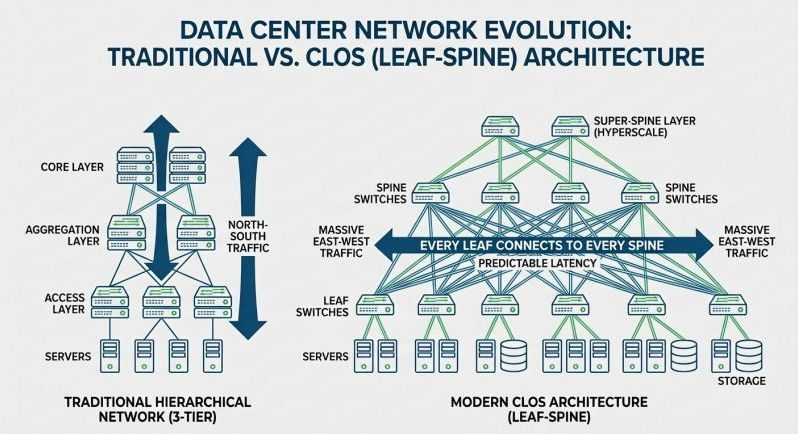
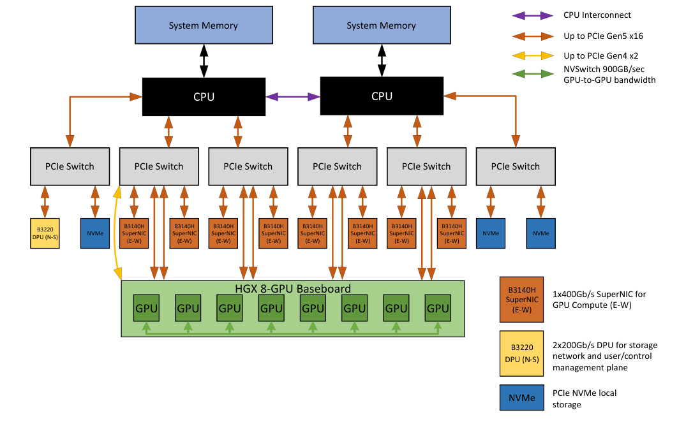
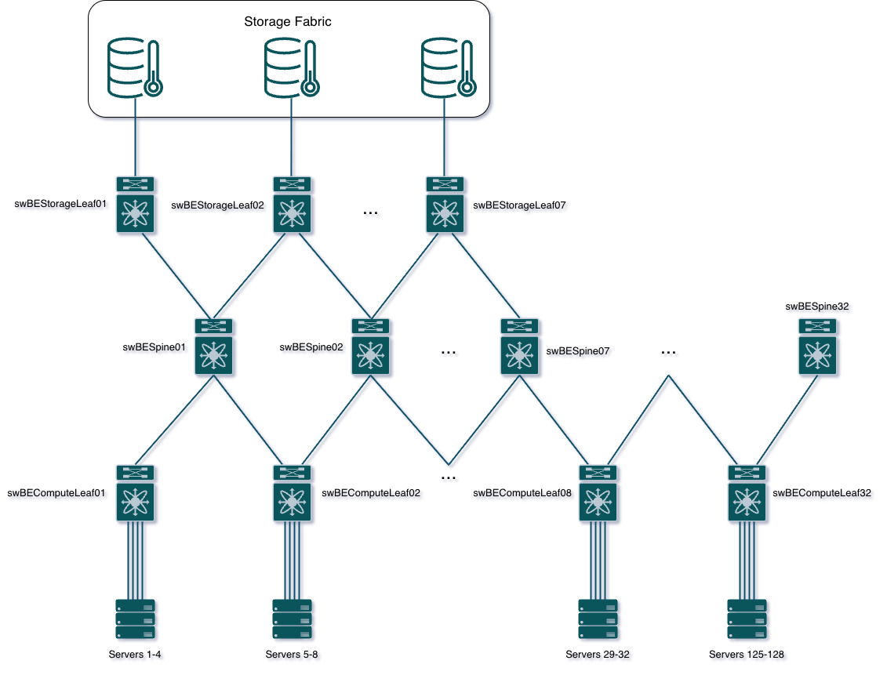
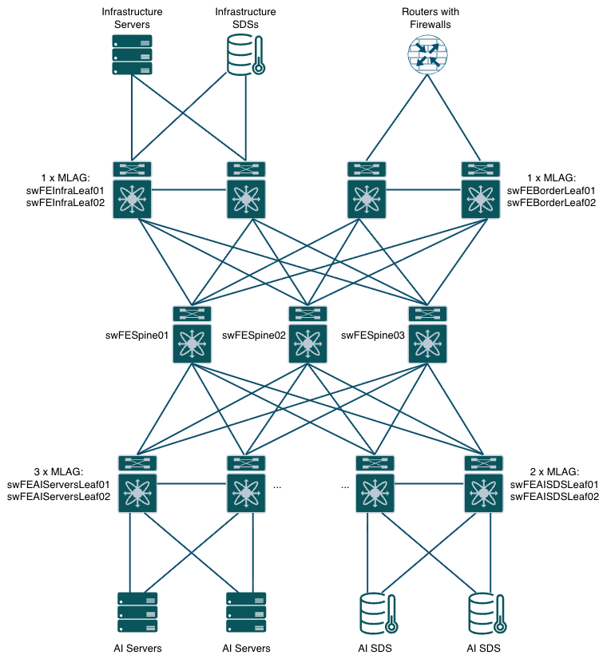
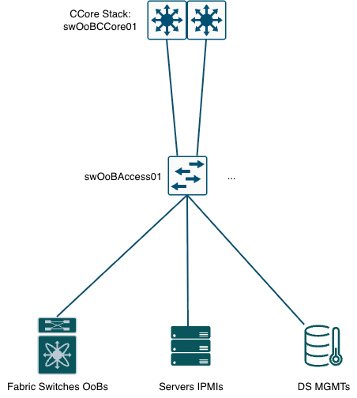
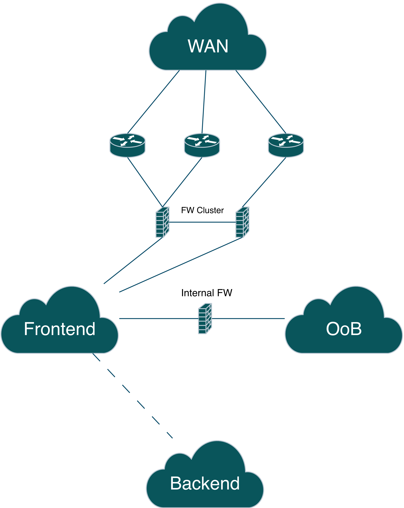

<p align="right">«Вещи, которыми ты владеешь, в конце концов овладевают тобой»
<p align="right">— Чак Паланик, «Бойцовский клуб»*

# Проектирование и автоматизация развертывания высокопроизводительной AI-фабрики ЦОД на базе оборудования Arista с мультивендорной интеграцией бэкэнда и оркестрацией через ZTP и Ansible

## Цель работы
Проектирование архитектуры и разработка комплексной системы автоматизированного развертывания высокопроизводительной мультивендорной AI-фабрики ЦОД на базе оборудования Arista для минимизации задержек сетевого транспорта и исключения человеческого фактора при пусконаладочных работах.

## Задачи работы
Для достижения поставленной цели необходимо решить следующие задачи:
1. Проанализировать теоретические основы построения сетей для AI/ML-нагрузок (Artificial Intelligence/Machine Learning - искусственный интеллект/машинное обучение), специфику их трафика, а также провести сравнительный анализ транспортных протоколов InfiniBand и RoCEv2 (RDMA over Converged Ethernet).
2. Исследовать алгоритмы управления перегрузками (PFC, ECN) и механизмы адаптивной маршрутизации в высокопроизводительных коммутационных матрицах (ASIC Broadcom / Arista).
3. Спроектировать неблокируемую топологию Клоза (Fat-Tree) с коэффициентом переподписки 1:1, разработать схему Underlay-маршрутизации на базе протокола Unnumbered eBGP и профили QoS/RoCEv2.
4. Разработать методику мультивендорной интеграции сетевого оборудования Arista с вычислительными узлами (GPU-серверами) и системами хранения данных (СХД) сторонних производителей.
5. Спроектировать и реализовать архитектуру автоматического ввода в эксплуатацию (Zero Touch Provisioning), включая настройку обеспечивающих инфраструктурных сервисов (DHCP, HTTP).
6. Разработать декларативную конфигурационную модель фабрики (Single Source of Truth) на базе шаблонов Ansible Validated Designs (AVD) для автоматической генерации и валидации конфигураций сетевых устройств.
7. Развернуть демонстрационный стенд (в виртуальной среде vEOS) для верификации разработанной системы автоматизации и тестирования сетевого транспорта.
8. Оценить технико-экономическую эффективность внедрения разработанного решения, включая показатели сокращения времени развертывания сети (Time-to-Market) и снижения рисков конфигурационных ошибок.

## Состав работы
- Вступительное слово
- Теоретико-методологические основы построения сетевой инфраструктуры для распределенного обучения ИИ-моделей (AI-фабрик)
- 


### Вступительное слово
Развитие технологий искусственного интеллекта и больших языковых моделей (Large Language Model - LLM) привело к экспоненциальному росту объемов распределенных вычислений. Эффективность обучения таких моделей напрямую зависит от сетевой инфраструктуры ЦОД, так как задержки при синхронизации вычислительных узлов (так называемая проблема «сетевого барьера») могут создавать эффективный простой порядка 30–50% от суммарной мощности дорогостоящих графических процессоров (GPU). Традиционная сетевая архитектура 3-Tier не справляется с паттернами AI-трафика (All-Reduce, All-to-All), вызывающими мгновенные перегрузки (Incast). В этих условиях критически важным становится проектирование специализированных высокопроизводительных AI-фабрик (AI Fabrics) с поддержкой технологий сверхмалой задержки (RoCEv2, Infiniband) и механизмов предотвращения потерь пакетов (PFC, ECN). Из-за высокой сложности и масштабов таких сетей ручная настройка оборудования неэффективна и ведет к ошибкам, что обуславливает необходимость сквозной автоматизации развертывания с использованием концепции Infrastructure as Code (IaC) на базе ZTP и Ansible в гетерогенных (мультивендорных) средах.

### Теоретико-методологические основы построения сетевой инфраструктуры для распределенного обучения ИИ-моделей (AI-фабрик)
На сегодняшний день технологии искусственного интеллекта (AI - Artificial Intelligence) и машинного обучения (ML - Machine Learning) стали ключевыми драйверами научно-технического прогресса. Проектирование и развертывание высокопроизводительных AI-кластеров является критически важной задачей для современной ИТ-инфраструктуры, поскольку обучение и работа больших моделей требуют специализированной аппаратной архитектуры и оптимизированных сетевых решений.

Технологии AI/ML опираются на понятие нейросети. В Wikipedia дается следующее определение:

> Нейросеть (или искусственная нейронная сеть) — это математический алгоритм и программа, созданные по принципу работы биологической нервной системы человека. Она состоит из множества связанных друг с другом вычислительных элементов — нейронов, которые обмениваются сигналами через числовые связи (синапсы).

С академической точки зрения нейросеть представляет собой направленный граф, вершинами которого являются математические модели искусственных нейронов (процессорные элементы), а дугами — синаптические связи, характеризующиеся весовыми коэффициентами.

Архитектурно, нейросеть организуется в виде многослойной конструкции, внешние два слоя которых (входной слой - Input layer и выходной слой - Output layer) предназначены для формализации интерфейса модели на, соответственно, получение информации и формирование выходного предсказания. Зажатые между ними скрытые слои (Hidden layers) осуществляют каскадные нелинейные преобразования над большим числом (миллиардами) связанных параметров, называемыми весами. Количество скрытых слоев определяеся моделью нейросети и, в большинстве своем, также является достаточно большим числом. 

С технической точки зрения, процесс обучения и работы таких моделей сводится к непрерывному выполнению низкоуровневых операций линейной алгебры — преимущественно матричного умножения (GEMM) и сложения тензоров. Несмотря на относительную простоту таких операций, их количество переводит процесс рассчета силами классических центральных процессоров (CPU) с их последовательной архитектурой в весьма долгий процесс - до сотни лет.

В противовес этому, графические процессоры (GPU), содержащие тысячи параллельных вычислительных ядер, позволяют значительно сократить этот процесс по времени (до считанных дней или недель), создавая, таким образом, техническое решение для сегмента AI.

Cовременные модели (LLM, генеративный AI) содержат сотни миллиардов параметров и физически не помещаются в локальную память (VRAM) одного графического ускорителя. Это вызывает необходимость объединения множества GPU в единый кластер для параллелизации вычислений.

В зависимости от того, с какими ограничениями сталкивается модель (нехватка скорости или нехватка памяти), вычисления распределяются по картам с помощью трех основных подходов:
1. **Параллелизм по данным (Data Parallelism)**: Метод, при которым нейросеть размещается в каждом GPU, а данные разбиваются на небольшие кусочки, называемые микро-батчами, с локальной обработкой в каждом GPU.

2. **Параллелизм по модели (Model Parallelism)**: Метод для больших нейросетей, когда дробится алгоритм самой нейросети между слоями (конвейерный параллелизм) или даже в рамках отдельных слоев (тензорный параллелизм). GPU выполняют работу над своей частью матрицы, но требуют моментального обмена и склейки результатов через сеть сразу после окончания операции.

Работа со сверхбольшими моделями представляет собой некоторую линейную комбинацию из этих методов, называемых 3D-параллелизмом, превращающим сотни GPU в одну монолитную вычислительную фабрику. Процесс обучения таких моделей называется распределенным (Distributed Training) и производится на кластерах из сотен или тысяч GPU.

Сам процесс обучения состоит из серии "прогонов" по всему объему обучающих данных и называется эпохой (Epoch), которых, в современных моделях требуется сотни и тысячи.

Эпохи также являются циклическими и состоят из последовательности процессов вычислений и проверок, производимых посредством ряда этапов с прямыми (Forward Pass) и обратными (Backward Pass) проходами (направленная итерация нейросети относительно полученных данных и формируемого предсказания), и усреднением с последующей синхронизацией (All-Reduce) градиентов между GPU кластера, для чего требуется высочайшая пропускная способность фабрики.

В некоторый период времени, называемый чекпоинт (Checkpoint), веса со всех GPU кластера сгружаются на сервера, в которые они установлены, и сохраняются на внешних надежных сетевых хранилищах. Эпоха содержит множество чекпоинтов, что накладывает определенные требования и на кластер и на средства хранения информации.

Важнейшей инженерной задачей при построении таких систем является организация межузлового взаимодействия (Inter-node interconnect). Необходимо понимать, что взаимодействие между GPU на современных решениях в процессе обучения производится напрямую между GPU, в то время, как процессы загрузки/выгрузки весов - через стандартные серверные среды, оркестрируемые, например, тем же Kubernetes.

С технической и экономической точек зрения, сеть современного AI-кластера четко делится на два контура (фабрики), имеющие собственные требования к среде передачи данных:
- **Front-end Network (Сеть управления и ввода-вывода)**: Фактически - это обычная Ethernet-сеть, используемая для загрузки начальных датасетов в кластер, управления нодами (SSH, Kubernetes), мониторинга и выдачи готовых ответов пользователям. Для нее характерны относительно небольшие пакеты, высокая чувствительность к задержкам подключения (RTT) и использование стандартного стека TCP/IP. Нагрузочные и технические требования которой соответствуют де-промо требованиям стандартной вычислительной фабрики.

- **Back-end Network (Фабрика межмашинного взаимодействия / AI-Fabric)**: Выделенная сверхвысокоскоростная сеть, связывающая GPU между собой (коэффициент переподписки 1:1). AI-кластер  генерирует колоссальный трафик типа `East-West`: во время фаз синхронизации градиентов (операции All-Reduce, All-to-All) сеть утилизируется на 100% полосы пропускания. Для снижения влияния и повышения отказоустойчивости, данную сеть ограничивают от остального трафика, так как если объединить эти фабрики, бэкенд-трафик полностью парализует работу фронтенда, вызывая потери пакетов и задержки для конечных пользователей. Выделенная AI-фабрика гарантирует предсказуемую производительность вычислений без влияния на внешние сервисы.

В современных AI-фабриках межузловое взаимодействие между GPU производится на сетевом уровне L3 (OSI) с использованием технологий RDMA (Remote Direct Memory Access) через протоколы RoCEv2 (RDMA over Converged Ethernet) или InfiniBand. Обе технологии используют RDMA или, конкретно, GPUDirect RDMA - технологию, которая позволяет сетевой карте (NIC) забирать данные напрямую из памяти GPU одного сервера и переносить их напрямую в память GPU другого сервера, минуя центральный процессор (CPU) и стек операционной системы.

В отличие от RoCEv2, которая изначально создавалась как L3-технология, инкапсулирующая RDMA-пакеты в стандартные IP/UDP-заголовки Ethernet (и маршрутизируется классическими коммутаторами по протоколу MP-BGP), технология InfiniBand является исторически L2-архитектурой, из-за чего ей присуще более высокое быстродействие. Но это превосходство реализуется за счет повышения архитектурной сложности: сеть является специализированной и требующей контроллера - Subnet Manager. 

Различия между этими технологиями сведены в следующую таблицу.

*Таблица 1. Сравнительный анализ существующих технологий межузлового взаимодействия AI-фабрик*

| **Критерий** | **InfiniBand (IB)** | **RoCEv2 (RDMA over Converged Ethernet)** |
|:-----|:-----|:-----|
| **Базовая технология** | Нативный протокол | Расширение Ethernet (L3/UDP) |
| **Управление потерями** | Кредитная система на физическом уровне (Credit-based flow control). Потери физически невозможны | Алгоритмы PFC (Priority Flow Control) и ECN требующие тонкой настройки |
| **Задержка** | Абсолютный минимум (аппаратный уровень) | Чуть выше, чем у IB за счет связки PCIe Switches - NIC и L3 инкапсуляции |
| **Стоимость и вендор-лок** | Очень дорого. Фактически монополия Nvidia (Mellanox) | Дешевле, открытый стандарт. Рыночные чипы (Broadcom Tomahawk 5, Cisco, Arista) |
| **Масштабируемость** | Сложнее масштабировать на десятки тысяч нод без спец-дизайна | Родной IP-роутинг позволяет масштабировать до гигантских дата-центров |

Как видно: с одной стороны чаши весов находится экосистема InfiniBand — закрытое решение, полностью контролируемое, фактически, одним производителем, что создает жесткие риски технологической зависимости (Vendor Lock-in). На противоположной, более перспективной чаше весов, расположен RoCEv2, который опирается на общедоступные стандарты Ethernet. Это позволяет развертывать AI-фабрики на базе высокопроизводительных коммерческих чипсетов (Broadcom Tomahawk 4/5, Cisco Silicon One) от независимых поставщиков под управлением открытых сетевых операционных систем (например, SONiC от Open Compute Project).

В долгосрочной перспективе, по моему мнению, эти весы окончательно склоняются в пользу Ethernet благодаря развитию консорциума Ultra Ethernet Consortium (UEC), который де-факто утвердил открытую архитектуру в качестве стратегического вектора развития AI-инфраструктуры.

С технической точки зрения RoCEv2 обеспечивает нативную интеграцию вычислительного контура в маршрутизируемые L3-сети (через стандартный BGP/ECMP) за счет инкапсуляции RDMA-пакетов непосредственно в заголовки IP/UDP. Это исключает необходимость внедрения сложных шлюзов или проприетарных контроллеров управления подсетями (Subnet Manager), обязательных для L2-архитектуры InfiniBand.

Использование L3 в RoCEv2-соединениях является следствием следующих причин:
- **Масштабируемость**: Сети L2 ограничены в размерах из-за архитектурного наличия широковещательного шторма и протоколов STP/RSTP, защищающих от него. Динамическая маршрутизация L3, например, BGP в архитектуре Clos / Fat-Tree, позволяет масштабировать кластер до тысяч GPU без проблем, существующих на уровне L2.

- **Балансировка нагрузки**: Использование ECMP (Equal-Cost Multi-Path) на уровне L3 обеспечивает равномерное распределение трафика по фабрике, исключая появление узких мест (oversubscription).

- **Отказоустойчивость**: Использование динамической маршрутизации L3 позволяет изолировать сбойные участки сети посредством динамического перестроения маршрутов трафика.

Однако, при всех описанных плюсах есть один момент, где RoCEv2 несколько проигрывает - это аппаратное управление перегрузками, которое в InfiniBand работает "из коробки" за счет жесткой проприетарной логики.
AI-сети, построенные на Ethernet (RoCEv2) с аналогичным функционалом должны опирается на следующие расширения:
1. **PFC (Priority Flow Control)**: Классический 802.3x Flow Control останавливает весь порт, PFC работает на уровне CoS (802.1p). Если буфер коммутатора переполняется трафиком (например, в очереди 3), коммутатор шлет назад кадр PFC PAUSE только для этой очереди, не трогая остальной трафик.

2. **ECN (Explicit Congestion Notification)**: Работает на L3. Когда буфер коммутатора начинает заполняться, он ставит бит `ECN` в IP-заголовке пакета. Принимающий сервер видит это и генерирует пакет `CNP` (Congestion Notification Packet) обратно отправителю, заставляя сетевую карту GPU превентивно снизить скорость отправки, не доводя до переполнения буффера.

3. **Балансировка трафика (Продвинутый ECMP)**: Стандартный ECMP балансирует по хэшу (IP, Port). Поскольку AI-потоков мало, но они огромные (Elephant flows), обычный хэш легко закинет несколько толстых потоков в один аплинк, а второй оставит пустым, что создаст состояние поляризации (Polarization). Для митигации этого используют технологию Adaptive Routing (динамическое перенаправление пакетов на менее загруженный линк на лету) или балансировку на уровне ячеек (Cell-based линки в фабриках типа Cisco Silicon One / Broadcom Jericho).

Подытоживая, аппаратная поддержка сквозного контроля перегрузок на базе PFC и ECN/CNP гарантирует создание беспотерьной среды (Lossless Ethernet), критически важной для межсерверных операций типа NCCL All-Reduce (NVIDIA Collective Communications Library All-Reduce), с производительностью и ультранизкими задержками, идентичными закрытым высокопроизводительным решениям. В масштабах эксплуатации дата-центра такой подход обеспечивает конвергентность инфраструктуры: для бэкенд и фронтенд контуров используется единый инженерный стек, общие инструменты автоматизации (Ansible, Terraform) и сквозной мониторинг (gNMI/INT телеметрия), что радикально снижает совокупную стоимость владения (TCO) и упрощает горизонтальное масштабирование кластера.

Однако обеспечение беспотерьности на транспортном уровне и унификация инженерного стека — это лишь половина системного решения. Чтобы описанные ранее механизмы могли эффективно предотвращать заторы, сама макротопология сети должна обладать колоссальным запасом пропускной способности и симметрии. 

Перед дальнейшим рассмотрением, необходимо ввести понятие переподписки, количественно описывающее уровень беспотерьности сети передачи данных.

> Коэффициент переподписки (Oversubscription Ratio) — это фундаментальная метрика сетевой архитектуры, определяющая отношение суммарной потенциальной пропускной способности всех нижестоящих портов коммутационного узла (направленных к конечным вычислительным узлам или устройствам доступа) к суммарной пропускной способности его вышестоящих портов (аплинков, направленных к магистрали или ядру сети).

Математически данный коэффициент выражается в виде пропорции `N:1`, где:
- N — коэффициент избыточности спроса на полосу пропускания,
- 1 — гарантированная единица емкости магистрального канала.

Если коэффициент составляет, например, `4:1`, это означает, что при одновременной попытке всех подключенных узлов передать данные на максимальной скорости линии, магистральный интерфейс сможет принять и обработать лишь 25% от общего объема входящего трафика.

В классических сетевых архитектурах (таких как 3-Tier, оптимизированных под трафик типа `North-South`) переподписка является осознанным инструментом экономической оптимизации, базирующимся на статистическом допущении, что в каждый конкретный момент времени большая часть серверов находится в режиме ожидания или утилизирует сеть лишь частично. Однако в высокопроизводительных вычислительных средах и AI-кластерах, где алгоритмы требуют синхронного обмена плотными массивами данных, любое значение коэффициента переподписки, отличное от `1:1` (Non-blocking / Line-rate), неизбежно приводит к буферизации, каскадному росту задержек и деградации производительности всего вычислительного комплекса.

Для распределенного обучения искусственного интеллекта, где доминирует лавинообразный горизонтальный трафик типа `East-West` (между вычислительными узлами), топология 3-Tier неприменима. Одновременный запуск коллективных сетевых операций (All-Reduce, All-to-All) мгновенно приводит к перегрузке («коллапсу») суженных участков сети с высокой переподпиской, вызывая массовые потери пакетов и резкий рост задержек.

В качестве фундаментального решения этой проблемы в ЦОД используется многоярусная топология Клоза (Clos Network), реализуемая по схеме Fat-Tree («Толстое дерево»). Теоретический принцип Fat-Tree заключается в том, что по мере движения от «листьев» дерева (Leafs, коммутаторов доступа) к его «корню» (Spine, магистральным коммутаторам), каналы связи становятся «толще» — не за счет увеличения скорости одного линка, а за счет строго пропорционального увеличения количества параллельных связей.



Анализируя макротопологии современных вычислительных систем, можно прийти к фундаментальному выводу: архитектура сетей для искусственного интеллекта и архитектура сетей общего назначения представляют собой два полярных, фактически ортогональных технологических решения, в то время как инфраструктура классического корпоративного дата-центра занимает между ними компромиссную промежуточную позицию.

Однако построение физической топологии — это лишь базис, который для эффективной работы современных ЦОД требует гибкого разделения сетевых ресурсов, реализуемого через виртуализацию сетей L2 поверх L3 (например, с помощью инкапсуляции VxLAN). Необходимость такого подхода продиктована тем, что классические L2-сети страдают от ограничений протокола STP (блокирующего параллельные линки Fat-Tree) и слабой масштабируемости, в то время как чистая L3-маршрутизация не позволяет свободно перемещать виртуальные машины и контейнеры с сохранением их IP-адресов. Чтобы решить эту проблему и объединить преимущества обоих подходов, сеть разделяют на два уровня: подстилающую сеть (Underlay) и наложенную сеть (Overlay). Назначение Underlay-уровня — обеспечить максимально быструю, отказоустойчивую L3-маршрутизацию и балансировку (ECMP) между физическими коммутаторами фабрики, формируя её жесткий «скелет». В свою очередь, Overlay-уровень работает поверх этой инфраструктуры, инкапсулируя исходные L2-кадры в L3-пакеты, что позволяет создавать изолированные, гибкие виртуальные L2-сегменты любого масштаба без привязки к физической топологии.

В качестве логического завершения данной теоретической главы необходимо рассмотреть архитектуру транспортного слоя фабрики. Ниже приведен сравнительный анализ протоколов динамической маршрутизации, применяемых для формирования топологической карты и обеспечения сходимости подстилающей сети (Underlay).

Я приведу табличное сравнение наиболее часто используемых протоколов подстилающей сети, а ниже - дам свои комментарии.

*Таблица 2. Сравнительная таблица наиболее распространенных протоколов Underlay*

| **Критерий** | **BGP Unnumbered** | **IS-IS** | **OSPFv2 / OSPFv3** |
|:---|:---|:---|:---|
| **Базовый стандарт IETF** | [RFC 5549](https://datatracker.ietf.org/doc/html/rfc5549) (Extended Next Hop), [RFC 4271](https://datatracker.ietf.org/doc/html/rfc4271) (BGP-4) | RFC 1195 (Использование в IP), [ISO/IEC 10589](https://www.iso.org/standard/30943.html) | [RFC 2328](https://datatracker.ietf.org/doc/html/rfc2328) (OSPFv2 для IPv4), [RFC 5340](https://datatracker.ietf.org/doc/html/rfc5340) (OSPFv3 для IPv6) |
| **Архитектурный тип** | **Path-Vector** (Дистанционно-векторный) | **Link-State** (Состояния канала) | **Link-State** (Состояния канала) внутри зоны / **Path-Vector** между зонами |
| **Уровень стека OSI** | **L4** (работает поверх 179/TCP) | **L2** (нативно на канальном уровне) | **L3** (инкапсулирован в IP-пакеты, используется мультикаст) |
| **Масштабируемость в Fat-Tree** | **Экстремальная**: миллионы маршрутов, до сотен тысяч GPU | **Очень высокая** в пределах одного домена/Level | **Ограниченная** из-за накладных расходов на LSA-флуд |
| **Скорость сходимости (Convergence)** | **Очень высокая** (при связке с BFD — [RFC 5880](https://datatracker.ietf.org/doc/html/rfc5880)) | **Экстремально высокая** (миллисекунды) | **Высокая** (но требует тонкого тюнинга таймеров) |
| **Защита от петель (Loop Prevention)** | **Нативная** (через AS-Path) | **Нативная** (алгоритм Дейкстры) | **Нативная** (алгоритм Дейкстры) |
| **Использование памяти (Memory Footprint)** | **Минимальное** для Underlay: хранит только префиксы Loopback-интерфейсов коммутаторов. Накладные расходы на соседство минимальны, так как нет тяжелых баз данных всей топологии | **Низкое / Среднее**: база данных состояния каналов (LSDB) оптимизирована за счет эффективных TLV-структур (Type-Length-Value). Потребляет меньше памяти, чем OSPF | **Высокое**: требует значительного объема RAM для хранения полной LSDB с множеством типов LSA-пакетов. Расход памяти растет пропорционально количеству линков в фабрике |
| **Наличие «слухов» (Routing Rumors)** | **Присутствует** (Специфика Path-Vector): коммутаторы не знают топологию всей сети, они «верят на слово» соседям, передающим им векторы путей (AS-Path); информация распространяется пошагово (Hop-by-Hop) | **Отсутствует** (Чистый Link-State): каждый коммутатор обладает точной, математически идентичной картой всей сети (LSDB); никаких «слухов» — только прямые факты о состоянии линков | **Отсутствует** (В пределах одной зоны): все коммутаторы внутри одной зоны имеют стопроцентную и идентичную информацию о топологии и не полагаются на «слухи», которые могут проявляться между зонами |
| **Параллельные ECMP-линки** | **Максимальное**: до 64 / 128 / 256 путей | **Высокое**: обычно до 32 / 64 путей | **Ограниченное**: обычно до 16 / 32 путей |
| **Дополнительные плюсы** | <UL><LI>**Zero-Touch конфигурация**: Автоподнятие сессий через IPv6 Link-Local <LI>**Идеальная изоляция**: Сбой на одном коммутаторе локализуется в рамках его ASN <LI>**Политики**: Гибкое управление трафиком через BGP-аттрибуты</UL> | <UL><LI>**Максимальная безопасность**: Работает на L2 (не имеет IP-адресов, устойчив к IP-атакам)<LI>**Сверхбыстрая сходимость**: Быстрее пересчитывает карту сети, чем OSPF <LI>**Гибкость**: Простая поддержка IPv4/IPv6 через TLV</UL> | <UL><LI>Знаком любому сетевому инженеру, колоссальная база знаний <LI>**Совместимость**: поддерживается абсолютно любым, даже устаревшим оборудованием</UL> |
| **Дополнительные минусы** | <UL><LI>**Медленная естественная сходимость**: требует обязательной связки с аппаратным BFD протоколом <LI>**Сложность отладки**: траблшутинг BGP без автоматизации на больших масштабах затруднен</UL> | <UL><LI>**Специфичный синтаксис**: требует сложной адресации NET (NSAP) для устройств <LI>**Дефицит кадров**: мало специалистов вне операторского (Telco) сектора <LI>**Нагрузка на CPU**: тяжелый алгоритм Дейкстры нагружает процессоры коммутаторов при сбоях </UL> | <UL><LI>**Шторм LSA** (Флудинг): при «мигании» (флапе, flap) одного линка весь кластер затапливается LSA-пакетами <LI>**Нагрузка на CPU**: тяжелый алгоритм Дейкстры нагружает процессоры коммутаторов при сбоях </UL> |
| **Сложность настройки** | **Средняя / Ниже среднего**: Zero-Touch через IPv6 Link-Local | **Средняя**: требует настройки NET-адресов | **Средняя**: требует планирования зон (Area) |
| **Использование в AI-фабриках** | Индустриальный стандарт (Meta, Microsoft, Google) | Редко (в гибридных HPC/AI архитектурах) | Практически не применяется |

Детально взвешивая информацию по представленным протоколам маршрутизации Underlay-подложки, для проектируемой AI-фабрики наиболее перспективным и технологически обоснованным решением является применение BGP Unnumbered (в соответствии со стандартами RFC 5549 и RFC 8950).

В условиях жестких требований распределенных вычислений к минимизации задержек и исключению пакетных потерь, Link-State протоколы (OSPF и IS-IS) обладают фундаментальным недостатком — необходимостью лавинообразной рассылки объявлений о состоянии каналов (LSA/LSP флуд) при любом изменении топологии и бОльшей нагрузкой на память и процессор коммутаторов, связанной с хранением и расчетом всей топологии сети Underlay. В крупных фабриках Clos / Fat-Tree, содержащих тысячи интерконнект-линков, это может привести к непредсказуемым всплескам времени сходимости сети.

Напротив, использование BGP Unnumbered полностью устраняет необходимость выделения и администрирования IPv4-подсетей для соединений типа "точка-точка" (Point-to-Point), используя механизмы автоматического обнаружения соседей по спецификации RFC 4861 (IPv6 Neighbor Discovery). Совместное использование BGP Unnumbered с протоколом детекции отказов BFD (RFC 5882) позволяет достичь субсекундного времени сходимости фабрики, минимизируя простои вычислительных узлов при аппаратных сбоях инфраструктуры».

Наиболее критическими элементами выступают планирование автономных систем (ASN) для протокола BGP, выбор типов соседства (iBGP/eBGP) и разработка системного плана IP-нумерации с учетом задела на долгосрочное расширение, которые значимо сказываются на скорости развертывания, быстроте и удобстве сопровождения построенной системы в условиях масштабирования.

Стоит отметить набирающий в последнее время популярность специализированный протокол RIFT (Routing in Fat-Trees), разработанный в рамках одноименной рабочей группы IETF и зафиксированный в стандарте [RFC 9696](https://datatracker.ietf.org/doc/html/rfc9696). В отличие от универсальных BGP или OSPF, RIFT изначально проектировался как анизотропный протокол, чувствительный к геометрии фабрики, и оптимизирован исключительно под регулярные топологии Клоза / Fat-Tree. Его главная цель — кардинально сократить объем избыточной маршрутной информации и автоматизировать обслуживание крупномасштабных вычислительных систем.

Техническая особенность RIFT заключается в гибридной архитектуре, объединяющей концепции разных классов протоколов в зависимости от направления трафика. При передаче информации «на север» (от Leaf к Spine) RIFT функционирует как классический Link-State протокол, заставляя нижестоящие узлы синхронизировать базы данных топологии с вышестоящими. Однако при передаче «на юг» (от Spine к Leaf) он ведет себя как Distance-Vector протокол, агрегируя всю информацию до единого маршрута по умолчанию (Default Route). В результате коммутаторы нижнего уровня практически освобождают свою оперативную память, зная только топологию своего локального окружения, в то время как полноценная маршрутная карта хранится на самом верху. При этом протокол нативно поддерживает автоматическое разрешение аварийных ситуаций: при отказе линка на верхнем ярусе Spine-коммутаторы отправляют вниз так называемые «отрицательные маршруты» (Negative Disaggregation), локально деагрегируя трафик в обход поврежденного узла.

К сожалению, на сегодняшний день протокол не имеет официальной поддержки со стороны «большой тройки» вендоров сетевых чипсетов и операционных систем для гиперскейлеров. Отсутствие готовых коммерческих реализаций в экосистемах Broadcom и Cisco делает внедрение RIFT в промышленные AI-фабрики рискованным шагом, оставляя его перспективной технологией будущего, в то время как стек BGP Unnumbered остается безальтернативным индустриальным стандартом.

### Рассчетная часть

#### Техническое задание
Настоящее техническое задание определяет комплекс требований к проектированию высокопроизводительной сетевой инфраструктуры (AI-фабрики) совокупной мощностью **1024 GPU**, развертываемой на базе 128 вычислительных узлов в архитектурной конфигурации по 8 GPU на один сервер. 

Конструктивное исполнение сетевой фабрики должно опираться на открытые, универсальные архитектурные принципы с использованием аппаратных платформ и операционных систем компании Arista Networks. Аппаратная связанность проектируемого комплекса жестко разделяется на три независимых физических и логических контура: бэкенд-сеть (вычислительный контур), фронтенд-сеть (сервисный контур), а также выделенную сеть удаленного управления (Out-of-Band) на базе медных портов 1G (IPMI карты серверов и Out-of-Band порты сетевого оборудования).

#### Общая часть
Вычислительное ядро комплекса формируется на базе современных AI-серверов, например, эквивалент NVIDIA DGX или аналогов от Supermicro/ASUS, содержащих 8 графических ускорителей (GPU).



Для обеспечения максимальной производительности, отказоустойчивости и информационной безопасности каждый вычислительный узел (сервер) оснащается строго регламентированным набором сетевых портов:

*Таблица 2. Итоговая таблица интерфейсов AI-сервера*

| **Контур сети** | **Кол-во портов** | **Скорость** | **Стек / Протокол** | **Примечание** |
|:---|:---:|:---:|:---|:---|
| **Compute/Backend (Вычисления)** | 8 | 400G | L3 RoCEv2 / GPUDirect RDMA | По одному на каждый GPU для моментального обмен градиентами между GPU соседних серверов и сохранения весов на выделенном СХД |
| **Frontend (Сервис/Хранилище)** | 2 | 25G | Стандартный TCP/IP | Оркестрация выделенного СХД и задач, доступ пользователей и других ИТ-служб ЦОД, сервисный контур Фронтэнда |
| **Management (IPMI / BMC)** | 1 | 1G (RJ45) | IPMI / Redfish | Мониторинг железа, датчиков температур и телеметрии; доступ к сетевой инфраструктуре через OoB-сеть |

Исходя из архитектурных особенностей вычислительных узлов (AI-серверов) и современных требований информационной безопасности, вся сетевая инфраструктура кластера должна быть физически разделена на 3 изолированных контура:
1. **Вычислительная сеть (Compute/Backend Fabric)**. Предназначена исключительно для межсерверного взаимодействия GPU (интерконнекта) при параллельных вычислениях (RDMA/RoCEv2). Данный сегмент критичен к задержкам и требует максимальной пропускной способности. В него объединяются 8х400 Гбит/с порты каждого сервера и высокоскоростные порты специализированной системы хранения данных. В целях безопасности и производительности этот контур должен быть полностью изолирован от внешней сети. Используется фиксированный коэффициент переподписки 1:1.
2. **Сеть клиентского доступа и данных (Frontend Network)**. Обеспечивает доступ пользователей к кластеру, интеграцию с системами хранения данных (СХД) и оркестрацию задач. Подключения производятся через 2х25 Гбит/с интерфейса. На данном периметре реализуются основные механизмы контроля доступа (Firewall, ACL) и мониторинга трафика, доступ к внешним сетям и подключение команд DevOps и SecDevOps.
3. **Сеть управления (Out-of-Band / IPMI Management)**. Выделенный сервисный контур для низкоуровневого администрирования серверов (KVM, мониторинг по низкоуровневой телеметрии, подключение к OoB интерфейсам сетевого оборудования, управление питанием). Подключается через 1 Гбит/с порты IPMI. С точки зрения безопасности этот сегмент требует строжайшей изоляции от Frontend и Backend сетей, а доступ к нему должен предоставляться только администраторам через доверенные шлюзы (VPN/Jump-хосты).

Учитывая значительные технологические различия указанных сетей, их рассчет и проектирование будет производиться раздельно. Однако, в целях унификации сетевой топологии, обеспечения прозрачности межкомпонентного взаимодействия и упрощения последующей эксплуатации инфраструктуры, разработан [единый сквозной план Underlay IP-адресации](#ip-план-сети-underlay-вычислительной-фабрики). Данный план охватывает все технологические контуры кластера: вычислительную фабрику (Backend), сеть клиентского доступа и данных (Frontend), а также выделенный сегмент удаленного администрирования (Out-of-Band Management).

Архитектурные принципы распределения адресного пространства, схемы нумерации интерфейсов, выделение автономных систем (ASN), а также методология масштабирования сети вынесены в отдельный специализированный раздел документа.

#### Анализ проблемы высокой плотности энергопотребления и тепловыделения
Развертывание высокопроизводительных вычислительных комплексов для искусственного интеллекта принципиально отличается от проектирования классических корпоративных ЦОД. Основным дестабилизирующим фактором является экстремальная плотность мощности современных AI-серверов.

В рамках данного проекта рассматривается 128 вычислительных узлов в архитектурной конфигурации по 8 GPU на один сервер. С учетом пиковой нагрузки на ускорители, центральные процессоры, высокоскоростную память и сетевые интерфейсы, энергопотребление одного такого сервера может составляет от 8 до 10 кВт.

При попытке использовать классический подход Top-of-Rack (ToR) с заполнением стандартного монтажного шкафа (42U) подряд (8–10 серверов), суммарная электрическая и тепловая нагрузка на одну стойку составит 80–100 кВт. Эксплуатация оборудования при такой плотности накладывает следующие критические ограничения:
1. **Невозможность воздушного охлаждения**: Физический объем воздуха, который необходимо прокачать через стойку мощностью более 35-40 кВт для удержания температуры компонентов в безопасном диапазоне, превышает аэродинамические возможности систем кондиционирования.

2. **Ограничения инфраструктуры ЦОД**: Подавляющее большинство существующих машзалов рассчитано на подведение средней мощности 7–15 кВт (редко до 25 кВт) на одно стойко-место. 

Для решения данной проблемы в проекте реализуется стратегия деконцентрации вычислительной мощности: плотность серверов ограничивается 4 узлами на одну монтажную стойку. Это фиксирует пиковую мощность AI-шкафа на уровне ~40 кВт. Для съема такого тепла предусматривается обязательное использование систем прямого жидкостного охлаждения (Direct-to-Chip Liquid Cooling, DLC) в комбинации с внутрирядными кондиционерами.

Ограничение плотности (4 сервера на стойку) приводит к тому, что в каждом AI-шкафу задействуется минимальное количество сетевых интерфейсов.

Cуществует 3 распространенных метода размещения сетевого оборудования:
1. **Классическая ToR-архитектура (Top-of-Rack)**. Все подключения производятся в рамках конкретного конструктива. Это обеспечивает наивысшие прозрачность и однозначность физической топологии, но обладает существенным недостатком: критически низкой утилизацией портов (Extreme-underutilization). Стоимость сетевой фабрики, при таком решении, возрастет в несколько раз. В срезе настоящего технического задания, в каждый AI-шкаф потребуется установить:
    - 1 Leaf-коммутатор AI-фабрики;
    - 2 Leaf-коммутатора Frontend-фабрики для реализации отказоустойчивого решения MLAG / EVPN-ESI.
    - 1 Access-коммутатор Out-of-Band Management сети.

2. **Архитектура EoR / MoR (End-of-Row / Middle-of-Row)**. Стойки объединяются в ряды. В начале или середине каждого ряда ставится сетевая стойка с нужным количеством коммутаторов Leaf и Access, к которым стягиваются кабели от серверов этого ряда. Следует отметить, что каждый тип фабрики потребует собственного количества коммутаторов, однако, используя арифметические функции НОД и НОК можно найти экстремальное значение заполнения коммутаторов фабрик и размер матрицы `ряды` * `стойки`. Физические подключения, в данном случае, делают с помощью DAC-кабелей соответствующей длины.

3. **Централизованная архитектура** с выделенными шкафами передачи данных (Network Racks) и подключениями через стационарную оптическую сеть. Данная архитектура предусматривает развертывание оптической сети нужной плотности с установкой ODF (Optical Distribution Frame - оптические полки) нужной плотности в TOR конструктива. Вся оптическая сеть сводится в один или несколько сетевых конструктивов, где и осуществляется подключение стандартными оптическими шнурами.

Централизованное архитектурное решение (вынос коммутаторов в выделенные Network Racks) обеспечивает максимальную эффективность использования портовой емкости сетевого оборудования. В отличие от децентрализованных схем, где порты коммутаторов неизбежно простаивают из-за ограничений тепловыделения и распределения серверов по стойкам, централизованная структура позволяет утилизировать интерфейсы со 100%-й плотностью, существенно снижая капитальные затраты (CAPEX) на построение фабрики.

С точки зрения эксплуатационной безопасности, физическое разделение серверной и сетевой зон предотвращает несанкционированный или случайный доступ сетевых специалистов к дорогостоящим вычислительным узлам. Консолидация сетевой инфраструктуры в чистой, технологически изолированной зоне полностью исключает риски механического повреждения элементов СХД или контуров жидкостного охлаждения серверов при проведении сетевых регламентных работ, что упрощает администрирование систем электропитания и кондиционирования ЦОД, а также позволяет развернуть структурированную кабельную систему высокой плотности на базе постоянных оптических магистралей.

Т.о., для последующих расчетов портовой емкости и топологии межкоммутационных связей ***за основу берется централизованное архитектурное решение***. 

#### Вычислительная сеть (Compute/Backend Fabric)
Проектирование бэкенд-сети, обслуживающей горизонтальный AI-трафик (чистый `East-West`), должно быть строго выполнено по двухъярусной многопутевой топологии Клоза (Fat-Tree) с неблокируемым коэффициентом переподписки `1:1`. Для межузлового взаимодействия GPU предписывается использование открытого транспорта RoCEv2 с обязательной поддержкой технологии GPUDirect RDMA в пропорции 1 GPU к 1 сетевому интерфейсу (NIC). Беспотерьность сетевой среды (Lossless Ethernet), критически важная для выполнения коллективных операций NCCL All-Reduce, должна обеспечиваться на аппаратном уровне механизмами канального приоритетного контроля потока PFC (Priority Flow Control, IEEE 802.1Qbb) и сквозного уведомления о заторах ECN (Explicit Congestion Notification).

Обеспечение бесконфликтной сетевой фабрики бэкенда логически предопределяет требования к подсистеме хранения данных (СХД), которая выполняет в AI-кластере две фундаментальные роли: непрерывную подачу обучающих выборок (датасетов) на расчетные узлы и высокоскоростную фиксацию промежуточных состояний нейросети (Checkpointing).

В AI-ориентированных инфраструктурах применение традиционных монолитных СХД корпоративного класса (SAN/NAS) технически невозможно. Согласно отраслевым архитектурным руководствам (в частности, NVIDIA DGX SuperPOD Storage Architecture Reference Guide), классические СХД с централизованными контроллерами и традиционными сетевыми протоколами (NFS/SMB) при столкновении с параллельными многопоточными запросами от сотен GPU неизбежно генерируют критические задержки ввода-вывода. На этапах итерационного перечитывания данных и особенно во время синхронной записи чекпоинтов, когда весь вычислительный процесс останавливается, медленная СХД провоцирует деградацию производительности и простой графических ускорителей (GPU Starvation).

В связи с этим для AI-вычислений предписывается внедрение специализированных распределенных параллельных программно-определяемых СХД (Software-Defined Storage, SDS). Их специализация обусловлена необходимостью сквозного параллелизма на уровне файловой системы (например, WEKA, Lustre или IBM Storage Scale), поддержки POSIX-совместимого многопоточного I/O и нативной интеграции с RDMA-сетью для исключения промежуточного кэширования в системной памяти хоста.

Современные компоненты распределенной СХД (Storage Nodes) аппаратно представляют собой унифицированные серверы стандартной архитектуры (x86/ARM), аналогичные по своей компоновке вычислительным узлам кластера, но адаптированные под профиль I/O-нагрузки. В их спецификации полностью отсутствуют дорогостоящие графические ускорители (GPU), однако вся емкость шасси и слотов расширения отведена под размещение максимальной плотности твердотельных накопителей высокой производительности класса NVMe SSD с интерфейсом PCIe 5.0. Таким образом, СХД масштабируется горизонтально: увеличение емкости и пропускной способности подсистемы хранения происходит линейно путем добавления новых аналогичных узлов в общую фабрику.

Для выполнения заявленных требований и исключения взаимного влияния разнородных типов трафика, каждый узел СХД оснащается изолированными сетевыми интерфейсами, разделяющими систему на бэкенд и фронтенд:
1. **Вычислительный интерфейс (Backend Data Plane)**: Реализуется через высокоскоростные порты RoCEv2 400G. Количество портов на одну ноду СХД (от 2 до 4) рассчитывается по принципу «снизу вверх» на основе суммарной полосы пропускания (Throughput) внутренней дисковой матрицы NVMe SSD, гарантируя, что пропускная способность сетевого интерфейса не станет ограничивающим фактором для потенциала дисков. Через данный контур передается «горячий» вычислительный трафик.

2. **Сервисный интерфейс (Frontend Control & Ingestion Plane)**: Подключается к выделенной сервисной сети Ethernet, где вычислительные сервера имеют адаптеры 2х25G. Данный уровень функционирует независимо от бэкенда и решает задачи внутрисетевого управления (In-Band Management): обеспечивает интеграцию ПО СХД с оркестраторами кластера (Kubernetes/Slurm) для динамического монтирования томов и сбора телеметрии. Также через фронтенд-порты сетевые шлюзы выполняют «холодную» загрузку первичных терабайтных датасетов из внешних репозиториев ЦОД в СХД и выгрузку финальных обученных моделей наружу.

Данную систему хранения строго не рекомендуется использовать как общее (разделяемое) хранилище с фронтенд-сегментом. Трафик Compute-СХД должен быть полностью изолирован от общих инфраструктурных задач, сервисов виртуализации и пользовательского доступа, чтобы исключить зашумление полосы (Noisy Neighbor) и гарантировать предсказуемые сверхнизкие задержки для RDMA/RoCEv2 в процессе обучения AI-моделей.

Поскольку сервисный трафик носит нерегулярный, но пиковый характер, расчет портовой емкости фронтенд-коммутаторов для СХД ведется по принципу «сверху вниз» и составляет фиксированную долю (20%) от общей портовой емкости сервисного сегмента вычислительного кластера, что гарантирует абсолютную изоляцию расчетной фабрики от заторов во внешних сетях.

Согласно [технического задания](#техническое-задание), мы получаем следующие нагрузочные коэффициенты:
- 1024 GPU — это 128 физических серверов.
- Каждый сервер имеет 8 выделенных сетевых интерфейсов вычислительной сети (по одному на каждый GPU) скоростью 400 Bbps каждый. Итого от одного сервера в сеть уходит 3.2 Tbps трафика.

Рассчитаем конфигурацию фабрики Клоза. Чтобы обеспечить фабрику без переподписки (без сужения каналов), мы строим схему, где суммарная скорость портов "вниз" равна скорости портов "вверх". Для этого используем следующий подход:
1. **Уровень Leaf вычислительного контура**:
	- Используем высокоплотные коммутаторы с 64 портами по 400G (или 32 портами 800G, разделяемыми на 400G) и делим портовую емкость поровну между аплинками и даунлинками, так как их мощность (полоса пропускания) эквивалентны. При этом мы получаем: 
    	- 32 порта идут вниз к серверам (это 4 сервера по 8 портов в каждом)
	    - 32 порта идут наверх к Spine-коммутаторам.
	- _Итого нам нужно_: `128 серверов / 4 сервера на Leaf = 32 Leaf-коммутатора`.

2. **Уровень Leaf контура хранения данных**:
    - Используем те же коммутаторы Leaf, что и для вычислительного контура:
        - Требуемая полоса СХД: 1024 * 400 * 0.2 = 81.92 Tbps.
        - Количество портов GDS на нативной скорости 400G: 81920 Gbps / 400 Gbps = 206 (портов).
        - Количество коммутаторов уровня Leaf: 206 / 32 = 6.4 (коммутаторов) = 7 (коммутаторов).
    - _Итого нам нужно_: 7 Leaf-коммутаторов`.

3. **Уровень Spine**:
	- Каждый Leaf должен быть соединен с каждым Spine одинаковым количеством линков.
	- Поскольку у каждого из Leaf коммутаторов есть 32 аплинка наверх, нам идеально подходят 32 Spine-коммутатора (таких же, на 64 порта 400G), при этом от каждого Leaf идет ровно по 1 линку 400G к каждому из 32 Spine.
    - Увеличение количества коммутаторов уровня Spine производиться не будет в силу того, что процесс взаимодействия с хранилищем ограничен по времени и является эпизодическим.
    - _Итого нам нужно_: `32 Spine-коммутатора`.

Для обеспечения гарантированной доставки RoCEv2 трафика хранения данных без потерь (Lossless Ethernet) и исключения простоев вычислительных узлов, на уровне доступа AI-фабрики активируется технологический стек DCB (Data Center Bridging). Конфигурация Leaf-коммутаторов включает в себя применение механизмов PFC (Priority Flow Control - IEEE 802.1Qbb) для поочередной приостановки трафика хранения, ECN (Explicit Congestion Notification - RFC 3168 / RFC 5033) для упреждающего сигнализирования о перегрузках оконечным узлам, и ETS (Enhanced Transmission Selection - IEEE 802.1Qaz) для строгого выделения и резервирования 20% полосы пропускания под контур СХД в моменты пиковых нагрузок. Для этого, весь трафик в фабрике (RoCEv2 / NVMe-oF) помещается в класс обслуживания (DSCP 26 / Traffic-Class 3) с жестким резервированием 20% полосы пропускания механизмами ETS. Это гарантирует передачу тяжелых массивов данных абсолютно без потерь и с минимальной задержкой, защищая буферы коммутаторов от перегрузок при лавинообразном сохранении весов AI-моделей.

Идеальным решением является коммутатор Arista 7060X5 на 64 порта 400GbE QSFP-DD / OSFP, а схема вычислительной фабрики приобретает следующий вид:



В текущей схеме на каждом из 32 Spine-коммутаторов занято всего по `32 + 7 = 39` портов. Это значит, что еще `32 - 7 = 25` портов на каждом Spine остаются свободными. Ввиду этого факта существует два основных сценария расширения фабрики без нарушения правила неблокируемости (переподписка `1:1`):
1. **Экстенсивное некратное расширение до 1704 GPU - 213 серверов**. Это самый простой способ, который утилизирует свободную емкость текущих Spine-коммутаторов. Этот шаг позволит масштабировать кластер, без установки новых Spine-коммутаторов.

2. **Масштабирование свыше 213 серверов (Переход на 3-й ярус: Super-Spine)**. При расширении фабрики на бОльшее количество GPU, классическая двухъярусная схема Leaf-Spine упрется в физический лимит портов на коммутаторах ядра. В этом случае текущую фабрику проще перестроить в трехъярусную сеть, чем производить замену коммутаторов на оборудование с бОльшим количеством портов. Такая схема позволяет масштабировать сеть практически неограниченно (до десятков тысяч GPU), сохраняя неблокируемую архитектуру `1:1`, но требует кратного увеличения оптических линков и закупки новых коммутаторов уровня Super-Spine.

На уровне маршрутизируемой подложки (Underlay) бэкенд-сети будем разворачивать протокол динамической маршрутизации BGP Unnumbered в соответствии со стандартами RFC 5549 и RFC 8950, функционирующий через механизмы автоматического обнаружения соседей по адресам IPv6 Link-Local (RFC 4861). Для распределения плотных потоков данных по магистрали фабрики требуется активация алгоритма балансировки ECMP в сочетании с механизмами адаптивной маршрутизации Arista, динамически перенаправляющими трафик в обход локальных перегрузок буферов.

Использование BGP Unnumbered позволяет отказаться от планирования IP-адресации для пиринговый линий (p2p), соединяющих коммутаторы разных уровней, что позволяет снизить объем RIB/FIB сетевого оборудования.

Подключение вычислительных узлов осуществляется по схеме `L3 Single-Homing` с использованием BGP Unnumbered. Изоляция арендаторов (мультитеннантность) реализуется на сетевом уровне с помощью технологии VRF-Lite (без использования оверлейных протоколов инкапсуляции типа VxLAN) посредством изоляции BGP-сессий на соответствующих наборах интерфейсов (по одному надору на тенант или один общий), либо на уровне оркестрации вычислительных задач (Host-based multitenancy) в плоской L3-сети.

Вычислительные ноды и ноды хранилища передают свои IP-адреса с маской /32 через L3 Point-to-Point (p2p) подключение с фабрикой, автоматически попадая в соответствующие контексты маршрутизации (VRF) на Leaf-коммутаторах. Разработка статического плана IP-адресации самих нод не входит в данное изложение; распределение, сигнализация и динамическое изучение этих адресов инфраструктурой фабрики осуществляются непосредственно средствами протокола BGP.

На данных стыках протоколы L2 (MCLAG, vPC, STP) не используется. Отказоустойчивость линков на этом уровне отсутствует, изоляция сбоев (fault domain) сужена до одного порта/кабеля.

#### Frontend сеть
В отличие от технологических контуров вычислительной сети (Backend) и администрирования (Out-of-Band), которые функционируют в режиме строгой физической и логической изоляции, фабрика клиентского доступа и данных (Frontend Network) является пограничным сегментом. Она проектируется с учетом необходимости контролируемого взаимодействия с сетями общего пользования (Интернет) и смежными сегментами корпоративной инфраструктуры.

Frontend-фабрика является многофункциональной кросс-платформенной средой и отвечает за обеспечение следующих ключевых технологических процессов:
1. **Высокоскоростной межсерверный обмен данными (Трафик `East-West`)**:
	- ***Оркестрация процессом синхронизации весов и коэффициентов модели***: Управление прочессом  оперативного кэширования, сохранения контрольных точек (Checkpointing) и выгрузки коэффициентов нейросети между эпохами обучения на промежуточные серверы хранения (непосредственная передача данных осуществляется в бэкенд-сети).
	- ***Оркестрация и высокоуровневый менеджмент***: Передача служебных команд систем оркестрации вычислительных задач (Kubernetes, Slurm) для управления жизненным циклом контейнеров и распределения нагрузки на узлы.
	- ***Внутрикластерное взаимодействие разработчиков***: Обеспечение связи между инженерами данных (Data Engineers), DevOps-специалистами и исследователями ИИ (Data Scientists) в процессе совместной отладки распределенного кода осуществляется согласно общего концепта системы безопасности с административной изоляцией разных группа с использованием технологии VRF.

2. **Взаимодействие с внешним периметром (Трафик `North-South`)**:
	- ***Обслуживание конечных клиентов***: Прием и обработка входящих запросов к развернутым моделям со стороны внешних пользователей, приложений и микросервисов, запрашивающих результаты вычислений (Inference/Вывод).
	- ***Импорт исходных датасетов***: Загрузка массивов неструктурированных данных из внешних озер данных (Data Lakes, S3), корпоративных репозиториев и публичных источников для последующей подготовки и разметки.
	- ***Телеметрия и централизованный мониторинг***: Трансляция логов, метрик производительности и дампов памяти во внешние SOC-системы (SIEM) и платформы комплексного мониторинга инфраструктуры.

Централизованная архитектурная модель позволяет развернуть конвергентную фронтенд-сеть, разделив её на логическом уровне на изолированные подсистемы с использованием VRF-Lite на уровне L3 и VLAN на уровне L2. Каждая из этих подсистем решает строго определенный класс технологических задач кластера и обладает собственным профилем сетевой нагрузки.

Согласно архитектурным гайдам лидеров индустрии ([Cisco Validated Designs](https://www.cisco.com/c/en/us/td/docs/dcn/whitepapers/amd-cisco-ai-cluster-ra.html), [Juniper Networks](https://www.juniper.net/documentation/us/en/software/nce/ai-clusters-data-center-design/ai-clusters-data-center-design.pdf)), выбор целевого коэффициента делится на три сценария:
1. **Конвергентный фронтенд (Frontend + Storage)**. В современных AI-архитектурах сетевые интерфейсы хостов для управления и для СХД часто объединяют (например, в серверах уровня Nvidia HGX/H100/B200 выделяется пара резервных портов по 200G/400G под эти нужды).
    - ***Причина***: Во время фазы `Incast` (узлов одновременно читают одну и ту же партию датасета) или во время записи Чекпоинта (сохранения весов модели, когда терабайты данных лавиной сбрасываются из памяти GPU на диск), сеть фронтенда работает в режиме критического насыщения.
    - ***Рекомендуемый коэффициент***: `1:1` или максимум `2:1`. Любая задержка на фронтенде/хранилище в этот момент приведет к простою GPU, что делает обучение экономически неэффективным.

2. **Выделенный фронтенд только для LLM-обучения (Training)**. Если трафик систем хранения данных (Storage) вынесен в отдельную физическую фабрику (например, InfiniBand/RoCE под NVMe-oF), то фронтенд занимается чистой оркестрацией, отправкой API-команд и мониторингом.
    - ***Причина***: Трафик становится прерывистым, преобладают мелкие пакеты телеметрии. Потоки данных стабильны и предсказуемы.
    - ***Рекомендуемый коэффициент***: `3:1` или `4:1`. В редких случаях для гигантских кластеров допускается до 6:1, но архитекторы стараются избегать больших цифр, чтобы не создавать заторы (head-of-line blocking) для пакетов синхронизации планировщика Slurm/Kubernetes.

3. **Фронтенд для инференса (Inference / Serving)**. Когда ИИ-кластер используется не для обучения, а для промышленного исполнения готовых моделей (выдача ответов пользователям).
    - ***Причина***: Нагрузка кардинально меняется. Трафик становится похож на классический веб-датацентр: тысячи разрозненных пользовательских запросов (Mice flows) вместо гигантских "потоков-слонов" (Elephant flows). Здесь отлично работает статистическое мультиплексирование.
    - ***Рекомендуемый коэффициент***: `3:1` — стандарт де-факто, обеспечивающий баланс между стоимостью сетевого оборудования и гарантией низкой задержки (Ultra-low Latency), которая критична для real-time генерации (например, при стриминге токенов LLM пользователю).

Спроектированная фабрика фронтенда включает в себя следующие функциональные контуры:
1. **Сервисный контур AI-серверов (AI Nodes Connectivity Segment)**, предназначенный для подключения вычислительных узлов через интерфейсы общего типа 2×25G. По сути - это IP-трафик: для загрузки ОС, обмена служебными данными между контейнерами, управления, первичного распределения задач и т.д.

2. **Сервисный контур систем хранения данных (Storage Connectivity Segment)**. Данный контур был затронут в предыдущем пункте при описании применяемой специализированной SDS. Как говорилось ранее, данный сегмент разворачивается в рамках конвергентного фронтенда и выполняет роль глобального репозитория фабрики, изолируя дисковый трафик от высокочувствительной бэкенд-сети (400G). Через порты этого контура осуществляется первоначальная загрузка и препроцессинг сырых датасетов, поступающих из внешних сетей, а также регулярный сброс контрольных точек (чекпоинтов) и весов моделей в процессе обучения. В ходе итеративного вычислительного цикла данные из СХД считываются через интерфейсы фронтенда и с помощью технологии NVIDIA GPUDirect Storage (GDS) доставляются методом RDMA напрямую в высокоскоростную память GPU (HBM), полностью минуя центральный процессор сервера и не утилизируя ресурсы изолированного бэкенд-контура. Для обеспечения стабильности этого процесса на коммутаторах Arista Networks активируется функционал Lossless Ethernet (PFC и ECN). Весь трафик хранения (RoCEv2 / NVMe-oF) изолируется на логическом уровне в выделенный VLAN и класс обслуживания (DSCP 26 / Traffic-Class 3) с жестким резервированием 20% полосы пропускания механизмами ETS. Это гарантирует передачу тяжелых массивов данных абсолютно без потерь и с минимальной задержкой, защищая буферы коммутаторов от перегрузок при лавинообразном сохранении весов многомиллиардных AI-моделей.

3. **Инфраструктурный контур служебных серверов (Management & Orchestration Pod)**: Данный сегмент состоит из серверов и СХД общего типа, необходимого для работоспособности Фронтенд-фабрики:
	- Интерфейсы пользователя и оркестрация (например, JupyterHub, Open-WebUI, Kubernetes, Slurm-мастера).
	- Служебная инфраструктура (Core Services): DNS, DHCP, NTP, локальные репозитории/реестры образов (Registry).
	- Телеметрия и аудит: Prometheus, Grafana, ELK/EFK-стек (для сбора логов и метрик как с серверов, так и с коммутаторов Arista через протокол gNMI/Telemetry).

4. **Контур межсетевых соединений (Border Pod)**: точка сопряжения изолированной AI-фабрики с внешней сетью предприятия, корпоративным ядром или Интернетом. К этому сегменту подключаются межсетевые экраны (Firewalls), шлюзы безопасности и, при необходимости, пограничные маршрутизаторы.

Ввиду того, что используется конвергентное решение на базе RoCEv2, то желательно максимально повысить коэффициент переподписки для минимизации возможных заторов на стадии `Incast` - используем для дальнейших расчетов коэффициент `1:1` во всех контурах (сегментах) по-умолчанию и указываем иное, если требуется другое значение коэффициента.

##### Расчет сервисного контура AI-серверов
Исходя из [расчета AI-фабрики](#вычислительная-сеть-computebackend-fabric), имеем стартовую мощность фабрики в 128 AI-серверов и следующие рассчетные показатели:
- **Количество серверов**: 128 узлов.
- **Отказоустойчивость**: Каждый сервер имеет 2 сетевых адаптера общего типа, ввиду чего обеспечиваем отказоустойчивость подключения к фабрике.
- **Пропускная способность на сервер**: 50 Gbps (2 × 25 Gbps).
- **Коэффициент переподписки (Oversubscription)**: Строго `1:1`.

Для обеспечения отказоустойчивости можно использовать технологии канального уровня L2: MLAG или EVPN-ESI. Каждая из которых имеет своим особенности, собранные в следующей таблице:

*Таблица 3. Сравнительный анализ: Arista MLAG vs EVPN-ESI*

| **Критерий / Параметр** | **Arista MLAG (Multi-Chassis LAG)** | **EVPN-ESI (Ethernet Segment Identifier)** |
|:---|:---|:---|
| **Основа технологии** | **Проприетарный механизм Arista EOS**. Требует строго парной работы двух одинаковых или совместимых коммутаторов Arista | **Открытый стандарт (RFC 7432)**. Позволяет строить мультивендорные фабрики (Interoperability) |
| **Лимит масштабирования (Узлы)** | **Максимум 2 коммутатора** в одной логической паре (MLAG Domain) | **До 16 коммутаторов** (VTEP) на один Ethernet Segment (ES) в рамках Arista EOS |
| **Связанность плоскости управления (Control Plane)** | **Полная зависимость (Fate-sharing)**. Состояние синхронизируется локально между двумя шасси. Состояние MLAG не передается в BGP EVPN | **Полная независимость коммутаторов**. Вся координация и сигнализация состояний происходят распределенно через BGP Control Plane |
| **Физический линк синхронизации (Peer-Link)** | **Обязателен (Peer-Link)**. Задействует высокоскоростные порты (например, 2х100G) только для служебного трафика и MAC-синхронизации | **Не требуется**. Резервирование портов под Peer-Link отсутствует, вся фабрика используется для полезной нагрузки |
| **Сложность Control Plane фабрики** | **Низкая (Базовая)**. Меньше служебного трафика BGP. Обе коммутирующие фабрики видны для остальной сети как один логический VTEP (Shared IP) | **Высокая**. Создает дополнительную нагрузку на BGP (State Churn) из-за генерации большого количества маршрутов EVPN Type-1 и Type-4 |
| **Адресация VTEP** | **Общий IPv4/IPv6 адрес** (Shared VTEP IP / Anycast IP) для пары коммутаторов. Балансировка в Underlay через ECMP | **Уникальный IP-адрес** на каждом физическом коммутаторе-участнике ESI-LAG. Балансировка в Overlay |
| **Скорость сходимости (Convergence)** | **Высокая (на уровне LACP / Data Plane)**. Переключение при локальном сбое линка происходит мгновенно без перестроения BGP | **Зависит от BGP**. Для быстрого восстановления используются механизмы Mass-Withdraw (Type-1 routes), но сходимость завязана на протокол BGP |
| **Взаимодействие со Spanning Tree (STP)** | **Нативная поддержка** на уровне модулей интеграции (MSI). Устройства работают как единый Root Bridge | **Требует специфических настроек**, таких как создание логического «Super-Root» для корректной работы STP |

При выборе отказоустойчивого Dual-Homing подключения вычислительных AI-узлов к двум коммутаторам, технология Arista MLAG является более оправданным выбором, чем EVPN-ESI. Применение MLAG существенно оптимизирует плоскость управления (Control Plane) сетевой фабрики. Пара коммутаторов разделяет один общий Anycast VTEP IP, что сокращает количество VxLAN-туннелей в сети ровно в два раза и, в свою очередь, сокращает нагрузку на сеть при использовании HER-репликации за счет снижения количества репликаций.

Вся синхронизация MAC-адресов переносится из BGP в локальный канал связи, избавляя сеть от избыточных служебных маршрутов EVPN Type-1 и Type-4. Переключение трафика при авариях происходит локально на уровне LACP за единицы миллисекунд, вообще не затрагивая глобальный протокол BGP.

С другой стороны, внедрение MLAG накладывает ряд эксплуатационных ограничений и усложняет администрирование. Технология требует выделения дорогостоящего физического канала Inter-Chassis Link (Peer-Link) скоростью от 100G/400G.

Схема создает эффект связанности состояний (Fate-Sharing) между устройствами и требует абсолютной идентичности конфигураций параметров оверлея (VRF, VNI, VLAN) на обоих коммутаторах. Это повышает риски человеческой ошибки при ручной настройке. Кроме того, регламентное обновление операционной системы Arista EOS в паре MLAG проходит сложнее, а сама архитектура формирует жесткий вендорлок, полностью исключая использование оборудования других производителей в каждой отдельной паре коммутаторов.

Расчет портовой емкости Leaf-уровня:
1. **Потребность серверов (Downlink)**:
	- ***Всего серверов***: 128 единиц.
	- ***Интерфейсы на сервер***: 2 x 25 Gbps (подключаются в режиме MLAG All-Active к двум разным коммутаторам).
	- ***Общее количество портов доступа***: 128 * 2 = 256(портов по 25 Gbps).
	- ***Суммарная полоса пропускания серверов***: 256 * 25 Gbps = 6.4 Tbps.

2. **Потребность в аплинках (Uplink) для переподписки 1:1**:
	- Для обеспечения чистой переподписки 1:1 полоса аплинков должна быть не менее 6.4 Tbps.
	- Используя решение, гармонизированное с бэкенд-фабрикой (400 Gbps), получим: 6400 Gbps / 400 Gbps = 16 (портов) на весь контур.
    
3. **Емкость для Peer-Link (MLAG)**:
	- Для надежной синхронизации и пропуска BUM-трафика в между коммутаторами MLAG-пары закладываем 2 порта по 400 Gbps

##### Расчет сервисного контура систем хранения данных
При расчете данного контура, необходимо опереться на данные, полученные при расчете высокоскоростных портов SDS - плотность сервисных портов СХД, вообще говоря, будет совпадать с плотностью сервисных портов ввиду особенностей архитектурного решения.

Архитектура сетевой фабрики проектируемого AI-кластера базируется на принципе полного разделения трафика вычислений (Backend-сеть для "горячих данных") и трафика управления/сервисов (Frontend-сеть - "холодные 
данные").

Расчет портовой емкости Leaf-уровня:
1. **Потребность серверов (Downlink)**:
	- ***Общее количество портов доступа***: 206 (портов по 25 Gbps).
	- ***Суммарная полоса пропускания серверов***: 206 * 25 Gbps = 5.15 Tbps.

2. **Потребность в аплинках (Uplink) для переподписки 1:1**:
	- Для обеспечения чистой переподписки 1:1 полоса аплинков должна быть не менее 5.15 Tbps.
	- Используя решение, гармонизированное с бэкенд-фабрикой (400 Gbps), получим: 5150 Gbps / 400 Gbps = 13 (портов) на весь контур.
    
3. **Емкость для Peer-Link (MLAG)**:
	- Для надежной синхронизации и пропуска BUM-трафика в между коммутаторами MLAG-пары закладываем 2 порта по 400 Gbps

##### Расчет инфраструктурного контур служебных серверов (Infrastructure Nodes)
Обеспечение непрерывного функционирования, оркестрации и безопасности AI-фабрики возлагается на пул серверов общего назначения (инфраструктурного типа) и сопряженную с ними гибридную СХД. В рамках данного проекта эти компоненты разворачиваются справочно и выполняют роль фундаментального сервисного базиса кластера.

Инфраструктурные узлы агрегируют в себе критически важные общесистемные службы: планировщики задач и оркестраторы (Slurm, Kubernetes Control Plane), базовые сетевые сервисы (DHCP, DNS, NTP, IPAM), системы централизованной авторизации и аудита (RADIUS, TACACS+, Identity Management), а также программные комплексы мониторинга, глубокой телеметрии фабрики и информационной безопасности (Prometheus/Grafana, Arista CloudVision, SIEM/ELK-стек).

Связанная с Бэкенд-кластеро СХД общего назначения конфигурируется по гибридной технологии (высокопроизводительные SSD под базы данных и емкие HDD под архивы) и предназначается для долговременного хранения логов, аудиторских слепков, образов операционных систем и первичных "сырых" датасетов до их финальной очистки.

Каждый инфраструктурный сервер и контроллер СХД подключается к централизованным лиф-коммутаторам фронтенда через избыточные интерфейсы 2×25G с применением технологии Arista MLAG (Multi-Chassis Link Aggregation). Это гарантирует отказоустойчивость уровня Active-Active на физическом и логическом уровнях (LACP), распределяет входящие потоки телеметрии и обсервинга, а также исключает простои управляющего контура фабрики при проведении планового обслуживания или аварийном выходе из строя любого из Leaf-коммутаторов».

Расчет портовой емкости Leaf-уровня:
1. **Потребность серверов (Downlink)**:
	- ***Всего серверов***: 128 * 0.2 = 25.6 = 26 единиц.
    - ***Контроллеры СХД***: 2 узла.
	- ***Интерфейсы на сервер***: 2 x 25 Gbps (подключаются в режиме MLAG All-Active к двум разным коммутаторам).
	- ***Общее количество портов доступа***: (26 + 2) * 2 = 56 (портов по 25 Gbps).
	- ***Суммарная полоса пропускания серверов***: 56 * 25 Gbps = 1.4 Tbps.

2. **Потребность в аплинках (Uplink) для переподписки 1:1**:
	- Для обеспечения чистой переподписки 1:1 полоса аплинков должна быть не менее 1.4 Tbps.
	- Используя решение, гармонизированное с бэкенд-фабрикой (400 Gbps), получим: 1400 Gbps / 400 Gbps = 4 (порта) на весь контур.
    
3. **Емкость для Peer-Link (MLAG)**:
	- Для надежной синхронизации и пропуска BUM-трафика в между коммутаторами MLAG-пары закладываем 2 порта по 400 Gbps

##### Расчет пограничного контура (Border Leaf / Edge Pod)
Пограничный контур (Border Leaf / Edge Pod) проектируемой фабрики представляет собой изолированный архитектурный сегмент, развернутый на базе строго одной пары коммутаторов Arista Networks, объединенных в отказоустойчивый домен Arista MLAG, к которой подключаются исключительно стыки межсетевых экранов, Multi-Fabric-лучей и т.д.

В соответствии с отраслевыми стандартами построения современных фабрик, к данному контуру настоятельно не рекомендуется подключение любых конечных хостов, серверов или систем хранения. Это обеспечивает полную изоляцию внутренних вычислительных систем от внешних доменов отказов, сетевых штормов и лавинообразных пересчетов таблиц маршрутизации BGP, а также позволяет развернуть защищенную демилитаризованную зону (DMZ) на стыке с корпоративными межсетевыми экранами. 

Освобождение памяти аппаратных чипсетов (TCAM) от обслуживания абонентских MAC- и ARP-таблиц позволяет целиком сфокусировать ресурсы коммутаторов на высокоскоростной L3-маршрутизации и агрегации пограничного трафика.

Для обеспечения отказоустойчивости шлюзов по умолчанию на L3-стыках вместо классического VRRP применяется вендорская технология Arista VARP (Virtual ARP), реализующая симметричную обработку пакетов в режиме Active-Active на обоих пограничных узлах без избыточной нагрузки на их центральные процессоры. 

Архитектура пограничного контура изначально проектируется с прицелом реализации бесшовного межплатформенное масштабирования любым из существующих методов Multi-SiteX.

Для Border Leaf стандартом является коэффициент переподписки от 4:1 до 8:1 (в зависимости от емкости внешних каналов). Так как внешние каналы связи (WAN/Internet) всегда являются узким местом (Bottleneck) и имеют гораздо меньшую пропускную способность, чем внутренняя сеть дата-центра. Выделять под внешние аплинки половину портов мощного коммутатора 400G экономически нецелесообразно.

Для надежности мы берем 2 коммутатора (1 пару MLAG). Поскольку внешних стыков обычно немного (например, 4–8 портов 400G на всю пару), все остальные свободные порты этих коммутаторов можно использовать для аплинков к Spine, чтобы обеспечить максимальную полосу распределения трафика наружу. Для нашего расчета мы заложим стандартную пару Border Leaf.

##### Результирующая конфигурация Фронтенд-фабрики
Учитывая, что все подключения во фронтенд-фабрике осуществляются 25Gbps линками, наиболее оптимальным будет использование коммутатора
Arista DCS-7050X4-48Y-4DF, имеющего 48 портов 25G (SFP28) + 4 порта 400G (QSFP-DD).

Рассчитаем конфигурацию соединений Downlink:
- ***Полоса Downlink***: 48 × 25 Gbps = 1.2 Tbps.
- ***Количество портов Uplink***: 1.2 Tbps / 400 Gbps = 3 (порта для подклоючения к уровню Spine).
- ***Количество портов MLAG Peer-Link***: 4 - 3 = 1 (порт).

Такая конфигурация позволяет достичь 100% утилизации портов коммутатора при удовлетворительном уровне отказоустойчивости (за счет единственного Peer-Link'а).

Произведем полный перерасчет фронтенд-фабрики:
- ***Расчет сервисного контура AI-серверов***: 256 портов / 48 = 5.3 = 6 (коммутаторов Leaf) = 3 (пары MLAG)
- ***Расчет сервисного контура систем хранения данных***: 206 портов / 48 = 4.2 = 4 (коммутаторов Leaf) = 2 (пары MLAG)
- ***Расчет инфраструктурного контур служебных серверов***: 56 портов / 48 = 1.1 = 2 (коммутатора Leaf) = 1 (пара MLAG)
- ***Расчет пограничного контура***: 2 Leaf (1 пара MLAG). Используем модель Arista DCS-7050X4-32S (32 порта 400G), где 24 порта отдаются под внешние стыки, а 8 портов уходят на Spine, обеспечивая честную переподписку 3:1.
- ***Рассчет Spine коммутаторов***: Поскольку каждый внутренний Leaf использует ровно 3 аплинка, нам требуется всего 3 Spine-коммутатора 400G (Arista DCS-7060X5), унифицированных с коммутаторами бэкенд-фабрики.

Схема фронтенд-фабрики имеет следующий вид:



##### Сеть управления (Out-of-Band)
Сеть удаленного управления Out-of-Band (OoB) спроектирована как полностью изолированный физический сегмент, построенный по топологии Top-of-Rack (ToR). Главной задачей OoB-сети является обеспечение непрерывного, независимого от состояния основных фабрик доступа к интерфейсам администрирования, мониторинга и телеметрии всех аппаратных компонентов кластера. Архитектура сети принята 3-Tier.

В каждый монтажный шкаф (Rack) устанавливается выделенный коммутатор OoB уровня доступа с медными интерфейсами 1G Base-T. В данные коммутаторы централизованно включаются все служебные порты инфраструктуры: IPMI/iLO/iDRAC/XCC-платы удаленного управления серверов, выделенные порты управления контроллеров систем хранения данных (СХД), а также специализированные физические Management-порты управляющих плат всех сетевых коммутаторов вычислительной и фронтенд-фабрик.

Расчет сети управления:
- ***Расчет OoB вычислительной фабрики***:
    - В каждом шкафу вычислительной фабрики содержится по 4 сервера или SDS СХД. Используем Сisco Catalyst 9200L-24T с 24 1000Base-T портами и 4 10G SFP+.
    - Каждый шкаф содержит: 4 порта IPMI и порты систем мониторинга физического мониторинга инфраструктуры (PDU, датчики температуры и влажности).
    - _Всего коммутаторов_: (128 + 26) / 4 = 38.5 (коммутаторов Access) = 39
- ***Расчет OoB фронтенд фабрики***:
    - В каждом шкафу может содержаться до 47 серверов высокой плотности. Однако, использование СХД существенно снизит эту плотность, позволяя использовать коммутаторы с 48 1000Base-T портами и 4 10G SFP+ (Cisco Catalyst 9200L-48T).
    - _Всего коммутаторов_: 56 / 48 = 2 (коммутатора Access)
- ***Расчет OoB сетевых шкафов***:
    - Всего коммутаторов фабрик:
        - Вычислительной: 32 (Spine) + 39 (Leaf) = 71
        - Фронтенда: 3 (Spine) + 14 (Leaf) = 17
        - Шкафов Network: (71 + 17) / 1U / 45 = 1.9 = 2 (шкафа)
        - Агрегация OoB: (71 + 17 + 2) * 2 (линка) / 48 (портов/коммутатор) = 3.75 = 4 (коммутатора)
- ***Расчет агрегации OoB***:   
    - Всего коммутаторов Access: (71 + 3 + 2 + 4) = 81 (шт)
    - _Всего коммутаторов CollapsedCore_: В конфигурации Stack'а: 81 * 2 / 48 = 4 (коммутатора)

В качестве коммутаторов доступа можно выбрать следующие:
- Сisco Catalyst 9200L-24T для TOR в вычислительной фабрике (88 шт).
- Cisco Catalyst 9200L-48T для TOR в фронтенд-фабрике и сетевых шкафах (6 шт).
- Cisco Catalyst 9300X-48HX для агрегации (4 шт).

Схема OoB сегмента представлена ниже:


 
#### Архитектера сетевой безопасности
Обеспечение комплексной защиты и непрерывности вычислений в рамках AI-платформы базируется на концепции эшелонированной обороны (Defense-in-Depth) и жесткой изоляции разнородных технологических контуров на физическом, сетевом и транспортном уровнях. Инфраструктура кластера разделена на три независимые сетевые фабрики, для каждой из которых определен индивидуальный периметр и контекст безопасности.




*Таблица 4. Инженерное резюме политик безопасности фабрик*

| **Параметр безопасности** | **Фронтенд-фабрика (Frontend)** | **Сеть управления (OoB)** | **Вычислительная фабрика (Backand/Compute)** |
|:---|:---|:---|:---|
| **Связь с другими сетями** | **Присутствует** через основной файрвол на границе | **Ограниченна**:  подключена через дополнительный файрвол к сети фронтенд |**Полностью отсутствует** (AirGap) |
| **Топология фильтрации** | Router-on-a-Stick (Inter-VRF) + ACL на IRB (Intra-VRF) | Router-on-a-Stick | Отсутствует |


#### IP-план сети Underlay
Для подстилающей сети и OoB будем использовать приватную IPv4-сеть класса A 10.0.0.0/8.

Структура адреса:
`10.<DC>.<Type>.<Host>`

где:
- <DC> - определяет порядковый номер сайта/ЦОД (2 байта);
- <Type> - Тип устройства/сервиса (2 байта);
    - 00 - 99: Сети типа 


    00 - зарезервировано для Spine;
    - 01 - зарезервировано для Client Edge;
    - 02 - Server Edge;
    - 1хх - заразервировано для VTEP Edge;  
    - 255 - зарезервировано для Border Leaf.

*Таблица 4: Underlay Control Plane IPv4*

| Hostname | Type | If | IPv4/Mask |
|------------|-----------|-----------|-----------------|
| swSpine01 | Spine | Loopback0 | `10.1.0.1/32` |
| swSpine02 | Spine | Loopback0 | `10.1.0.2/32` |
| swLeaf01 | Leaf | Loopback0 | `10.1.2.1/32` |
| swLeaf02 | Leaf | Loopback0 | `10.1.2.2/32` |
| swLeaf03 | Leaf | Loopback0 | `10.1.2.3/32` |


#### Архитектера сетевой безопасности


[ Категория трафика ] ──> [ Инструмент изоляции (L3 VRF) ] ──> [ Точка контроля (NGFW на палке) ]
Используйте код с осторожностью.
1. На уровне L2/L3 (Сегментация): Объяснить, что под каждую категорию (например: 1. Разработчики, 2. Трафик СХД, 3. Публичный инференс) внутри общего Frontend-интерфейса сервера (2х25G) нарезается свой VLAN, который жестко изолируется в рамках своего VRF.
2. На уровне защиты (Zero Trust): Указать, что хотя сеть и смотрит в Интернет, трафик клиентов (N-S) терминируется строго в демилитаризованной зоне (DMZ) на балансировщиках нагрузки. Внутренний трафик (E-W) разработчиков проверяется локальными Anycast ACL на коммутаторах Leaf.
3. На уровне стыка зон (NGFW): Показать, что транзитным узлом для связи этих категорий между собой и с Интернетом является NGFW на палке, который осуществляет инспекцию пакетов, предотвращая компрометацию внутренних ресурсов ИИ-кластера из внешнего мира.


на базе 128 специализированных серверных узлов высокой плотности в архитектурной конфигурации по 8 GPU на один физический сервер. В рамках проекта необходимо разработать комплексную сетевую архитектуру и произвести полный математический расчет портовой емкости, баланса пропускной способности каналов и топологической связности. Структура проектируемого комплекса должна предусматривать строгое разграничение сетевых контуров на три независимых физических и логических слоя: вычислительную бэкенд-сеть общего назначения для обеспечения межсерверного взаимодействия графических ускорителей, фронтенд-сеть для интеграции с внешними сервисами и подсистемами хранения данных, а также выделенную сеть для удаленного системного управления и сбора аппаратной телеметрии.

Взвешивая на инженерных весах различные концепции построения инфраструктуры для распределенных вычислений, ключевым приоритетом при разработке проекта является применение универсальных, открытых и вендоронезависимых решений. Архитектурное исполнение как бэкенд-, так и фронтенд-кластеров должно полностью исключать риски жесткой технологической зависимости (Vendor lock-in). Проектируемое аппаратное обеспечение и управляющее программное обеспечение сетевой фабрики обязаны опираться на общедоступные индустриальные стандарты и инициативы открытого кода (Open Source), гарантируя полную совместимость компонентов от независимых мировых поставщиков. Это стратегическое требование обеспечивает долгосрочную гибкость масштабирования дата-центра, независимость от логистических рисков отдельных производителей и оптимизацию совокупной стоимости владения системой.


Сервисный фронтенд-контур и контур управления должны быть спроектированы таким образом, чтобы их нагрузка была полностью изолирована от процессов интенсивного межузлового обмена, обеспечивая предсказуемость времени итераций и стабильность работы всего вычислительного кластера на 1024 GPU в круглосуточном режиме.


Сервисный фронтенд-контур, предназначенный для передачи трафика общего назначения (North-South) и выгрузки чекпоинтов весов, должен быть полностью физически изолирован от бэкенд-фабрики на уровне коммутации и кабельной инфраструктуры, что гарантирует предсказуемость задержек и времени итераций обучения.


---

К проекту!?


В рамках данного проекта в качестве технологического базиса для построения межузлового интерконнекта AI-кластера выбрана технология RoCEv2 (RDMA over Converged Ethernet v2). Данное решение разворачивается поверх L3-стандартизированной сетевой фабрики типа Leaf-Spine (Clos-топология). В отличие от InfiniBand, решение на RoCEv2 позволяет использовать классическую Ethernet-инфраструктуру, снижая совокупную стоимость владения (TCO) и упрощая масштабирование.
Связанность на сетевом уровне L3 обеспечивается за счет протокола динамической маршрутизации eBGP, где каждому коммутатору присваивается уникальный номер ASN, а адресация интерфейсов GPU выполняется в рамках выделенных подсетей IPv4/IPv6. Для утилизации всей полосы пропускания фабрики применяется механизм ECMP с поддержкой адаптивной маршрутизации (Adaptive Routing), распределяющий плотные потоки трафика (Elephant Flows) между Spine-коммутаторами на основе текущей загрузки их буферов.
Для гарантирования беспотерьной передачи данных (Lossless Ethernet), критически необходимой для NCCL/All-Reduce операций, на сетевом оборудовании реализуется гибридный механизм контроля перегрузок. На канальном уровне задействуется протокол PFC (Priority Flow Control) для изоляции AI-трафика в выделенном классе обслуживания и предотвращения дропов пакетов на интерфейсах. На сетевом уровне L3 внедряется механизм ECN (Explicit Congestion Notification) совместно с генерацией пакетов CNP (Congestion Notification Packets) на сетевых адаптерах (NIC), что обеспечивает сквозное динамическое регулирование окна отправки данных (Throttling) при возникновении заторов в ядре сети».


Важные технологические нюансы сметы:

1. Стоимость оптики: Обратите внимание, что оптическая коммутация (кабели AOC/трансиверы) составляет почти 15-20% от всей стоимости сети. На скоростях 400G/800G физика света становится одной из главных статей расходов.
2. Энергопотребление и стойки: 128 серверов высокой плотности нельзя поставить в стандартные серверные стойки подряд. Один такой ИИ-сервер потребляет около 6–10 кВт. Их распределяют максимум по 2-4 сервера на стойку, что потребует от 32 до 64 монтажных шкафов с обязательным жидкостным охлаждением (DLC) или внутрирядными кондиционерами.


Настройка Spine (Arista)
Spine автоматически принимает соединения от любых Leaf, используя динамический диапазон (Dynamic Peers) [RFC 4271].

```Spine
! Включаем маршрутизацию IPv6
ipv6 routing
!
router bgp 65001
   router-id 10.0.0.1
   !
   ! Настраиваем динамическую группу для приема любых Leaf по IPv6 Link-Local
   bgp listen range fe80::/10 peer-group LEAF-FABRIC as-remote-range 65100-65200
   !
   peer-group LEAF-FABRIC
      ! Включаем поддержку передачи IPv4 поверх IPv6 (RFC 5549)
      address-family ipv4
         next-hop encoding ipv6-address
         activate
      ! Разрешаем максимальное количество путей для ECMP
      maximum-paths 64 ecmp-as-path-lookup
```

Настройка Leaf (Arista)
Leaf просто указывает интерфейсы-аплинки, смотрящие в сторону Spine, не настраивая на них IP-адреса.

```Leaf
ipv6 routing
!
interface Ethernet1
   description UPLINK-TO-SPINE-1
   no switchport
   ipv6 enable
!
router bgp 65101
   router-id 10.100.1.1
   maximum-paths 64
   !
   ! Объявляем соседа прямо на физическом интерфейсе без указания IP
   neighbor Ethernet1 interface remote-as 65001
   !
   address-family ipv4
      neighbor Ethernet1 activate
      next-hop encoding ipv6-address
      ! Анонсируем сеть ИИ-серверов, подключенных к этому Leaf
      network 10.200.1.0/24
```


Часть 2. Настройка Lossless Ethernet (PFC и ECN) для RoCEv2
Для того чтобы тяжелый трафик ИИ (RoCEv2) передавался без единой потери пакетов, нам нужно настроить два механизма на коммутаторах:
1. PFC (Priority Flow Control): Если буфер коммутатора переполняется, он отправляет сигнал «ПАУЗА» на соседнее устройство, чтобы то временно прекратило отправку [IEEE 802.1Qbb].
2. ECN (Explicit Congestion Notification): Коммутатор ставит специальную метку в заголовке пакета, если видит зарождающийся затор. Сервер-получатель видит эту метку и просит сервер-отправитель снизить скорость [RFC 3168].
Поскольку трафик RoCEv2 маркируется тегом CoS 3 или DSCP 24 (CS3), мы должны изолировать его в выделенную очередь (Queue 3).

```
! 1. Настройка приоритезации и классификации трафика
dscp-to-queue map
   24 to queue 3
!
! 2. Включаем PFC (аппаратные паузы) для ИИ-трафика на интерфейсах
interface Ethernet1
   priority-flow-control mode on
   priority-flow-control watch dog action drop
   ! Назначаем PFC именно на приоритет 3 (где живет RoCEv2)
   priority-flow-control priority 3 no-drop
!
! 3. Настройка ECN (управление заторами через буферы)
qos profile AI-ROCE-PROFILE
   ! Если очередь 3 заполняется выше 500 Кб, начинаем метить пакеты (ECN)
   ! Если заполнение достигает 1500 Кб, маркируем 100% пакетов
   queue 3 ecn random-detect threshold 500 kbytes 1500 kbytes max-probability 100
!
! Применяем созданный QoS-профиль ко всей системе
system cfc default profile AI-ROCE-PROFILE
```


Как это работает в связке?

Когда тысячи GPU начинают фазу синхронизации (All-Reduce) и лавина данных летит через наш eBGP-андерлей, коммутаторы Arista/Cisco/Juniper отслеживают размер буферов в queue 3.
• Сначала срабатывает ECN: коммутатор мягко сигнализирует серверам: «Притормозите, буфер заполняется» [RFC 3168].
• Если затор слишком резкий («слоновий поток») и буфер вот-вот переполнится, мгновенно срабатывает PFC: коммутатор отправляет аппаратный кадр PAUSE назад к источнику [IEEE 802.1Qbb]. Передача замирает на микросекунды, буфер очищается, и ни один пакет ИИ не теряется.


Часть 1. Анатомия пакета RoCEv2 (RDMA over Converged Ethernet)

Технология RDMA (Remote Direct Memory Access) изначально создавалась для сетей InfiniBand. Ее главная фишка — возможность пересылать данные из оперативной (или GPU) памяти одного сервера в память другого напрямую, минуя процессор (CPU) и операционную систему обеих машин. Это снижает задержки до минимума.
RoCEv2 — это адаптация RDMA для стандартных сетей Ethernet. Чтобы данные могли маршрутизироваться через коммутаторы Leaf/Spine, их упаковывают в стандартный стек протоколов UDP/IP [RFC 7510].
Вот как выглядит структура пакета RoCEv2 изнутри (сверху вниз):

!!! Табличка
Уровень (Заголовок)	    Что внутри и зачем это нужно
Ethernet Header (L2)	Стандартные MAC-адреса. Тут же находится тег 802.1Q (CoS 3), который говорит коммутатору: «Это ИИ-трафик, примени к нему PFC (паузы)!» [IEEE 802.1Qbb]
IP Header (L3)	        Стандартные IP-адреса GPU-серверов. Здесь критически важен флаг DSCP (обычно 24 / CS3) для классификации и поле ECN (Explicit Congestion Notification) для маркировки заторов [RFC 3168].
UDP Header (L4)	        Порт назначения (Destination Port) всегда жестко равен 4791 (зарегистрирован IANA для RoCEv2) [RFC 7510]. Порт источника (Source Port) рассчитывается динамически как хэш от параметров сессии — это нужно, чтобы eBGP/ECMP на коммутаторах мог раскидывать разные потоки по разным линкам [RFC 4271].
BTH (Base Transport Header)	Специальный заголовок InfiniBand. Содержит QP (Queue Pair) — идентификатор виртуального канала связи между GPU, и PSN (Packet Sequence Number) для контроля порядка доставки пакетов.
Payload (Данные ИИ)	    Сами веса нейросети, градиенты или куски тензоров, которые пересылают видеокарты.
ICRC / FCS (Хвост пакета)	ICRC (Invariant CRC) — это дополнительная контрольная сумма, которая проверяет, что данные RDMA не повредились при маршрутизации (коммутаторы ИИ строго проверяют этот хвост).


Часть 2. Тестирование и симуляция заторов в ИИ-фабрике

Перед тем как запускать на кластере реальное (и безумно дорогое) обучение ИИ, сетевые инженеры обязаны провести стресс-тестирование (Stress Testing), чтобы убедиться, что PFC и ECN настроены правильно и сеть не дропает пакеты при перегрузках.
Обычный iperf3 здесь не подойдет: он работает через стандартный стек TCP/IP ОС и не умеет генерировать «чистый» RDMA-трафик, использующий обход CPU.

Инструменты для тестирования AI Fabrics

Для проверки RoCEv2-сетей используют специализированный софт от разработчиков сетевых карт (Mellanox/NVIDIA, Broadcom):

1. Утилиты Perftest (ib_send_bw, ib_write_bw)

Это золотой стандарт для тестирования RDMA-производительности [RFC 7510]. Они запускаются непосредственно на серверах с RoCEv2-картами.
• На Сервере-Получателе (Receiver):bash
# Запускаем тест пропускной способности в режиме ожидания
ib_send_bw -d mlx5_0 -i 1 --dscp 24
Используйте код с осторожностью.
(Здесь -d mlx5_0 — имя ИИ-сетевой карты, --dscp 24 — жестко маркируем трафик нужным тегом, чтобы коммутаторы обрабатывали его в Lossless-очереди).
• На Сервере-Отправителе (Sender):bash
# Запускаем генерацию трафика на IP получателя в 8 потоков (симулируем слоновий поток)
ib_send_bw -d mlx5_0 -i 1 --dscp 24 10.200.1.10 -n 1000000 -q 8
Используйте код с осторожностью.

2. Симуляция «Слоновьего затора» (Incast Congestion)

Самый жесткий тест для ИИ-сети — это Incast, когда 10 или 20 серверов одновременно начинают слать RDMA-пакеты на максимальной скорости (400G каждый) в сторону одного целевого сервера. Порт коммутатора, куда подключен этот сервер, мгновенно перегружается.
Что мы должны увидеть на коммутаторах Arista/Juniper во время теста:
1. Команда show qos counters должна показать рост счетчиков ECN CE (Congestion Experienced). Это значит, что коммутатор успешно ставит метки «затор» в IP-заголовок [RFC 3168].
2. Сервер-отправитель должен реагировать на ECN и снижать скорость (алгоритм DCQCN).
3. Если затор критический, команда show priority-flow-control должна показать отправленные кадры PFC PAUSE (Tx) на аплинках коммутатора [IEEE 802.1Qbb].
4. Главный показатель успеха: Счётчик Discards (сброшенные пакеты) на интерфейсах коммутатора должен оставаться строго равен 0.

Для того чтобы наша беспотерперостная сеть (Lossless Ethernet) работала как единое целое, настройки на коммутаторах (которые мы разобрали ранее) должны идеально совпадать с настройками на стороне серверов ИИ. Если сервер не поймет сигнал ECN, отправленный коммутатором, или проигнорирует кадр PFC, сеть начнет сбрасывать пакеты, и производительность кластера упадет.
Давайте разберем, как выглядит конфигурация алгоритма DCQCN (главного механизма управления заторами для RoCEv2) на стороне операционной системы Linux и как это стыкуется с сетевыми картами разных вендоров.


Часть 1. Настройка алгоритма DCQCN на серверах Linux

DCQCN (Data Center Quantized Congestion Notification) — это алгоритм, который работает на сетевой карте (NIC) сервера [RFC 7510]. Когда коммутатор маркирует пакеты меткой ECN (Congestion Experienced) [RFC 3168], сервер-получатель отправляет обратно специальный пакет уведомления (CNP — Congestion Notification Packet). Сервер-отправитель, получив CNP, мгновенно и ювелирно снижает скорость отправки именно этого потока, предотвращая переполнение буферов коммутатора.
Настройка DCQCN выполняется через утилиту управления трафиком ядра Linux — mstconfig, mlnx_qos (для NVIDIA/Mellanox) или стандартный инструмент devlink.

Шаг 1. Включение ECN для нужного приоритета (на примере RoCEv2 / CoS 3)

Мы должны сказать сетевой карте, чтобы она реагировала на метки ECN именно в третьей очереди (Queue 3).
Если мы используем карты NVIDIA ConnectX-6 / ConnectX-7:
bash
# Включаем кабельный PFC для приоритета 3 и активируем обработку ECN (DCQCN)
# --pfc: битовая маска для приоритета 3 (00001000 в двоичной = 8 в десятичной)
mlnx_qos -i mlx5_0 --pfc 8 --trust dscp --egress_map 24

# Тонкая настройка параметров DCQCN в драйвере (задается через sysfs)
# Указываем время задержки перед отправкой CNP-пакетов (в микросекундах)
echo 50 > /sys/class/net/eth0/ecn/roce_np/v2/cnp_dscp
echo 1 > /sys/class/net/eth0/ecn/roce_rp/v2/enable


Шаг 2. Ювелирная настройка параметров алгоритма

Чтобы сервер не снижал скорость слишком сильно (что вызовет простой GPU) или слишком слабо, инженеры настраивают три ключевых параметра DCQCN:
1. Rate Decrease (Снижение скорости): насколько резко падает скорость при получении CNP.
2. Rate Recovery (Восстановление скорости): как быстро сервер возвращается к исходным 400G/800G, когда затор исчез.
3. Alpha: коэффициент, определяющий степень жесткости затора.
bash
# Пример конфигурации параметров восстановления скорости на Mellanox/NVIDIA
# Увеличиваем шаг восстановления, чтобы сеть быстрее возвращалась на полную мощность после пиковых нагрузок
echo 10 > /sys/class/infiniband/mlx5_0/tc/3/rate_limit_quantum


Часть 2. Особенности настройки сетевых карт разных вендоров

Хотя логика RoCEv2 и DCQCN едина, у каждого вендора сетевых карт (NIC) есть свои нюансы управления в Linux.

1. NVIDIA / Mellanox (ConnectX-7 / BlueField-3 DPU)

Это самые популярные карты в ИИ-инфраструктуре.
• Особенность: Все алгоритмы обработки RoCEv2 «зашиты» в чипсет карты (Hardware Offload). Нагрузка на CPU хоста равна нулю.
• Для проверки того, что карта правильно видит настройки PFC от коммутатора Arista/Juniper, используется команда:bash
show_gids | grep -E 'RoCEv2|v2'
Используйте код с осторожностью.
Она покажет активные индексы таблиц маршрутизации RDMA.

2. AMD Pensando (Pollux / Elba)

Эту платформу сейчас активно внедряет HPE / Juniper как открытую альтернативу NVIDIA.
• Особенность: Это не просто сетевые карты, а полноценные DPU (Data Processing Units) на базе программируемой архитектуры P4.
• Настройка DCQCN и профилей очередей здесь выполняется не через стандартные утилиты Linux, а загрузкой специального P4-профиля прямо в память адаптера. Это позволяет менять логику работы ECN «на лету» без перезагрузки сервера ИИ.

3. Intel (Intel IPU / Columbiaville E810)

Часто используются в кластерах, ориентированных на инференс (вывод) моделей.
• Особенность: Конфигурация Lossless-режима выполняется через стандартную системную утилиту Linux devlink.
• Пример включения RoCEv2 на картах Intel:bash
devlink dev param set pci/0000:01:00.0 name roce_mode value 2 cmode runtime


Как проверить, что всё настроено правильно? (Итоговый чек-лист)

Когда фабрика (например, трехуровневый Clos на Juniper с RIFT или Arista с eBGP) запущена, а серверы настроены, выполните финальный тест с помощью утилиты ib_send_bw (о которой мы говорили в прошлом шаге) и посмотрите на статистику сервера:
bash
# Смотрим счетчики сетевой карты на сервере
ethtool -S eth0 | grep -E 'pfc_requests|ecn_marked|cnp'
Используйте код с осторожностью.
• rx_pfc_requests / tx_pfc_requests: Если эти счетчики растут, значит, механизм пауз PFC работает, коммутатор и сервер успешно защищают буферы от переполнения [IEEE 802.1Qbb].
• rx_cnp_handled: Если этот счетчик растет, значит, алгоритм DCQCN на сервере успешно ловит сигналы заторов от сети и плавно регулирует поток данных ИИ [RFC 7510].

---

Давайте разберем до мельчайших деталей, как оркестраторы координируют ИИ-нагрузки, как сетевая изоляция (EVPN/VXLAN) разделяет проекты и как защитить эту многомиллионную инфраструктуру с помощью файрволов (Firewalls).

1. Как Slurm и Kubernetes координируют работу двух сетей

Когда дата-инженер отправляет задачу: «Обучить модель на 256 GPU», оркестратор (например, Slurm или Kubernetes с плагином Kube-Share/MPI-Operator) запускает сложнейший двухконтурный процесс:

Контур 1: Управление (Корпоративная сеть)

1. Оркестратор через обычную сеть (10G/25G) отправляет команду на нужные 32 сервера (по 8 GPU в каждом).
2. На серверах разворачиваются Docker-контейнеры с фреймворком (например, PyTorch).
3. Через корпоративную сеть скачивается сам код скрипта обучения из Git и проверяется готовность видеокарт.

Контур 2: Вычисления (ИИ-сеть)

1. PyTorch инициализирует библиотеку NCCL (NVIDIA Collective Communications Library) или открытый аналог RCCL / OneCCL.
2. Эта библиотека «обходит» стандартную корпоративную сеть Linux. Она напрямую задействует драйверы RDMA (RoCEv2) и начинает транслировать гигантские потоки данных через наши 400G-интерфейсы и фабрику eBGP/RIFT [RFC 7510].
3. Корпоративная сеть в этот момент «отдыхает», а ИИ-сеть загружена на 100%


2. Сетевая изоляция: EVPN / VXLAN в корпоративном контуре

В крупной компании ИИ-кластер делят между разными командами (например, команда LLM-исследований и команда Компьютерного зрения). Их данные и процессы должны быть строго изолированы друг от друга из соображений безопасности.
Для этого в корпоративном контуре (Frontend) разворачивается технология EVPN/VXLAN:
• VXLAN (Virtual Extensible LAN): Инкапсулирует обычный L2-трафик серверов в L3 UDP-пакеты. Это позволяет создавать до 16 миллионов изолированных виртуальных сетей (VNI) поверх одной физической инфраструктуры.
• EVPN (Ethernet VPN): Использует протокол BGP в качестве плоскости управления (Control Plane), чтобы коммутаторы автоматически обменивались информацией о том, за каким Leaf-коммутатором находится конкретный контейнер с ИИ.

Пример конфигурации виртуальной сети (VRF) для ИИ-команды на Arista EOS (Frontend)

none
! 1. Создаем изолированную таблицу маршрутизации (VRF) для ИИ-проекта
vrf instance AI_PROJECT_LLM
!
! 2. Создаем VXLAN-интерфейс для инкапсуляции трафика
interface Loopback1
   description VTEP_Source_IP
   ip address 10.255.0.1/32
!
interface Vxlan1
   vxlan source-interface Loopback1
   ! Привязываем сегмент VXLAN (VNI 10001) к нашему ИИ-VRF
   vxlan vrf AI_PROJECT_LLM vni 10001
!
! 3. Настраиваем EVPN (BGP) для автоматического анонсирования клиентов
router bgp 65000
   vrf AI_PROJECT_LLM
      rd 10.255.0.1:10001
      route-target import evpn 10001:10001
      route-target export evpn 10001:10001

Результат: Трафик команды LLM полностью изолирован внутри туннеля VXLAN. Даже если они случайно перепутают IP-адреса, они никак не смогут перехватить или испортить данные другой команды.


3. Информационная безопасность (Firewalls) в ИИ-кластерах

Безопасность ИИ-инфраструктуры имеет свою жесткую специфику. Стоимость весов современных моделей (например, GPT-4 или Llama-3-70B) исчисляется миллионами долларов, и их кража — главный кошмар бизнеса.
Сетевые экраны (Firewalls) устанавливаются по периметру корпоративного контура. В саму ИИ-сеть (Backend) ставить классические файрволы категорически запрещено, так как ни один межсетевой экран в мире не способен обрабатывать терабитный трафик RoCEv2 с наносекундной задержкой без потери пакетов [RFC 3168, RFC 7510].

 [ Внешний Интернет / Корпоративная сеть компании ]
                        |
                        v
         +-----------------------------+

         | Next-Generation Firewall    |  <-- Фильтрация трафика, проверка на вирусы,
         | (Palo Alto / Fortinet / NGFW)|      защита от утечки данных (DLP)
         +-----------------------------+
                        |
      +-----------------+-----------------+

      |                                   |
      v                                   v
[ Frontend Fabric ]              [ Storage Fabric ]
(Управление, Kubernetes,         (NVMe-oF / Быстрая СХД)
 SSH, API для пользователей)               |

      |                                   |
      +-----------------+-----------------+
                        |
                        v
               [ GPU СЕРВЕРЫ ИИ ]
                        |
         ===============================
         [  AI Backend Fabric (RoCEv2) ]  <-- Абсолютно изолированный «остров» 
         ===============================      внутри ЦОД. Сюда нет доступа извне.


Ключевые зоны контроля безопасности:

1. Зона Инференса (API Gateway): Когда обученная модель отдает ответы пользователям, трафик обязательно проходит через NGFW (Next-Generation Firewall). Файрвол проверяет запросы на наличие ИИ-инъекций (Prompt Injection) и вредоносного кода.
2. Защита от утечек (DLP — Data Loss Prevention): На файрволах настраиваются строгие правила: ИИ-серверам запрещено напрямую инициировать сессии во внешний интернет. Они могут только принимать задачи от Kubernetes. Это исключает ситуацию, когда взломанный сервер начнет «сливать» веса обученной нейросети на сторонний сервер в интернете.
3. Сегментация СХД: Доступ к хранилищу датасетов (СХД) жестко ограничивается. Доступ на чтение/запись выдается только конкретным IP-адресам серверов, на которых в данный момент Slurm запустил легитимную задачу обучения.


---


---

Что конкретно настраивает сетевой инженер в RoCEv2 сетях?


---


Сетевая архитектура и необходимость разделения кластеров

Связь и разделение!!?!?!? кто с кем связывается?

Да, как подключаются сервера?


Что такое FP8???


swBESpine01
swBEComputeLeaf01 - 
swBEStorageLeaf01 - 

swFESpine01
swFEComputeLeaf01
swFEInfraLeaf01
swFEBorderLeaf01

swOOBCore01
swOOBTOR01

fw!!!


