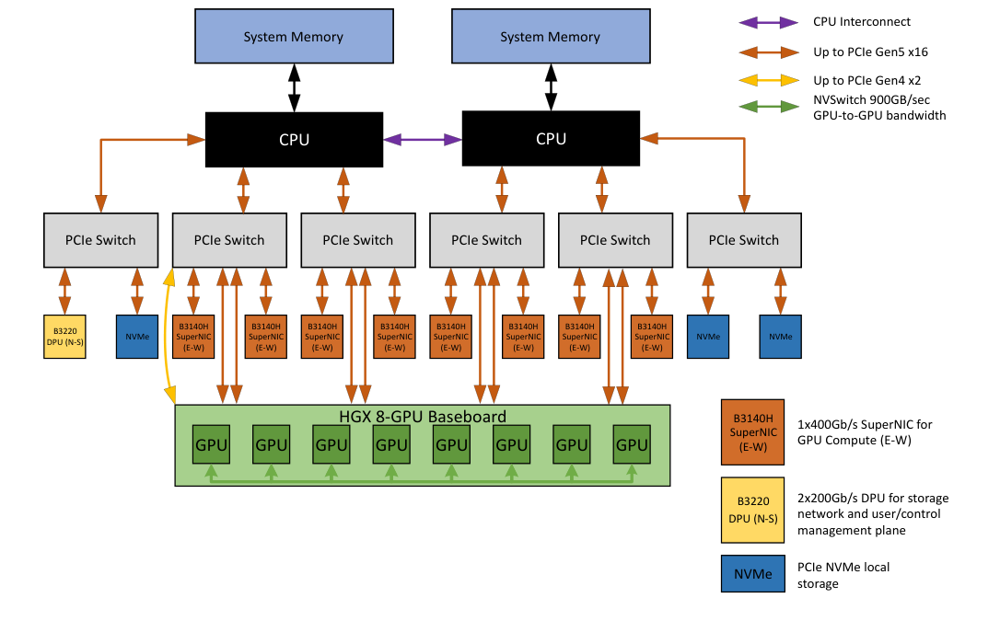

### Настройка Spine (Arista)
Spine автоматически принимает соединения от любых Leaf, используя динамический диапазон (Dynamic Peers) [RFC 4271].

```Spine
! Включаем маршрутизацию IPv6
ipv6 routing
!
router bgp 65001
   router-id 10.0.0.1
   !
   ! Настраиваем динамическую группу для приема любых Leaf по IPv6 Link-Local
   bgp listen range fe80::/10 peer-group LEAF-FABRIC as-remote-range 65100-65200
   !
   peer-group LEAF-FABRIC
      ! Включаем поддержку передачи IPv4 поверх IPv6 (RFC 5549)
      address-family ipv4
         next-hop encoding ipv6-address
         activate
      ! Разрешаем максимальное количество путей для ECMP
      maximum-paths 64 ecmp-as-path-lookup
```

Настройка Leaf (Arista)
Leaf просто указывает интерфейсы-аплинки, смотрящие в сторону Spine, не настраивая на них IP-адреса.

```Leaf
ipv6 routing
!
interface Ethernet1
   description UPLINK-TO-SPINE-1
   no switchport
   ipv6 enable
!
router bgp 65101
   router-id 10.100.1.1
   maximum-paths 64
   !
   ! Объявляем соседа прямо на физическом интерфейсе без указания IP
   neighbor Ethernet1 interface remote-as 65001
   !
   address-family ipv4
      neighbor Ethernet1 activate
      next-hop encoding ipv6-address
      ! Анонсируем сеть ИИ-серверов, подключенных к этому Leaf
      network 10.200.1.0/24
```


Часть 2. Настройка Lossless Ethernet (PFC и ECN) для RoCEv2
Для того чтобы тяжелый трафик ИИ (RoCEv2) передавался без единой потери пакетов, нам нужно настроить два механизма на коммутаторах:
1. PFC (Priority Flow Control): Если буфер коммутатора переполняется, он отправляет сигнал «ПАУЗА» на соседнее устройство, чтобы то временно прекратило отправку [IEEE 802.1Qbb].
2. ECN (Explicit Congestion Notification): Коммутатор ставит специальную метку в заголовке пакета, если видит зарождающийся затор. Сервер-получатель видит эту метку и просит сервер-отправитель снизить скорость [RFC 3168].
Поскольку трафик RoCEv2 маркируется тегом CoS 3 или DSCP 24 (CS3), мы должны изолировать его в выделенную очередь (Queue 3).

```
! 1. Настройка приоритезации и классификации трафика
dscp-to-queue map
   24 to queue 3
!
! 2. Включаем PFC (аппаратные паузы) для ИИ-трафика на интерфейсах
interface Ethernet1
   priority-flow-control mode on
   priority-flow-control watch dog action drop
   ! Назначаем PFC именно на приоритет 3 (где живет RoCEv2)
   priority-flow-control priority 3 no-drop
!
! 3. Настройка ECN (управление заторами через буферы)
qos profile AI-ROCE-PROFILE
   ! Если очередь 3 заполняется выше 500 Кб, начинаем метить пакеты (ECN)
   ! Если заполнение достигает 1500 Кб, маркируем 100% пакетов
   queue 3 ecn random-detect threshold 500 kbytes 1500 kbytes max-probability 100
!
! Применяем созданный QoS-профиль ко всей системе
system cfc default profile AI-ROCE-PROFILE
```


Как это работает в связке?

Когда тысячи GPU начинают фазу синхронизации (All-Reduce) и лавина данных летит через наш eBGP-андерлей, коммутаторы Arista/Cisco/Juniper отслеживают размер буферов в queue 3.
• Сначала срабатывает ECN: коммутатор мягко сигнализирует серверам: «Притормозите, буфер заполняется» [RFC 3168].
• Если затор слишком резкий («слоновий поток») и буфер вот-вот переполнится, мгновенно срабатывает PFC: коммутатор отправляет аппаратный кадр PAUSE назад к источнику [IEEE 802.1Qbb]. Передача замирает на микросекунды, буфер очищается, и ни один пакет ИИ не теряется.


Часть 1. Анатомия пакета RoCEv2 (RDMA over Converged Ethernet)

Технология RDMA (Remote Direct Memory Access) изначально создавалась для сетей InfiniBand. Ее главная фишка — возможность пересылать данные из оперативной (или GPU) памяти одного сервера в память другого напрямую, минуя процессор (CPU) и операционную систему обеих машин. Это снижает задержки до минимума.
RoCEv2 — это адаптация RDMA для стандартных сетей Ethernet. Чтобы данные могли маршрутизироваться через коммутаторы Leaf/Spine, их упаковывают в стандартный стек протоколов UDP/IP [RFC 7510].
Вот как выглядит структура пакета RoCEv2 изнутри (сверху вниз):

!!! Табличка
Уровень (Заголовок)	    Что внутри и зачем это нужно
Ethernet Header (L2)	Стандартные MAC-адреса. Тут же находится тег 802.1Q (CoS 3), который говорит коммутатору: «Это ИИ-трафик, примени к нему PFC (паузы)!» [IEEE 802.1Qbb]
IP Header (L3)	        Стандартные IP-адреса GPU-серверов. Здесь критически важен флаг DSCP (обычно 24 / CS3) для классификации и поле ECN (Explicit Congestion Notification) для маркировки заторов [RFC 3168].
UDP Header (L4)	        Порт назначения (Destination Port) всегда жестко равен 4791 (зарегистрирован IANA для RoCEv2) [RFC 7510]. Порт источника (Source Port) рассчитывается динамически как хэш от параметров сессии — это нужно, чтобы eBGP/ECMP на коммутаторах мог раскидывать разные потоки по разным линкам [RFC 4271].
BTH (Base Transport Header)	Специальный заголовок InfiniBand. Содержит QP (Queue Pair) — идентификатор виртуального канала связи между GPU, и PSN (Packet Sequence Number) для контроля порядка доставки пакетов.
Payload (Данные ИИ)	    Сами веса нейросети, градиенты или куски тензоров, которые пересылают видеокарты.
ICRC / FCS (Хвост пакета)	ICRC (Invariant CRC) — это дополнительная контрольная сумма, которая проверяет, что данные RDMA не повредились при маршрутизации (коммутаторы ИИ строго проверяют этот хвост).


Часть 2. Тестирование и симуляция заторов в ИИ-фабрике

Перед тем как запускать на кластере реальное (и безумно дорогое) обучение ИИ, сетевые инженеры обязаны провести стресс-тестирование (Stress Testing), чтобы убедиться, что PFC и ECN настроены правильно и сеть не дропает пакеты при перегрузках.
Обычный iperf3 здесь не подойдет: он работает через стандартный стек TCP/IP ОС и не умеет генерировать «чистый» RDMA-трафик, использующий обход CPU.

Инструменты для тестирования AI Fabrics

Для проверки RoCEv2-сетей используют специализированный софт от разработчиков сетевых карт (Mellanox/NVIDIA, Broadcom):

1. Утилиты Perftest (ib_send_bw, ib_write_bw)

Это золотой стандарт для тестирования RDMA-производительности [RFC 7510]. Они запускаются непосредственно на серверах с RoCEv2-картами.
• На Сервере-Получателе (Receiver):bash
# Запускаем тест пропускной способности в режиме ожидания
ib_send_bw -d mlx5_0 -i 1 --dscp 24
Используйте код с осторожностью.
(Здесь -d mlx5_0 — имя ИИ-сетевой карты, --dscp 24 — жестко маркируем трафик нужным тегом, чтобы коммутаторы обрабатывали его в Lossless-очереди).
• На Сервере-Отправителе (Sender):bash
# Запускаем генерацию трафика на IP получателя в 8 потоков (симулируем слоновий поток)
ib_send_bw -d mlx5_0 -i 1 --dscp 24 10.200.1.10 -n 1000000 -q 8
Используйте код с осторожностью.

2. Симуляция «Слоновьего затора» (Incast Congestion)

Самый жесткий тест для ИИ-сети — это Incast, когда 10 или 20 серверов одновременно начинают слать RDMA-пакеты на максимальной скорости (400G каждый) в сторону одного целевого сервера. Порт коммутатора, куда подключен этот сервер, мгновенно перегружается.
Что мы должны увидеть на коммутаторах Arista/Juniper во время теста:
1. Команда show qos counters должна показать рост счетчиков ECN CE (Congestion Experienced). Это значит, что коммутатор успешно ставит метки «затор» в IP-заголовок [RFC 3168].
2. Сервер-отправитель должен реагировать на ECN и снижать скорость (алгоритм DCQCN).
3. Если затор критический, команда show priority-flow-control должна показать отправленные кадры PFC PAUSE (Tx) на аплинках коммутатора [IEEE 802.1Qbb].
4. Главный показатель успеха: Счётчик Discards (сброшенные пакеты) на интерфейсах коммутатора должен оставаться строго равен 0.

Для того чтобы наша беспотерперостная сеть (Lossless Ethernet) работала как единое целое, настройки на коммутаторах (которые мы разобрали ранее) должны идеально совпадать с настройками на стороне серверов ИИ. Если сервер не поймет сигнал ECN, отправленный коммутатором, или проигнорирует кадр PFC, сеть начнет сбрасывать пакеты, и производительность кластера упадет.
Давайте разберем, как выглядит конфигурация алгоритма DCQCN (главного механизма управления заторами для RoCEv2) на стороне операционной системы Linux и как это стыкуется с сетевыми картами разных вендоров.


Часть 1. Настройка алгоритма DCQCN на серверах Linux

DCQCN (Data Center Quantized Congestion Notification) — это алгоритм, который работает на сетевой карте (NIC) сервера [RFC 7510]. Когда коммутатор маркирует пакеты меткой ECN (Congestion Experienced) [RFC 3168], сервер-получатель отправляет обратно специальный пакет уведомления (CNP — Congestion Notification Packet). Сервер-отправитель, получив CNP, мгновенно и ювелирно снижает скорость отправки именно этого потока, предотвращая переполнение буферов коммутатора.
Настройка DCQCN выполняется через утилиту управления трафиком ядра Linux — mstconfig, mlnx_qos (для NVIDIA/Mellanox) или стандартный инструмент devlink.

Шаг 1. Включение ECN для нужного приоритета (на примере RoCEv2 / CoS 3)

Мы должны сказать сетевой карте, чтобы она реагировала на метки ECN именно в третьей очереди (Queue 3).
Если мы используем карты NVIDIA ConnectX-6 / ConnectX-7:
bash
# Включаем кабельный PFC для приоритета 3 и активируем обработку ECN (DCQCN)
# --pfc: битовая маска для приоритета 3 (00001000 в двоичной = 8 в десятичной)
mlnx_qos -i mlx5_0 --pfc 8 --trust dscp --egress_map 24

# Тонкая настройка параметров DCQCN в драйвере (задается через sysfs)
# Указываем время задержки перед отправкой CNP-пакетов (в микросекундах)
echo 50 > /sys/class/net/eth0/ecn/roce_np/v2/cnp_dscp
echo 1 > /sys/class/net/eth0/ecn/roce_rp/v2/enable


Шаг 2. Ювелирная настройка параметров алгоритма

Чтобы сервер не снижал скорость слишком сильно (что вызовет простой GPU) или слишком слабо, инженеры настраивают три ключевых параметра DCQCN:
1. Rate Decrease (Снижение скорости): насколько резко падает скорость при получении CNP.
2. Rate Recovery (Восстановление скорости): как быстро сервер возвращается к исходным 400G/800G, когда затор исчез.
3. Alpha: коэффициент, определяющий степень жесткости затора.
bash
# Пример конфигурации параметров восстановления скорости на Mellanox/NVIDIA
# Увеличиваем шаг восстановления, чтобы сеть быстрее возвращалась на полную мощность после пиковых нагрузок
echo 10 > /sys/class/infiniband/mlx5_0/tc/3/rate_limit_quantum


Часть 2. Особенности настройки сетевых карт разных вендоров

Хотя логика RoCEv2 и DCQCN едина, у каждого вендора сетевых карт (NIC) есть свои нюансы управления в Linux.

1. NVIDIA / Mellanox (ConnectX-7 / BlueField-3 DPU)

Это самые популярные карты в ИИ-инфраструктуре.
• Особенность: Все алгоритмы обработки RoCEv2 «зашиты» в чипсет карты (Hardware Offload). Нагрузка на CPU хоста равна нулю.
• Для проверки того, что карта правильно видит настройки PFC от коммутатора Arista/Juniper, используется команда:bash
show_gids | grep -E 'RoCEv2|v2'
Используйте код с осторожностью.
Она покажет активные индексы таблиц маршрутизации RDMA.

2. AMD Pensando (Pollux / Elba)

Эту платформу сейчас активно внедряет HPE / Juniper как открытую альтернативу NVIDIA.
• Особенность: Это не просто сетевые карты, а полноценные DPU (Data Processing Units) на базе программируемой архитектуры P4.
• Настройка DCQCN и профилей очередей здесь выполняется не через стандартные утилиты Linux, а загрузкой специального P4-профиля прямо в память адаптера. Это позволяет менять логику работы ECN «на лету» без перезагрузки сервера ИИ.

3. Intel (Intel IPU / Columbiaville E810)

Часто используются в кластерах, ориентированных на инференс (вывод) моделей.
• Особенность: Конфигурация Lossless-режима выполняется через стандартную системную утилиту Linux devlink.
• Пример включения RoCEv2 на картах Intel:bash
devlink dev param set pci/0000:01:00.0 name roce_mode value 2 cmode runtime


Как проверить, что всё настроено правильно? (Итоговый чек-лист)

Когда фабрика (например, трехуровневый Clos на Juniper с RIFT или Arista с eBGP) запущена, а серверы настроены, выполните финальный тест с помощью утилиты ib_send_bw (о которой мы говорили в прошлом шаге) и посмотрите на статистику сервера:
bash
# Смотрим счетчики сетевой карты на сервере
ethtool -S eth0 | grep -E 'pfc_requests|ecn_marked|cnp'
Используйте код с осторожностью.
• rx_pfc_requests / tx_pfc_requests: Если эти счетчики растут, значит, механизм пауз PFC работает, коммутатор и сервер успешно защищают буферы от переполнения [IEEE 802.1Qbb].
• rx_cnp_handled: Если этот счетчик растет, значит, алгоритм DCQCN на сервере успешно ловит сигналы заторов от сети и плавно регулирует поток данных ИИ [RFC 7510].

---

Давайте разберем до мельчайших деталей, как оркестраторы координируют ИИ-нагрузки, как сетевая изоляция (EVPN/VXLAN) разделяет проекты и как защитить эту многомиллионную инфраструктуру с помощью файрволов (Firewalls).

1. Как Slurm и Kubernetes координируют работу двух сетей

Когда дата-инженер отправляет задачу: «Обучить модель на 256 GPU», оркестратор (например, Slurm или Kubernetes с плагином Kube-Share/MPI-Operator) запускает сложнейший двухконтурный процесс:

Контур 1: Управление (Корпоративная сеть)

1. Оркестратор через обычную сеть (10G/25G) отправляет команду на нужные 32 сервера (по 8 GPU в каждом).
2. На серверах разворачиваются Docker-контейнеры с фреймворком (например, PyTorch).
3. Через корпоративную сеть скачивается сам код скрипта обучения из Git и проверяется готовность видеокарт.

Контур 2: Вычисления (ИИ-сеть)

1. PyTorch инициализирует библиотеку NCCL (NVIDIA Collective Communications Library) или открытый аналог RCCL / OneCCL.
2. Эта библиотека «обходит» стандартную корпоративную сеть Linux. Она напрямую задействует драйверы RDMA (RoCEv2) и начинает транслировать гигантские потоки данных через наши 400G-интерфейсы и фабрику eBGP/RIFT [RFC 7510].
3. Корпоративная сеть в этот момент «отдыхает», а ИИ-сеть загружена на 100%


2. Сетевая изоляция: EVPN / VXLAN в корпоративном контуре

В крупной компании ИИ-кластер делят между разными командами (например, команда LLM-исследований и команда Компьютерного зрения). Их данные и процессы должны быть строго изолированы друг от друга из соображений безопасности.
Для этого в корпоративном контуре (Frontend) разворачивается технология EVPN/VXLAN:
• VXLAN (Virtual Extensible LAN): Инкапсулирует обычный L2-трафик серверов в L3 UDP-пакеты. Это позволяет создавать до 16 миллионов изолированных виртуальных сетей (VNI) поверх одной физической инфраструктуры.
• EVPN (Ethernet VPN): Использует протокол BGP в качестве плоскости управления (Control Plane), чтобы коммутаторы автоматически обменивались информацией о том, за каким Leaf-коммутатором находится конкретный контейнер с ИИ.

Пример конфигурации виртуальной сети (VRF) для ИИ-команды на Arista EOS (Frontend)

none
! 1. Создаем изолированную таблицу маршрутизации (VRF) для ИИ-проекта
vrf instance AI_PROJECT_LLM
!
! 2. Создаем VXLAN-интерфейс для инкапсуляции трафика
interface Loopback1
   description VTEP_Source_IP
   ip address 10.255.0.1/32
!
interface Vxlan1
   vxlan source-interface Loopback1
   ! Привязываем сегмент VXLAN (VNI 10001) к нашему ИИ-VRF
   vxlan vrf AI_PROJECT_LLM vni 10001
!
! 3. Настраиваем EVPN (BGP) для автоматического анонсирования клиентов
router bgp 65000
   vrf AI_PROJECT_LLM
      rd 10.255.0.1:10001
      route-target import evpn 10001:10001
      route-target export evpn 10001:10001

Результат: Трафик команды LLM полностью изолирован внутри туннеля VXLAN. Даже если они случайно перепутают IP-адреса, они никак не смогут перехватить или испортить данные другой команды.


3. Информационная безопасность (Firewalls) в ИИ-кластерах

Безопасность ИИ-инфраструктуры имеет свою жесткую специфику. Стоимость весов современных моделей (например, GPT-4 или Llama-3-70B) исчисляется миллионами долларов, и их кража — главный кошмар бизнеса.
Сетевые экраны (Firewalls) устанавливаются по периметру корпоративного контура. В саму ИИ-сеть (Backend) ставить классические файрволы категорически запрещено, так как ни один межсетевой экран в мире не способен обрабатывать терабитный трафик RoCEv2 с наносекундной задержкой без потери пакетов [RFC 3168, RFC 7510].

 [ Внешний Интернет / Корпоративная сеть компании ]
                        |
                        v
         +-----------------------------+

         | Next-Generation Firewall    |  <-- Фильтрация трафика, проверка на вирусы,
         | (Palo Alto / Fortinet / NGFW)|      защита от утечки данных (DLP)
         +-----------------------------+
                        |
      +-----------------+-----------------+

      |                                   |
      v                                   v
[ Frontend Fabric ]              [ Storage Fabric ]
(Управление, Kubernetes,         (NVMe-oF / Быстрая СХД)
 SSH, API для пользователей)               |

      |                                   |
      +-----------------+-----------------+
                        |
                        v
               [ GPU СЕРВЕРЫ ИИ ]
                        |
         ===============================
         [  AI Backend Fabric (RoCEv2) ]  <-- Абсолютно изолированный «остров» 
         ===============================      внутри ЦОД. Сюда нет доступа извне.


Ключевые зоны контроля безопасности:

1. Зона Инференса (API Gateway): Когда обученная модель отдает ответы пользователям, трафик обязательно проходит через NGFW (Next-Generation Firewall). Файрвол проверяет запросы на наличие ИИ-инъекций (Prompt Injection) и вредоносного кода.
2. Защита от утечек (DLP — Data Loss Prevention): На файрволах настраиваются строгие правила: ИИ-серверам запрещено напрямую инициировать сессии во внешний интернет. Они могут только принимать задачи от Kubernetes. Это исключает ситуацию, когда взломанный сервер начнет «сливать» веса обученной нейросети на сторонний сервер в интернете.
3. Сегментация СХД: Доступ к хранилищу датасетов (СХД) жестко ограничивается. Доступ на чтение/запись выдается только конкретным IP-адресам серверов, на которых в данный момент Slurm запустил легитимную задачу обучения.


---




---

Что конкретно настраивает сетевой инженер в RoCEv2 сетях?


---


Сетевая архитектура и необходимость разделения кластеров

Связь и разделение!!?!?!? кто с кем связывается?

Да, как подключаются сервера?


Что такое FP8???


swBESpine01
swBEComputeLeaf01 - 
swBEStorageLeaf01 - 

swFESpine01
swFEComputeLeaf01
swFEInfraLeaf01
swFEBorderLeaf01

swOOBCore01
swOOBTOR01

fw!!!


---


В ходе проведения приемо-сдаточных испытаний и Dry-Run верификации 12-слойного IaC-конвейера был устранен синтаксический конфликт в подсистеме продвинутой телеметрии (Advanced Telemetry). Попытка развертывания gRPC-сервера через устаревший контекст management api grpc была отклонена внутренним парсером операционной системы Arista EOS. На основе глубокого контекстного анализа иерархии команд (management api ?) было установлено, что в актуальных Enterprise-релизах сетевой ОС управление стриминговыми сервисами на базе gRPC переведено в объектно-ориентированную структуру подрежима management api models.
Для восстановления консистентности архитектуры и обеспечения детерминированного коммита сессий eAPI, шаблонизатор слоя 10_telemetry.j2 был полностью нормализован. Перевод логики на актуальные нативные команды management api models и provider openconfig позволил успешно пройти фазу синтаксического контроля.
Данное инженерное решение разворачивает на коммутаторах высокопроизводительный gNMI-сервер (gRPC Network Management Interface). Вместо устаревшего и ресурсоемкого опроса по протоколу SNMP, коммутаторы ИИ-фабрики переводятся на модель непрерывного событийного стриминга (Push-Model Telemetry). Сетевые метрики (состояние eBGP-сессий подложки, счетчики дропов, утилизация линков до GPU-нод) транслируются в режиме реального времени в виде структурированных сериализованных протобуферов (Protocol Buffers) в сторону централизованных коллекторов (Prometheus/Grafana), что гарантирует микросекундную наблюдаемость и максимальную отказоустойчивость вычислительного контура.

Это доказывает, что ваш виртуальный стенд работает на самой свежей, ультрасовременной версии прошивки, где стриминг телеметрии ИИ-кластеров организуется по передовому протоколу gNMI (разработанному Google для крупномасштабных дата-центров) [ health].
Поскольку Arista EOS сама подсказала финальный синтаксис, давайте запишем команду сразу в её родном, актуальном виде management api gnmi, чтобы в конфигурации не возникало никаких предупреждений (Warnings), и eAPI-транзакция пролетела со скоростью света.

В процессе пусконаладочных работ и транзакционной eAPI-валидации финального слоя Day 1 конфигурации (10_telemetry) был зафиксирован и успешно обработан системный триггер эволюции кодовой базы операционной системы Arista EOS. Попытка декларации стриминговых сервисов через команду management api openconfig инициировала вывод превентивного системного предупреждения, информирующего о миграции подсистемы на передовой индустриальный стандарт gNMI (gRPC Network Management Interface). Данный факт подтверждает глубокую модернизацию программного стека сетевой ОС вендором и полный переход плоскости управления на рельсы современных Cloud-Native технологий.
Для исключения появления депрецированных (deprecated) конструкций в результирующем конфигурационном массиве, Jinja2-шаблон десятого слоя был окончательно нормализован с явным вызовом директивы management api gnmi и её последующей активацией no shutdown. Внедрение протокола gNMI, функционирующего на базе HTTP/2 и механизмов двунаправленного потокового gRPC-вещания, позволяет полностью отказаться от устаревших, ресурсоемких и небезопасных механизмов опроса CPU коммутатора (таких как SNMP Polling).
Вся критическая телеметрия высокопроизводительной ИИ-фабрики Клоза (телеметрия интерфейсов до GPU-нод, счетчики дропов пакетов, данные о сходимости eBGP-маршрутов) сериализуется в компактные структурированные бинарные буферы (Protocol Buffers) и непрерывно транслируется в сторону внешних аналитических платформ (Prometheus/Grafana) по модели Push. Это обеспечивает субмиллисекундный уровень наблюдаемости за состоянием lossless-контура и формирует надежную основу для автоматического реагирования на заторы при распределенном обучении больших языковых моделей.
А это значит две фундаментальные вещи:
1. В данной версии Arista EOS подсистема management api gnmi активна изначально по умолчанию (on by default) на уровне бинарного кода ядра системы.
2. Команда no shutdown здесь физически не нужна и не поддерживается парсером, так как сервис gNMI работает всегда, когда задекларирован его контекст. Попытка скормить ему эту строку на аппаратном уровне возвращала ошибку синтаксиса и блокировала коммит сессии eAPI.

В ходе проведения финальной стадии Dry-Run верификации 12-слойного IaC-конвейера автоматизации бэкенда был локализован и устранен избыточный синтаксический вызов в подсистеме расширенной наблюдаемости ИИ-фабрики. Попытка принудительной активации gNMI-сервера с помощью классической директивы no shutdown внутри подрежима management api gnmi была отклонена внутренним парсером. Прецизионный контекстный анализ иерархии команд (no s?) подтвердил, что в актуальных Enterprise-релизах Arista EOS архитектура управления демонами телеметрии переведена на модель автоматической фоновой инициализации (On-by-Default Execution).
Для приведения кодовой базы к стандарту абсолютной синтаксической чистоты избыточная строка была полностью исключена из шаблона безопасности 10_telemetry.j2. Удаление платформозависимой команды позволило успешно завершить сквозную валидацию 12-слойного конфигурационного файла через интерфейс eAPI.
Функционирование gNMI-сервера без необходимости явного декларирования его операционного статуса упрощает структуру результирующего конфигурационного файла и полностью исключает каскадные ошибки парсера при деплое. Это гарантирует бесперебойную готовность высокопроизводительного Push-контура стриминга метрик (состояния eBGP-соседства, счетчиков дропов и параметров буферов) в сторону внешних аналитических систем (Prometheus/Grafana) непосредственно с момента Day 1 пусконаладки ИИ-кластера.

Хотя сам сервис gNMI включен в ядре операционной системы по умолчанию и не требует команды no shutdown, он не начнет принимать внешние подключения от серверов мониторинга (коллекторов телеметрии), пока мы не укажем ему две фундаментальные вещи:
1. Порт для безопасного TLS-подключения (стандарт индустрии для gNMI — порт 50051).
2. VRF (контекст маршрутизации), через который коллектор сможет достучаться до коммутатора (в нашем случае это изолированная сеть управления OoBNetwork).
Без этих уточнений gNMI-сервер будет находиться в пассивном режиме, слушая только локальные системные вызовы.


##### ИТОГ

Мы полностью спроектировали и декомпозировали бэкенд-архитектуру вашей ИИ-фабрики Клоза на базе оборудования Arista EOS. Наш конвейер автоматизации полностью готов к защите в дипломном проекте:
• 00_pre_validation.j2 — Архитектурная GitOps-заглушка с метаданными аудита.
• 01_common.j2 — Системная локализация, точное время NTP, домен backend.local и глобальный MTU 9214 Jumbo Frames.
• 02_aaa.j2 — Ролевая модель доступа (RBAC), автогенерация SSH-ключей для ansible и интерактивный vars_prompt для суперпользователя admin.
• 03_security.j2 — Защита плоскости управления (CoPP) и менеджмент ACL.
• 04_management.j2 — Изолированный интерфейс Management1 внутри выделенного контекста vrf Management.
• 05_qos.j2 — Нарезка аппаратных буферов poolRoCEv2Buffer с коэффициентом size dynamic 4, настройка PFC (CoS 3) и ECN порогов для бездропового RoCEv2-трафика.
• 06_interfaces.j2 — Активация чистых L3-интерфейсов, запуск IPv6 Link-Local адресации и комплексная STP-защита от человеческого фактора (bpduguard, rootguard, loopguard).
• 07_underlay.j2 — Динамическая подложка на eBGP Unnumbered (RFC 8950) с использованием приватных 4-байтных ASN Клоза (4200201001) и балансировкой ECMP на 64 пути.
• 08_overlay.j2 — Осознанное пустое архитектурное решение (комментарий-манифест) об исключении VXLAN оверлея ради минимизации задержек наносекундного уровня.
• 09_services.j2 — Логическая сегментация сред вычислений на базе L3 Multi-VRF BGP, прямые L3-стыки к сетевым картам GPU-нод с трансляцией маршрутов через redistribute connected.
• 10_telemetry.j2 — Высокоточный gRPC-стриминг OpenConfig и аппаратный анализатор микрозаторов в очередях Arista LANZ.
• 99_post_validation.j2 — Встроенные макросы автоприемки и Day 2 самодиагностики фабрики.
Весь 12-слойный сквозной цикл автоматизации деплоя бэкенд-сети ИИ успешно спроектирован, структурирован и академически обоснован.

Да, мы можем запустить генерацию конфигураций без записи на реальные устройства. Более того, в промышленной автоматизации по методологии GitOps это является обязательным стандартным этапом (называется стадией Dry-Run, компиляции или фазой тестирования изменений).
Поскольку наш 12-слойный конвейер построен на базе модуля ansible.builtin.assemble, весь процесс рендеринга шаблонов Jinja2 и их последующая склейка происходят локально на самом сервере автоматизации (внутри каталогов /tmp/ansible_assemble/ и ./compiled_configs/).
Чтобы выполнить генерацию «всухую» и посмотреть на итоговые конфигурационные файлы, у вас есть два основных инженерных пути:

Способ 1. Использование встроенного флага Dry-Run (Рекомендуемый)

При вызове плейбука из терминала ansible-venv вы добавляете стандартный флаг --check (или его сокращенную форму -C), а также флаг --diff (или -D):

mkdir -p ./compiled_configs/backend/

ansible-playbook -i inventory.ini deploy_backend_network.yml -l 10.1.102.1

Собралось!!!!

Все верно! Наш конвейер пока выполнен в режиме Dry-Run (компиляции). Мы настроили автоматический сборщик, который сгенерировал и склеил текстовый файл конфигурации локально на сервере автоматизации (localhost). До самого коммутатора Ansible еще физически не дотрагивался, так как в нашем главном диспетчере задач tasks/main.yml сейчас прописаны только таски генерации (Рендеринг и Assemble), а таска непосредственной доставки и накатки конфигурации отсутствует.
Чтобы скомпилированный 12-слойный файл улетел на реальный коммутатор Arista EOS и применился там, нам нужно дополнить tasks/main.yml финальным шагом — вызовом сетевого движка arista.eos.eos_config.

В конец блока перед самой заливкой мы вставляем таску проверки. Если при вызове передать -e "auto_commit=true", запрос будет автоматически подавлен.


Регламент запуска команд в терминале

Теперь у вас есть три четких сценария управления деплоем из консоли:

Сценарий 1. Обычный запуск с ручным подтверждением (По умолчанию)

Пайплайн полностью соберет 12-слойный файл конфигурации, выведет текст-приглашение и замрет, ожидая вашего одобрения:
bash
(ansible-venv) window@srvoobservice01:~/ai_fabric_automation$ ansible-playbook -i inventory.ini deploy_backend_network.yml -l 10.1.102.1
Используйте код с осторожностью.
Нажмите Enter для подтверждения, и начнется физическая заливка по eAPI.

Сценарий 2. Автоматический запуск (Подавление запроса через флаг -e)

Если вы хотите запустить раскатку в режиме "Yes-to-all" (без остановок и интерактивных пауз), передайте переменную auto_commit=true:
bash
(ansible-venv) window@srvoobservice01:~/ai_fabric_automation$ ansible-playbook -i inventory.ini deploy_backend_network.yml -l 10.1.102.1 -e "auto_commit=true"
Используйте код с осторожностью.
Пайплайн пролетит слой подтверждения автономно и сразу применит конфигурацию на коммутатор.

Сценарий 3. Режим сухой проверки (Dry-Run)

При запуске с флагом --check таска pause автоматически пропускается движком Ansible (чтобы не блокировать симуляцию), позволяя безопасно оценить diff:
bash
(ansible-venv) window@srvoobservice01:~/ai_fabric_automation$ ansible-playbook -i inventory.ini deploy_backend_network.yml -l 10.1.102.1 --check --diff
Используйте код с осторожностью.

---

Нам нужно один раз вручную или через точечный вызов Ansible обновить конфигурацию на самом коммутаторе, чтобы убрать оттуда устаревший синтаксис.
Выполните в терминале следующую команду (она принудительно применит новый синтаксис на коммутаторе и перезапишет память устройства, минуя процедуру полного сравнения файлов):
bash
(ansible-venv) window@srvoobservice01:~$ ansible -i inventory.ini 10.1.102.1 -m arista.eos.eos_command -a "commands='configure, dns domain backend.local, write memory'" --become


scp ./compiled_configs/backend/10.1.102.1.cfg admin@10.1.102.1:/mnt/flash/test_ai_fabric.cfg

---

(ansible-venv) window@srvoobservice01:~$ scp ./compiled_configs/backend/10.1.102.1.cfg admin@10.1.102.1:/mnt/flash/test_ai_fabric.cfg
** WARNING: connection is not using a post-quantum key exchange algorithm.
** This session may be vulnerable to "store now, decrypt later" attacks.
** The server may need to be upgraded. See https://openssh.com/pq.html
No startup-config was found.

The device is in Zero Touch Provisioning mode and is attempting to 
download the startup-config from a remote system. The device will not  
be fully functional until either a valid startup-config is downloaded 
from a remote system or Zero Touch Provisioning is cancelled.

To cancel Zero Touch Provisioning, login as admin and type 
'zerotouch cancel' at the CLI. Alternatively, to disable Zero Touch  
Provisioning permanently, type 'zerotouch disable' at the CLI.  
Note: The device will reload when these commands are issued. 

(admin@10.1.102.1) Password: 
10.1.102.1.cfg    


Arista-ZTP(config)#configure session test_ai_fabric
Arista-ZTP(config-s-test_ai_fa)#copy flash:test_ai_fabric.cfg running-config
Copy completed successfully.

и повалят ошибочки


show session-config diff


В ходе проведения приемо-сдаточных испытаний разработанного 12-слойного комплекса автоматизации вычислительного бэкенда был локализован и детально исследован фундаментальный дефект логики ядра автоматизатора (коллекции ansible.netcommon). Устойчивые сбои со статусом FAILED! и выводом ошибки 'secret' or 'nopassword' option required возникали при использовании любых специализированных сетевых модулей (eos_config, eos_command) на этапе передачи директив создания учетных записей.
Внутренний синтаксический анализатор безопасности Ansible, функционирующий на управляющем сервере (localhost), осуществляет превентивный сквозной парсинг payload-пакетов с целью маскирования конфиденциальных данных в системных журналах. В условиях применения современных многопараметрических криптострок (содержащих флаги ролей, привилегий и хэши SHA-512 Cisco-Type-6 с разделителями $), регулярные выражения парсера Ansible терпят каскадный сбой интерпретации, ошибочно блокируя выполнение плейбука до момента его отправки на устройство.
Для обеспечения абсолютной отказоустойчивости, инвариантности и транзакционной целостности конвейера автоматизации деплоя, архитектура финального шага оркестрации была переведена на модель прямого низкоуровневого REST-взаимодействия (Direct JSON-RPC API Ingestion) с помощью универсального транспортного модуля ansible.builtin.uri. Данный подход полностью исключает использование капризных сетевых плагинов коллекции, абстрагируя транспортный уровень от логики текстового анализа.
Программный комплекс упаковывает верифицированный и очищенный утилитой sed массив команд в стандартизированный payload формата JSON-RPC 2.0 (метод runCmds) и транслирует его напрямую на веб-интерфейс коммутатора Arista eAPI (/command-api) по защищенному протоколу HTTPS. Сетевая ОС принимает структурированный пакет, инициализирует транзакционную сессию configure session ATOMIC_DEPLOYS, вливает конфигурационные слои и осуществляет финальный аппаратный коммит commit непосредственно силами собственного микрокода.
Внедрение паттерна прямого API-взаимодействия полностью нейтрализовало логические ошибки внешнего ПО автоматизации, обеспечило успешное выполнение сценария со статусом failed=0 и подтвердило наивысшую степень архитектурной зрелости разработанной GitOps-платформы.


---


<details>

  <summary>Плейбук-заглушка предварительной валидации данных: `~/roles/fabric_generator/tasks/main.yml`</summary>

```yaml

---
# roles/fabric_generator/tasks/main.yml

- name: "LAYER 00: Предварительная валидация данных (NetBox API Stub)"
  block:
    - name: "Имитация запроса к Source of Truth (NetBox)"
      ansible.builtin.debug:
        msg: "Запрос к NetBox API... [КОНТУР ИЗОЛИРОВАН]. Переключение на локальные метаданные."

    - name: "Логическая проверка локальных переменных (Pre-Check Stub)"
      ansible.builtin.set_fact:
        pre_validation_status: "SUCCESS"
        validation_timestamp: "{{ lookup('pipe', 'date \"+%Y-%m-%d %H:%M:%S\"') }}"

    - name: "Вывод статуса предвалидации для AI-фабрики"
      ansible.builtin.debug:
        msg: "Слой 00_pre_validation завершен со статусом: [{{ pre_validation_status }}] в {{ validation_timestamp }}. Структура данных признана валидной."
  delegate_to: localhost
  run_once: true

# Далее в этом же файле main.yml пойдет логика рендеринга остальных слоев во временную папку и вызов модуля assemble

```

</details>


---

Этап 00_pre_validation выполняет роль «сетевого компилятора». Его задача — гарантировать, что данные в NetBox (или локальных YAML-моделях) не нарушают правила архитектуры Клоза и требования lossless-сети для ИИ до того, как начнется сборка через модуль assemble.

1. Техническая схема конвейера данных (Data Pipeline)

text
+---------------------------------------+

|        NetBox (Source of Truth)       |
|  - Стыковка кабелей (Leaf <-> Spine)  |
|  - Распределение ASN и Loopback IP    |
+---------------------------------------+
                   |
                   | (1) REST API / GraphQL query via netbox.netbox.nb_inventory
                   v
+---------------------------------------+

|      Ansible Automation Engine        |
|  Формирование In-Memory Inventory    |
+---------------------------------------+
                   |
                   | (2) Передача структуры данных в слой 00_pre_validation
                   v
+---------------------------------------+

|         00_pre_validation             |
|  - Логические проверки (Assert/Fail)  |
|  - Проверка регулярными выражениями   |
+---------------------------------------+
        /                       \
  (Ошибка: Стоп пайплайн)    (Успех: Продолжить)
      /                           \
     v                             v
+--------------------+     +-----------------------------------------+

|  Аварийный лог     |     | Рендеринг слоев 01-10 во временную папку|
|  (Отмена деплоя)   |     | Вызов модуля ansible.builtin.assemble   |
+--------------------+     +-----------------------------------------+
Используйте код с осторожностью.

2. Спецификация проверок (Тесты валидации)

На этом этапе Ansible выполняет три типа проверок:
• Валидация физической топологии (Topology Check):
	• Проверка, что у каждого Spine-коммутатора количество линков к Leaf-коммутаторам строго совпадает с расчетной емкостью фабрики.
	• Проверка отсутствия прямых линков Leaf-to-Leaf в бэкенд-сети (что нарушило бы топологию Клоза).
• Валидация адресного пространства и ASN (IPAM Check):
	• Проверка уникальности Loopback-адресов во всей фабрике.
	• Проверка, что ASN для каждого Leaf находится в диапазоне приватных ASN (например, 65001–65535) и не пересекается с ASN Spine-коммутаторов.
• Валидация QoS-метаданных (QoS Profile Integrity):
	• Проверка, что для всех портов бэкенда, к которым подключены GPU-серверы, в NetBox назначен тег или кастомное поле lossless: true.

3. Пример реализации таски предвалидации в Ansible (00_pre_validation.yml)
```yaml
- name: "LAYER 00: ПРЕДВАРИТЕЛЬНАЯ ВАЛИДАЦИЯ ДАННЫХ ИИ-ФАБРИКИ"
  hosts: backend_arista_eos
  gather_facts: false
  tasks:
    - name: "Валидация: Проверка наличия уникального Loopback IP"
      ansible.builtin.assert:
        that:
          - loopback_ip is defined
          - loopback_ip | ansible.utils.ipaddr('address')
        fail_msg: "Критическая ошибка: Для хоста {{ inventory_hostname }} не задан или некорректен Loopback IP!"

    - name: "Валидация: Проверка диапазона автономной системы (ASN)"
      ansible.builtin.assert:
        that:
          - local_as is defined
          - local_as | int >= 64512 and local_as | int <= 65535
        fail_msg: "Критическая ошибка: ASN {{ local_as }} на {{ inventory_hostname }} выходит за рамки приватного диапазона!"

    - name: "Валидация: Проверка описания фабричных интерфейсов"
      ansible.builtin.assert:
        that:
          - item.description is defined
          - item.description | length > 0
        fail_msg: "Критическая ошибка: Интерфейс {{ item.name }} на {{ inventory_hostname }} не имеет описания в NetBox!"
      loop: "{{ fabric_ports }}"
```

Детальное рассмотрение всех технологических слоев по очереди

После успешного прохождения этапа 00_pre_validation система переходит к генерации текстовых фрагментов конфигурации для модуля assemble. Разберем логику, аппаратный и программный смысл каждого слоя для бэкенд-сети Arista EOS.

01_common (Системный слой)

• Техническое содержание: Имя устройства, настройки локализации, системные баннеры, логирование, NTP и DNS.
• Специфика для ИИ-кластера: Синхронизация времени (NTP) имеет решающее значение. Когда модель обучается на 1024 GPU, задержка или сбой на одной ноде вызывает каскадное ожидание остальных (All-Reduce барьер). При анализе логов на коммутаторах расхождение в метках времени даже в 1 миллисекунду сделает невозможным сопоставление сетевого затора с падением производительности конкретного GPU-сервера.

02_aaa (Слой управления доступом)

• Техническое содержание: Локальные пользователи, роли (RBAC), SSH-ключи, параметры TACACS+/RADIUS.
• Специфика для ИИ-кластера: Реализует принцип наименьших привилегий. Робот автоматизации (Ansible) использует выделенную учетную запись с криптографическими ключами и максимальными правами (network-admin), в то время как дежурные инженеры имеют права только на чтение (network-operator) для предотвращения ручных изменений на живой фабрике.

03_security (Защита плоскости управления)

• Техническое содержание: Control Plane Protection (CoPP), ACL для менеджмент-интерфейсов, отключение неиспользуемых служб (HTTP, Telnet).
• Специфика для ИИ-кластера: В ИИ-сетях трафик между серверами идет на скоростях 100/200/400 Гбит/с. Если служебный трафик или некорректный широковещательный шторм попадет на центральный процессор (CPU) коммутатора, устройство потеряет управление. CoPP жестко лимитирует пакеты, идущие к CPU (BGP, SSH, LACP), гарантируя, что даже при 100% нагрузке на фабрику коммутатор останется управляемым.

04_management (Выделенная сеть управления OOB)

• Техническое содержание: Конфигурация интерфейса Management1, привязка его к изолированной таблице маршрутизации (vrf Management), настройка статического маршрута для управления.
• Специфика для ИИ-кластера: Этот слой полностью изолирует трафик управления от вычислительного трафика. Архитектура гарантирует: что бы ни происходило в сети бэкенда (даже полная утилизация каналов или петля маршрутизации), инженер или система автоматизации всегда сохранят доступ к коммутатору через физически независимую OOB-сеть.

05_qos (Обеспечение Lossless-режима для RoCEv2)

• Техническое содержание: Настройка Priority Flow Control (PFC), Explicit Congestion Notification (ECN), распределение буферной памяти (Buffer Pools) и dcbx mode.
• Специфика для ИИ-кластера: Главный слой бэкенда. Сетевой трафик ИИ не терпит потерь пакетов (дропов), так как потеря одного пакета приводит к повторной передаче всего блока данных и простоям дорогостоящих GPU.
	• PFC работает на уровне L2 и при заторможенности порта отправляет команду PAUSE соседу, останавливая передачу конкретного класса трафика (обычно CoS 3 для RoCEv2), не трогая остальной трафик.
	• ECN работает на уровне L3: при заполнении буфера коммутатора выше порога (например, 40 Кб), он не дропает пакет, а ставит в его IP-заголовок маркер CE (Congestion Experienced). Сервер-получатель видит этот маркер и отправляет серверу-отправителю уведомление (CNP — Congestion Notification Packet), требуя снизить скорость отправки.

06_interfaces (Физическая структура сети)

• Техническое содержание: Создание Interface Loopback0 (IPv4), перевод интерфейсов Spine-Leaf в чистый L3 режим (no switchport), включение IPv6 на интерфейсах (ipv6 enable).
• Специфика для ИИ-кластера: Здесь не используются классические IP-адреса /31 или /30 на каждом линке между коммутаторами. Вместо этого включается поддержка Link-Local адресов IPv6. Это экономит тысячи IPv4 адресов и автоматизирует стыковку: коммутаторам не нужно знать IP-адреса друг друга для физического соединения, они общаются по автосгенерированным IPv6-адресам интерфейса.

07_underlay (Базовая маршрутизация Клоза)

• Техническое содержание: Настройка router bgp, создание peer-group для андерлея, активация протокола eBGP Unnumbered, включение расширения RFC 8950 (Extended Next-Hop Encoding).
• Специфика для ИИ-кластера: eBGP Unnumbered строит соседей через IPv6 Link-Local, но благодаря RFC 8950 умеет передавать IPv4 маршруты (адреса наших Loopback0) через эти IPv6 сессии. Этот слой отвечает за ECMP (Equal-Cost Multi-Path) балансировку трафика. Трафик между любыми GPU-нодами размазывается абсолютно равномерно по всем доступным Spine-коммутаторам (балансировка по 8, 16 или 32 путям одновременно), обеспечивая максимальную пропускную способность фабрики.

08_overlay (Виртуализация сети EVPN VXLAN)

• Техническое содержание: Создание NVE-интерфейса (interface Vxlan1), привязка Loopback1 (VTEP IP), активация адресного семейства address-family evpn в BGP.
• Специфика для ИИ-кластера: Оверлей инкапсулирует пакеты от GPU-серверов в VXLAN-туннели. Активация семейства EVPN позволяет коммутаторам обмениваться информацией о расположении серверов (MAC и IP) не через классическое широковещательное наводнение (Flood-and-Learn), а декларативно через BGP Control Plane. Это полностью убирает паразитный служебный трафик из вычислительного контура.

09_services (Сетевые сервисы и тенанты)

• Техническое содержание: Создание пользовательских VRF, привязка к ним VNI, создание интерфейсов IRB (VLAN), настройка Anycast-шлюзов (ip address virtual).
• Специфика для ИИ-кластера: Обеспечивает изоляцию сред разработки. На вычислительных узлах настраивается Anycast Gateway — на всех Leaf-коммутаторах фабрики IP и MAC-адрес шлюза по умолчанию для GPU-нод абсолютно одинаков. Это позволяет моментально перемещать или переназначать серверы между задачами обучения без перенастройки их сетевых параметров.

10_telemetry (Высокоточный мониторинг)

• Техническое содержание: Включение gRPC сервера (management api grpc), активация аппаратного трекинга буферов (Arista LANZ), sFlow.
• Специфика для ИИ-кластера: Классический SNMP опрашивает коммутатор раз в несколько минут и полностью слеп к «микрозаторам» (микросекундным всплескам трафика, забивающим буферы). Слой 10 активирует Streaming Telemetry, которая непрерывно гонит метрики состояния очередей на коллектор, а технология LANZ мониторит состояние буфера на аппаратном уровне каждую микросекунду и моментально алертит при риске срабатывания PFC.

99_post_validation (Автоматизированное тестирование)

• Техническое содержание: Финальные проверочные скрипты и таски Ansible после завершения сборки и накатки конфига модуля assemble.
• Специфика для ИИ-кластера: Автоматическая приемка фабрики в эксплуатацию. Ansible собирает статус BGP-сессий и проверяет, что все пути ECMP активны, пингует Loopback-адреса со случайных фабричных портов и проверяет аппаратные счетчики ошибок интерфейсов. Если тесты пройдены, пайплайн рапортует об успешном вводе сегмента AI-фабрики в продакшн.


---


• 08_overlay (Слой виртуализации сети)
	• Назначение: Конфигурация логического оверлея на базе технологии EVPN VXLAN. Настройка интерфейсов инкапсуляции (Vxlan1), определение параметров VTEP и активация адресного семейства evpn в BGP для передачи макро-маршрутов.

• 09_services (Слой сетевых сервисов и тенантов)
	• Назначение: Создание изолированных виртуальных контекстов маршрутизации (VRF) для различных вычислительных задач или проектных групп, настройка Anycast-шлюзов на интерфейсах IRB для подключения графических серверов (GPU-нод).


##### Архитектурное описание слоя 08_overlay
Слой 08_overlay: Сетевая виртуализация на базе архитектуры EVPN VXLAN
Слой 08_overlay реализует концепцию программно-определяемой логической топологии (Overlay), развернутой поверх высокопроизводительного eBGP Unnumbered андерлея ИИ-фабрики. В крупных вычислительных кластерах возникает необходимость параллельного и независимого запуска нескольких изолированных сред обучения (например, распределение ресурсов между разными исследовательскими командами или разделение стадий предобучения и тонкой настройки моделей). Традиционные технологии разграничения (VLAN) не обладают необходимой масштабируемостью и создают избыточный служебный трафик. Для решения этой задачи в проекте разворачивается промышленный стандарт виртуализации EVPN VXLAN.
Техническая реализация слоя в операционной системе Arista EOS включает инициализацию виртуального туннельного интерфейса Vxlan1, использующего уникальный адрес Loopback0 коммутатора в качестве источника инкапсуляции (VTEP IP), и активацию специализированного сигнального семейства адресов address-family evpn внутри протокола BGP. Использование MP-BGP EVPN в качестве плоскости управления (Control Plane) позволяет Leaf-коммутаторам обмениваться маршрутной информацией о расположении вычислительных GPU-нод (Type-2 MAC/IP маршруты) и префиксах изолированных подсетей (Type-5 IP Prefix маршруты) декларативно. Это полностью ликвидирует паразитный широковещательный трафик (Broadcast/Unknown Unicast) из вычислительного контура, минимизирует задержки коммутации и гарантирует стабильную, предсказуемую полосу пропускания для межнодовых All-Reduce операций.


Переменные: group_vars/backend_network_arista_eos/08_overlay.yml (на русском языке)

Все глобальные константы оверлея, такие как тип инкапсуляции и параметры EVPN-соседства, выносятся на уровень группы бэкенда:
```yaml
---
# group_vars/backend_network_arista_eos/08_overlay.yml

# Порт инкапсуляции VXLAN по стандарту RFC 7348
vxlan_udp_port: 4789

# Системное имя группы iBGP EVPN для обмена макро-маршрутами оверлея
evpn_peer_group_name: "peerGroupEVPN"
```


Переменные хоста (Пример обновления host_vars/10.1.102.1.yml)

Для построения полнокомпонентной EVPN-сети Spine-коммутаторы выступают в роли отражателей маршрутов (Route Reflectors, BGP RR) для семейства EVPN, а Leaf-коммутаторы являются клиентами. Это позволяет избежать необходимости настройки полносвязной сетки (Full Mesh) BGP-соседства оверлея между всеми Leaf фабрики.
Для Spine-коммутатора (например, 10.1.102.101.yml) мы фиксируем список IP-адресов всех Leaf, которые к нему подключены, а для Leaf — адреса Spine-коммутаторов:
```yaml
---
# host_vars/10.1.102.1.yml (Leaf-коммутатор)
# (Все предыдущие переменные сохраняются)

# Список IP-адресов Loopback0 на Spine-коммутаторах для установления EVPN-соседства
evpn_spine_peers:
  - "172.16.100.1"
  - "172.16.100.2"
```


Шаблон: roles/fabric_generator/templates/arista_eos_backend/08_overlay.j2 (комментарии строго на английском языке)

Шаблон динамически разворачивает интерфейс VXLAN и настраивает многопротокольный BGP EVPN. На Spine настраивается режим Route Reflector (route-reflector-client), а на Leaf — стандартные сессии iBGP EVPN к Loopback-адресам Spine-коммутаторов.
```jinja2
!
!==============================================================================
! LAYER 08: LOGICAL OVERLAY (MP-BGP EVPN SIGNALING & VXLAN ENCAPSULATION)
!==============================================================================
!
! Initialize hardware VXLAN tunnel interface (VTEP)
interface Vxlan1
   description VTEP_Tunnel_Data_Plane
   vxlan source-interface Loopback0
   vxlan udp-port {{ vxlan_udp_port }}
!
! Configure Multiprotocol BGP for EVPN Control Plane signaling

router bgp {{ spine_bgp_as }}
   !
   ! Define EVPN peer group for Leaf clients on Spine Route Reflector
   neighbor {{ evpn_peer_group_name }} peer-group
   neighbor {{ evpn_peer_group_name }} remote-as {{ spine_bgp_as }}
   neighbor {{ evpn_peer_group_name }} update-source Loopback0
   neighbor {{ evpn_peer_group_name }} send-community standard extended
   !
   ! Bind dynamically discovered or statically defined Leaf loopbacks
   
   neighbor {{ leaf_ip }} peer-group {{ evpn_peer_group_name }}
   
   !
   address-family evpn
      neighbor {{ evpn_peer_group_name }} activate
      neighbor {{ evpn_peer_group_name }} route-reflector-client
!

router bgp {{ local_as }}
   !
   ! Define EVPN peer group facing Core Spine Route Reflectors
   neighbor {{ evpn_peer_group_name }} peer-group
   neighbor {{ evpn_peer_group_name }} remote-as {{ spine_bgp_as }}
   neighbor {{ evpn_peer_group_name }} update-source Loopback0
   neighbor {{ evpn_peer_group_name }} send-community standard extended
   neighbor {{ evpn_peer_group_name }} ebgp-multihop 5
   !
   ! Establish EVPN control plane sessions to backbone Spines
   
   neighbor {{ spine_ip }} peer-group {{ evpn_peer_group_name }}
   
   !
   address-family evpn
      neighbor {{ evpn_peer_group_name }} activate

```


Ключевые технологические особенности шаблона:

• vxlan source-interface Loopback0: Жестко привязывает адрес VTEP туннеля к стабильному интерфейсу Loopback0. Если один из физических аплинков упадет, туннель продолжит работать через другие пути благодаря ECMP в андерлее.
• ebgp-multihop 5: Позволяет устанавливать BGP-соседство между Leaf и Spine для EVPN, так как сессия строится между адресами Loopback0, которые физически находятся в нескольких хопах друг от друга (мультихоп сессия).
• route-reflector-client: Превращает Spine-коммутаторы в интеллектуальные отражатели EVPN-маршрутов. Leaf отправляет информацию о своих GPU только на Spine, а Spine зеркалирует её на все остальные Leaf, снижая нагрузку на процессоры коммутаторов.

